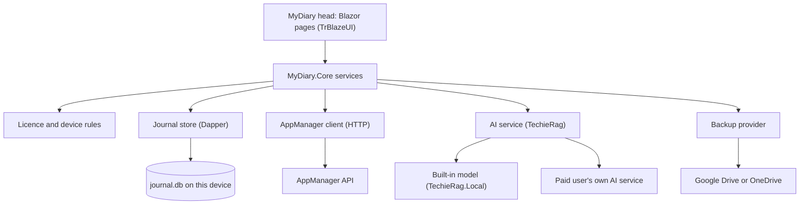
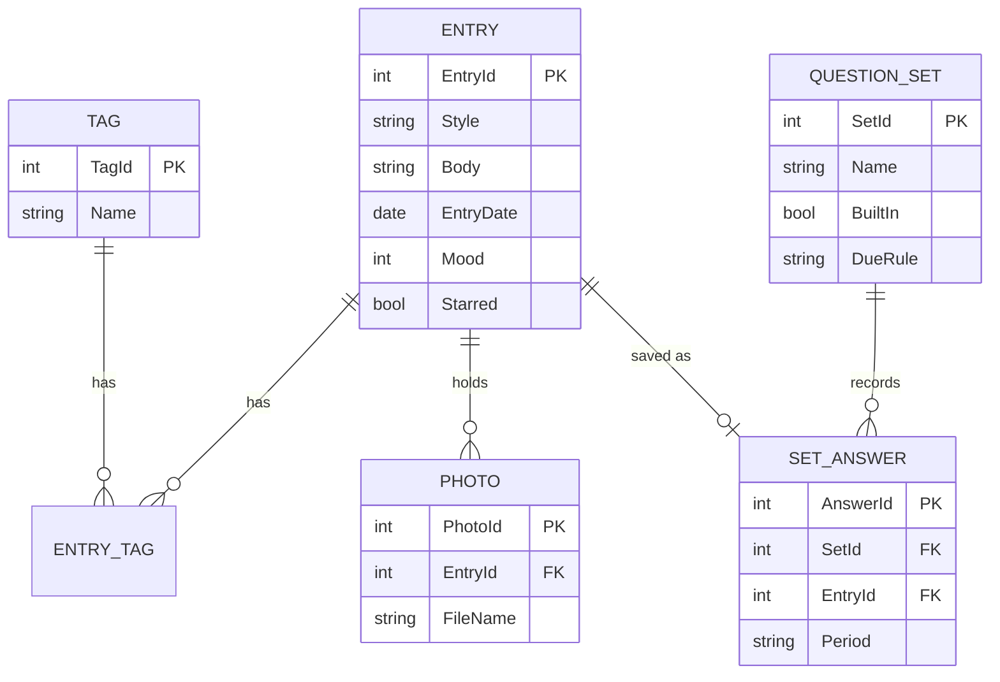

# MyDiary — Architecture

| | |
|---|---|
| App | MyDiary |
| Kind | app |
| Size | Medium |
| Stack answer set | dotnet (`.tfcore/templates/stack-defaults/dotnet.md`) |
| Date | 2026-10-24 |

## 1. Stack decisions

One row per stack question. "Source" says where the answer came from: the answer set, the owner, or the existing code. Rows marked **override** replace the answer set's row for this project; the answer set's reason does not fit a device-only app.

| Q | Topic | Decision | Source |
|---|---|---|---|
| Q1 | Configuration | `appsettings.json` plus `appsettings.{Environment}.json`, embedded in the MyDiary head. Holds the AppManager base URL and the installed-app key. No other configuration mechanism. | answer set: dotnet |
| Q2 | Secrets in development | `dotnet user-secrets` for development values; `secrets.example.json` lists every key the app reads. The installed-app key is public by design (AppManager issues it with no secret), so it sits in `appsettings.json`. Passwords and tokens are never stored in configuration. | answer set: dotnet; the key's public status from the AppManager guide, section 1 |
| Q3 | Database | **Override.** No PostgreSQL and no Docker container. MyDiary has no server; each device keeps its journal in one SQLite file, read and written with Dapper. The answer set's PostgreSQL row is for a web app on a server, and a phone cannot reach one. | override: owner, brief ("MyDiary has no server of its own") |
| Q4 | Authentication | AppManager, the shared service for accounts, devices and licences. It counts as part of the application. | owner, brief ("Fixed choices") |
| Q4a | Test users | Three test users on AppManager under the MyDiary application id: `mydiary-owner@…`, `mydiary-second@…`, `mydiary-yolo-tester@…`. A script in the project registers them and writes each password only to git-ignored user secrets. | answer set: dotnet (applies because Q4 is AppManager) |
| Q5 | Logging | Serilog, with a rolling file sink (14 daily files) in the app data folder, wired in `MauiProgram` before anything else can fail. | answer set: dotnet (its MAUI rule) |
| Q6 | Tests | xUnit. The test project `MyDiary.Tests` exists from day one. Browser testing does not apply to a MAUI head; the build phase defines the device checks. | answer set: dotnet |
| Q7 | Layout and naming | `src/` and `tests/` at the root. The primary executable is `MyDiary` (the MAUI head). Other projects: `MyDiary.Core`, `MyDiaryDb`, `MyDiary.Tests`. | answer set: dotnet |
| Q8 | User interface | TrBlazeUI in the MAUI Blazor Hybrid head for all five platforms: `TrBlazeUI.Components` and `TrBlazeUI.Icons.Lucide`. Rendering mode: **Blazor Hybrid** (the MAUI head renders its pages in a web view), one code base for Android, iPhone, iPad, Windows and Mac. The answer set leaves the rendering mode to the project; this is the choice, taken from the brief's "same screens on every platform". | answer set: dotnet (library); choice: owner, brief (rendering mode) |
| Q9 | Hosting and deployment | Not yet asked (UAT). The app runs on the device; there is no server to host. | not yet asked (UAT) |
| Q10 | Production secrets | Not yet asked (production). | not yet asked (production) |
| Q11 | Standing rules | 1. Never add a NuGet package without a line in the Decisions log. 2. Never create a second configuration mechanism. 3. Missing library features are filed in that library's feedback file and held, never worked around. 4. Data access is always Dapper. 5. Migrations live in `MyDiaryDb` (DbUp) and run at app start. 6. Log files go under the app data folder, never at the repository root. 7. No unnecessary folders at the repository root. 8. **Project rule:** journal text leaves the device only for a paid user's own AI key or the paid user's own cloud backup. | answer set: dotnet (1 to 7); project rule 8: owner, brief |

Required packages: `TrBlazeUI.Components` (the MAUI Blazor Hybrid head).

## 2. Solution structure

| Project | Kind | Purpose |
|---|---|---|
| `MyDiary` | .NET MAUI Blazor Hybrid app (Android, iOS, Mac Catalyst, Windows) | The primary head: every screen in the BRD, the TrBlazeUI layout, platform permissions (photos, biometrics, notifications). |
| `MyDiary.Core` | class library | Entries, question sets, the device and licence rules, the AppManager client, the TechieRag wrapper, backup and import/export. No UI code. |
| `MyDiaryDb` | migrations project (DbUp, SQLite scripts) | Creates and upgrades the on-device journal file. The head runs it at start. |
| `MyDiary.Tests` | xUnit test project | Unit tests for the rules in `MyDiary.Core` and the store, run against an in-memory SQLite file. |

Target framework: `net10.0` for every project. TechieRag's embedded packages require it for the MAUI head.

## 3. Component map

**How a request travels** (one typical request, in words; per-screen detail is in the DevGuide):
1. The Ask page sends the question to `AskService` in `MyDiary.Core`.
2. `AskService` asks the store for the entries that match, then asks the AI service to count and phrase the answer from those entries only.
3. The store reads the entries through Dapper from `journal.db`; nothing leaves the device for a free user.
4. The page shows the count, the answer and the source entries. If no entry matched, the service returns "no match" and the AI service is not called.

## 4. Data model

| Entity | Key fields | Notes |
|---|---|---|
| Entry | EntryId, Style (`thought` or `free`), Body, EntryDate, Mood, Starred | Body holds the ten lines of a Thought Dump separated by line breaks, or the Free-Flow text as Markdown. One journal, so no journal column. |
| Tag | TagId, Name | Names are unique. |
| EntryTag | EntryId, TagId | Joins entries and tags. |
| Photo | PhotoId, EntryId, FileName | The file sits in the app data folder; the row keeps its name. |
| QuestionSet | SetId, Name, BuiltIn, DueRule | Seven built-in rows (Monthly Goals, Yearly Review, Health, Fitness, Weekly Retro, Project Retro, Gratitude) and the person's own rows. |
| SetAnswer | AnswerId, SetId, EntryId, Period | Each saved answer is also an entry, so search and Ask read one place. |
| Setting | Key, Value | Reminder time, PIN hash, biometric flag, AI model choice. The AI key and the tokens go to platform secure storage, never this table. |
| AccountCache | UserId, Email, PlanName, LicenseName, DeviceLimit, LastOnlineCheck, DeviceId | Lets the app open offline for up to 30 days and reads the device rules without the network. |

## 5. Cross-cutting

- **Identity:** AppManager. The app sends `X-Api-Key` (installed-app key) and `X-Device-Id` (a GUID made once and kept in platform storage) on every call. Passwords are encrypted with the server's RSA-OAEP-SHA256 key, as the AppManager guide requires. Access and refresh tokens live in platform secure storage.
- **Device rules are enforced by the app.** AppManager issues tokens even when a device is over its cap (`deviceCap.isOverCap`), so `MyDiary.Core` refuses sign-in itself: a free account allows one device, a paid account allows `deviceCap.maxDevices` (2 for "Pro"; the licence's own number for "Pro-Plus"). Blocked devices return `403 DEVICE_BLOCKED` and are refused.
- **Licence:** `LicenseSvc/validate` runs on sign-in and on Check now. A success stores `LastOnlineCheck` in `AccountCache`. The journal closes when `LastOnlineCheck` is more than 30 days old. Licence name decides paid: "Pro" and "Pro-Plus" are paid, no licence is free.
- **Configuration:** `appsettings.json` only (Q1).
- **Logging:** Serilog, rolling daily file, 14 files, under the app data folder (Q5). The log never records journal text or passwords.
- **Errors:** AppManager errors map to plain messages on the same screen. `ACCOUNT_LOCKED` (5 wrong passwords, 15 minutes) and `RATE_LIMITED` (60 requests per minute per device) each get their own message. An unexpected error is logged and shows "Something went wrong; try again".
- **AI:** Every AI call goes through TechieRag. A free user's calls use the built-in model only. A paid user's own key is held in secure storage and used only by TechieRag.
- **Privacy:** journal text leaves the device only in two cases: a paid user's own AI key, or a paid user's own cloud backup (Q11 rule 8).

## 6. Decisions log

One row per decision. Every package added to the project has a row saying why.

| Date | Decision | Why | Status |
|---|---|---|---|
| 2026-10-24 | Stack answer set `dotnet` | The brief names TrBlazeUI (a Blazor library) and AppManager, both .NET. | decided |
| 2026-10-24 | Journal in SQLite on the device, not PostgreSQL | MyDiary has no server; a phone cannot reach a database container. Override of Q3. | decided |
| 2026-10-24 | MAUI Blazor Hybrid head for all five platforms | One code base for the same screens on every platform, with TrBlazeUI. Rendering mode, Q8. | decided |
| 2026-10-24 | Target `net10.0` | TechieRag's embedded packages need it for the MAUI head. | decided |
| 2026-10-24 | Device limits enforced in `MyDiary.Core`, not by AppManager | AppManager issues tokens over the cap and does not refuse sign-in. | decided |
| 2026-10-24 | Free account: one device | The brief's free rule; AppManager gives no cap for a free account. | decided |
| 2026-10-24 | 30-day offline limit counted from the last successful licence check, stored on the device | The brief's rule; AppManager documents no offline grace period. | decided |
| 2026-10-24 | Built-in model: TechieRag.Local, Qwen2.5 0.5B on every head | The brief asks for the smallest built-in model; TechieRag's own phone model is the smallest it names. The desktop default (Phi-3 mini) is larger, so it is not used. Mark for owner check. | decided |
| 2026-10-24 | AppManager calls through a hand-written `HttpClient` in `MyDiary.Core` | AppManager publishes no NuGet client; the guide's C# examples are the reference. No package added. | decided |
| 2026-10-24 | `TrBlazeUI.Components` added | Every screen is built with it (brief; Q8). | decided |
| 2026-10-24 | `TrBlazeUI.Icons.Lucide` added | Icon set for TrBlazeUI (Q8). | decided |
| 2026-10-24 | `TechieRag`, `TechieRag.Local`, `TechieRag.Embedded` added | Every AI feature goes through TechieRag (brief). Built-in model needs Local; ONNX wiring for the MAUI head needs Embedded. | decided |
| 2026-10-24 | `Dapper`, `Microsoft.Data.Sqlite` added | Data access is Dapper (Q11 rule 4); SQLite is the on-device engine (Q3 override). | decided |
| 2026-10-24 | `dbup-sqlite` added | Migrations with DbUp (Q11 rule 5). | decided |
| 2026-10-24 | `Serilog`, `Serilog.Sinks.File`, `Serilog.Extensions.Logging` added | Logging is Serilog with a rolling file (Q5). | decided |
| 2026-10-24 | `xunit` test packages added | Tests are xUnit (Q6). | decided |
| 2026-10-24 | Google Drive and OneDrive SDKs | Paid backup targets (brief). Chosen when the backup feature is built; one row per SDK then. | planned |
| 2026-10-24 | BRD-47 (copy of account data) held | AppManager's `data-export` refuses the installed-app key (403 `PUBLIC_KEY_NOT_ALLOWED`) and has no download link. Filed in `docs/MyDiary-AppManager-Feedback.md`. Not worked around (Q11 rule 3). | decided |

## 7. Module responsibilities

| Module | Responsibility | Depends on |
|---|---|---|
| `MyDiary` (head) | Pages, layout, platform permissions, starts the database and the logger | `MyDiary.Core`, `MyDiaryDb`, TrBlazeUI |
| `MyDiary.Core` — `Journal` | Entries, tags, stars, moods, search, date filters | Store |
| `MyDiary.Core` — `QuestionSets` | Built-in and own sets, due dates, saving answers as entries | Store |
| `MyDiary.Core` — `Ask` | Counts from the store, then asks TechieRag for the phrasing; returns "no match" without calling AI | Store, AI service |
| `MyDiary.Core` — `OnThisDay` | Finds entries near today's date, asks TechieRag for one story per year | Store, AI service |
| `MyDiary.Core` — `Account` | Sign-in, register, reset, profile, password, devices, problem reports | AppManager client |
| `MyDiary.Core` — `Licence` | Reads the licence, decides plan and device limit, keeps the 30-day count | AppManager client, `AccountCache` |
| `MyDiary.Core` — `Backup` | Backup, sync and restore through one provider interface | Provider SDK (planned) |
| `MyDiary.Core` — `DataExchange` | JSON export; import of MyDiary JSON and Day One JSON | Store |
| `MyDiary.Core` — `AiService` | The only class that calls TechieRag; picks the built-in or the paid user's model | TechieRag |
| `MyDiaryDb` | Migrations for `journal.db` | DbUp |

## 8. Open questions

- **AppManager data-export (BRD-47).** The installed-app key cannot call `UserSvc/data-export`, and the export arrives by email, not in the app. BRD-47 is held until AppManager allows it. Filed in `docs/MyDiary-AppManager-Feedback.md`.
- **Day One export format.** The brief asks for Day One import. A sample Day One JSON file is needed before the import is built. Owner to supply one.
- **Backup provider SDK.** Google Drive and OneDrive SDK choice is made when the backup feature is built.
- **Built-in model on older phones.** Speed on the lowest supported phone is not yet measured (see BRD risks).
