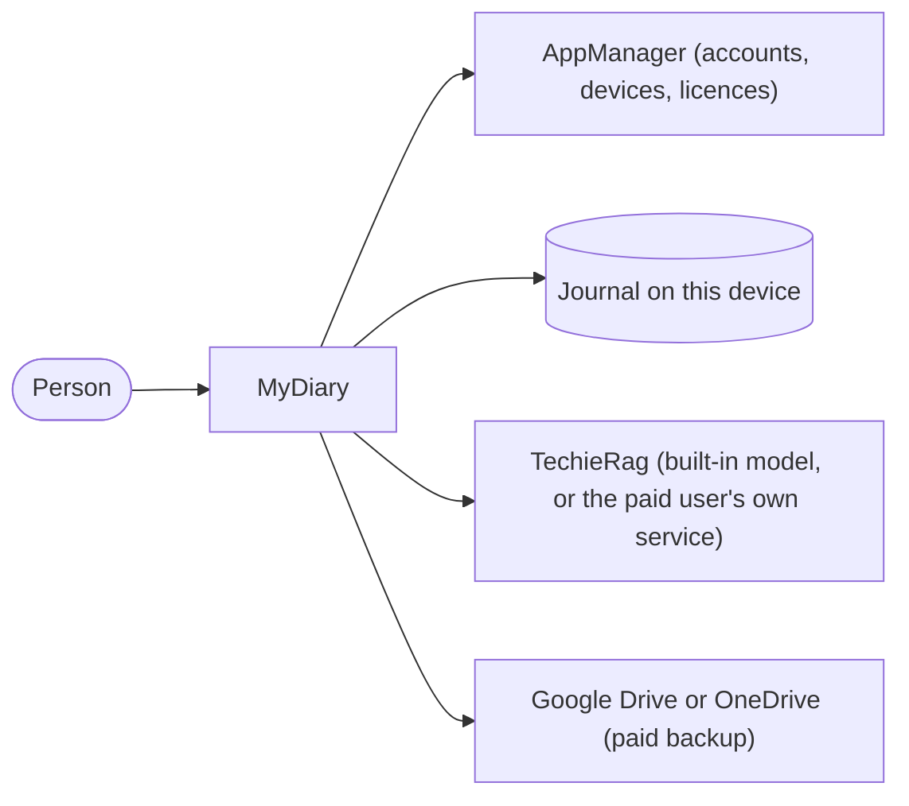

# MyDiary — Business Requirements

| | |
|---|---|
| App | MyDiary |
| Kind | app |
| Size | Medium |
| Stack answer set | dotnet (`.tfcore/templates/stack-defaults/dotnet.md`) |
| Status | Draft |
| Date | 2026-10-24 |

## 1. Summary

MyDiary is a private journal for phone, tablet and computer. Each person keeps one journal and writes in one of three ways: a ten-line Thought Dump, a Free-Flow entry with formatting and photos, or an answer to a set of questions. The home screen shows today's entries, a streak and a short story of what was written on this date in past years. A person can ask plain questions about their past and get a counted answer that lists the entries used. The app is free on one device. A paid licence adds backup, use on several devices and a choice of AI model. Accounts, devices and licences are handled by AppManager. The journal stays on the device; AI runs through TechieRag.

## 2. Scope

**In:**
- Sign-in, password reset and a licence check through AppManager, with a 30-day offline allowance.
- One journal per person, with Thought Dump and Free-Flow entries, tags, stars, moods and photos.
- Question sets: seven built-in sets, the person's own sets, and set answers kept as entries.
- On This Day stories, search, plain-question answers and a side-by-side view of one question over time.
- Device limits, plan and device management, PIN or fingerprint/face lock, reminders.
- Paid backup, sync and restore to the person's own Google Drive or OneDrive.
- JSON export and import, including Day One exports.
- The same screens on Android, iPhone, iPad, Windows and Mac.

**Out:**
- The purchase and landing page, which is a separate phase-2 web app. Until then the admin assigns paid licences in AppManager, and MyDiary has no "Buy" button.
- Taking payment inside the app, and app-store purchases.
- More than one journal, shared journals, and family groups sharing one licence.
- Sending journal text anywhere for a free user. Online AI happens only when a paid user enters their own key.
- iCloud, Dropbox and any other sync service.
- Map view, voice transcription, widgets, handwriting, sharing an entry as an image.

## 3. Users and roles

| Role | Who they are | What they need |
|---|---|---|
| Free user | Writes on one device. Everything stays on that device. | Journal, prompts, On This Day, search, questions, built-in AI, export and import. |
| Paid user | Writes on several devices and may pick their own AI model or online AI service. | Everything a free user has, plus backup, sync, restore, device management and a choice of AI model. |

The goal reviewer (free or paid) is a way of using the app, not a separate role: they run monthly, yearly, health, fitness or project reviews and want the same answers side by side over time (BRD-38). The owner (admin) assigns paid licences and reads problem reports on the AppManager site. The owner does nothing inside MyDiary, so the owner is not a role in this BRD.

## 4. Screens and flow

One row per routed page. A dialog is a row under its parent screen with `on /route` in the Route column; it is not counted as a screen.

| Screen | Route | Role | Mockup | Fields |
|---|---|---|---|---|
| Sign in | `/signin` | Free user, Paid user | [mockup](mockups/signin.html) | email, password, Create account, Sign in, Forgot password link |
| Forgot password | `/forgot-password` | Free user, Paid user | [mockup](mockups/forgot-password.html) | email, new password |
| Licence check | `/licence-check` | Free user, Paid user | [mockup](mockups/licence-check.html) | status, last check date, Check now |
| Lock | `/lock` | Free user, Paid user | [mockup](mockups/lock.html) | PIN, fingerprint or face prompt |
| Home | `/home` | Free user, Paid user | [mockup](mockups/home.html) | today's entries, streak, On This Day card, due question set card |
| Entries | `/entries` | Free user, Paid user | [mockup](mockups/entries.html) | view switch (timeline, calendar), date, mood, star |
| Write entry | `/entries/new` | Free user, Paid user | [mockup](mockups/entry-new.html) | style (Thought Dump, Free-Flow), 10 lines, text, photos, tags, star, mood |
| Edit entry | `/entries/{id}` | Free user, Paid user | [mockup](mockups/entry-edit.html) | text, photos, tags, star, mood, date |
| Delete entry (dialog) | on `/entries/{id}` | Free user, Paid user | [mockup](mockups/entry-edit.html) | Delete, Cancel |
| On This Day | `/on-this-day` | Free user, Paid user | [mockup](mockups/on-this-day.html) | one story per past year |
| Search | `/search` | Free user, Paid user | [mockup](mockups/search.html) | keyword, from date, to date, tag, question set, photo, star, mood |
| Ask the journal | `/ask` | Free user, Paid user | [mockup](mockups/ask.html) | question, answer, source entries |
| Compare | `/compare` | Free user, Paid user | [mockup](mockups/compare.html) | question, from period, to period, answer columns |
| Questions | `/questions` | Free user, Paid user | [mockup](mockups/questions.html) | set list, due date, Build a set |
| Answer a question set | `/questions/{set}` | Free user, Paid user | [mockup](mockups/question-answer.html) | one field per question, Save |
| Build a question set | `/questions/new` | Free user, Paid user | [mockup](mockups/question-build.html) | set name, questions, Save |
| Account | `/account` | Free user, Paid user | [mockup](mockups/account.html) | name, email, current password, new password, Request data copy, Request deletion, Report a problem |
| Problem report (dialog) | on `/account` | Free user, Paid user | [mockup](mockups/account.html) | description, reference number |
| Plan and devices | `/account/plan` | Free user, Paid user | [mockup](mockups/plan-devices.html) | plan name, end date, devices in use, Forget, Block |
| Settings | `/settings` | Free user, Paid user | [mockup](mockups/settings.html) | reminder time, PIN lock, fingerprint or face, AI model |
| AI model and key (dialog) | on `/settings` | Free user, Paid user | [mockup](mockups/settings.html) | model choice, own key, warning, I understand tick |
| Backup and restore | `/backup` | Paid user | [mockup](mockups/backup.html) | provider (Google Drive, OneDrive), last backup time, Back up now, Restore |
| Export and import | `/data` | Free user, Paid user | [mockup](mockups/data.html) | Export JSON, Import file, format (MyDiary JSON, Day One JSON) |

**Primary journey:**
1. A new user opens the app, creates an account on Sign in and lands on Home.
2. The user writes a Thought Dump or a Free-Flow entry from Write entry and saves it. It appears under today on Home.
3. The user opens On This Day from Home, or asks a question on Ask the journal.
4. On the 1st, Home shows the Monthly Goals card. The user answers the set and returns to Home.

## 5. Requirements

One item per thing the verifier will test. Each names its screen, links the mockup, and states its acceptance in the form the checklist will carry.

### Sign in

The first screen a person sees: create an account, or sign in to an existing one.

- **BRD-1** — Create an account. *Screen:* Sign in · *Mockup:* [mockup](mockups/signin.html)
  - *Acceptance:* When a new user enters an email and password and presses Create account on Sign in, then the account is created and the app opens Home.
- **BRD-2** — Sign in. *Screen:* Sign in · *Mockup:* [mockup](mockups/signin.html)
  - *Acceptance:* When a user enters a correct email and password and presses Sign in on Sign in, then the app opens Home.
- **BRD-3** — Wrong password. *Screen:* Sign in · *Mockup:* [mockup](mockups/signin.html)
  - *Acceptance:* When a user enters a wrong password and presses Sign in on Sign in, then an error shows and the screen stays on Sign in.
- **BRD-4** — First launch. *Screen:* Sign in · *Mockup:* [mockup](mockups/signin.html)
  - *Acceptance:* When the app opens with no signed-in account on Sign in, then no journal screen is shown until sign-in succeeds.
- **BRD-5** — Free account on a second device. *Screen:* Sign in · *Mockup:* [mockup](mockups/signin.html)
  - *Acceptance:* When a free account signs in on a second device on Sign in, then sign-in is refused with a message saying a paid licence allows more devices.
- **BRD-6** — Device over the licence limit. *Screen:* Sign in · *Mockup:* [mockup](mockups/signin.html)
  - *Acceptance:* When a paid account signs in on a device above its licence limit on Sign in, then sign-in is refused and the message says how to free a device slot.

### Forgot password

A person who has forgotten their password resets it from their email.

- **BRD-7** — Request a reset. *Screen:* Forgot password · *Mockup:* [mockup](mockups/forgot-password.html)
  - *Acceptance:* When a user enters their email and presses Send reset on Forgot password, then the screen tells them to check their email.
- **BRD-8** — Set a new password. *Screen:* Forgot password · *Mockup:* [mockup](mockups/forgot-password.html)
  - *Acceptance:* When a user sets a new password from the reset email on Forgot password, then sign-in works with the new password and the old one is refused.

### Licence check

The app checks the licence online and decides from it whether the account is paid.

- **BRD-9** — Offline limit. *Screen:* Licence check · *Mockup:* [mockup](mockups/licence-check.html)
  - *Acceptance:* When the last online licence check was more than 30 days ago on Licence check, then journal screens stay closed until a check succeeds.
- **BRD-10** — Online check restarts the count. *Screen:* Licence check · *Mockup:* [mockup](mockups/licence-check.html)
  - *Acceptance:* When the device is online and the user presses Check now on Licence check, then a successful check opens the journal and restarts the 30-day count.
- **BRD-11** — Plan from the licence name. *Screen:* Licence check · *Mockup:* [mockup](mockups/licence-check.html)
  - *Acceptance:* When the check returns licence "Pro" on Licence check, then the account is paid for 2 devices; "Pro-Plus" allows the number set on the licence; no licence means free.
- **BRD-12** — Ended licence keeps the journal. *Screen:* Licence check · *Mockup:* [mockup](mockups/licence-check.html)
  - *Acceptance:* When a paid licence has ended at the check on Licence check, then Home opens, every free feature works and every entry on the device is still there.

### Lock

The app can be locked with a PIN, or with fingerprint or face.

- **BRD-13** — PIN lock. *Screen:* Lock · *Mockup:* [mockup](mockups/lock.html)
  - *Acceptance:* When the app returns from the background and a PIN is set on Lock, then the journal shows only after the right PIN is entered.
- **BRD-14** — Fingerprint or face unlock. *Screen:* Lock · *Mockup:* [mockup](mockups/lock.html) <!-- inferred — please verify -->
  - *Acceptance:* When fingerprint or face unlock is on and the device supports it on Lock, then Lock offers it, and a failed attempt falls back to the PIN prompt.

### Home

The first screen after sign-in. It shows today's entries, the streak and the cards that matter today.

- **BRD-15** — Today's entries. *Screen:* Home · *Mockup:* [mockup](mockups/home.html)
  - *Acceptance:* When a user opens Home, then entries written today are listed, and pressing one opens it on Edit entry.
- **BRD-16** — Streak. *Screen:* Home · *Mockup:* [mockup](mockups/home.html) <!-- inferred — please verify -->
  - *Acceptance:* When the user has entries on consecutive days on Home, then the streak shows the count of days with an entry, counting back from today.
- **BRD-17** — On This Day card. *Screen:* Home · *Mockup:* [mockup](mockups/home.html)
  - *Acceptance:* When past entries exist for today's date on Home, then the On This Day card shows and pressing it opens On This Day.
- **BRD-18** — Due question set card. *Screen:* Home · *Mockup:* [mockup](mockups/home.html)
  - *Acceptance:* When a question set is due today on Home, then a card shows it, and pressing the card opens that set on Answer a question set.
- **BRD-19** — One journal. *Screen:* Home · *Mockup:* [mockup](mockups/home.html)
  - *Acceptance:* When a user opens the app, then no journal list or journal picker appears anywhere, and all entries belong to one journal.

### Entries

Every entry in the journal, browsed by timeline or by calendar.

- **BRD-20** — Timeline. *Screen:* Entries · *Mockup:* [mockup](mockups/entries.html)
  - *Acceptance:* When a user opens Entries in timeline view, then entries show newest first, each with its date, mood and star mark.
- **BRD-21** — Calendar. *Screen:* Entries · *Mockup:* [mockup](mockups/entries.html)
  - *Acceptance:* When a user switches to calendar view on Entries and taps a day with entries, then that day's entries are listed.

### Write entry

A new entry, written as a Thought Dump or as a Free-Flow entry.

- **BRD-22** — Thought Dump. *Screen:* Write entry · *Mockup:* [mockup](mockups/entry-new.html)
  - *Acceptance:* When a user picks Thought Dump on Write entry and saves, then the entry holds up to ten numbered quick lines and empty lines are dropped.
- **BRD-23** — Free-Flow formatting. *Screen:* Write entry · *Mockup:* [mockup](mockups/entry-new.html)
  - *Acceptance:* When a user writes bold, italic and a list in a Free-Flow entry on Write entry and saves, then reopening the entry shows the same formatting.
- **BRD-24** — Photos. *Screen:* Write entry · *Mockup:* [mockup](mockups/entry-new.html)
  - *Acceptance:* When a user adds a photo to a Free-Flow entry on Write entry and saves, then the photo shows when the entry is reopened.
- **BRD-25** — Blank entry. *Screen:* Write entry · *Mockup:* [mockup](mockups/entry-new.html)
  - *Acceptance:* When a user presses Save on an empty entry on Write entry, then nothing is saved and the screen asks for at least one line.
- **BRD-26** — Tags. *Screen:* Write entry · *Mockup:* [mockup](mockups/entry-new.html)
  - *Acceptance:* When a user adds a tag on Write entry and saves, then the entry shows that tag when reopened.
- **BRD-27** — Star. *Screen:* Write entry · *Mockup:* [mockup](mockups/entry-new.html)
  - *Acceptance:* When a user stars an entry on Write entry and saves, then the star mark shows on that entry in Entries.
- **BRD-28** — Mood. *Screen:* Write entry · *Mockup:* [mockup](mockups/entry-new.html)
  - *Acceptance:* When a user picks a mood on Write entry and saves, then the mood shows on that entry in Entries.

### Edit entry

A saved entry, opened to change it or delete it.

- **BRD-29** — Change a saved entry. *Screen:* Edit entry · *Mockup:* [mockup](mockups/entry-edit.html)
  - *Acceptance:* When a user changes the text of a saved entry on Edit entry and saves, then reopening the entry shows the new text.
- **BRD-30** — Delete an entry. *Screen:* Edit entry · *Mockup:* [mockup](mockups/entry-edit.html) <!-- inferred — please verify -->
  - *Acceptance:* When a user presses Delete on Edit entry and confirms in the Delete entry dialog, then the entry no longer shows in Entries or Search.

### On This Day

For each past year, a short warm story of what was written on or near this date.

- **BRD-31** — One story per year. *Screen:* On This Day · *Mockup:* [mockup](mockups/on-this-day.html)
  - *Acceptance:* When past years have entries on or near this date, then On This Day shows one short warm story per year and no list of entries.
- **BRD-32** — Nothing to show. *Screen:* On This Day · *Mockup:* [mockup](mockups/on-this-day.html)
  - *Acceptance:* When no past year has an entry on or near this date, then On This Day says so kindly and shows no story.

### Search

Find entries by keyword and narrow them by date and by attribute.

- **BRD-33** — Keyword. *Screen:* Search · *Mockup:* [mockup](mockups/search.html)
  - *Acceptance:* When a user types a word and searches on Search, then only entries containing that word are listed.
- **BRD-34** — Date range. *Screen:* Search · *Mockup:* [mockup](mockups/search.html)
  - *Acceptance:* When a user sets a from date and a to date on Search, then only entries inside that range are listed.
- **BRD-35** — Attribute filter. *Screen:* Search · *Mockup:* [mockup](mockups/search.html)
  - *Acceptance:* When a user filters by tag, question set, photo, star or mood on Search, then only entries that match that filter are listed.

### Ask the journal

Plain questions answered with a count and the entries used.

- **BRD-36** — Counted answer. *Screen:* Ask the journal · *Mockup:* [mockup](mockups/ask.html)
  - *Acceptance:* When a user asks a plain question on Ask the journal, then the answer gives a count and lists the source entries used.
- **BRD-37** — No match. *Screen:* Ask the journal · *Mockup:* [mockup](mockups/ask.html)
  - *Acceptance:* When no entry matches the question on Ask the journal, then the answer says no entry matched and gives no count.

### Compare

One question's answers, side by side over months or years.

- **BRD-38** — Side by side. *Screen:* Compare · *Mockup:* [mockup](mockups/compare.html)
  - *Acceptance:* When a user picks one question and a range of months or years on Compare, then the answers show side by side, one column per period.

### Questions

The question sets the user can answer.

- **BRD-39** — Set list. *Screen:* Questions · *Mockup:* [mockup](mockups/questions.html)
  - *Acceptance:* When a user opens Questions, then the seven built-in sets and the user's own sets are listed, each with its next due date.

### Answer a question set

Answering a set saves the answers as an entry.

- **BRD-40** — Save answers as an entry. *Screen:* Answer a question set · *Mockup:* [mockup](mockups/question-answer.html)
  - *Acceptance:* When a user answers a set's questions and presses Save on Answer a question set, then the answers are kept as an entry tagged with the set's name.
- **BRD-41** — Done for the period. *Screen:* Answer a question set · *Mockup:* [mockup](mockups/question-answer.html) <!-- inferred — please verify -->
  - *Acceptance:* When a user saves a set's answers in its period on Answer a question set, then the set shows as done on Questions for that period.

### Build a question set

A person builds a set of their own questions.

- **BRD-42** — Build a set. *Screen:* Build a question set · *Mockup:* [mockup](mockups/question-build.html)
  - *Acceptance:* When a user names a set, adds questions and presses Save on Build a question set, then the set appears in Questions.
- **BRD-43** — Edit a built set. *Screen:* Build a question set · *Mockup:* [mockup](mockups/question-build.html) <!-- inferred — please verify -->
  - *Acceptance:* When a user changes the questions of a set they built and saves on Build a question set, then the new questions show in Questions.

### Account

Profile, password, problem reports and account-data requests, all from inside the app.

- **BRD-44** — Edit profile. *Screen:* Account · *Mockup:* [mockup](mockups/account.html)
  - *Acceptance:* When a user changes their name and saves on Account, then the new name shows when the screen is reopened.
- **BRD-45** — Change password. *Screen:* Account · *Mockup:* [mockup](mockups/account.html)
  - *Acceptance:* When a user enters the current password and a new one on Account, then sign-in works with the new password only.
- **BRD-46** — Problem report. *Screen:* Account · *Mockup:* [mockup](mockups/account.html)
  - *Acceptance:* When a user writes a description in the Problem report dialog on Account and sends it, then the app shows a reference number.
- **BRD-47** — Request a copy of account data. *Screen:* Account · *Mockup:* [mockup](mockups/account.html) <!-- blocked upstream: AppManager data-export refuses the installed-app key; see MyDiary-AppManager-Feedback.md -->

  - *Acceptance:* When a user presses Request data copy on Account, then the request is sent and the screen confirms it.
- **BRD-48** — Request account deletion. *Screen:* Account · *Mockup:* [mockup](mockups/account.html)
  - *Acceptance:* When a user presses Request deletion on Account and confirms, then the request is sent and the screen shows it as pending.

### Plan and devices

What plan the account is on, and which devices are signed in.

- **BRD-49** — Plan and end date. *Screen:* Plan and devices · *Mockup:* [mockup](mockups/plan-devices.html)
  - *Acceptance:* When a user opens Plan and devices, then the plan name shows, with the date the paid licence ends, or "Free".
- **BRD-50** — Devices in use. *Screen:* Plan and devices · *Mockup:* [mockup](mockups/plan-devices.html)
  - *Acceptance:* When a user opens Plan and devices, then every signed-in device is listed, with the count "n of m allowed devices in use".
- **BRD-51** — Forget a device. *Screen:* Plan and devices · *Mockup:* [mockup](mockups/plan-devices.html)
  - *Acceptance:* When a user presses Forget on a device and confirms, then that device leaves the list and must sign in again.
- **BRD-52** — Block a device. *Screen:* Plan and devices · *Mockup:* [mockup](mockups/plan-devices.html)
  - *Acceptance:* When a user presses Block on a device, then the list marks it blocked and sign-in from it is refused.

### Settings

Reminders, the lock and the AI model.

- **BRD-53** — Journaling reminder. *Screen:* Settings · *Mockup:* [mockup](mockups/settings.html)
  - *Acceptance:* When a user sets a reminder time on Settings, then the device shows a journaling reminder at that time.
- **BRD-54** — Turn off the PIN. *Screen:* Settings · *Mockup:* [mockup](mockups/settings.html) <!-- inferred — please verify -->
  - *Acceptance:* When a user turns the PIN off on Settings, then the app opens without asking for a PIN.
- **BRD-55** — Free model choice. *Screen:* Settings · *Mockup:* [mockup](mockups/settings.html)
  - *Acceptance:* When a free user opens the AI model choice on Settings, then only the built-in small model can be chosen and the others show as paid.
- **BRD-56** — Paid model choice. *Screen:* Settings · *Mockup:* [mockup](mockups/settings.html)
  - *Acceptance:* When a paid user chooses another AI model on Settings, then Ask the journal uses that model from then on.
- **BRD-57** — Own key warning. *Screen:* Settings · *Mockup:* [mockup](mockups/settings.html)
  - *Acceptance:* When a paid user enters their own key on Settings, then a warning says journal text will be sent to that service, and Save stays off until ticked.

### Backup and restore

A paid feature: back up the journal to the person's own cloud drive, sync it, and restore it on a new device.

- **BRD-58** — Backup refused for a free user. *Screen:* Backup and restore · *Mockup:* [mockup](mockups/backup.html)
  - *Acceptance:* When a free user opens Backup and restore, then the screen explains that backup is a paid feature and no backup runs.
- **BRD-59** — Back up. *Screen:* Backup and restore · *Mockup:* [mockup](mockups/backup.html)
  - *Acceptance:* When a paid user presses Back up now and chooses Google Drive or OneDrive on Backup and restore, then the journal is saved there and the time shows.
- **BRD-60** — Sync between devices. *Screen:* Backup and restore · *Mockup:* [mockup](mockups/backup.html)
  - *Acceptance:* When a paid user has the same account on two devices and sync runs on one, then the other device shows the same entries after its next sync.
- **BRD-61** — Restore on a new device. *Screen:* Backup and restore · *Mockup:* [mockup](mockups/backup.html)
  - *Acceptance:* When a paid user presses Restore on Backup and restore on a new device, then the journal entries from the backup appear on that device.

### Export and import

The journal, out to a file and back in, for any user.

- **BRD-62** — Export. *Screen:* Export and import · *Mockup:* [mockup](mockups/data.html)
  - *Acceptance:* When a user presses Export JSON on Export and import, then a JSON file of all entries is saved for the user to keep.
- **BRD-63** — Import MyDiary file. *Screen:* Export and import · *Mockup:* [mockup](mockups/data.html)
  - *Acceptance:* When a user imports a MyDiary JSON file on Export and import, then its entries are added to the journal and duplicates are skipped.
- **BRD-64** — Import Day One file. *Screen:* Export and import · *Mockup:* [mockup](mockups/data.html)
  - *Acceptance:* When a user imports a Day One JSON export on Export and import, then its entries are added with their original dates.

## 6. Non-functional requirements

| Id | Area | Requirement | Measure |
|---|---|---|---|
| BRD-65 | Logging | Serilog writes a rolling log file in the app data folder, kept 14 days | Log file exists after first launch, with at most 14 daily files |
| BRD-66 | Privacy | Journal text never goes to AppManager, and goes to an online AI service only for a paid user's own key | Network capture on a free account shows no journal text |
| BRD-67 | Offline | Every journal screen works with no connection for up to 30 days after the last licence check | Airplane mode for 30 days: journal screens open and save |
| BRD-68 | Security | Passwords reach AppManager encrypted, as AppManager requires; the lock screen guards the journal when a PIN or fingerprint is set <!-- inferred — please verify --> | Password field is encrypted on the wire; Lock appears after background |
| BRD-69 | Platforms | The same screens work on Android, iPhone, iPad, Windows and Mac | Each head opens Home and every screen in the set |

## 7. Development status

Written by the status gate after every build, verify and handoff; not by hand.

**Snapshot as of 2026-10-24.** Live per-requirement status: `PROJECT-STATUS.md` and the Requirements Status table in `docs/MyDiary-Checklist.md`.

| Screen | Requirements | Verified | Open | Status |
|---|---|---|---|---|
| Sign in | 6 | 0 | 6 | Planned |
| Forgot password | 2 | 0 | 2 | Planned |
| Licence check | 4 | 0 | 4 | Planned |
| Lock | 2 | 0 | 2 | Planned |
| Home | 5 | 0 | 5 | Planned |
| Entries | 2 | 0 | 2 | Planned |
| Write entry | 7 | 0 | 7 | Planned |
| Edit entry | 2 | 0 | 2 | Planned |
| On This Day | 2 | 0 | 2 | Planned |
| Search | 3 | 0 | 3 | Planned |
| Ask the journal | 2 | 0 | 2 | Planned |
| Compare | 1 | 0 | 1 | Planned |
| Questions | 1 | 0 | 1 | Planned |
| Answer a question set | 2 | 0 | 2 | Planned |
| Build a question set | 2 | 0 | 2 | Planned |
| Account | 5 | 0 | 5 | Planned |
| Plan and devices | 4 | 0 | 4 | Planned |
| Settings | 5 | 0 | 5 | Planned |
| Backup and restore | 4 | 0 | 4 | Planned |
| Export and import | 3 | 0 | 3 | Planned |

## 8. Context diagram

## 9. Constraints and assumptions

- The app has no server of its own. The journal lives on each device; AppManager never sees journal text.
- Screens are built with TrBlazeUI; every AI feature goes through TechieRag, and MyDiary writes no AI code of its own.
- Free users get the smallest built-in AI model, installed with the app.
- Assumes AppManager's account, device and licence endpoints cover every sign-in and device rule in this BRD, as its API guide describes.

## 10. Risks

| Risk | Likelihood | Impact | Mitigation |
|---|---|---|---|
| The built-in model is too slow on older phones | Medium | Medium | Measure on the lowest supported phone before the build phase; the Ask screen says when it is slow |
| The journal is lost when a device is lost and there is no backup | Medium | High | Free users are told that export is the only copy; the Export and import screen is one tap from Settings |
| A cloud provider changes its sign-in rules | Low | Medium | Backup goes through one provider interface, so one provider can change alone |
| Licence check fails on a long offline stay | Low | High | The 30-day rule is in BRD-9; the journal opens again after one successful check |

## 11. Glossary

- **AppManager** — the shared service for accounts, devices and licences.
- **TechieRag** — the library that runs every AI feature.
- **Thought Dump** — ten numbered quick lines in one entry.
- **Free-Flow** — a free-form entry with formatting and photos.
- **On This Day** — a short story of past entries written on this date.
- **Question set** — a list of questions answered together, for example Monthly Goals.
