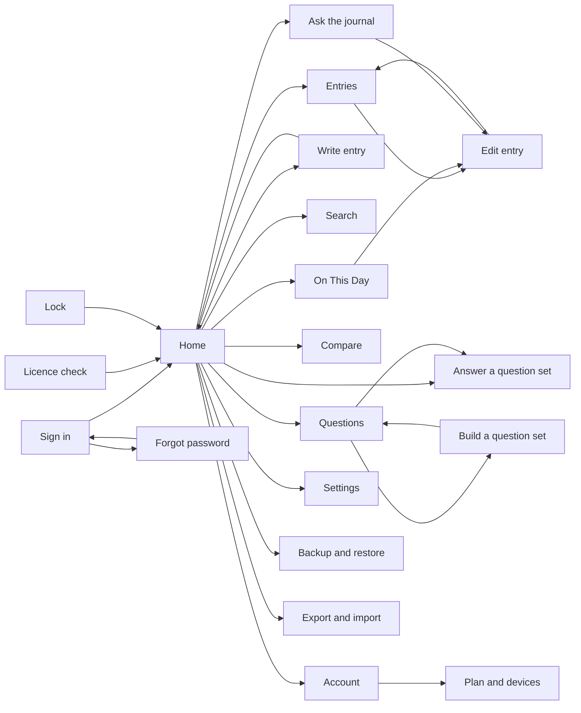

<!-- tf-schema
doc: uidesign
file: docs/MyDiary-UIDesign.md
header: App, Kind, Size, UI library, Theme
section: Design system | required | max 300
section: Screens | required
section: Click-through flow | optional-small
section: Branding guide | optional
entries: Screens | Screen:
per-entry: 250 400
rule: entry-mockup
rule: entry-regions-table
rule: entry-fields-table
rule: entry-states
rule: mockup-links
-->

# MyDiary — UI Design

| | |
|---|---|
| App | MyDiary |
| Kind | app |
| Size | Medium |
| UI library | TrBlazeUI (`TrBlazeUI.Components`, `TrBlazeUI.Icons.Lucide`), reference copied to `.trblazeui/TrBlazeUI-AI-Reference.md` |
| Theme | both (light and dark, following the device setting) |

## Design system

- **Layout shell:** `SidebarProvider` with a `Sidebar` on wide screens (Windows, Mac, iPad); on phones the sidebar collapses to a menu button. The entry screens (sign-in, forgot password, licence check, lock) have no sidebar.
- **Theme:** TrBlazeUI's OKLCH variables on `:root`, light and dark, from the reference's Theme Setup section.
- **Shared controls:** Button, Input, Label, Field, Card, Badge, Alert, Typography, Separator, Empty; Dialog or AlertDialog for confirmations.
- **Rules:** one 16px side gutter on phones; cards stack in one column below 720px; no horizontal page scroll at any width.

## Screens

### Screen: Sign in (`/signin`)

**Mockup:** [mockups/signin.html](mockups/signin.html) · **Roles:** Free user, Paid user · **BRD:** BRD-1–BRD-6

| Region | Control | Shows or binds |
|---|---|---|
| signin-header | TypographyH1, TypographyMuted | Title "Sign in" and the line that the journal stays on this device |
| signin-card | Card (CardHeader, CardTitle, CardDescription, CardContent) | Account panel holding the form |
| signin-error-password | Alert Variant="Danger" | Wrong email or password (BRD-3); hidden until AppManager refuses |
| signin-error-device | Alert Variant="Danger" | Free account on a second device, or paid device over its cap (BRD-5, BRD-6) |
| signin-form | FieldGroup | Submits Email and Password to Core sign-in |
| signin-email-field | Field, FieldLabel, Input Type="Email" | Binds Email |
| signin-password-field | Field, FieldLabel, Input Type="Password" | Binds Password |
| signin-submit | Button Type="Submit" | Sign in; opens `/home` on success |
| signin-create-account | Button Variant="Outline", Type="Submit" | Create account with the same fields; opens `/home` (BRD-1) |
| signin-forgot-link | Button Variant="Link" Href="/forgot-password" | Forgot password |
| signin-device-note | TypographyMuted | Free accounts use one device; paid accounts can use more |

| Field | Type | Required | Validation |
|---|---|---|---|
| Email | Email | Yes | Well-formed address; FieldError "Enter an email address" |
| Password | Password | Yes | Not empty; no strength rule at sign-in |

**Dialogs opened here:** none

**States:** empty: both fields blank, errors appear only after a submit attempt · loading: Spinner in the Sign in button, fields disabled until AppManager answers · error: Alert names the cause: wrong password, `ACCOUNT_LOCKED` (5 wrong passwords, 15 minutes), `RATE_LIMITED` (60 requests a minute), device refused (`403 DEVICE_BLOCKED`) or "Something went wrong; try again" for anything unexpected; the screen stays on Sign in and the password field is cleared.

### Screen: Forgot password (`/forgot-password`)

**Mockup:** [mockups/forgot-password.html](mockups/forgot-password.html) · **Roles:** Free user, Paid user · **BRD:** BRD-7–BRD-8

| Region | Control | Shows or binds |
|---|---|---|
| forgot-password-header | TypographyH1, TypographyMuted, Button Variant="Link" Href="/signin" | Title, one-line explanation that links last one hour, back link |
| reset-request-card | Card | Request-a-reset panel |
| reset-sent-message | Alert Variant="Success" | "Check your email", same text whether or not the address has an account |
| reset-email-field | Field, Input Type="Email" | Binds the reset email |
| reset-send-button | Button Type="Button" | Send reset; shows reset-sent-message |
| new-password-card | Card | Set-a-new-password panel, reached from the reset email |
| new-password-error | Alert Variant="Danger" | Passwords do not match, or the reset link has expired |
| new-password-strength | PasswordStrength | Strength of the new password while typing |
| new-password-strength-label | TypographySmall | Strength word beside the meter |
| confirm-password-field | Field, Input Type="Password" | Binds the confirmation |
| save-password-button | Button Type="Submit" | Saves the new password, then opens `/signin` (BRD-8) |

| Field | Type | Required | Validation |
|---|---|---|---|
| Email | Email | Yes | Well-formed address |
| New password | Password | Yes | Not empty; PasswordStrength shows strength; AppManager's rule message shown if it refuses |
| Confirm new password | Password | Yes | Must equal New password; FieldError "The two passwords do not match" |

**Dialogs opened here:** none

**States:** empty: email and new-password fields blank, strength meter at zero · loading: Spinner in Send reset or Save new password while the call runs · error: Alert Danger for mismatch, an expired or used reset link (with a Button to request another), `RATE_LIMITED`, or "Something went wrong; try again"; a successful save returns to `/signin`, where the old password is refused.

### Screen: Licence check (`/licence-check`)

**Mockup:** [mockups/licence-check.html](mockups/licence-check.html) · **Roles:** Free user, Paid user · **BRD:** BRD-9–BRD-12

| Region | Control | Shows or binds |
|---|---|---|
| licence-check-header | TypographyH1, TypographyMuted | Title and the 30-day rule |
| licence-offline-error | Alert Variant="Danger" | Journal closed: last check more than 30 days ago (BRD-9) |
| licence-ended-notice | Alert Variant="Warning" | Paid licence ended; free features and entries kept (BRD-12) |
| licence-checked-message | Alert Variant="Success" | Check succeeded; 30-day count restarted (BRD-10) |
| licence-status-card | Card | Status panel |
| licence-status-badge | Badge Variant="Success" (Paid) or Outline (Free) | Paid or Free, from the licence name (BRD-11) |
| licence-plan-value | TypographyMuted | Plan text: "Pro, 2 devices", the licence's own number for "Pro-Plus", or "Free, 1 device" |
| last-check-date | TypographyP | Binds `AccountCache.LastOnlineCheck` as a date |
| days-since-check | TypographyP | Days since that check, "n of 30" |
| offline-limit-meter | Progress | Days used of the 30-day limit |
| check-now-button | Button Variant="Outline" | Calls `LicenseSvc/validate`; disabled when offline |
| continue-home-button | Button Href="/home" | Opens Home when the journal is open |
| licence-signout-link | Button Variant="Link" Href="/signin" | Sign out |

| Field | Type | Required | Validation |
|---|---|---|---|
| (none) | | | |

**Dialogs opened here:** none

**States:** empty: no check has ever succeeded on this device, status Badge reads "Not checked yet", date reads "Never", Check now is the only action · loading: Spinner inside Check now while the call runs · error: offline, or AppManager refused the check; Alert Danger keeps the journal closed and names the message; a paid licence that has ended shows the Warning alert with Continue to Home.

### Screen: Lock (`/lock`)

**Mockup:** [mockups/lock.html](mockups/lock.html) · **Roles:** Free user, Paid user · **BRD:** BRD-13–BRD-14

| Region | Control | Shows or binds |
|---|---|---|
| lock-header | Avatar, TypographyH1, TypographyMuted | App avatar, "MyDiary is locked", one-line instruction |
| lock-card | Card | PIN and biometric panel |
| lock-error-pin | Alert Variant="Danger" | Wrong PIN; hidden until a wrong entry |
| lock-error-fingerprint | Alert Variant="Danger" | Fingerprint or face did not match; falls back to PIN (BRD-14) |
| pin-form | Form (FieldGroup) | Submits the PIN; unlock opens `/home` |
| pin-field | Field, FieldLabel, InputOTP Length="6" | Binds the PIN |
| pin-unlock-button | Button Type="Submit" | Unlock |
| biometric-row | Row of Button and Badge | Shown only when the device supports biometrics and the setting is on (BRD-14) |
| biometric-method-badge | Badge Variant="Secondary" | "Fingerprint on" or "Face on" |
| fingerprint-prompt-button | Button Variant="Outline" Size="Small" | Starts the OS fingerprint or face prompt |
| lock-signout-link | Button Variant="Link" Href="/signin" | Sign out |

| Field | Type | Required | Validation |
|---|---|---|---|
| PIN | Numeric (InputOTP) | Yes | Digits only; submits when every slot is filled; length as set when the PIN was created (the mockup shows six) |

**Dialogs opened here:** none

**States:** empty: PIN slots blank; biometric row hidden when there is no device support · loading: Spinner in the biometric button while the OS prompt is open · error: wrong PIN clears the slots and shows lock-error-pin; a failed biometric attempt shows lock-error-fingerprint and leaves the PIN field focused.

### Screen: Home (`/home`)

**Mockup:** [mockups/home.html](mockups/home.html) · **Roles:** Free user, Paid user · **BRD:** BRD-15–BRD-19

| Region | Control | Shows or binds |
|---|---|---|
| sidebar-provider | SidebarProvider | Shell for the sidebar and inset |
| sidebar | Sidebar, SidebarMenuButton (Href) | Home, Entries, Search, Ask, Compare, Questions, On This Day, Account, Plan and devices, Settings, Backup and restore, Export and import |
| sidebar-cta | Button | Write entry, opens `/entries/new` |
| app-header | SidebarTrigger, TypographyH2 | Opens the menu on a phone; page title |
| home-header | TypographyMuted, TypographyH1 | Today's date and greeting |
| streak-card | Card, StatTile | Streak in days, counting back from today (BRD-16) |
| today-count-card | Card, StatTile | Entries written today |
| today-entries-card | Card | Today's entries panel |
| today-entries-list | ItemGroup, Item | Entries written today, newest first (BRD-15) |
| entry-link | Item (navigation) | Opens `/entries/{id}` |
| entry-title, entry-meta | ItemTitle, ItemDescription | Entry text, time, style, mood |
| entry-star-badge | Badge Variant="Outline" | Shown on starred entries |
| today-empty | Empty | Empty message when nothing is written today |
| on-this-day-card | Card with Badge Variant="Info" | One past story for today's date; hidden when none (BRD-17); links `/on-this-day` |
| due-set-card | Card with Badge Variant="Warning" | Question set due today; hidden when none (BRD-18); links `/questions/{set}` |
| write-entry-button | Button Href="/entries/new" | Write entry |

| Field | Type | Required | Validation |
|---|---|---|---|
| (none) | | | |

**Dialogs opened here:** none

**States:** empty: today-empty Empty with a Write entry Button; streak shows 0 and the On This Day and due set cards hide · loading: Skeleton rows in today-entries-list and the stat tiles · error: Alert Danger in place of the list with "Something went wrong; try again", the error logged without journal text.

### Screen: Entries (`/entries`)

**Mockup:** [mockups/entries.html](mockups/entries.html) · **Roles:** Free user, Paid user · **BRD:** BRD-20–BRD-21

| Region | Control | Shows or binds |
|---|---|---|
| sidebar | SidebarProvider, Sidebar, SidebarMenuButton | Nav items; Entries marked active; Write entry primary |
| page-header | TypographyH1, TypographyP | Title "Entries" and subtitle |
| write-entry-button | Button (Href `/entries/new`) | Opens Write entry |
| view-switch | ToggleGroup (Joined, AllowDeselect false) | Timeline or Calendar; one chosen |
| timeline-view | Card list | Entries newest first, grouped under day headings |
| day-heading-{date} | TypographySmall | Weekday and date for each group |
| entry-card-{n} | Card (Href `/entries/{id}`) | Whole card opens Edit entry |
| entry-date-{n} | TypographyMuted | Date and time, value cell |
| entry-mood-{n} | Badge (Secondary) | Mood name |
| entry-star-{n} | LucideIcon star | Shown only on starred entries |
| entry-tag-{n} | Badge (Outline) | Each tag |
| calendar-view | Calendar | Month grid; one month shown |
| calendar-day-{d} | Calendar day cell | Day number; selected day marked |
| calendar-count-{d} | Badge (Outline) | Entry count on days with entries |
| calendar-prev, calendar-next | Button (Size Icon, AriaLabel) | Previous or next month |
| day-list | Card list | Entries for the tapped day, same card as timeline |

| Field | Type | Required | Validation |
|---|---|---|---|

**Dialogs opened here:** none

**States:** empty: no entries yet, Empty with title and a Write entry button; calendar shows no counts · loading: Skeleton rows in timeline-view, Spinner in day-list · error: Alert (destructive) above the list reading "Could not load entries", with a Retry button

### Screen: Write entry (`/entries/new`)

**Mockup:** [mockups/entry-new.html](mockups/entry-new.html) · **Roles:** Free user, Paid user · **BRD:** BRD-22–BRD-28

| Region | Control | Shows or binds |
|---|---|---|
| page-header | Button (Size Icon, Href `/entries`), TypographyH1 | Back to Entries; title "Write entry" |
| style-switch | ToggleGroup (Joined, AllowDeselect false) | Thought Dump or Free-Flow |
| thought-lines | Input (ten rows, Label) | Lines 1 to 10 |
| free-flow-editor | RichTextEditor | Formatting bar and text area |
| photo-strip | FileUpload, thumbnail Card | Photos on a Free-Flow entry |
| tags-field | Input, Badge (Secondary) | Tag chips and new tag |
| star-toggle | Toggle with LucideIcon star | Starred or not |
| mood-picker | ToggleGroup (single) | Five moods |
| blank-entry-message | Field, FieldError | "Add at least one line" |
| cancel-entry, save-entry | Button (Outline, Default) | Back to Entries; save |

| Field | Type | Required | Validation |
|---|---|---|---|
| Style | Choice (two) | Yes | Defaults to Thought Dump |
| Date | Date | Yes | Defaults to today |
| Lines 1 to 10 | Text | One non-empty line | Empty lines dropped; ten maximum |
| Free-Flow text | Rich text | Text or a photo | Blank save refused |
| Photos | File | No | Image files only |
| Tags | Text | No | Empty tags ignored |
| Star | Toggle | No | Off by default |
| Mood | Choice | No | One mood |

**Dialogs opened here:** none

**States:** empty: blank entry with ten empty lines · loading: Spinner on Save · error: FieldError "Add at least one line"; other save failures show an Alert "Something went wrong; try again"

### Screen: Edit entry (`/entries/{id}`)

**Mockup:** [mockups/entry-edit.html](mockups/entry-edit.html) · **Roles:** Free user, Paid user · **BRD:** BRD-29–BRD-30

| Region | Control | Shows or binds |
|---|---|---|
| page-header | Button (Size Icon, Href `/entries`), TypographyH1 | Back; title "Edit entry" |
| saved-at | TypographyMuted | Saved date and time, value cell |
| entry-text | RichTextEditor | Saved text with its formatting |
| photo-strip | Card thumbnails, Button (Icon) to remove, FileUpload | Saved photos; remove and add |
| tags-field | Badge (Secondary) | Saved tags |
| star-toggle | Toggle with LucideIcon star | Saved star state |
| mood-picker | ToggleGroup (single) | Saved mood |
| delete-entry-button | Button (Destructive) | Opens Delete entry dialog |
| save-changes, cancel-edit | Button (Default, Outline) | Saves and returns; cancels |
| delete-entry-dialog | AlertDialog, AlertDialogContent, AlertDialogTitle, AlertDialogDescription | Title, one-sentence warning |

| Field | Type | Required | Validation |
|---|---|---|---|
| Date | Date | Yes | Valid date |
| Entry text | Rich text | Yes | Blank text refused; formatting kept |
| Photos | File | No | Image files only |
| Tags | Text | No | Trimmed; empty tags ignored |
| Star | Toggle | No | None |
| Mood | Choice (one of five) | No | At most one mood |

**Dialogs opened here:** Delete entry: no fields; buttons Delete and Cancel

**States:** empty: not applicable, a saved entry always has text · loading: Skeleton for the text and photos while the entry loads · error: Alert "Could not open this entry" with Retry; a failed save keeps the page open with an Alert and the edits intact

### Screen: On This Day (`/on-this-day`)

**Mockup:** [mockups/on-this-day.html](mockups/on-this-day.html) · **Roles:** Free user, Paid user · **BRD:** BRD-31–BRD-32

| Region | Control | Shows or binds |
|---|---|---|
| sidebar | SidebarProvider, Sidebar, SidebarMenuButton | On This Day marked active |
| page-header | TypographyH1, TypographyP, Button (Outline, Href `/home`) | Title, today's date, Home link |
| year-card-{year} | Card | One card per past year with an entry near today |
| year-heading-{year} | CardTitle (As h2) | Year |
| year-date-{year} | TypographyMuted | Date of the entry the story is drawn from |
| story-{year} | TypographyP | One short warm story; no entry list |
| open-entry-{year} | Button (Link, Href `/entries/{id}`) | Opens that entry on Edit entry |
| on-this-day-empty | Empty (Icon, Title, Description, ChildContent) | Kind message when no past year has an entry |
| empty-write-link | Button (Outline, Href `/entries/new`) | Write entry |

| Field | Type | Required | Validation |
|---|---|---|---|

**Dialogs opened here:** none

**States:** empty: Empty with "Nothing from earlier Octobers yet" and a Write entry button, no story cards · loading: Skeleton cards, one per expected year · error: Alert "Could not load past entries" with Retry

### Screen: Search (`/search`)

**Mockup:** [mockups/search.html](mockups/search.html) · **Roles:** Free user, Paid user · **BRD:** BRD-33–BRD-35

| Region | Control | Shows or binds |
|---|---|---|
| sidebar | SidebarProvider, Sidebar, SidebarMenuButton | Search marked active |
| page-header | TypographyH1 | Title "Search" |
| keyword-input | Input (Type Search, Label) | Word to find |
| date-range | Input (Type Date) x2, Label | From and To dates |
| filter-chips | ToggleGroup (Multiple, Variant Outline) | Tag, Question set, Photo, Star, Mood |
| search-button, clear-search | Button (Submit, Ghost) | Runs the search; clears it |
| results-count | Badge (Outline) | Count of matching entries |
| result-card-{n} | Card (Href `/entries/{id}`) | Date, mood, star and matched text |
| result-star-{n} | LucideIcon star | Shown only on starred results |

| Field | Type | Required | Validation |
|---|---|---|---|
| Keyword | Text | No | Matched inside entry text |
| From | Date | No | Valid date; not after To |
| To | Date | No | Valid date; not before From |
| Filters | Toggle set (five) | No | Any combination; each narrows results |

**Dialogs opened here:** none

**States:** empty: no entries match, Empty with "No matching entries" and a Clear button · loading: Skeleton result cards while searching · error: Alert "Search did not finish" with Retry

### Screen: Ask the journal (`/ask`)

**Mockup:** [mockups/ask.html](mockups/ask.html) · **Roles:** Free user, Paid user · **BRD:** BRD-36–BRD-37

| Region | Control | Shows or binds |
|---|---|---|
| ask-form | Field, FieldLabel, Input | Plain question; Send submits it |
| ask-send-button | Button (Default) | Submits the question |
| ask-answer-count | TypographyH1 (value cell) | Number of matching entries |
| ask-answer-sentence | TypographyP | One-sentence answer |
| ask-sources | Item, ItemGroup | Source entries, each an Item linking to entry-edit |
| ask-source-date-N | TypographySmall | Entry date |
| ask-source-mood-N | Badge (Outline) | Mood of each source entry |
| ask-see-all-link | Button (Outline, Href `/search`) | Opens Search with the same words |
| ask-answer-no-match | Card, Empty | "No entry matched"; no count shown |

| Field | Type | Required | Validation |
|---|---|---|---|
| Your question | Input (Text) | Yes | Trimmed and not blank; Send stays disabled until it is |

**Dialogs opened here:** none

**States:** empty: the field and a sample question only; no answer card. loading: Send disabled, Skeleton lines in the answer card while the answer is computed. error: Alert (Danger) in place of the answer card reading "Something went wrong; try again", with the question kept in the field.

### Screen: Compare (`/compare`)

**Mockup:** [mockups/compare.html](mockups/compare.html) · **Roles:** Free user, Paid user · **BRD:** BRD-38–BRD-38

| Region | Control | Shows or binds |
|---|---|---|
| compare-form | Card, Field | Question, period type, from and to |
| compare-question-select | Select | One question from the user's sets |
| compare-period-type | RadioGroup | Months or Years |
| compare-from-select, compare-to-select | Select | First and last period in the range |
| compare-submit-button | Button (Default) | Runs the comparison |
| compare-range-badge | Badge (Outline) | Range shown as text |
| compare-column-PERIOD | Card | One column per month or year |
| compare-count-PERIOD | Badge (Secondary) | Number of entries in that period |
| compare-answer-PERIOD | TypographyP | Answer for that period |

| Field | Type | Required | Validation |
|---|---|---|---|
| Question | Select | Yes | One question must be chosen |
| Period type | RadioGroup | Yes | Defaults to Months |
| From | Select | Yes | Same period type as To |
| To | Select | Yes | Same as or later than From |

**Dialogs opened here:** none

**States:** empty: no question chosen, or no entries in the range; the results area shows Empty "No entries in these periods" instead of columns. loading: Skeleton in each column. error: Alert (Danger) above the columns, "Something went wrong; try again".

### Screen: Questions (`/questions`)

**Mockup:** [mockups/questions.html](mockups/questions.html) · **Roles:** Free user, Paid user · **BRD:** BRD-39–BRD-39

| Region | Control | Shows or binds |
|---|---|---|
| page-header | TypographyH1, TypographyMuted | Page title and intro |
| build-set-button | Button (Default, Href `/questions/new`) | Opens Build a question set |
| set-list-built-in | ItemGroup | The seven built-in sets |
| set-row-KEY | Item | One set; Href `/questions/{set}` |
| set-due-KEY | TypographySmall (value cell) | Next due date |
| set-done-KEY | Badge (Success) | "Done" when the current period is answered |
| set-list-own | ItemGroup | The person's own sets |

| Field | Type | Required | Validation |
|---|---|---|---|
| none | — | — | The screen takes no input; its rows and buttons are links or actions. |

**Dialogs opened here:** none

**States:** empty: no own sets; Empty in the "Your sets" section with "Build a set" as its action. The built-in sets always show. loading: Skeleton rows in each group. error: Alert (Danger) above the lists, "Something went wrong; try again", with the built-in names still listed from the device.

### Screen: Answer a question set (`/questions/{set}`)

**Mockup:** [mockups/question-answer.html](mockups/question-answer.html) · **Roles:** Free user, Paid user · **BRD:** BRD-40–BRD-41

| Region | Control | Shows or binds |
|---|---|---|
| back-to-questions | Button (Ghost, Href `/questions`) | Way back to the list |
| set-card | Card | Holds the set's form |
| set-name | CardTitle | Set name |
| set-period | CardDescription | Period the answers belong to |
| set-due | TypographySmall | Due date |
| question-field-N | Field, FieldLabel, FieldDescription | One question and its answer |
| set-save-button | Button (Submit) | Saves answers as an entry tagged with the set name |
| cancel-button | Button (Outline, Href `/questions`) | Leaves without saving |

| Field | Type | Required | Validation |
|---|---|---|---|
| Answer to each question | Textarea | No, but one is needed | At least one answer not blank; otherwise Save shows "Write at least one answer" |

**Dialogs opened here:** none

**States:** empty: the set has no answers yet, so the fields are blank with the question text. loading: Skeleton lines in place of the fields. error: Alert (Danger) above the form, "Something went wrong; try again", with the typed answers kept on the page.

### Screen: Build a question set (`/questions/new`)

**Mockup:** [mockups/question-build.html](mockups/question-build.html) · **Roles:** Free user, Paid user · **BRD:** BRD-42–BRD-43

| Region | Control | Shows or binds |
|---|---|---|
| back-to-questions | Button (Ghost, Href `/questions`) | Way back to the list |
| set-name-field | Field, FieldLabel, Input | Set name |
| question-list | FieldGroup | Question rows in order |
| question-row-N | Input, Button (Ghost, Icon) | One question with its remove button |
| question-remove-N | Button (Ghost, Icon, AriaLabel "Remove question N") | Removes that row |
| add-question-button | Button (Outline) | Adds an empty row |
| build-save-button | Button (Submit) | Saves the set and returns to Questions |
| cancel-button | Button (Outline, Href `/questions`) | Leaves without saving |

| Field | Type | Required | Validation |
|---|---|---|---|
| Set name | Input (Text) | Yes | Trimmed and not blank; must differ from the person's other set names |
| Question N | Input (Text) | Yes, at least one | Blank rows are dropped on Save; at least one question must remain |

**Dialogs opened here:** none

**States:** empty: one blank question row and the Add question button. loading: Skeleton rows while an existing set opens for editing (BRD-43). error: Alert (Danger) above the form on a failed save, "Something went wrong; try again", with the draft kept.

### Screen: Account (`/account`)

**Mockup:** [mockups/account.html](mockups/account.html) · **Roles:** Free user, Paid user · **BRD:** BRD-44–BRD-48

| Region | Control | Shows or binds |
|---|---|---|
| sidebar | SidebarProvider, Sidebar, SidebarMenuButton | Signed-in navigation; Account active |
| page-header | TypographyH1, TypographyMuted | Screen title and one line of purpose |
| profile-card | Card | Name and email |
| name-input | Input | Display name, bound to profile name |
| email-input | Input (Email) | Account email |
| save-profile-button | Button | Saves name and email |
| password-card | Card | Current and new password |
| current-password-input | Input (Password) | Current password |
| new-password-input | Input (Password) | New password |
| change-password-button | Button | Changes password; sign-in uses the new one only |
| account-data-card | Card | Data copy and deletion requests |
| data-copy-status | Badge (Outline) | "Not requested" or "Requested" with date |
| request-data-copy-button | Button (Outline) | Sends the data copy request |
| deletion-status | Badge (Outline) | "Not requested" or "Pending" |
| request-deletion-button | Button (Destructive) | Opens the deletion confirm dialog |
| report-problem-button | Button (Outline) | Opens Problem report |

| Field | Type | Required | Validation |
|---|---|---|---|
| Name | Input (Text) | Yes | 1 to 80 characters, not blank |
| Email | Input (Email) | Yes | Valid email address |
| Current password | Input (Password) | Yes, for a password change | Must match the account password |
| New password | Input (Password) | Yes, for a password change | 8 or more characters, different from current |

**Dialogs opened here:** Problem report: description (Textarea, required, 1000 characters maximum; reference number shown after Send, sample `MDY-2026-0042`); Request account deletion confirm (AlertDialog: Cancel, Request deletion).

**States:** empty: a new account has a blank name and Save profile is disabled. loading: the pressed button shows a Spinner and its fields are read-only until the reply. error: AppManager errors show as an Alert under the card that failed (wrong current password, `ACCOUNT_LOCKED`, `RATE_LIMITED`); anything else shows "Something went wrong; try again" in a Toast. Request data copy is drawn as BRD-47 requires but is blocked upstream (see the AppManager feedback file).

---

### Screen: Plan and devices (`/account/plan`)

**Mockup:** [mockups/plan-devices.html](mockups/plan-devices.html) · **Roles:** Free user, Paid user · **BRD:** BRD-49–BRD-52

| Region | Control | Shows or binds |
|---|---|---|
| sidebar | SidebarProvider, SidebarMenuButton | Navigation; Plan and devices active |
| page-header | TypographyH1 | Screen title |
| plan-card | Card | Plan details |
| plan-name | Typography value | Plan name, "Pro" or "Free" |
| plan-end-date | Typography value | Licence end date, or "Free" |
| devices-card | Card | Device list and count |
| devices-in-use-count | TypographyP | "n of m allowed devices in use" |
| devices-usage-progress | Progress | Devices in use against the allowed count |
| device-table | Table | One row per signed-in or blocked device |
| device-name-n | TableCell | Device name, with "(this device)" on the current one |
| device-last-seen-n | TableCell | Last sign-in time |
| device-status-n | Badge (Success, Danger) | "Active" or "Blocked" |
| forget-button-n | Button (Outline) | Opens the forget confirm dialog |
| block-button-n | Button (Destructive) | Blocks the device; disabled once blocked |
| back-to-account-link | Button (Outline, Href) | Returns to Account |

**Fields:** none; this screen has no input.

| Field | Type | Required | Validation |
|---|---|---|---|
| none | — | — | The screen takes no input; its rows and buttons are links or actions. |

**Dialogs opened here:** Forget device confirm (AlertDialog: device name, Cancel, Forget device).

**States:** empty: a device-free account shows "No devices signed in" with the count "0 of m allowed devices in use" (Empty component). loading: the table shows Skeleton rows. error: a failed load shows an Alert (danger) above the table with a retry Button; a Forget or Block failure shows a Toast and leaves the row unchanged. Over the cap, the count reads "m of m" and the Progress uses the danger colour.

---

### Screen: Settings (`/settings`)

**Mockup:** [mockups/settings.html](mockups/settings.html) · **Roles:** Free user, Paid user · **BRD:** BRD-53–BRD-57

| Region | Control | Shows or binds |
|---|---|---|
| sidebar | SidebarProvider, SidebarMenuButton | Navigation; Settings active |
| reminder-card | Card | Daily journaling reminder |
| reminder-time-input | Input (Time) | Reminder time, 24-hour |
| lock-card | Card | PIN and biometric lock |
| pin-lock-switch | Switch | Turns the PIN lock on or off |
| biometric-switch | Switch | Fingerprint or face unlock |
| ai-model-card | Card | Model list and own key status |
| ai-model-status-builtin | Badge (Secondary) | "Selected" for the built-in small model |
| ai-model-status-large, ai-model-status-long | Badge (Outline) | "Paid" for the other models |
| own-key-status | Typography value | "Not set" or "Set" |
| change-ai-model-button | Button (Outline) | Opens the AI model and key dialog |

| Field | Type | Required | Validation |
|---|---|---|---|
| Reminder time | Input (Time) | Yes | Valid 24-hour time; saved on change |
| Model | RadioGroup | Yes | Free users: built-in small model only |
| Your own key | Input (Password) | No | Paid users only; saving needs the understand tick |
| I understand journal text will be sent to this service | Checkbox | Yes, to save a key | Must be ticked before Save enables |

**Dialogs opened here:** AI model and key: model (RadioGroup), own key (Input Password), warning (Alert warning, "Journal text leaves the device"), understand tick (Checkbox), Save (disabled until ticked), Cancel.

**States:** empty: no key set shows "Not set" and the dialog's Save stays disabled. loading: Switches and the model list are disabled while a change saves, with a Spinner in the card. error: a failed save reverts the switch and shows an Alert (danger) in the card; an invalid key shows a FieldError under the key field.

---

### Screen: Backup and restore (`/backup`)

**Mockup:** [mockups/backup.html](mockups/backup.html) · **Roles:** Paid user (free users see the free state) · **BRD:** BRD-58–BRD-61

| Region | Control | Shows or binds |
|---|---|---|
| sidebar | SidebarProvider, SidebarMenuButton | Navigation; Backup and restore active |
| backup-paid-state | Card group (data-tf-state="paid") | Default view for paid users |
| provider-radio-group | RadioGroup | Google Drive or OneDrive |
| last-backup-time | Typography value | Time and device of the last backup |
| sync-status | Badge (Success, Warning) | "Synced" or "Sync needed" |
| sync-status-text | TypographyMuted | Last sync time and source device |
| back-up-now-button | Button | Saves the journal to the chosen provider |
| restore-button | Button (Outline) | Restores entries from the backup |
| backup-free-state | Card (data-tf-state="free") | Free-user view, shown below the paid view |
| free-notice | Alert (warning) | Backup is a paid feature; no backup runs |
| back-up-now-button-free, restore-button-free | Button (disabled) | Disabled, data-tf-state="free" |

**Fields:** none beyond the provider choice.

| Field | Type | Required | Validation |
|---|---|---|---|
| Provider | RadioGroup | Yes | Google Drive or OneDrive; default Google Drive |

**Dialogs opened here:** none.

**States:** empty: no backup yet shows "Never" as the last backup time and Restore is disabled. loading: Back up now shows a Progress bar until the upload finishes. error: a failed backup or restore shows an Alert (danger) with the provider's message; the last backup time is not changed.

---

### Screen: Export and import (`/data`)

**Mockup:** [mockups/data.html](mockups/data.html) · **Roles:** Free user, Paid user · **BRD:** BRD-62–BRD-64

| Region | Control | Shows or binds |
|---|---|---|
| sidebar | SidebarProvider, SidebarMenuButton | Navigation; Export and import active |
| export-card | Card | Export explanation and action |
| export-json-button | Button | Saves all entries to one JSON file |
| import-card | Card | Format choice and file import |
| import-format-group | RadioGroup | MyDiary JSON or Day One JSON |
| format-explanation-mydiary, format-explanation-dayone | TypographyMuted | What each format keeps |
| import-file-button | Button (Outline) | Opens the file picker; import runs on selection |
| import-file-name | Typography value | Chosen file name or "No file chosen" |
| import-note | Alert (info) | Duplicates are skipped |

| Field | Type | Required | Validation |
|---|---|---|---|
| File format | RadioGroup | Yes | MyDiary JSON or Day One JSON; default MyDiary JSON |
| Import file | Input (File) | Yes | `.json`; must parse in the chosen format |

**Dialogs opened here:** none.

**States:** empty: "No file chosen" and Export JSON is always available. loading: Export shows a Spinner until the file is saved; import shows a Progress bar with the entry count. error: an unreadable or wrong-format file shows an Alert (danger) naming the format; nothing is imported.

## Click-through flow

