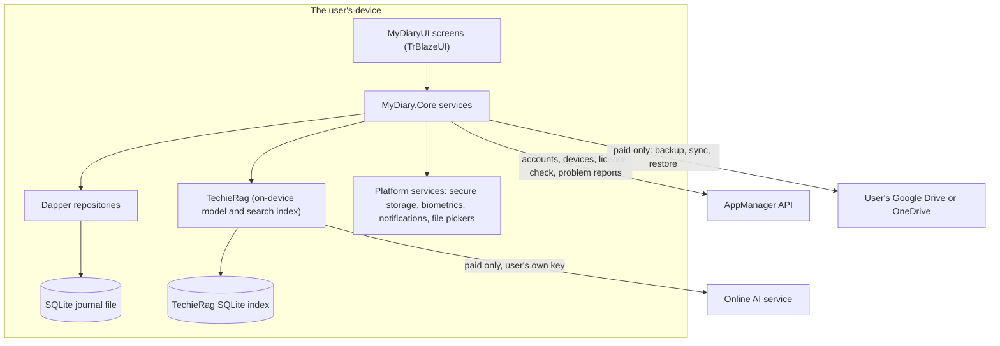
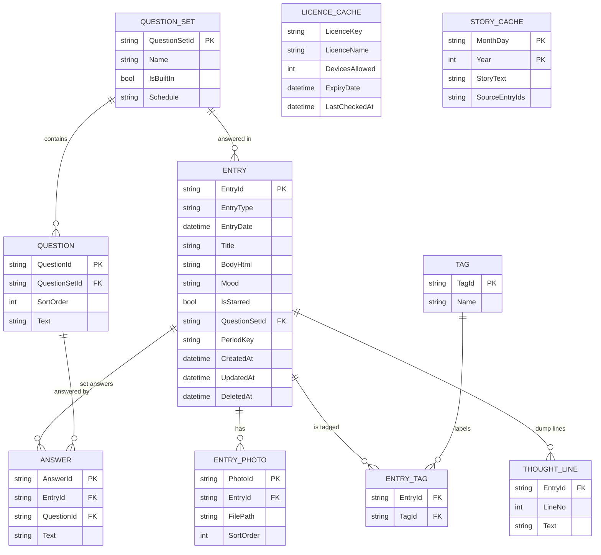

# MyDiary — Architecture

| | |
|---|---|
| App | MyDiary |
| Kind | app |
| Size | Medium |
| Stack answer set | dotnet (`.tfcore/templates/stack-defaults/dotnet.md`) |
| Date | 2026-10-18 |

Source of every product fact here: the owner's brief, `docs/MyDiary-Brief.md` (2026-10-18). Source of every AppManager fact: `docs/AppManager-api-usage-guide.md` (version 1.6, 2026-10-04). TechieRag facts come from its AI reference (`TechieRag-AI-Reference.md`, v3, updated 2026-10-11). TrBlazeUI facts come from its AI reference (`TrBlazeUI-AI-Reference.md`, 2026-10-15). The owner gave no other notes at day-1 ("Hints: none").

## 1. Stack decisions

One row per stack question. The owner's instruction at day-1 was: take the stack answers, open questions and size as the brief states them; where the brief is silent, take the answer set's default and record the choice. "brief" below means a fixed choice stated in the brief.

| Q | Topic | Decision | Source |
|---|---|---|---|
| Q1 | Configuration | `appsettings.json` embedded in the MAUI head, layered by `appsettings.{Environment}.json`; it holds the AppManager base address (`AppManager:ApiUrl`) and the installed-app key (`AppManager:InstalledAppKey`, a `pk_live_` key, which is public by design). Per-user choices (AI model, lock, reminders, zoom) live in MAUI `Preferences`, which is the user's state, not configuration. No other configuration mechanism. | answer set: dotnet; AppManager guide §2.1.1 |
| Q2 | Secrets in development | Project user secrets for the developer's own values (for example a test online-AI key). `appsettings.Development.json` holds no real secret. `secrets.example.json` lists every key read. On the device, tokens, the PIN and a paid user's online-AI key are kept in MAUI `SecureStorage`, never in `Preferences` or the database. | answer set: dotnet; device storage inferred from the brief's privacy rule <!-- inferred — please verify --> |
| Q3 | Database | **Overrides the answer set.** SQLite on each device, one file under `FileSystem.AppDataDirectory`; no PostgreSQL and no Docker. The answer set's PostgreSQL default cannot hold here: the brief says MyDiary has no server of its own and a free user's journal stays on the device. TechieRag keeps its search index in its own SQLite file next to it. | brief ("no server of its own", "everything stays on that device"); recorded as the one deviation from the answer set |
| Q4 | Authentication | AppManager, through its installed-app key (`X-Api-Key: pk_live_…` plus a stable `X-Device-Id` per install), using device-bound register and sign-in (`/AuthSvc/device-register`, `/AuthSvc/device-login`). AppManager owns accounts, devices, licences, problem reports and account-data requests. | brief (fixed choice) |
| Q4a | Test users | Three test users registered under MyDiary's application id through AppManager's register call, by a script in `tests/`; passwords only in git-ignored secrets. Written at stage 2 in the UsageGuide. | answer set: dotnet |
| Q5 | Logging | Serilog, wired first in `MauiProgram`, rolling daily file under `FileSystem.AppDataDirectory/logs`, 14 files kept. Journal text, PINs, passwords, tokens and AI keys are never logged. | answer set: dotnet; the never-logged list is inferred from the brief's privacy rule <!-- inferred — please verify --> |
| Q6 | Tests | xUnit; `MyDiary.Tests` exists from day-1. Unit tests for the licence and device-limit rules, the 30-day offline rule, the Thought Dump save rule, imports, and the counting behind Ask. Screen checks run against the Windows head. | answer set: dotnet |
| Q7 | Layout and naming | `src/` and `tests/` at the root. Primary head `src/MyDiary/MyDiary.csproj`. Satellites `MyDiaryUI` (Razor class library), `MyDiary.Core`, `MyDiaryDb`, `MyDiary.Tests`. | answer set: dotnet |
| Q8 | User interface | One MAUI Blazor Hybrid head targeting Android, iOS (iPhone and iPad), Mac Catalyst and Windows; every screen built with TrBlazeUI (`TrBlazeUI.Components`, which brings `TrBlazeUI.Primitives`; icons from `TrBlazeUI.Icons.Lucide`). Rendering mode: Blazor Hybrid in a `BlazorWebView`, interactive in process, which is the only mode a Hybrid head has. Zoom on the Windows and Mac heads as in the stack's coding standards §9b. | brief (TrBlazeUI, the five platforms); rendering mode: answer set leaves it open, the Hybrid head allows one |
| Q9 | Hosting | Not yet asked (UAT). The apps are distributed as device packages; there is no server to host. | answer set: asked at UAT |
| Q10 | Production secrets | Not yet asked (production). | answer set: asked after UAT |
| Q11 | Standing rules | The answer set's seven rules, unchanged: 1. no NuGet package without a line here saying why; 2. no second configuration mechanism; 3. a gap in TechieFlow, TrBlazeUI, TechieRag or AppManager is recorded in that library's feedback file and the feature waits, never a workaround; 4. data access is always Dapper; 5. migrations live in `MyDiaryDb` using DbUp, run by the app at startup; 6. log files under the build output folder (on a device, under the app data folder), never at the repository root; 7. no extra folders at the repository root. Added from the brief: 8. MyDiary writes no AI code of its own; every AI feature goes through TechieRag; 9. no journal text is ever sent to AppManager; 10. no journal text leaves a free user's device. | answer set: dotnet; rules 8 to 10: brief |

Required packages: `TrBlazeUI.Components`

## 2. Solution structure

| Project | Kind | Purpose |
|---|---|---|
| `MyDiary` | MAUI Blazor Hybrid app (Android, iOS, Mac Catalyst, Windows) | The primary head. Hosts the `BlazorWebView`, Serilog, dependency injection, platform services (secure storage, biometrics, notifications, file pickers, cloud-drive sign-in) and runs the `MyDiaryDb` migrations at startup. |
| `MyDiaryUI` | Razor class library | Every screen, dialog and the app shell, built only from TrBlazeUI components. No data access. |
| `MyDiary.Core` | class library | The journal, question sets, search, On This Day, Ask, Compare, licence and device rules, backup and sync, import and export, the AppManager client, and the calls into TechieRag. |
| `MyDiaryDb` | class library (DbUp migrations) | SQLite schema scripts as embedded resources, applied in order at app startup. |
| `MyDiary.Tests` | xUnit test project | Unit tests for `MyDiary.Core`, migration tests on a temporary SQLite file, and the screen checks run against the Windows head. |

## 3. Component map

**How a request travels** (one typical request, in words; per-screen detail is in the DevGuide):
1. On the Ask screen the user types "how many coffee bottles did I open last year?" and presses Ask.
2. `AskService` in `MyDiary.Core` hands the question to TechieRag with the journal search index, which runs on the chosen model: the built-in on-device model for a free user, or the paid user's chosen model or online service.
3. TechieRag finds the matching entries in its index; the entry ids lead back to `EntryRepository`, which reads them from the SQLite journal through Dapper.
4. The screen shows the counted answer and lists every entry it used, each opening on the Entry screen. When nothing matches, it says so and shows no number.

Starting the app follows its own path. The head runs the migrations, opens the journal, and reads the cached licence result. If the last successful licence check is under 30 days old, Home opens (after Unlock when a lock is set). Otherwise the app calls `POST /LicenseSvc/validate`, and Access stopped is shown when the check cannot be made or the device is over its limit.

## 4. Data model

All tables live in the one SQLite file on the device. Account, device and licence facts belong to AppManager; MyDiary keeps only a cached copy of the last licence check.

| Entity | Key fields | Notes |
|---|---|---|
| Entry | `EntryId` (GUID text), `EntryType` (`dump`, `free`, `questions`), `EntryDate`, `Mood`, `IsStarred` | One journal per user, so there is no Journal table. GUID ids keep sync and import free of clashes. `DeletedAt` marks a deletion so sync can carry it to other devices. |
| Thought line | `EntryId`, `LineNo` 1 to 10 | Only filled lines are saved (brief, Must do 10). |
| Entry photo | `PhotoId`, `FilePath` | The photo file sits in the app data folder; the row points to it. |
| Tag, Entry tag | `Name` unique, case-insensitive | Free tags, shared across entry types. |
| Question set, Question | `IsBuiltIn`, `Schedule` (`monthly-1st`, `yearly`, `weekly`, `none`) | Seven built-in sets are seeded by a migration: Monthly Goals, Yearly Review, Health, Fitness, Weekly Retro, Project Retro, Gratitude. Built-in sets cannot be deleted. |
| Answer | `EntryId`, `QuestionId` | `Entry.PeriodKey` (for example `2026-10` or `2026`) lets Compare line the same question up across months or years. |
| Licence cache | `LicenceName`, `DevicesAllowed`, `LastCheckedAt` | The last successful `POST /LicenseSvc/validate`. `LastCheckedAt` drives the 30-day offline rule. |
| Story cache | `MonthDay`, `Year` | A written On This Day story is kept so Home opens fast and offline; rewritten when an entry of that date changes. |

## 5. Cross-cutting

- **Identity:** AppManager through the installed-app key, with device-bound register and sign-in (guide §2.1.1, §3.1). Passwords are encrypted with AppManager's public key before sending, as the guide requires (§2.4). The access and refresh tokens are kept in `SecureStorage`; the refresh token renews the access token through `POST /AuthSvc/refresh`.
- **Licence and devices:** after sign-in and at each licence check, `LicenceService` reads `POST /LicenseSvc/validate`. Paid or free comes from the returned licence key and licence name: "Pro" allows 2 devices; "Pro-Plus" allows the `devicesAllowed` set on the licence; no valid paid licence means free, with 1 device. AppManager reports a device over the cap but does not refuse it (guide L659), so MyDiary enforces the limit itself from `deviceCap.isOverCap`, `devicesUsed` and `devicesAllowed`, as the guide directs. For a free user AppManager returns no cap, so MyDiary counts the signed-in devices from `GET /AuthSvc/devices`. Logged as AppManager feedback AM-002.
- **Offline rule:** the app works offline while the last successful licence check is under 30 days old; after that it must check online before the journal opens (brief, Must do 2). A device clock set backwards does not extend the period; the newest time seen is kept with the cache. <!-- inferred — please verify -->
- **Paid licence ends:** paid-only features lock (backup, sync, model choice, online AI); the journal and every free feature stay on the device, and the AI setting falls back to the built-in model (brief, Must do 8).
- **AI:** TechieRag only. A free user gets the smallest built-in on-device model (TechieRag's `Qwen25Instruct05B` with the phone search model, pinned on every platform so indexes match between devices). A paid user may pick another TechieRag model or enter their own key for an online service TechieRag supports; the key is kept in `SecureStorage`. Each entry is added to TechieRag's index under its `EntryId` when saved and replaced when edited. Three gaps are logged as TechieRag feedback: counting across every matching entry (TR-RAG-001), choosing entries by date (TR-RAG-002) and shipping the model inside the app (TR-RAG-003). The features that need them wait for TechieRag.
- **Backup and sync (paid):** the journal file and photos are packed into one backup file in the user's own Google Drive or OneDrive app folder. Sync merges entries by `EntryId` and `UpdatedAt`, newest wins, deletions carried by `DeletedAt`. Restore replaces the journal on a new device after a confirmation. <!-- inferred — please verify -->
- **Export and import:** a MyDiary JSON file holds every entry, its lines, answers, tags, mood, star and photos (as embedded data). Import reads MyDiary JSON and a Day One JSON export, matching on `EntryId` so a second import adds nothing twice.
- **Lock and reminders:** a PIN (stored as a hash in `SecureStorage`) or the platform's fingerprint/face check guards opening the app; reminders are local notifications on the chosen days and time.
- **Configuration:** `appsettings.json` in the head (Q1); per-user choices in MAUI `Preferences`; secrets on the device in `SecureStorage`.
- **Logging:** Serilog to a rolling file under the app data folder, wired before anything else; no journal text, PIN, password, token or key in any log line.
- **Errors:** every AppManager call goes through one client that maps the guide's error body (`error`, `message`, `statusCode`) to a plain message on the screen; a `401` after a password change returns to Sign in. The stock Blazor error bar stays. Network failures fall back to offline use within the 30-day rule.

## 6. Decisions log

One row per decision. Every package added to the project has a row saying why.

| Date | Decision | Why | Status |
|---|---|---|---|
| 2026-10-18 | One MAUI Blazor Hybrid head for Android, iOS, iPadOS, Mac Catalyst and Windows | The brief requires the same screens on all five; TrBlazeUI is a Blazor library | decided |
| 2026-10-18 | Package `TrBlazeUI.Components` (and `TrBlazeUI.Icons.Lucide`) | Brief: screens are built with TrBlazeUI; answer set Q8 | decided |
| 2026-10-18 | Packages `TechieRag`, `TechieRag.Embedded`, `TechieRag.Local` | Brief: every AI feature goes through TechieRag; on-device model for free users | decided |
| 2026-10-18 | Package `Microsoft.Data.Sqlite` and SQLite on the device instead of PostgreSQL | No server of its own; the journal stays on the device (brief) | decided |
| 2026-10-18 | Package `Dapper` | Answer set Q11.4: data access is always Dapper | decided |
| 2026-10-18 | Package `dbup-sqlite` in `MyDiaryDb` | Answer set Q11.5: migrations with DbUp in a dedicated project, run at startup | decided |
| 2026-10-18 | Packages `Serilog.Extensions.Logging`, `Serilog.Sinks.File` | Answer set Q5: Serilog file logging | decided |
| 2026-10-18 | Packages `xunit`, `xunit.runner.visualstudio`, `Microsoft.NET.Test.Sdk` | Answer set Q6 | decided |
| 2026-10-18 | Package `Plugin.Fingerprint` for fingerprint/face unlock | MAUI has no built-in biometric check; Must do 23 | planned <!-- inferred — please verify --> |
| 2026-10-18 | Package `Plugin.LocalNotification` for reminders | MAUI has no built-in scheduled local notification; Must do 23 | planned <!-- inferred — please verify --> |
| 2026-10-18 | Packages `Microsoft.Identity.Client` (OneDrive) and `Google.Apis.Drive.v3` with `Google.Apis.Auth` (Google Drive) | Backup to the user's own drive (Must do 21) | planned <!-- inferred — please verify --> |
| 2026-10-18 | MyDiary enforces the device limit itself from AppManager's licence check | AppManager reports a device over the cap but does not refuse it (guide L659: "enforce it client-side") | decided |
| 2026-10-18 | Medium size, 20 screens | 20 routed pages counted from the brief, one signed-in role; within Medium | decided |
| 2026-10-18 | Ask, data copy and data deletion are held until their upstream gaps are fixed | Answer set Q11.3: never work around a library gap (TR-RAG-001, AM-001) | decided |

## 7. Module responsibilities

| Module | Responsibility | Depends on |
|---|---|---|
| `MyDiary` head | Startup, Serilog, DI, migrations, platform services, zoom on Windows and Mac | `MyDiaryUI`, `MyDiary.Core`, `MyDiaryDb` |
| `MyDiaryUI` shell | Navigation (TrBlazeUI `Sidebar`: a slide-out sheet below 768px on phones, a fixed sidebar on tablets and computers), lock gate, access gate | TrBlazeUI, `MyDiary.Core` service interfaces |
| `AccountService` | Register, sign in and out, reset and change password, profile, problem reports, data requests | AppManager API |
| `LicenceService` | Licence check, paid or free, device limit, 30-day offline rule, licence cache | AppManager API, SQLite |
| `DeviceService` | Device list, forget and block | AppManager API |
| `JournalService` | Thought Dump, Free-Flow, answers, tags, mood, star, delete, streak | Dapper repositories |
| `QuestionSetService` | Built-in and own sets, due suggestions | Dapper repositories |
| `SearchService` | Keyword search and filters | Dapper repositories (SQLite full-text search) |
| `OnThisDayService` | Picks past entries for the date, asks TechieRag for each year's story, caches it | `JournalService`, TechieRag |
| `AskService` | Plain questions, counted answers, source entries, no-match reply | TechieRag, `JournalService` |
| `CompareService` | One question's answers across periods | Dapper repositories |
| `AiSettingsService` | Model choice, online key, warning, fallback when a licence ends | TechieRag, `LicenceService`, `SecureStorage` |
| `BackupService` | Backup, sync, restore to Google Drive or OneDrive | `LicenceService`, cloud drive clients |
| `TransferService` | Export and import, including Day One | `JournalService` |
| `LockService`, `ReminderService` | PIN and biometric lock; reminder notifications | Platform services |

## 8. Open questions

- AppManager has no "free tier" device cap: a user with no licence gets no cap from the licence check. MyDiary counts devices itself (AM-002). The owner may prefer a free licence type with one device assigned to every new account.
- The installed-app key may not call AppManager's data-copy and data-deletion endpoints (guide L226), so Must do 3's data requests wait for AppManager (AM-001). AppManager's copy covers only account data; the journal itself is copied through Export.
- TechieRag downloads its on-device model on first use and does not ship it inside the app (TR-RAG-003); Must do 19 says "installed with the app". Until that changes, the first launch downloads about 420 MB (the 333 MB language model and the 91 MB search model).
- "Pro" and "Pro-Plus" are licence types the owner creates in AppManager; their names must match exactly.
