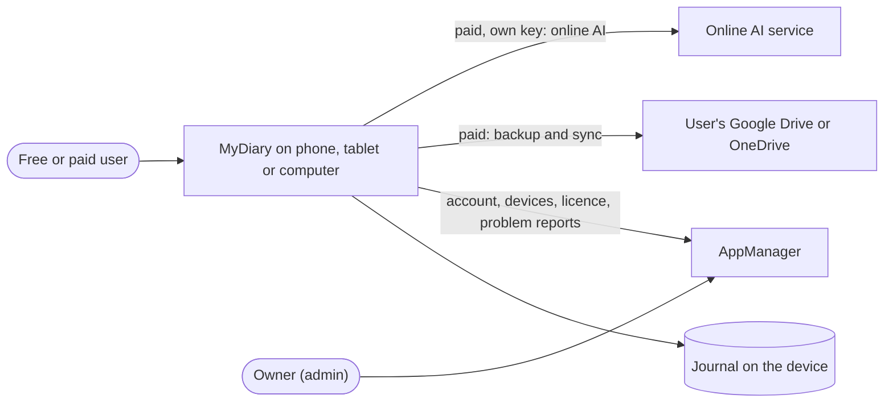

# MyDiary — Business Requirements

| | |
|---|---|
| App | MyDiary |
| Kind | app |
| Size | Medium |
| Stack answer set | dotnet (`.tfcore/templates/stack-defaults/dotnet.md`) |
| Status | Draft |
| Date | 2026-10-18 |

Source: the owner's brief, `docs/MyDiary-Brief.md` (2026-10-18), read in full. Every "Must do" line, every user, every fixed choice and every out-of-scope line of the brief is carried below. Items the brief does not state outright are marked as inferred for the owner to check.

## 1. Summary

MyDiary is a private journaling app for phone, tablet and computer (Android, iPhone, iPad, Windows and Mac). Each person keeps one journal and has three ways to write in it: a 10-Thought Dump, a Free-Flow entry with formatting and photos, and Targeted Questioning sets such as Monthly Goals or a Yearly Review.

Opening the app shows a short, warm story of what the person wrote on this date in past years. They can ask plain questions about their past ("how many coffee bottles did I open last year?") and get a counted answer that lists the entries it used. They can also put one question's answers side by side across months or years.

It is free on one device, with a small AI model that runs on the device. A paid licence adds backup, sync between several devices, and a choice of AI model or online AI service.

Accounts, sign-in, devices, licences, problem reports and account-data requests use AppManager. AI features use TechieRag. Screens use TrBlazeUI. MyDiary has no server of its own, and journal text never reaches AppManager.

## 2. Scope

**In:**
- Creating a MyDiary account, signing in, resetting a forgotten password, editing the profile and changing the password, all inside the app through AppManager (brief, Must do 1 and 3).
- Working offline for up to 30 days, then checking the licence online again (Must do 2).
- Device limits: a free account on one device; a paid account on as many devices as its licence allows; refusing a device over the limit with a message that says what to do (Must do 4, 5).
- Showing the plan, its end date and every signed-in device with the count in use, and forgetting or blocking a device (Must do 6).
- Deciding paid or free from the licence key and licence name returned by AppManager's licence check: "Pro" allows 2 devices, "Pro-Plus" allows the number set on the licence, no paid licence means free (Must do 7).
- Keeping every free feature and the whole journal on the current device when a paid licence ends (Must do 8).
- Sending a problem report and asking for a copy or deletion of account data from inside the app (Must do 3).
- One journal per person, with no journal picker (Must do 9).
- Three ways to write: 10-Thought Dump, Free-Flow with formatting and photos, Targeted Questioning sets (built-in and the user's own), with a suggestion when a set is due (Must do 10, 11, 12).
- A home screen with today's entries, a streak and the On This Day card; On This Day as a short story per past year (Must do 13, 15).
- Browsing by timeline or calendar, tags, stars and moods; keyword search with filters (Must do 14, 16).
- Asking plain questions and getting counted answers with their source entries, never an invented answer; comparing one question's answers across months or years (Must do 17, 18).
- The smallest built-in AI model for free users; a choice of model, or the user's own key for an online AI service TechieRag supports, for paid users, with a warning that journal text will be sent (Must do 19, 20).
- Backup to the user's own Google Drive or OneDrive, sync between devices and restore on a new device for paid users (Must do 21).
- Export to a JSON file and import one, including a Day One export, for every user (Must do 22).
- App lock with a PIN or fingerprint/face, and journaling reminders (Must do 23).
- The same screens on Android, iPhone, iPad, Windows and Mac (Must do 24).

**Out:**
- The purchase and landing page. It is a separate MyDiary web app in phase 2, which buys licences through AppManager. Until then the admin assigns paid licences in AppManager, and MyDiary has no "Buy" button.
- Taking payment inside the app, and app-store purchases.
- More than one journal, shared journals, and family groups sharing one licence.
- Sending journal text anywhere for a free user. Online AI only happens when a paid user enters their own key.
- iCloud, Dropbox and any other sync service.
- Map view, voice transcription, widgets, handwriting, sharing an entry as an image.
- A server of MyDiary's own. AppManager never sees journal text.
- AI code written inside MyDiary. Every AI feature, built-in or online, goes through TechieRag.

## 3. Users and roles

The app has one kind of signed-in user. Free and paid are states of that user's licence, not separate logins. A goal reviewer is a free or paid user doing reviews. The owner works only on the AppManager site.

| Role | Who they are | What they need |
|---|---|---|
| Free user | Anyone with a MyDiary account and no paid licence. Writes on one device; everything stays on that device. | All writing, browsing, search, On This Day, plain-question answers and comparisons, using the built-in on-device AI model; export and import; lock and reminders. |
| Paid user | A user whose AppManager licence is "Pro" (2 devices) or "Pro-Plus" (the number set on the licence). | Everything a free user has, plus several devices, backup and restore to their own Google Drive or OneDrive, sync between devices, and a choice of AI model or their own online AI key. |
| Goal reviewer | A free or paid user who runs monthly, yearly, health, fitness or project reviews. | Question sets suggested when due, and the same question's answers side by side over months or years. |
| Owner (admin) | The person who runs MyDiary. Works on the AppManager site and does nothing inside MyDiary. | Assigns paid licences and reads problem reports on AppManager. No screen in MyDiary. |

## 4. Screens and flow

One row per routed page. A dialog is a row under its parent screen with `on /route` in the Route column; it is not counted as a screen. 20 screens, one signed-in role. Tabs and dialogs are regions of their page.

| Screen | Route | Role | Mockup | Fields |
|---|---|---|---|---|
| Sign in | `/signin` | Free user, Paid user | [mockup](mockups/signin.html) | email, password |
| Create account | `/register` | Free user | [mockup](mockups/register.html) | name, email, password, confirm password |
| Reset password | `/reset-password` | Free user, Paid user | [mockup](mockups/reset-password.html) | email, reset code, new password |
| Access stopped | `/access-stopped` | Free user, Paid user | [mockup](mockups/access-stopped.html) | reason (device limit free, device limit paid, licence check due), devices in use, allowed devices |
| Unlock | `/unlock` | Free user, Paid user | [mockup](mockups/unlock.html) | PIN, fingerprint/face button |
| Home | `/` | Free user, Paid user, Goal reviewer | [mockup](mockups/home.html) | today's entries, streak, On This Day card, due question set |
| On This Day | `/on-this-day` | Free user, Paid user | [mockup](mockups/on-this-day.html) | date, one story per past year, source entries |
| Thought Dump | `/write/dump` | Free user, Paid user | [mockup](mockups/thought-dump.html) | lines 1 to 10, mood, tags |
| Free-Flow | `/write/free` | Free user, Paid user | [mockup](mockups/free-flow.html) | title, formatted body, photos, mood, tags |
| Question sets | `/questions` | Free user, Paid user, Goal reviewer | [mockup](mockups/question-sets.html) | set name, questions count, due badge, schedule |
| Build question set (dialog) | on `/questions` | Free user, Paid user, Goal reviewer | [mockup](mockups/question-sets.html) | set name, questions, schedule |
| Answer questions | `/questions/answer` | Free user, Paid user, Goal reviewer | [mockup](mockups/answer-questions.html) | set name, period, one answer per question, mood |
| Browse | `/browse` | Free user, Paid user | [mockup](mockups/browse.html) | timeline tab, calendar tab, entry type, mood, star, tags |
| Entry | `/entry` | Free user, Paid user | [mockup](mockups/entry.html) | date, type, body, photos, mood, tags, star |
| Delete entry (dialog) | on `/entry` | Free user, Paid user | [mockup](mockups/entry.html) | confirmation |
| Search | `/search` | Free user, Paid user | [mockup](mockups/search.html) | keyword, date range, tag, question set, has photo, starred, mood |
| Ask | `/ask` | Free user, Paid user, Goal reviewer | [mockup](mockups/ask.html) | question, counted answer, source entries, AI model used |
| Compare answers | `/compare` | Goal reviewer | [mockup](mockups/compare.html) | question set, question, by month or by year, period columns |
| Account | `/account` | Free user, Paid user | [mockup](mockups/account.html) | name, email, current password, new password |
| Report a problem (dialog) | on `/account` | Free user, Paid user | [mockup](mockups/account.html) | subject, description |
| My account data (dialog) | on `/account` | Free user, Paid user | [mockup](mockups/account.html) | request type (copy, deletion), confirmation |
| Plan and devices | `/account/devices` | Free user, Paid user | [mockup](mockups/plan-devices.html) | plan name, end date, devices in use, allowed devices, device list |
| Forget or block device (dialog) | on `/account/devices` | Paid user | [mockup](mockups/plan-devices.html) | device name, action |
| Settings | `/settings` | Free user, Paid user | [mockup](mockups/settings.html) | AI model, online AI service, API key, PIN, fingerprint/face, reminder days and time |
| Online AI warning (dialog) | on `/settings` | Paid user | [mockup](mockups/settings.html) | service name, acknowledgement |
| Backup and data | `/backup` | Free user, Paid user | [mockup](mockups/backup.html) | backup service, last backup, sync status, export file, import file, import source |
| Restore journal (dialog) | on `/backup` | Paid user | [mockup](mockups/backup.html) | backup to restore, confirmation |

**Primary journey:**
1. On first launch the user creates a MyDiary account or signs in; the app registers this device with AppManager and checks the licence.
2. If the device is over the account's limit, Access stopped explains why and what to do. Otherwise Home opens (after Unlock, when a lock is set).
3. Home shows today's entries, the streak, the On This Day card and any question set that is due.
4. The user writes a Thought Dump, a Free-Flow entry or answers a question set; the entry appears on Home and in Browse.
5. Later the user browses, searches, asks a plain question on Ask, or compares answers over time on Compare answers.
6. From the menu the user manages their Account, Plan and devices, Settings (AI model, lock, reminders) and Backup and data.

## 5. Requirements

One item per thing the verifier will test. Each names its screen, links its mockup, and carries one acceptance line. "Must do N" points at the line of the brief it comes from.

### Sign in

Sign in lets a returning user open their journal with their MyDiary account.

- **BRD-1** — Sign in opens the journal (Must do 1). *Screen:* Sign in · *Mockup:* [mockup](mockups/signin.html)
  - *Acceptance:* When a user enters a correct email and password on Sign in and presses Sign in, then Home opens.
- **BRD-2** — A wrong password is refused (Must do 1). *Screen:* Sign in · *Mockup:* [mockup](mockups/signin.html)
  - *Acceptance:* When a user enters a wrong password on Sign in, then "Email or password is wrong" shows and Sign in stays open.
- **BRD-3** — First launch asks to sign in or create an account (Must do 1). *Screen:* Sign in · *Mockup:* [mockup](mockups/signin.html)
  - *Acceptance:* When a user opens MyDiary for the first time on a device, then Sign in shows with a Create an account link.

### Create account

Create account makes a new MyDiary account through AppManager and opens an empty journal.

- **BRD-4** — A new account opens an empty journal (Must do 1). *Screen:* Create account · *Mockup:* [mockup](mockups/register.html)
  - *Acceptance:* When a user enters name, email and a valid password on Create account and presses Create account, then Home opens with an empty journal.
- **BRD-5** — An email that already has an account is refused (Must do 1). *Screen:* Create account · *Mockup:* [mockup](mockups/register.html)
  - *Acceptance:* When a user enters an email that already has an account on Create account, then a message says so and links to Sign in.
- **BRD-6** — The password rule is shown (Must do 1; AppManager's rule). *Screen:* Create account · *Mockup:* [mockup](mockups/register.html)
  - *Acceptance:* When a user types a password without 8 characters, an uppercase letter, a digit and a symbol, then Create account says which is missing.

### Reset password

Reset password lets a user who forgot their password set a new one with a code sent by email.

- **BRD-7** — A reset code is sent (Must do 3). *Screen:* Reset password · *Mockup:* [mockup](mockups/reset-password.html)
  - *Acceptance:* When a user enters their email on Reset password and presses Send code, then a message says a reset code is on its way.
- **BRD-8** — The new password works (Must do 3). *Screen:* Reset password · *Mockup:* [mockup](mockups/reset-password.html)
  - *Acceptance:* When a user enters the emailed code and a new password on Reset password, then Sign in opens and the new password signs them in.

### Access stopped

Access stopped is shown instead of Home when this device may not open the journal, and says what to do.

- **BRD-9** — A free account is refused on a second device (Must do 4). *Screen:* Access stopped · *Mockup:* [mockup](mockups/access-stopped.html)
  - *Acceptance:* When a free user signs in on a second device, then Access stopped says a free account works on one device and a paid licence allows more.
- **BRD-10** — A paid account is refused over its device limit (Must do 5). *Screen:* Access stopped · *Mockup:* [mockup](mockups/access-stopped.html)
  - *Acceptance:* When a paid user signs in on one device more than the licence allows, then Access stopped shows the devices in use and how to free a slot.
- **BRD-11** — The licence is checked again after 30 days (Must do 2). *Screen:* Access stopped · *Mockup:* [mockup](mockups/access-stopped.html)
  - *Acceptance:* When the last licence check is over 30 days old and the device is offline, then Access stopped asks the user to connect and check again.
- **BRD-12** — The app works offline within 30 days (Must do 2). *Screen:* Home · *Mockup:* [mockup](mockups/home.html)
  - *Acceptance:* When the device is offline and the last licence check is under 30 days old, then Home opens and every journal screen works.

### Unlock

Unlock keeps the journal closed until the user enters their PIN or passes the fingerprint or face check.

- **BRD-13** — A locked app asks first (Must do 23). *Screen:* Unlock · *Mockup:* [mockup](mockups/unlock.html)
  - *Acceptance:* When a user who has set a PIN opens MyDiary, then Unlock shows before any journal content.
- **BRD-14** — The right PIN opens the journal (Must do 23). *Screen:* Unlock · *Mockup:* [mockup](mockups/unlock.html)
  - *Acceptance:* When the user enters the correct PIN on Unlock, then Home opens.
- **BRD-15** — A wrong PIN is refused (Must do 23). *Screen:* Unlock · *Mockup:* [mockup](mockups/unlock.html)
  - *Acceptance:* When the user enters a wrong PIN on Unlock, then "Wrong PIN" shows and the PIN boxes clear.
- **BRD-16** — Fingerprint or face opens the journal (Must do 23). *Screen:* Unlock · *Mockup:* [mockup](mockups/unlock.html)
  - *Acceptance:* When a user with fingerprint or face unlock turned on passes the device check on Unlock, then Home opens.

### Home

Home shows today's entries, the streak, the On This Day card and any question set that is due.

- **BRD-17** — Today's entries are listed (Must do 13). *Screen:* Home · *Mockup:* [mockup](mockups/home.html)
  - *Acceptance:* When a user has written two entries today, then Home lists both under Today, each with its time, type and mood.
- **BRD-18** — The streak is shown (Must do 13). *Screen:* Home · *Mockup:* [mockup](mockups/home.html)
  - *Acceptance:* When a user has written on each of the last 12 days, then the Streak tile on Home shows 12 days.
- **BRD-19** — The On This Day card is shown (Must do 13, 15). *Screen:* Home · *Mockup:* [mockup](mockups/home.html)
  - *Acceptance:* When entries exist on today's date in past years, then the On This Day card on Home shows the start of a story and the years.
- **BRD-20** — A due question set is suggested (Must do 12). *Screen:* Home · *Mockup:* [mockup](mockups/home.html)
  - *Acceptance:* When a user opens Home on the 1st of a month, then Home shows "Monthly Goals is due" with a Start button.
- **BRD-21** — A new journal says how to start. *Screen:* Home · *Mockup:* [mockup](mockups/home.html) <!-- inferred — please verify -->
  - *Acceptance:* When a new user opens Home, then it shows "Your journal is empty" with a Start writing button.

### On This Day

On This Day tells, for each past year, a short warm story of what was written on this date.

- **BRD-22** — One story per past year (Must do 15). *Screen:* On This Day · *Mockup:* [mockup](mockups/on-this-day.html)
  - *Acceptance:* When entries exist on today's date in three past years, then On This Day shows three stories, one per year, newest first.
- **BRD-23** — A story, not a list (Must do 15). *Screen:* On This Day · *Mockup:* [mockup](mockups/on-this-day.html)
  - *Acceptance:* When a user opens On This Day, then each year shows a paragraph of prose, not a list of entries.
- **BRD-24** — Entries around the date count (Must do 15). *Screen:* On This Day · *Mockup:* [mockup](mockups/on-this-day.html)
  - *Acceptance:* When a past year has no entry on this date but one within three days, then its story uses it and says "Around this date". <!-- inferred — please verify: the three-day window -->
- **BRD-25** — The story's entries can be opened. *Screen:* On This Day · *Mockup:* [mockup](mockups/on-this-day.html) <!-- inferred — please verify -->
  - *Acceptance:* When the user presses "Based on 2 entries" under a story, then those entries are listed and each opens on Entry.
- **BRD-26** — No past entries, no story (Must do 15). *Screen:* On This Day · *Mockup:* [mockup](mockups/on-this-day.html)
  - *Acceptance:* When no entry exists on or around today's date in any past year, then On This Day says so and shows no story.

### Thought Dump

Thought Dump takes ten quick numbered lines and saves the filled ones as one entry.

- **BRD-27** — Ten numbered lines (Must do 10). *Screen:* Thought Dump · *Mockup:* [mockup](mockups/thought-dump.html)
  - *Acceptance:* When a user opens Thought Dump, then ten numbered empty lines show with the cursor on line 1.
- **BRD-28** — Enter moves to the next line. *Screen:* Thought Dump · *Mockup:* [mockup](mockups/thought-dump.html) <!-- inferred — please verify -->
  - *Acceptance:* When the user presses Enter on a line of Thought Dump, then the cursor moves to the next line.
- **BRD-29** — Empty lines are dropped on save (Must do 10). *Screen:* Thought Dump · *Mockup:* [mockup](mockups/thought-dump.html)
  - *Acceptance:* When the user saves a Thought Dump with lines 3 and 8 to 10 empty, then the saved entry shows only the six filled lines.
- **BRD-30** — The saved dump shows on Home (Must do 10, 13). *Screen:* Thought Dump · *Mockup:* [mockup](mockups/thought-dump.html)
  - *Acceptance:* When the user saves a Thought Dump, then Home opens and lists it under Today.

### Free-Flow

Free-Flow is a free-form entry with formatting, photos, a mood and tags.

- **BRD-31** — Formatting is kept (Must do 10). *Screen:* Free-Flow · *Mockup:* [mockup](mockups/free-flow.html)
  - *Acceptance:* When a user writes bold text, italic text and a bulleted list on Free-Flow and saves, then Entry shows the same formatting.
- **BRD-32** — Photos are added (Must do 10). *Screen:* Free-Flow · *Mockup:* [mockup](mockups/free-flow.html)
  - *Acceptance:* When a user adds two photos from the device on Free-Flow and saves, then Entry shows both photos.
- **BRD-33** — A mood is picked (Must do 14). *Screen:* Free-Flow · *Mockup:* [mockup](mockups/free-flow.html)
  - *Acceptance:* When a user picks the mood "Calm" on Free-Flow and saves, then Entry shows the Calm mood.
- **BRD-34** — Tags are added (Must do 14). *Screen:* Free-Flow · *Mockup:* [mockup](mockups/free-flow.html)
  - *Acceptance:* When a user adds the tags "health" and "family" on Free-Flow and saves, then Entry shows both tags.

### Question sets

Question sets lists the built-in and the user's own sets, marks the ones that are due, and builds new ones.

- **BRD-35** — Seven built-in sets (Must do 11). *Screen:* Question sets · *Mockup:* [mockup](mockups/question-sets.html)
  - *Acceptance:* When a user opens Question sets, then Monthly Goals, Yearly Review, Health, Fitness, Weekly Retro, Project Retro and Gratitude show.
- **BRD-36** — A due set is marked (Must do 12). *Screen:* Question sets · *Mockup:* [mockup](mockups/question-sets.html)
  - *Acceptance:* When a set's schedule falls on today, then its card on Question sets shows a "Due today" badge.
- **BRD-37** — A user builds their own set (Must do 11). *Screen:* Question sets · *Mockup:* [mockup](mockups/question-sets.html)
  - *Acceptance:* When a user names a set, adds three questions and a schedule in Build question set and saves, then the set shows on Question sets.
- **BRD-38** — Only the user's own sets can be deleted. *Screen:* Question sets · *Mockup:* [mockup](mockups/question-sets.html) <!-- inferred — please verify -->
  - *Acceptance:* When a user deletes their own set on Question sets, then it leaves the list; built-in sets show no Delete button.

### Answer questions

Answer questions shows each question of a set with its own answer box and saves the answers as one entry.

- **BRD-39** — One box per question (Must do 11). *Screen:* Answer questions · *Mockup:* [mockup](mockups/answer-questions.html)
  - *Acceptance:* When a user starts Weekly Retro, then Answer questions shows the set name, the week, and each question with its own answer box.
- **BRD-40** — Answers are saved as one entry (Must do 11). *Screen:* Answer questions · *Mockup:* [mockup](mockups/answer-questions.html)
  - *Acceptance:* When the user saves Answer questions, then one entry holding every answer, marked with the set name, shows on Home and Browse.

### Browse

Browse lists every entry on a timeline or a month calendar.

- **BRD-41** — The timeline lists entries newest first (Must do 14). *Screen:* Browse · *Mockup:* [mockup](mockups/browse.html)
  - *Acceptance:* When a user opens Browse, then the Timeline lists entries newest first, grouped by day, each with its type, mood, star and tags.
- **BRD-42** — The calendar marks days with entries (Must do 14). *Screen:* Browse · *Mockup:* [mockup](mockups/browse.html)
  - *Acceptance:* When the user opens the Calendar tab on Browse, then each day of the month that has an entry is marked.
- **BRD-43** — A day opens its entries (Must do 14). *Screen:* Browse · *Mockup:* [mockup](mockups/browse.html)
  - *Acceptance:* When the user picks a marked day on the Browse calendar, then that day's entries are listed below it.

### Entry

Entry shows one entry in full and lets the user star it, change its mood and tags, edit it or delete it.

- **BRD-44** — The whole entry is shown (Must do 10). *Screen:* Entry · *Mockup:* [mockup](mockups/entry.html)
  - *Acceptance:* When a user opens an entry, then Entry shows its date, type, formatted text, photos, mood and tags.
- **BRD-45** — An entry is starred (Must do 14). *Screen:* Entry · *Mockup:* [mockup](mockups/entry.html)
  - *Acceptance:* When the user presses the star on Entry, then the star fills and the entry shows under the Starred filter on Search.
- **BRD-46** — The mood is changed (Must do 14). *Screen:* Entry · *Mockup:* [mockup](mockups/entry.html)
  - *Acceptance:* When the user picks another mood on Entry, then the new mood shows on Entry and on Browse.
- **BRD-47** — Tags are changed (Must do 14). *Screen:* Entry · *Mockup:* [mockup](mockups/entry.html)
  - *Acceptance:* When the user removes the tag "family" on Entry, then the tag no longer shows on that entry.
- **BRD-48** — An entry is edited. *Screen:* Entry · *Mockup:* [mockup](mockups/entry.html) <!-- inferred — please verify -->
  - *Acceptance:* When the user presses Edit on a Free-Flow entry, then Free-Flow opens holding its text, photos, mood and tags.
- **BRD-49** — An entry is deleted. *Screen:* Entry · *Mockup:* [mockup](mockups/entry.html) <!-- inferred — please verify -->
  - *Acceptance:* When the user confirms Delete entry, then the entry no longer shows on Browse or Home.

### Search

Search finds entries by keyword and narrows them with filters.

- **BRD-50** — Keyword search (Must do 16). *Screen:* Search · *Mockup:* [mockup](mockups/search.html)
  - *Acceptance:* When a user searches "coffee" on Search, then only entries containing "coffee" are listed, with the word highlighted.
- **BRD-51** — Filter by date (Must do 16). *Screen:* Search · *Mockup:* [mockup](mockups/search.html)
  - *Acceptance:* When the user sets the dates 1 January to 31 December 2025 on Search, then only entries from 2025 are listed.
- **BRD-52** — Filter by tag (Must do 16). *Screen:* Search · *Mockup:* [mockup](mockups/search.html)
  - *Acceptance:* When the user picks the tag "health" on Search, then only entries tagged "health" are listed.
- **BRD-53** — Filter by question set (Must do 16). *Screen:* Search · *Mockup:* [mockup](mockups/search.html)
  - *Acceptance:* When the user picks Weekly Retro on Search, then only Weekly Retro entries are listed.
- **BRD-54** — Filter by photo (Must do 16). *Screen:* Search · *Mockup:* [mockup](mockups/search.html)
  - *Acceptance:* When the user turns on "Has photos" on Search, then only entries with at least one photo are listed.
- **BRD-55** — Filter by star (Must do 16). *Screen:* Search · *Mockup:* [mockup](mockups/search.html)
  - *Acceptance:* When the user turns on "Starred only" on Search, then only starred entries are listed.
- **BRD-56** — Filter by mood (Must do 16). *Screen:* Search · *Mockup:* [mockup](mockups/search.html)
  - *Acceptance:* When the user picks the moods Low and Stressed on Search, then only entries with one of those moods are listed.
- **BRD-57** — No results says so. *Screen:* Search · *Mockup:* [mockup](mockups/search.html) <!-- inferred — please verify -->
  - *Acceptance:* When no entry matches on Search, then "No entries match" shows with a Clear filters button.

### Ask

Ask answers plain questions about the journal with a count and the entries it used, and never makes one up.

- **BRD-58** — A counted answer (Must do 17). *Screen:* Ask · *Mockup:* [mockup](mockups/ask.html)
  - *Acceptance:* When a user asks "How many coffee bottles did I open last year?" on Ask, then the answer states a number.
- **BRD-59** — The entries used are listed (Must do 17). *Screen:* Ask · *Mockup:* [mockup](mockups/ask.html)
  - *Acceptance:* When Ask gives an answer, then every entry it counted is listed with its date, and each opens on Entry.
- **BRD-60** — No match, no invented answer (Must do 17). *Screen:* Ask · *Mockup:* [mockup](mockups/ask.html)
  - *Acceptance:* When no entry matches the question on Ask, then it says no entries match and shows no number.

### Compare answers

Compare answers puts one question's answers side by side across months or years.

- **BRD-61** — Answers side by side by month (Must do 18). *Screen:* Compare answers · *Mockup:* [mockup](mockups/compare.html)
  - *Acceptance:* When a goal reviewer picks Monthly Goals, a question and "By month" on Compare answers, then each month's answer shows in its own column.
- **BRD-62** — Answers side by side by year (Must do 18). *Screen:* Compare answers · *Mockup:* [mockup](mockups/compare.html)
  - *Acceptance:* When the reviewer picks Yearly Review and "By year" on Compare answers, then each year's answer shows in its own column.
- **BRD-63** — A period with no answer is marked. *Screen:* Compare answers · *Mockup:* [mockup](mockups/compare.html) <!-- inferred — please verify -->
  - *Acceptance:* When a month in the range has no answer, then its column on Compare answers shows "No answer".

### Account

Account holds the profile, the password, problem reports, account-data requests and sign-out.

- **BRD-64** — The profile is edited (Must do 3). *Screen:* Account · *Mockup:* [mockup](mockups/account.html)
  - *Acceptance:* When a user changes their first name on Account and saves, then the new name shows on Account and in the menu.
- **BRD-65** — The password is changed (Must do 3). *Screen:* Account · *Mockup:* [mockup](mockups/account.html)
  - *Acceptance:* When a user enters the current password and a valid new one on Account and saves, then Sign in opens and the new password works.
- **BRD-66** — A wrong current password is refused (Must do 3). *Screen:* Account · *Mockup:* [mockup](mockups/account.html)
  - *Acceptance:* When the current password entered on Account is wrong, then "Current password is wrong" shows and nothing changes.
- **BRD-67** — A problem report is sent (Must do 3). *Screen:* Account · *Mockup:* [mockup](mockups/account.html)
  - *Acceptance:* When a user sends a subject and description in Report a problem, then "Report sent" shows with the report's number.
- **BRD-68** — A problem report carries no journal text (brief: AppManager never sees journal text). *Screen:* Account · *Mockup:* [mockup](mockups/account.html)
  - *Acceptance:* When a user opens Report a problem, then the dialog lists what is sent, and no journal text is among it.
- **BRD-69** — A copy of account data is requested (Must do 3). *Screen:* Account · *Mockup:* [mockup](mockups/account.html)
  - *Acceptance:* When a user presses Ask for a copy on Account, then a message says the copy will be emailed within 24 hours.
- **BRD-70** — Deletion of account data is requested (Must do 3). *Screen:* Account · *Mockup:* [mockup](mockups/account.html)
  - *Acceptance:* When a user types their email in My account data and confirms deletion, then a message says deletion takes about 7 days.
- **BRD-71** — Sign out. *Screen:* Account · *Mockup:* [mockup](mockups/account.html) <!-- inferred — please verify -->
  - *Acceptance:* When the user presses Sign out, then Sign in opens and the journal is not shown until they sign in again.

### Plan and devices

Plan and devices shows the plan, when it ends, and every signed-in device, and lets the user forget or block one.

- **BRD-72** — The plan and its end date are shown (Must do 6). *Screen:* Plan and devices · *Mockup:* [mockup](mockups/plan-devices.html)
  - *Acceptance:* When a paid user opens Plan and devices, then the plan name and its end date show.
- **BRD-73** — A free plan is shown without a Buy button (Must do 6, 7; Out of scope). *Screen:* Plan and devices · *Mockup:* [mockup](mockups/plan-devices.html)
  - *Acceptance:* When a free user opens Plan and devices, then the plan reads "Free — one device" and no Buy button shows.
- **BRD-74** — Every signed-in device and the count in use (Must do 6). *Screen:* Plan and devices · *Mockup:* [mockup](mockups/plan-devices.html)
  - *Acceptance:* When a user with two signed-in devices opens Plan and devices, then both are listed and "2 of 2 devices in use" shows.
- **BRD-75** — "Pro" allows 2 devices (Must do 7). *Screen:* Plan and devices · *Mockup:* [mockup](mockups/plan-devices.html)
  - *Acceptance:* When AppManager's licence check returns the licence name "Pro", then Plan and devices shows 2 devices allowed.
- **BRD-76** — "Pro-Plus" allows the number set on the licence (Must do 7). *Screen:* Plan and devices · *Mockup:* [mockup](mockups/plan-devices.html)
  - *Acceptance:* When the licence check returns "Pro-Plus" with 5 devices allowed, then Plan and devices shows 5 devices allowed.
- **BRD-77** — A device is forgotten (Must do 5, 6). *Screen:* Plan and devices · *Mockup:* [mockup](mockups/plan-devices.html)
  - *Acceptance:* When the user forgets a device and confirms on Plan and devices, then it leaves the list and the in-use count drops by one.
- **BRD-78** — A device is blocked (Must do 6). *Screen:* Plan and devices · *Mockup:* [mockup](mockups/plan-devices.html)
  - *Acceptance:* When the user blocks a device and confirms on Plan and devices, then it shows Blocked and its next sign-in is refused.
- **BRD-79** — An ended paid licence keeps the journal (Must do 8). *Screen:* Plan and devices · *Mockup:* [mockup](mockups/plan-devices.html)
  - *Acceptance:* When a paid licence ends, then Plan and devices reads Free and every entry is still on this device.

### Settings

Settings holds the AI model choice, the app lock and journaling reminders.

- **BRD-80** — Free users get the built-in model (Must do 19). *Screen:* Settings · *Mockup:* [mockup](mockups/settings.html)
  - *Acceptance:* When a free user opens Settings, then the built-in on-device model is chosen and other choices show "Needs a paid licence".
- **BRD-81** — A paid user chooses another model (Must do 20). *Screen:* Settings · *Mockup:* [mockup](mockups/settings.html)
  - *Acceptance:* When a paid user picks another model on Settings and saves, then the next answer on Ask names that model.
- **BRD-82** — An online AI key needs the user's agreement (Must do 20). *Screen:* Settings · *Mockup:* [mockup](mockups/settings.html)
  - *Acceptance:* When a paid user enters a key for an online AI service on Settings, then a warning says journal text will be sent, and saving needs agreement.
- **BRD-83** — A PIN lock is set (Must do 23). *Screen:* Settings · *Mockup:* [mockup](mockups/settings.html)
  - *Acceptance:* When a user turns on the PIN lock and enters the same PIN twice on Settings, then the next app start shows Unlock.
- **BRD-84** — Fingerprint or face unlock is turned on (Must do 23). *Screen:* Settings · *Mockup:* [mockup](mockups/settings.html)
  - *Acceptance:* When a user turns on fingerprint or face unlock on Settings, then the next app start offers it on Unlock.
- **BRD-85** — A journaling reminder is set (Must do 23). *Screen:* Settings · *Mockup:* [mockup](mockups/settings.html)
  - *Acceptance:* When a user sets a reminder for 9 pm on weekdays on Settings, then a "Time to write" notification arrives at 9 pm on those days.

### Backup and data

Backup and data backs up, syncs and restores the journal for paid users, and exports and imports it for everyone.

- **BRD-86** — Back up to the user's own drive (Must do 21). *Screen:* Backup and data · *Mockup:* [mockup](mockups/backup.html)
  - *Acceptance:* When a paid user connects Google Drive or OneDrive and presses Back up now, then "Last backup" shows the current time.
- **BRD-87** — Sync between devices (Must do 21). *Screen:* Backup and data · *Mockup:* [mockup](mockups/backup.html)
  - *Acceptance:* When a paid user with sync on writes an entry on one device, then it shows on their other device after that device syncs.
- **BRD-88** — Restore on a new device (Must do 21). *Screen:* Backup and data · *Mockup:* [mockup](mockups/backup.html)
  - *Acceptance:* When a paid user picks a backup in Restore journal on a new device and confirms, then every backed-up entry shows on Browse.
- **BRD-89** — Backup and sync are paid only (Must do 21; Out of scope). *Screen:* Backup and data · *Mockup:* [mockup](mockups/backup.html)
  - *Acceptance:* When a free user opens Backup and data, then backup and sync say "Needs a paid licence" and export and import still work.
- **BRD-90** — Export to a JSON file (Must do 22). *Screen:* Backup and data · *Mockup:* [mockup](mockups/backup.html)
  - *Acceptance:* When a user presses Export on Backup and data, then a JSON file holding every entry is saved where they choose.
- **BRD-91** — Import a MyDiary file (Must do 22). *Screen:* Backup and data · *Mockup:* [mockup](mockups/backup.html)
  - *Acceptance:* When a user imports a MyDiary JSON file twice, then its entries show on Browse once each.
- **BRD-92** — Import a Day One export (Must do 22). *Screen:* Backup and data · *Mockup:* [mockup](mockups/backup.html)
  - *Acceptance:* When a user imports a Day One JSON export, then its entries show on Browse with their dates, text and photos.

## 6. Non-functional requirements

| Id | Area | Requirement | Measure |
|---|---|---|---|
| BRD-93 | Privacy | A free user's journal text never leaves the device, and AppManager never receives journal text from any user (brief: fixed choices, Out of scope). | A network capture during sign-in, writing, Ask and a problem report shows no journal text in any request. |
| BRD-94 | Offline | Every screen except Sign in, Create account and Reset password works with no connection while the last licence check is under 30 days old (Must do 2). | Each screen opens and saves in airplane mode. |
| BRD-95 | Platforms | The same screens work on Android, iPhone, iPad, Windows and Mac (Must do 24). | Each screen opens on each of the five platforms. |
| BRD-96 | Logging | Serilog writes a daily rolling log file under the app data folder from the first line of startup; no journal text, PIN, password, token or AI key is ever logged (answer set Q5). | The log file exists after first launch and holds none of the listed values. |
| BRD-97 | Zoom (a desktop head drawn in a web view) | Cmd/Ctrl+=, - and 0 zoom 50% to 300% in 10% steps; the level is kept across restarts | zoom-check: keys · zoom-check: kept |

No `perf-budget:` is set: the brief gives no speed figure.

## 7. Development status

Written by the status gate after every build, verify and handoff; not by hand.

**Snapshot as of 2026-10-18.** Live per-requirement status: `PROJECT-STATUS.md` and the Requirements Status table in `docs/MyDiary-Checklist.md`.

| Screen | Requirements | Verified | Open | Status |
|---|---|---|---|---|
| Sign in | 3 | 0 | 3 | Planned |
| Create account | 3 | 0 | 3 | Planned |
| Reset password | 2 | 0 | 2 | Planned |
| Access stopped | 3 | 0 | 3 | Planned |
| Unlock | 4 | 0 | 4 | Planned |
| Home | 6 | 0 | 6 | Planned |
| On This Day | 5 | 0 | 5 | Planned |
| Thought Dump | 4 | 0 | 4 | Planned |
| Free-Flow | 4 | 0 | 4 | Planned |
| Question sets | 4 | 0 | 4 | Planned |
| Answer questions | 2 | 0 | 2 | Planned |
| Browse | 3 | 0 | 3 | Planned |
| Entry | 6 | 0 | 6 | Planned |
| Search | 8 | 0 | 8 | Planned |
| Ask | 3 | 0 | 3 | Planned |
| Compare answers | 3 | 0 | 3 | Planned |
| Account | 8 | 0 | 8 | Planned |
| Plan and devices | 8 | 0 | 8 | Planned |
| Settings | 6 | 0 | 6 | Planned |
| Backup and data | 7 | 0 | 7 | Planned |

## 8. Context diagram

## 9. Constraints and assumptions

- Accounts, sign-in, devices, licences, problem reports and account-data requests use the AppManager API with its installed-app key; MyDiary has no server of its own and AppManager never sees journal text (brief).
- Screens are built with TrBlazeUI, and the mockups use TrBlazeUI's components and look (brief).
- Every AI feature, built-in or online, goes through TechieRag; MyDiary writes no AI code of its own (brief).
- Licences are assigned by the owner in AppManager. The licence types must be named exactly "Pro" and "Pro-Plus" (brief, Must do 7).
- AppManager reports a device over a licence's limit but does not refuse it, and gives no limit for a user without a licence; MyDiary enforces both limits itself (AppManager guide; AM-002).
- The installed-app key cannot call AppManager's data-copy and data-deletion endpoints today. BRD-69 and BRD-70 wait for AppManager (AM-001). The copy covers account data only; the journal is copied through Export (BRD-90).
- TechieRag cannot yet count across every matching entry, limit a search to dates, promise a "no match" answer, or ship its model inside the app. BRD-58 to BRD-60 and BRD-22 to BRD-26 wait for TechieRag (TR-RAG-001, 002, 004). Until TR-RAG-003 is fixed, the built-in model is downloaded on first launch.
- TrBlazeUI's Calendar cannot mark the days that have entries; BRD-42 waits for TrBlazeUI (TR-001).
- When the brief is silent, the stack answer set's default was taken and recorded in the Architecture's Stack decisions (owner's instruction, 2026-10-18).

## 10. Risks

| Risk | Likelihood | Impact | Mitigation |
|---|---|---|---|
| The smallest on-device model writes weak stories or miscounts | High | Free users judge On This Day and Ask by it | Keep stories short; Ask lists every source entry so a count can be checked; paid users can choose a larger model |
| The model download (about 420 MB) fails or is refused on a phone | Medium | No stories or answers until it completes | Writing, browsing and search work without it; TR-RAG-003 asks to ship it inside the app |
| Upstream gaps hold Ask, On This Day, the calendar marks and data requests | Medium | Those requirements cannot be built until fixed | Seven feedback entries filed on day-1; the rest of the app is built first |
| Sync conflicts when the same entry is edited on two devices offline | Medium | An edit is lost | Newest change wins, by entry and time; covered by the sync tests |
| A device clock set back extends the 30-day offline period | Low | A licence is used past its end | Keep the newest time seen with the licence cache |
