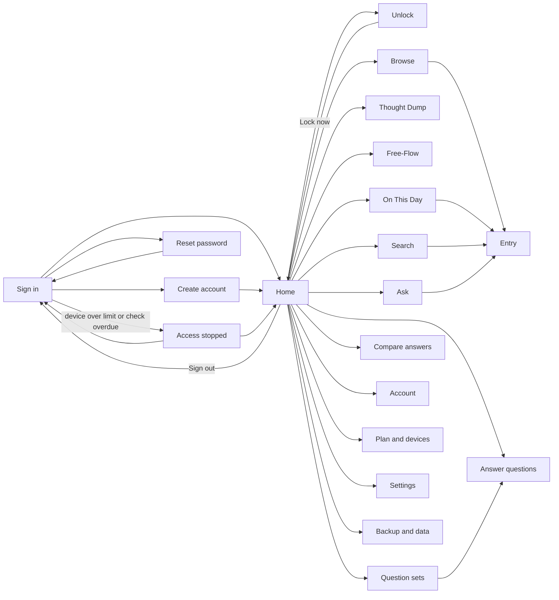

# MyDiary — UI Design

| | |
|---|---|
| App | MyDiary |
| Kind | app |
| Size | Medium |
| UI library | TrBlazeUI 2.1.9 (`TrBlazeUI.Components`, `TrBlazeUI.Icons.Lucide`) |
| Theme | both (light shown; dark through TrBlazeUI's `html.dark`) |

## Design system

- **Layout shell:** signed-in screens use `SidebarProvider` with a collapsible `Sidebar` (menu groups Journal, Write, Insights, You; Lock now and Sign out in the footer) and a `SidebarInset` holding a 64px top bar (`SidebarTrigger`, breadcrumb, search, New entry). Below 768px the sidebar is a slide-out sheet. Sign in, Create account, Reset password, Access stopped and Unlock use `CenteredPanel` with no menu.
- **Theme:** TrBlazeUI's own tokens and font stack. One brand override: `--primary` and `--ring` are a warm terracotta. Stories use a serif face for a diary feel.
- **Shared controls:** `Card`, `Item` rows for entries, `Badge` for type, plan and status, `ToggleGroup` with emoji for mood, `MultiSelect` chips for tags, `Toggle` star, `Alert` for notices, `Dialog` and `AlertDialog`, `Empty` and `Skeleton` for states, `ToastService` for confirmations, `LucideIcon` for every icon.
- **Rules:** spacing on a 4px scale (24px between sections, 16px inside cards); default density; one column below 768px, two or three above; every form control inside a `Field`; no hand-built controls.

Shared stylesheet for every mockup: [mockups/mydiary.css](mockups/mydiary.css). Shared script: [mockups/mydiary.js](mockups/mydiary.js) makes the controls behave as the app will. The theme choice in Settings (Light, Dark, System) changes every mockup page and is remembered. Switches flip, toggle groups pick one (or several where the app allows several: reminder days and the search filters), radio cards select, the drop-down opens and picks, tabs switch panels, calendar days select, the star toggles, and tag chips can be removed or added with Enter. Buttons that do not move to another screen show a message. Links never need the script.

## Screens

Every signed-in screen has the shell from Home (`app-sidebar`, `app-nav`, `top-bar`, `sidebar-trigger`, `nav-<screen>` links); the entries below list only what is particular to each screen.

### Screen: Sign in (`/signin`)

**Mockup:** [mockups/signin.html](mockups/signin.html) · **Roles:** Free user, Paid user · **BRD:** BRD-1, BRD-2, BRD-3

| Region | Control | Shows or binds |
|---|---|---|
| Brand (`brand`) | `CenteredPanel`, `TypographyH1`, `LucideIcon` book-open | App name and one line on privacy |
| Sign-in card (`signin-card`) | `Card` holding an `EditForm` | The sign-in form |
| Error (`signin-error`) | `Alert` Danger | AppManager's wrong-credentials or locked-account message |
| Email, Password (`signin-email`, `signin-password`) | `Field` + `Input` Email / Password | Credentials; the password is encrypted with AppManager's public key before sending |
| Forgot password (`signin-forgot`) | `Button` Link | Opens Reset password |
| Sign in (`signin-submit`) | `Button` Default, full width | `POST /AuthSvc/device-login`, then the licence check |
| Create account (`signin-create-account`) | `Button` Link | Opens Create account |
| Privacy line (`signin-privacy`) | `TypographyMuted` | Fixed text |

| Field | Type | Required | Validation |
|---|---|---|---|
| Email | email | yes | a valid email address |
| Password | password | yes | not empty |

**Dialogs opened here:** none.

**States:** empty: first launch shows the empty form. loading: the Sign in button shows a `Spinner` and is disabled while AppManager answers. error: wrong email or password, a locked account (15 minutes) or no connection shows in the `Alert`; a device over its limit or an overdue licence check opens Access stopped instead of Home.

### Screen: Create account (`/register`)

**Mockup:** [mockups/register.html](mockups/register.html) · **Roles:** Free user, Paid user · **BRD:** BRD-4, BRD-5, BRD-6

| Region | Control | Shows or binds |
|---|---|---|
| Brand (`brand`, `page-title`) | `CenteredPanel`, `TypographyH1`, `LucideIcon` book-open | App name and one line |
| Create card (`register-card`) | `Card` holding an `EditForm` | The create-account form |
| Email used (`register-email-used`, `register-email-used-signin`) | `Alert` Danger + `Button` Link | AppManager says the email already has an account; link opens Sign in |
| Name (`register-first-name`, `register-last-name`) | `Field` + `Input` Text | First and last name |
| Email (`register-email`) | `Field` + `Input` Email | Sign-in email |
| Password (`register-password`, `register-password-strength`, `register-password-rule`, `register-password-error`) | `Field` + `Input` Password, `PasswordStrength`, `FieldDescription`, `FieldError` | Password with live strength and the rule |
| Confirm (`register-confirm-password`, `register-confirm-error`) | `Field` + `Input` Password, `FieldError` | Must match the password |
| Create account (`register-submit`) | `Button` Default, full width | `POST /AuthSvc/register`, sign-in, licence check, then Home with an empty journal |
| Sign in link (`register-signin`) | `Button` Link | Opens Sign in |
| Privacy note (`register-privacy`) | `TypographyMuted` | Fixed text |

| Field | Type | Required | Validation |
|---|---|---|---|
| First name | text | yes | not empty, 50 characters at most |
| Last name | text | yes | not empty, 50 characters at most |
| Email | email | yes | a valid email address; not already registered |
| Password | password | yes | at least 8 characters with an uppercase letter, a digit and a symbol |
| Confirm password | password | yes | same as Password |

**Dialogs opened here:** none.

**States:** empty: the form starts blank with the strength meter at zero. loading: Create account shows a `Spinner` and is disabled while AppManager answers. error: an email already used shows the Danger `Alert` with a Sign in link; a weak or mismatched password shows a `FieldError` under the field; no connection shows "Connect to the internet to create an account".

### Screen: Reset password (`/reset-password`)

**Mockup:** [mockups/reset-password.html](mockups/reset-password.html) · **Roles:** Free user, Paid user · **BRD:** BRD-7, BRD-8

| Region | Control | Shows or binds |
|---|---|---|
| Brand (`brand`, `page-title`) | `CenteredPanel`, `TypographyH1`, `LucideIcon` lock | Title and one line |
| Step 1 (`reset-step1-card`, `reset-email`, `reset-send-code`) | `Card`, `Field` + `Input` Email, `Button` Outline | Asks AppManager to email a reset code |
| Code sent (`reset-code-sent`) | `Alert` Info | Same message whether or not the email exists |
| Step 2 (`reset-step2-card`) | `Card` holding an `EditForm` | Code and new password |
| Code error (`reset-code-error`) | `Alert` Danger | "This code has expired or is wrong" |
| Code (`reset-code`) | `Field` + `Input` Text | Six-digit code from the email |
| New password (`reset-new-password`, `reset-password-strength`, `reset-password-error`, `reset-confirm-password`) | `Input` Password, `PasswordStrength`, `FieldError` | New password and its confirmation |
| Set new password (`reset-submit`) | `Button` Default, full width | Sends code and password, then opens Sign in |
| Back (`reset-back`) | `Button` Link | Opens Sign in |

| Field | Type | Required | Validation |
|---|---|---|---|
| Email | email | yes | a valid email address |
| Reset code | text | yes | six digits |
| New password | password | yes | at least 8 characters with an uppercase letter, a digit and a symbol |
| Confirm new password | password | yes | same as New password |

**Dialogs opened here:** none.

**States:** empty: Step 1 shows a blank email and Step 2 waits for a code; the Info `Alert` appears only after Send code. loading: Send code and Set new password each show a `Spinner` while AppManager answers. error: an expired or wrong code shows the Danger `Alert`; a weak password shows a `FieldError`; no connection shows a toast.

### Screen: Access stopped (`/access-stopped`)

**Mockup:** [mockups/access-stopped.html](mockups/access-stopped.html) · **Roles:** Free user, Paid user · **BRD:** BRD-9, BRD-10, BRD-11

| Region | Control | Shows or binds |
|---|---|---|
| Brand (`brand`, `page-title`, `access-stopped-safe`) | `CenteredPanel`, `TypographyH1`, `TypographyMuted` | Title and "Your journal on this device is safe" |
| Free limit (`access-free-card`, `access-free-badge`, `access-free-other-account`) | `Card`, `Badge` Secondary, `Button` Outline | The other device's name; paid licences come from the owner; no Buy button |
| Paid limit (`access-paid-card`, `access-paid-count`, `access-paid-device`, `access-paid-how`) | `Card`, `Badge` Warning, `Item` list | "2 of 2 devices in use", the devices from AppManager, how to free a slot |
| Try again (`access-paid-try-again`, `access-paid-other-account`) | `Button` Default, `Button` Outline | Repeats device login; Home if a slot is free |
| Licence check due (`access-licence-card`, `access-licence-badge`, `access-licence-check-now`, `access-licence-other-account`) | `Card`, `Badge` Danger, `Button` Default | Days since the last check; Check now runs the licence check, then Home |

| Field | Type | Required | Validation |
|---|---|---|---|
| (none) | read-only screen | — | — |

**Dialogs opened here:** none.

**States:** empty: not applicable; exactly one of the three cards shows, picked from the refusal reason. loading: Try again and Check now show a `Spinner` while AppManager answers. error: still over the limit keeps the card with a toast "Still 2 of 2 devices in use"; Check now with no connection shows "Still offline. Connect and try again."

### Screen: Unlock (`/unlock`)

**Mockup:** [mockups/unlock.html](mockups/unlock.html) · **Roles:** Free user, Paid user · **BRD:** BRD-13, BRD-14, BRD-15, BRD-16

| Region | Control | Shows or binds |
|---|---|---|
| Brand (`brand`, `page-title`) | `CenteredPanel`, `TypographyH1`, `LucideIcon` lock | "MyDiary is locked"; no journal content is drawn before unlock |
| Unlock card (`unlock-card`) | `Card` holding an `EditForm` | The PIN form |
| Wrong PIN (`unlock-error`) | `Alert` Danger | "Wrong PIN. Try again." |
| PIN (`unlock-pin`, `unlock-pin-slot-1` … `unlock-pin-slot-4`) | `InputOTP`, 4 slots, masked | Compared with the stored PIN hash |
| Unlock (`unlock-submit`) | `Button` Default, full width | Opens Home on a match |
| Biometric (`unlock-biometric`) | `Button` Outline, Large, `LucideIcon` fingerprint | Device fingerprint or face check, then Home; hidden when not turned on |
| Forgot PIN (`unlock-forgot`, `unlock-note`) | `Button` Link, `TypographyMuted` | Opens Sign in; signing in again clears the PIN |

| Field | Type | Required | Validation |
|---|---|---|---|
| PIN | 4 digits | yes | digits only, all four slots filled |

**Dialogs opened here:** none.

**States:** empty: the four slots start blank; the biometric prompt opens by itself when turned on. loading: a `Spinner` on Unlock while the PIN is checked. error: a wrong PIN shows the Danger `Alert` and clears the slots; a failed or cancelled biometric check leaves the PIN form ready.

### Screen: Home (`/`)

**Mockup:** [mockups/home.html](mockups/home.html) · **Roles:** Free user, Paid user, Goal reviewer · **BRD:** BRD-12, BRD-17, BRD-18, BRD-19, BRD-20, BRD-21

| Region | Control | Shows or binds |
|---|---|---|
| App shell (`app-sidebar`, `app-nav`, `top-bar`, `sidebar-trigger`) | `SidebarProvider`, `Sidebar` Collapsible, `SidebarMenu`, `SidebarMenuButton`, `SidebarInset`, `SidebarTrigger` | The menu on every signed-in screen; a slide-out sheet below 768px |
| Plan badge (`sidebar-plan-badge`) | `Badge` Secondary | Free, Pro or Pro-Plus |
| Greeting (`page-title`) | `TypographyH1`, `TypographyMuted` | First name and today's date |
| Due set (`due-set-alert`, `due-set-start`) | `Alert` Info + `Button` Small | The question set due today; Start opens Answer questions |
| Write actions (`write-thought-dump`, `write-free-flow`, `write-question-sets`) | `Card` (as links) with `LucideIcon` | The three ways to write |
| On This Day card (`on-this-day-card`, `otd-preview`, `otd-years-badge`, `otd-open`) | `Card`, `Badge` Outline, `Button` Outline | Start of the latest story and the years that have one |
| Stats (`stats`, `stat-streak`, `stat-this-month`) | `StatGroup`, `StatTile` | Streak in days, entries this month |
| Today (`today-entries`, `today-entry`, `today-count`) | `Card` + `Item` list, `Badge` | Today's entries with time, type, mood, star and photo marks; a row opens Entry |
| Empty journal (`home-empty`) | `Empty` with a `Button` | Shown instead of the lists for a new journal |

| Field | Type | Required | Validation |
|---|---|---|---|
| (none) | read-only screen | — | — |

**Dialogs opened here:** none.

**States:** empty: a new journal shows `Empty` "Your journal is empty" with Start writing; no due set shows no alert. loading: `Skeleton` rows for Today and the On This Day card while the story is read from the cache or written. error: if the story cannot be written (no model yet), the card says "Stories will appear once the AI model is ready" and Today still shows.

### Screen: On This Day (`/on-this-day`)

**Mockup:** [mockups/on-this-day.html](mockups/on-this-day.html) · **Roles:** Free user, Paid user · **BRD:** BRD-22, BRD-23, BRD-24, BRD-25, BRD-26

| Region | Control | Shows or binds |
|---|---|---|
| Heading (`page-title`, `otd-date`) | `TypographyH1`, `TypographyMuted` | The day shown, "18 October, in past years" |
| Day switch (`otd-day-nav`, `otd-prev-day`, `otd-next-day`) | `ButtonGroup` of `Button` Outline Small | Moves to the day before or after; reloads the stories |
| Stories (`otd-stories`) | stack of `Card` | One card per past year with entries, newest first |
| Year story (`otd-story-2025`, `otd-year-2025`, `otd-story-text-2025`) | `Card`, `Badge` Secondary, `TypographyP` (serif) | The year and one paragraph of warm prose written by TechieRag from that day's entries; never a list |
| Around this date (`otd-around-badge`) | `Badge` Outline | "Around this date · 16 Oct" when the story uses the nearest day within three days |
| Sources (`otd-sources-2025`, `otd-sources-toggle-2025`, `otd-source-row`) | `Collapsible` with `Item` rows | "Based on 2 entries"; each row shows date, time, mood, type and opens Entry |
| Empty (`otd-empty`) | `Empty` with `Button` | No past entries on or near this date |
| Loading (`otd-loading`) | `Skeleton` | While a story is written |
| Error (`otd-error`) | `Alert` Warning | The model is not ready |
| AI note (`otd-ai-note`) | `TypographyMuted`, `LucideIcon` sparkles | "Stories are written on this device by MyDiary's built-in AI model." (names the chosen model for a paid user) |

| Field | Type | Required | Validation |
|---|---|---|---|
| (none) | read-only screen | — | — |

**Dialogs opened here:** none.

**States:** empty: a journal with no past-year entries on or around this date shows `Empty` "Nothing written on this date in past years yet. Your first story appears next year." loading: each year card shows `Skeleton` lines while its story is read from the cache or written. error: if the model is not installed or fails, the `Alert` says stories will appear once the AI model is ready, and the source entries are still listed.

### Screen: Thought Dump (`/write/dump`)

**Mockup:** [mockups/thought-dump.html](mockups/thought-dump.html) · **Roles:** Free user, Paid user · **BRD:** BRD-27, BRD-28, BRD-29, BRD-30

| Region | Control | Shows or binds |
|---|---|---|
| Heading (`page-title`) | `TypographyH1`, `TypographyMuted` | Screen name and one line of help |
| Form card (`dump-form`, `dump-time`, `dump-count`) | `Card` holding an `EditForm`, `Badge` Secondary | Today's date, time and how many lines are filled |
| Lines (`dump-lines`, `dump-line-1` … `dump-line-10`) | `Field` + ten `Input` Text, each with its number 1–10 | The ten thoughts; focus starts on line 1 |
| Enter hint (`dump-enter-hint`) | `FieldDescription` | "Press Enter to move to the next line" |
| Mood (`dump-mood`, `mood-picker`, `mood-great` … `mood-stressed`) | `ToggleGroup` Single, emoji items | Great, Good, Calm, Okay, Low, Stressed |
| Tags (`dump-tags`, `tag-chip-work`, `tag-remove-work`, `dump-tag-input`) | `MultiSelect` with `Badge` chips | Existing tags offered; new ones created on Enter |
| Empty-lines note (`dump-empty-note`) | `TypographyMuted` | "Empty lines are dropped when you save." |
| Error (`dump-error`) | `Alert` Danger | All ten lines empty |
| Actions (`dump-cancel`, `dump-save`) | `Button` Outline, `Button` Default submit | Cancel returns Home; Save stores the entry and returns Home |

| Field | Type | Required | Validation |
|---|---|---|---|
| Line 1–10 | text | at least one line | up to 280 characters each; blank lines dropped |
| Mood | single choice | no | one of six moods |
| Tags | multi-select | no | each tag 1–30 characters |

**Dialogs opened here:** none.

**States:** empty: a fresh dump shows ten empty numbered lines with focus on line 1. loading: Save shows a `Spinner` and is disabled while the entry is written. error: saving with every line empty shows the `Alert` "Write at least one line before saving."; a storage failure shows a toast and keeps the text.

### Screen: Free-Flow (`/write/free`)

**Mockup:** [mockups/free-flow.html](mockups/free-flow.html) · **Roles:** Free user, Paid user · **BRD:** BRD-31, BRD-32, BRD-33, BRD-34

| Region | Control | Shows or binds |
|---|---|---|
| Heading (`page-title`) | `TypographyH1` | Screen name |
| Form card (`free-flow-form`) | `Card` holding an `EditForm` | The entry being written or edited |
| Title, Date (`ff-title`, `ff-date`) | `Field` + `Input` Text, `DatePicker` | Optional title; date defaults to today |
| Editor (`ff-editor`, `ff-toolbar`, `ff-bold`, `ff-italic`, `ff-underline`, `ff-bullets`, `ff-numbers`, `ff-body`) | `RichTextEditor` Simple toolbar | Formatted body: bold, italic, underline, bulleted and numbered lists |
| Photos (`ff-dropzone`, `ff-file-input`, `ff-thumbs`, `ff-thumb`, `ff-thumb-remove`) | `FileUpload` Accept image/*, ShowPreview; `Button` Icon | Added photos as thumbnails, each removable |
| Photo error (`ff-photo-error`) | `Alert` Danger | "This photo is too large. Photos up to 10 MB can be added." |
| Mood (`ff-mood`, `mood-picker`) | `ToggleGroup` Single, emoji items | Six moods |
| Tags (`ff-tags`, `tag-chip-health`, `tag-remove-health`, `ff-tag-input`) | `MultiSelect` with `Badge` chips | Tags on the entry |
| Actions (`ff-cancel`, `ff-save`) | `Button` Outline, `Button` Default submit | Cancel returns Home; Save opens the saved Entry |

| Field | Type | Required | Validation |
|---|---|---|---|
| Title | text | no | up to 120 characters |
| Date | date | yes | not in the future |
| Body | rich text | yes, unless a photo is added | not empty |
| Photos | file, image/* | no | each up to 10 MB; up to 10 photos |
| Mood | single choice | no | one of six moods |
| Tags | multi-select | no | each tag 1–30 characters |

**Dialogs opened here:** none.

**States:** empty: a new entry shows an empty title, empty editor, today's date and no photos. loading: a photo shows a `Spinner` on its thumbnail while it is resized; Save shows a `Spinner` while writing. error: a photo over 10 MB or not an image shows the `Alert`; an empty body shows `FieldError` "Write something or add a photo."

### Screen: Question sets (`/questions`)

**Mockup:** [mockups/question-sets.html](mockups/question-sets.html) · **Roles:** Free user, Paid user, Goal reviewer · **BRD:** BRD-35, BRD-36, BRD-37, BRD-38

| Region | Control | Shows or binds |
|---|---|---|
| Heading (`page-title`, `qs-build`) | `TypographyH1`, `Button` Default | Opens Build question set |
| Built-in sets (`qs-builtin`, `qs-card-monthly-goals` … `qs-card-gratitude`) | grid of `Card` | The seven built-in sets, with question count and schedule |
| Built-in mark (`qs-builtin-badge`) | `Badge` Secondary | "Built-in"; these have no Delete |
| Due mark (`qs-due-badge`) | `Badge` Warning | "Due today" on a set whose schedule falls today |
| Start (`qs-start-weekly-retro` etc.) | `Button` Small | Opens Answer questions for that set |
| Compare (`qs-compare-weekly-retro` etc.) | `Button` Ghost Small | Opens Compare answers for that set |
| Your sets (`qs-mine`, `qs-card-custom`, `qs-custom-badge`, `qs-delete-custom`) | `Card`, `Badge` Outline, `Button` Ghost | User-built sets with Delete |
| No own sets (`qs-mine-empty`) | `Empty` with `Button` | Shown when the user has built none |
| Build set (`dlg-build-set`, `bs-name`, `bs-questions`, `bs-question-1`, `bs-add-question`, `bs-schedule`, `bs-save`) | `Dialog`, `Input`, `Button` Outline, `ToggleGroup` Single | Name, questions, schedule None / Weekly / Monthly on the 1st / Yearly |
| Delete set (`dlg-delete-set`, `ds-confirm`) | `AlertDialog`, `Button` Destructive | Removes the set; saved answers stay |

| Field | Type | Required | Validation |
|---|---|---|---|
| Set name | text | yes | 1–60 characters, unique among your sets |
| Question 1–20 | text | at least one | up to 200 characters each |
| Schedule | single choice | yes | None, Weekly, Monthly on the 1st, Yearly |

**Dialogs opened here:** Build question set, Delete question set.

**States:** empty: with no user-built sets, "Your sets" shows `Empty` "No sets of your own yet"; built-in sets always show. loading: `Skeleton` cards while sets and due dates load. error: saving a set without a name or question shows `FieldError` "Add a name and at least one question." in the dialog.

### Screen: Answer questions (`/questions/answer`)

**Mockup:** [mockups/answer-questions.html](mockups/answer-questions.html) · **Roles:** Free user, Paid user, Goal reviewer · **BRD:** BRD-39, BRD-40

| Region | Control | Shows or binds |
|---|---|---|
| Breadcrumb (`breadcrumb`) | `Breadcrumb` | Write / Question sets / set name |
| Heading (`page-title`, `aq-period`) | `TypographyH1`, `TypographyMuted` | Set name and the period it covers, e.g. "Week of 12–18 October 2026" |
| Progress (`aq-progress`, `aq-progress-label`, `aq-due-badge`) | `Progress`, `Badge` Warning | "3 of 5 answered"; due mark |
| Questions (`aq-question-1` … `aq-question-5`, `aq-answer-1` … `aq-answer-5`) | `Field` + `FieldLabel` + `Textarea` per question | Each question with its own answer box |
| Mood (`aq-mood`, `mood-picker`) | `ToggleGroup` Single, emoji items | Six moods |
| Save note (`aq-save-note`) | `TypographyMuted` | "Your answers are saved as one entry, marked Weekly Retro." |
| Error (`aq-error`) | `Alert` Danger | No question answered |
| Actions (`aq-cancel`, `aq-save`) | `Button` Outline, `Button` Default submit | Cancel returns to Question sets; Save stores one entry and returns Home |

| Field | Type | Required | Validation |
|---|---|---|---|
| Answer 1–n | textarea | at least one | up to 4,000 characters each |
| Mood | single choice | no | one of six moods |

**Dialogs opened here:** none.

**States:** empty: a new answer sheet shows every question with an empty `Textarea` and "0 of 5 answered". loading: `Skeleton` fields while the set loads; Save shows a `Spinner`. error: saving with no answers shows the `Alert` "Answer at least one question before saving."; a set deleted meanwhile returns to Question sets with a toast.

### Screen: Browse (`/browse`)

**Mockup:** [mockups/browse.html](mockups/browse.html) · **Roles:** Free user, Paid user · **BRD:** BRD-41, BRD-42, BRD-43

| Region | Control | Shows or binds |
|---|---|---|
| App shell (`app-sidebar`, `top-bar`) | `SidebarProvider`, `Sidebar`, `SidebarInset`, `SidebarTrigger` | Browse is the active menu item |
| Title (`page-title`) | `TypographyH1` | Fixed text |
| View tabs (`browse-tabs`, `browse-tab-timeline`, `browse-tab-calendar`) | `Tabs` (`TabsList`, `TabsTrigger`, `TabsContent`) | Timeline or Calendar; the last tab used is remembered |
| Timeline (`browse-timeline-panel`, `timeline-day-heading`, `timeline-entry`) | `TypographyMuted` day headings + `Item` list | Entries newest first, grouped by day; time, type `Badge` (`timeline-entry-type`), mood emoji, star (`timeline-entry-star`), photo icon (`timeline-entry-photo`), tag `Badge` Outline (`timeline-entry-tag`); a row opens Entry |
| Calendar (`browse-calendar-panel`, `browse-calendar`, `calendar-prev`, `calendar-next`, `calendar-month`) | `Calendar`, `Button` Ghost Icon | One month; a dot on days with entries; today outlined; tapped day selected (`calendar-day-selected`, `calendar-day-today`) |
| Selected day (`calendar-day-heading`, `calendar-day-entry`, `calendar-day-empty`) | `Item` list, `TypographyMuted` | That day's entries; a row opens Entry |
| Empty (`browse-empty`) | `Empty` with `Button` | No entries yet; links to Thought Dump |
| Error (`browse-error`) | `Alert` Danger | The journal could not be read |

| Field | Type | Required | Validation |
|---|---|---|---|
| (none) | read-only screen | — | — |

**Dialogs opened here:** none.

**States:** empty: a new journal shows `Empty` "No entries yet"; a calendar day with nothing written shows "Nothing written on this day." loading: `Skeleton` rows while the next page of the timeline loads as the user scrolls. error: a failed journal read shows the `Alert` and keeps the tabs. Library gap: TrBlazeUI `Calendar` cannot mark days that have entries; the dot (`.day.has`) is the intended design, reported upstream.

### Screen: Entry (`/entry`)

**Mockup:** [mockups/entry.html](mockups/entry.html) · **Roles:** Free user, Paid user · **BRD:** BRD-44, BRD-45, BRD-46, BRD-47, BRD-48, BRD-49

| Region | Control | Shows or binds |
|---|---|---|
| Navigation (`entry-back`, `entry-prev`, `entry-next`) | `Button` Ghost, `Button` Outline Small | Back to Browse; older and newer entry |
| Entry card (`entry-card`, `entry-date`, `entry-type-badge`, `page-title`) | `Card`, `Badge` Outline, `TypographyH1` | Date and time, type (Free-Flow, Thought Dump or set name), title |
| Actions (`entry-actions`, `entry-star`, `entry-edit`, `entry-delete`) | `Toggle` Icon (star), `Button` Outline | Star on or off; Edit opens Free-Flow; Delete opens Delete entry |
| Body (`entry-body`) | rendered `RichTextEditor` HTML | Formatted text, the ten lines, or questions with answers |
| Photos (`entry-photos`, `entry-photo`) | thumbnail images | Photos on the entry |
| Mood (`entry-mood`, `mood-picker`) | `ToggleGroup` Single, emoji items | Current mood; changing it saves at once |
| Tags (`entry-tags`, `tag-chip-health`, `tag-remove-health`, `entry-tag-input`) | `MultiSelect` with removable `Badge` chips | Tags; add or remove saves at once |
| Error (`entry-error`) | `Alert` Danger | Entry not found |
| Delete entry (`dlg-delete-entry`, `de-cancel`, `de-confirm`) | `AlertDialog`, `Button` Destructive | Deletes and returns to Browse |

| Field | Type | Required | Validation |
|---|---|---|---|
| Star | toggle | no | on or off |
| Mood | single choice | no | one of six moods |
| Tags | multi-select | no | each tag 1–30 characters |

**Dialogs opened here:** Delete entry.

**States:** empty: an entry with no photos, mood or tags hides those rows; no previous or next entry disables that button. loading: `Skeleton` lines for the body while the entry loads. error: an entry deleted on another device shows the `Alert` "Entry not found" with a link back to Browse; a failed star, mood or tag save shows a toast and reverts.

### Screen: Search (`/search`)

**Mockup:** [mockups/search.html](mockups/search.html) · **Roles:** Free user, Paid user · **BRD:** BRD-50, BRD-51, BRD-52, BRD-53, BRD-54, BRD-55, BRD-56, BRD-57

| Region | Control | Shows or binds |
|---|---|---|
| Title (`page-title`) | `TypographyH1` | Fixed text |
| Keyword (`search-keyword-group`, `search-keyword`) | `InputGroup` + `Input` Search, `LucideIcon` search | Words to find; searches as the user types |
| Filters (`search-filters`, `search-clear-filters`) | `Card`, `Button` Ghost Small | All filters; Clear filters resets them |
| Dates (`filter-date-range`, `filter-date-from`, `filter-date-to`) | `DateRangePicker` | Entry date from–to |
| Tags (`filter-tags`, `filter-tag-chip`) | `MultiSelect` | Tags the user has used |
| Question set (`filter-question-set`) | `ToggleGroup` Multiple | Monthly Goals, Weekly Retro, Health, Fitness, Gratitude… |
| Has photo, Starred (`filter-has-photo`, `filter-starred`) | `Switch` | Only entries with a photo / a star |
| Mood (`filter-mood`) | `ToggleGroup` Multiple | The six mood emoji |
| Results (`search-results`, `search-result-count`, `search-result`) | `Badge`, `Item` list | Count, then matches with the word highlighted; a row opens Entry |
| Ask link (`search-ask-link`) | `Button` Link | Opens Ask |
| No results (`search-empty`, `search-empty-clear`) | `Empty` + `Button` Outline | "No entries match. Try fewer filters." |
| Error (`search-error`) | `Alert` Danger | Search failed |

| Field | Type | Required | Validation |
|---|---|---|---|
| Keyword | search | no | up to 200 characters |
| From, To | date | no | From is not after To |
| Tags | multi-select | no | existing tags only |

**Dialogs opened here:** none.

**States:** empty: no matches shows `Empty` "No entries match. Try fewer filters." with Clear filters; no keyword and no filters lists recent entries. loading: `Skeleton` rows while the search runs. error: a failed search shows the `Alert`; filters keep their values.

### Screen: Ask (`/ask`)

**Mockup:** [mockups/ask.html](mockups/ask.html) · **Roles:** Free user, Paid user, Goal reviewer · **BRD:** BRD-58, BRD-59, BRD-60

| Region | Control | Shows or binds |
|---|---|---|
| Title (`page-title`) | `TypographyH1`, `TypographyMuted` | Fixed text |
| Privacy (`ask-privacy-alert`) | `Alert` Info | "Ask reads only your journal on this device." |
| Question (`ask-question-card`, `ask-question`, `ask-submit`) | `Card`, `Field` + `Textarea`, `Button` Default | The question; Ask sends it to TechieRag with the chosen model |
| Examples (`ask-examples`, `ask-example`) | `Button` Outline Small | Fills the question box |
| Answer (`ask-answer-card`, `ask-answer-count`, `ask-answer-text`) | `Card`, `TypographyH2` | The counted number and one sentence |
| Model label (`ask-model-label`) | `TypographyMuted` | Which model answered, e.g. "built-in model (Qwen 0.5B)" |
| Sources (`ask-sources`, `ask-sources-count`, `ask-source`) | `Card` + `Item` list, `Badge` | Each entry counted, its date, the matched sentence and how many it added; a row opens Entry |
| Compare link (`ask-compare-link`) | `Button` Link | Opens Compare answers |
| No match (`ask-no-match`, `ask-no-match-search`) | `Card`, `Button` Outline | "No entries mention that. MyDiary did not guess a number." |
| Error (`ask-error`) | `Alert` Danger | The model did not start or the online service refused |

| Field | Type | Required | Validation |
|---|---|---|---|
| Question | textarea | yes | 3 to 500 characters |

**Dialogs opened here:** none.

**States:** empty: before the first question only the box and examples show; no matching entry shows the no-match `Card` and never a number. loading: the Ask button shows a `Spinner` and a `Skeleton` answer reads "Reading your entries…". error: the `Alert` explains a model or service failure; the question is kept.

### Screen: Compare answers (`/compare`)

**Mockup:** [mockups/compare.html](mockups/compare.html) · **Roles:** Free user, Paid user, Goal reviewer · **BRD:** BRD-61, BRD-62, BRD-63

| Region | Control | Shows or binds |
|---|---|---|
| Title (`page-title`) | `TypographyH1` | Fixed text |
| Controls (`compare-controls`) | `Card` | The choices below |
| Question set (`compare-set`) | `ToggleGroup` Single | Sets the user has answered |
| Question (`compare-question`, `compare-question-trigger`, `compare-question-options`) | `Select` | The chosen set's questions |
| By (`compare-by`) | `ToggleGroup` Single | By month or By year |
| Period (`compare-period`, `compare-period-from`, `compare-period-to`) | `DateRangePicker` (month) | First and last month shown |
| Comparison (`compare-results`, `compare-table-wrap`, `compare-table`, `compare-col-head`, `compare-row`, `compare-cell`) | `Table` | One column per month; the answer in each cell; a header opens that Entry; scrolls sideways on phones |
| Missing answer (`compare-no-answer`) | `TypographyMuted` | "No answer" for a month not answered |
| By year (`compare-by-year`, `compare-year-table`) | `Table` | Yearly Review answers per year |
| Empty (`compare-empty`) | `Empty` + `Button` | "Answer this set at least twice to compare." |
| Error (`compare-error`) | `Alert` Danger | Answers could not be read |

| Field | Type | Required | Validation |
|---|---|---|---|
| Question set | toggle | yes | one set |
| Question | select | yes | a question in that set |
| Period from, to | month | yes | from is not after to; at most 24 columns |

**Dialogs opened here:** none.

**States:** empty: a set answered fewer than twice shows `Empty` with a link to Question sets. loading: a `Skeleton` table while answers load. error: the `Alert` shows and the controls keep their values.

### Screen: Account (`/account`)

**Mockup:** [mockups/account.html](mockups/account.html) · **Roles:** Free user, Paid user · **BRD:** BRD-64, BRD-65, BRD-66, BRD-67, BRD-68, BRD-69, BRD-70, BRD-71

| Region | Control | Shows or binds |
|---|---|---|
| App shell (`app-sidebar`, `breadcrumb`) | `Sidebar`, `Breadcrumb` | "You / Account", Account active |
| Profile (`profile-card`, `profile-first-name`, `profile-last-name`, `profile-mobile`, `profile-email`, `profile-save`) | `Card`, `Field` + `Input` Text / Email (read-only), `Button` Default | AppManager profile; Save shows "Profile saved" |
| Change password (`password-card`, `password-current`, `password-new`, `password-strength`, `password-confirm`, `password-save`, `password-note`, `password-error`) | `Card`, `Input` Password, `PasswordStrength`, `Alert` Danger | Changes the password, then opens Sign in |
| Report a problem (`report-card`, `report-open`) | `Card`, `Button` Outline | Opens the report dialog |
| Account data (`account-data-card`, `account-data-copy`, `account-data-delete`, `account-data-export-link`) | `Card`, `Button` Outline / Ghost, `Button` Link | Copy request; deletion dialog; link to Backup and data |
| Sign out (`signout-card`, `account-sign-out`) | `Card`, `Button` Outline | Signs out, opens Sign in |

| Field | Type | Required | Validation |
|---|---|---|---|
| First name, Last name | text | yes | not empty, 50 characters at most |
| Mobile number | tel | no | digits, spaces and a leading + |
| Current password | password | yes | not empty |
| New password, Confirm | password | yes | the password rule; both match |
| Subject, What happened | text, textarea | yes | not empty; 2,000 characters at most |
| Confirm email | email | yes | equals the account email |

**Dialogs opened here:** `dlg-report` (subject, what happened, "What is sent" list; Send gives the report number), `dlg-delete-data` (AlertDialog; type your email, Destructive confirm).

**States:** empty: a blank mobile number shows an empty field. loading: `Skeleton` fields while the profile loads; a `Spinner` on each button while AppManager answers. error: a wrong current password shows the Danger `Alert`; no connection disables the cards with a toast "Connect to the internet to change your account".

### Screen: Plan and devices (`/account/devices`)

**Mockup:** [mockups/plan-devices.html](mockups/plan-devices.html) · **Roles:** Free user, Paid user · **BRD:** BRD-72, BRD-73, BRD-74, BRD-75, BRD-76, BRD-77, BRD-78, BRD-79

| Region | Control | Shows or binds |
|---|---|---|
| App shell (`app-sidebar`, `breadcrumb`) | `Sidebar`, `Breadcrumb` | "You / Plan and devices" |
| Licence ended (`licence-ended-alert`) | `Alert` Warning | Shown once after a paid licence ends |
| Plan (`plan-card`, `plan-badge`, `plan-ends`, `plan-licence-key`, `plan-device-note`, `plan-pro-plus-note`) | `Card`, `Badge` Default | Licence name, end date, masked key, devices allowed (Pro 2, Pro-Plus from the licence) |
| Free plan (`plan-card-free`, `plan-badge-free`) | `Card`, `Badge` Secondary | "Free — one device"; no Buy button |
| Devices (`devices-card`, `devices-count-badge`, `devices-progress`) | `Card`, `Badge` Warning, `Progress` | "2 of 2 devices in use" |
| Device table (`devices-table`, `device-row`, `device-status`) | `Table`, `Badge` Info / Success / Danger | Name, type and system, last seen, status |
| Row actions (`device-forget`, `device-block`, `device-unblock`) | `Button` Outline / Ghost, Small | Not on this device's row |

| Field | Type | Required | Validation |
|---|---|---|---|
| (none) | read-only screen with row actions | — | — |

**Dialogs opened here:** `dlg-forget` (signs the device out, frees a slot), `dlg-block` (AlertDialog, Destructive confirm).

**States:** empty: a free account lists only this device. loading: `Skeleton` rows while AppManager lists devices. error: no connection shows the plan from the last licence check and a toast "Can't load devices offline"; Forget or Block failing shows a toast and leaves the row.

### Screen: Settings (`/settings`)

**Mockup:** [mockups/settings.html](mockups/settings.html) · **Roles:** Free user, Paid user · **BRD:** BRD-80, BRD-81, BRD-82, BRD-83, BRD-84, BRD-85

| Region | Control | Shows or binds |
|---|---|---|
| Title, tabs (`page-title`, `settings-tabs`, `settings-tab-ai`, `settings-tab-lock`, `settings-tab-reminders`) | `TypographyH1`, `Tabs` | AI model, Lock, Reminders |
| AI model (`settings-ai-card`, `ai-model-choice`, `ai-model-builtin`, `ai-model-larger`, `ai-model-online`, `ai-model-save`) | `Card`, `RadioGroup` (card style), `Button` | Built-in (default), Phi-3 mini, online service; Save switches TechieRag's model |
| Free plan (`ai-model-free-plan`, `ai-model-locked-badge`) | `Badge` Warning, `LucideIcon` lock | The two paid choices locked, "Needs a paid licence" |
| Online service (`ai-online-fields`, `ai-online-service`, `ai-online-key`, `ai-online-key-error`, `ai-online-use`) | `ToggleGroup` Single, `Input` Password, `FieldError`, `Button` Outline | Service and the user's own key; Use opens the warning |
| Lock (`settings-lock-card`, `lock-pin-switch`, `lock-change-pin`, `lock-biometric-switch`) | `Card`, `Switch`, `Button` Outline Small | PIN lock, Change PIN, fingerprint or face |
| Reminders (`settings-reminders-card`, `reminder-switch`, `reminder-time`, `reminder-days`, `reminder-message`, `reminder-save`) | `Switch`, `TimePicker`, `ToggleGroup` Multiple, `Input`, `Button` | Daily reminder |
| Appearance (`settings-appearance-card`, `appearance-theme`) | `ToggleGroup` Single | Light, Dark, System |

| Field | Type | Required | Validation |
|---|---|---|---|
| AI model | radio | yes | paid choices need a paid licence |
| API key | password | yes for online | not empty; checked with the service |
| PIN, confirm PIN | 6-digit OTP | yes when lock on | digits only; both the same |
| Reminder time | time | yes when on | — |
| Days | toggle multiple | yes when on | at least one day |
| Message | text | no | up to 60 characters |

**Dialogs opened here:** Online AI warning (`dlg-online-warning`: `Checkbox` I understand, Cancel, Send my journal text), Set PIN (`dlg-set-pin`: two `InputOTP`).

**States:** empty: a free user sees only the built-in model chosen and the paid choices locked; no PIN set shows the switch off. loading: a `Progress` bar while Phi-3 mini downloads (`settings-loading`). error: a rejected API key shows in `FieldError`; PINs that differ show under the confirm box.

### Screen: Backup and data (`/backup`)

**Mockup:** [mockups/backup.html](mockups/backup.html) · **Roles:** Free user, Paid user · **BRD:** BRD-86, BRD-87, BRD-88, BRD-89, BRD-90, BRD-91, BRD-92

| Region | Control | Shows or binds |
|---|---|---|
| Title (`page-title`) | `TypographyH1` | Fixed text |
| Backup and sync (`backup-sync-card`) | `Card` | Paid features |
| Free plan (`backup-free-plan`) | `Alert` Warning | "Backup and sync need a paid licence…"; no Buy button |
| Service (`backup-service`, `backup-service-status`, `backup-last`, `backup-now`) | `Item`, `Badge` Success, `Button` Small | Google Drive account, last backup time, Back up now |
| OneDrive (`backup-onedrive`, `backup-connect-onedrive`) | `Button` Outline Small | Connect a second service |
| Sync (`sync-row`, `sync-switch`, `sync-devices`, `sync-last`) | `Switch`, `Badge` Outline | Sync on/off, devices, last sync |
| Restore (`restore-row`, `restore-open`) | `Button` Outline Small | Opens Restore journal |
| Backup error (`backup-error`) | `Alert` Danger | Cloud not reachable |
| Export and import (`export-import-card`, `export-row`, `export-button`) | `Card`, `Button` Outline | Saves a JSON file |
| Import (`import-format`, `import-file`, `import-choose`, `import-error`, `import-progress`, `import-button`) | `ToggleGroup` Single, `FileUpload` (Accept ".json,.zip"), `FieldError`, `Progress`, `Button` | MyDiary file or Day One export; imports and reports skipped duplicates |

| Field | Type | Required | Validation |
|---|---|---|---|
| Import format | toggle | yes | one choice |
| Import file | file | yes | .json or .zip; must parse as the chosen format |
| Backup to restore | radio | yes | one backup |

**Dialogs opened here:** Restore journal (`dlg-restore`: `RadioGroup` of backups, warning, Cancel, Restore).

**States:** empty: a free user sees the warning `Alert` and export/import only; no connected service shows Connect buttons. loading: Back up now and Import show a `Spinner`; the import shows a `Progress` bar. error: a failed backup shows the `Alert`; a wrong file shows `FieldError`.

## Click-through flow

The mockups open from [mockups/signin.html](mockups/signin.html). Every link is a plain link, so the set clicks through in any viewer.

## Branding guide

TrBlazeUI's stock palette is grey. MyDiary overrides three tokens in its `theme.css` for a warm, personal feel: `--primary` and `--ring` become terracotta (`oklch(.56 .13 42)` in light, `oklch(.72 .12 48)` in dark), and `--sidebar-accent` becomes a pale sand (`oklch(.95 .025 60)`). On This Day stories use a serif face (Georgia, then the system serif). Every other token, the font stack, radius (10px) and spacing are TrBlazeUI's defaults.
