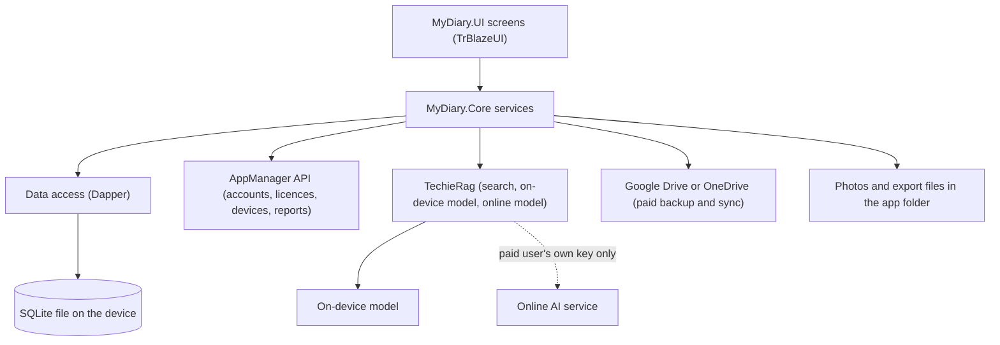
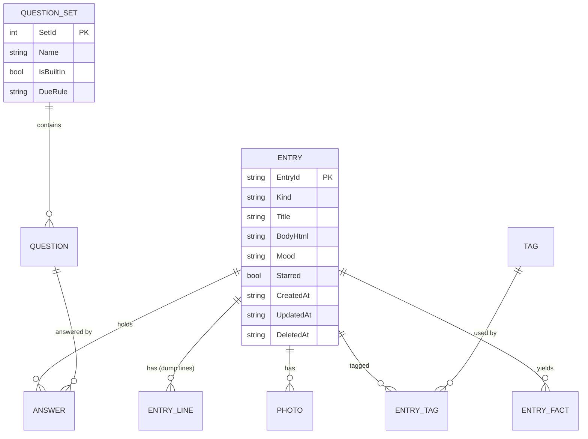

# MyDiary — Architecture

| | |
|---|---|
| App | MyDiary |
| Kind | app |
| Size | Medium |
| Stack answer set | dotnet |
| Date | 2026-10-25 |

## 1. Stack decisions

One row per stack question. "Source" says where the answer came from. Where the brief was silent the answer set's default was taken; where the brief or the nature of the app overrides the default, the row says so.

| Q | Topic | Decision | Source |
|---|---|---|---|
| Q1 | Configuration | Non-secret settings live in `appsettings.json`, layered by `appsettings.{Environment}.json`, shipped inside the app package. No other configuration mechanism. The AppManager installed-app key (`pk_live_…`) has no secret half and is meant to ship in the app, so it sits here, not in user secrets. | answer set: dotnet; key placement from the AppManager API guide §2.1.1 |
| Q2 | Secrets in development | Project user secrets, never committed; `secrets.example.json` lists every key. MyDiary has few: none for AppManager (the installed-app key is public). A paid user's own online-AI key is entered in the app and kept in the device's secure storage, never in a file of the journal and never in a backup. | answer set: dotnet; secure-storage rule added by owner brief (journal text and keys stay on the device) |
| Q3 | Database | **SQLite, one file per user on the device.** The answer set's PostgreSQL in Docker cannot run on a phone, and the brief says MyDiary has no server of its own, so this answer is replaced for this app. The file lives in the app's private data folder. TechieRag keeps its own search index in the same folder (`DataRoot`). | owner brief ("no server of its own", "everything stays on that device"); override of the answer set, recorded here |
| Q4 | Authentication | **AppManager**, through its installed-app key and a stable per-installation device id. Accounts, sign-in, devices, licences, problem reports and account-data requests all go through it. | owner brief ("Fixed choices") |
| Q5 | Logging | Serilog, with file logging wired at startup before anything else can fail. Log files go in a `logs` folder inside the app's private data folder on a device, and under the build output folder (`bin/`) in development. Journal text is never logged. | answer set: dotnet |
| Q6 | Tests | xUnit; the test project exists from day one. Unit tests cover the Core library; screens are tested through the shared UI library (see the Decisions log). | answer set: dotnet |
| Q7 | Layout and naming | `src/` and `tests/` at the root. The primary executable project is `MyDiary`. Secondary projects take a descriptive suffix. | answer set: dotnet |
| Q8 | User interface | TrBlazeUI for every screen, icons from `TrBlazeUI.Icons.Lucide`. Rendering mode: **MAUI Blazor Hybrid**, one set of screens drawn in the app's web view on Android, iPhone, iPad, Windows and Mac. No server rendering. | answer set: dotnet; default chosen and recorded because the brief requires one set of screens on five device kinds and no server |
| Q9 | Hosting | Not applicable: MyDiary is installed on devices and has no server. Store publishing is decided at the go-ahead for user acceptance testing. | answer set: dotnet; adapted |
| Q10 | Production secrets | Not yet asked (production). | answer set: dotnet |
| Q11 | Standing rules | 1. No NuGet package without a line in the Decisions log saying why. 2. No second configuration mechanism. 3. When TechieFlow, TrBlazeUI, TechieRag, AppManager or another internal library lacks something, record it in that library's feedback file and hold the feature; never write a workaround. 4. Data access is always Dapper. 5. Migrations live in `MyDiaryDb`, using DbUp, and run when the app starts. 6. Log files are written under the build output folder, never at the repository root. 7. No unnecessary folders at the repository root; everything is under `src/` or `tests/`. 8. MyDiary writes no AI code of its own: every AI feature goes through TechieRag. | answer set: dotnet (1 to 7); owner brief (8) |

Required packages: `TrBlazeUI.Components`

## 2. Solution structure

| Project | Kind | Purpose |
|---|---|---|
| `MyDiary` | MAUI Blazor Hybrid app | The primary head. Starts the app, wires services, hosts the screens in the web view, holds platform code (secure storage, fingerprint and face unlock, notifications, file pickers). |
| `MyDiary.UI` | Razor class library | Every screen and shared component, built with TrBlazeUI. Kept separate so the screens can be tested in a plain browser without a phone. |
| `MyDiary.Core` | class library | Journal rules and services: entries, question sets, search, streaks, plan and device rules, backup and sync, import and export, and the TechieRag calls. No UI. |
| `MyDiaryDb` | migrations library | DbUp scripts that create and upgrade the SQLite file. |
| `MyDiary.Tests` | xUnit test project | Unit tests for Core and UI components. |

## 3. Component map

**How a request travels** (one typical request: the user asks "how many coffee bottles did I open last year?"; per-screen detail is in the DevGuide):
1. The Ask page sends the question text to the Ask service in Core.
2. The service asks TechieRag to find entries from last year that mention coffee bottles, using the search index kept next to the journal file.
3. For each entry found, TechieRag runs the chosen model (on-device by default) to pull out the count as structured data. The service adds the counts up itself in code, so the total is never a guess.
4. The page shows the total and the list of entries used. When no entry matches, it says so and shows no number.

## 4. Data model

| Entity | Key fields | Notes |
|---|---|---|
| Entry | `EntryId` (a GUID, so devices never clash), kind (dump, free-flow, questions), title, body, mood, starred, created, updated, deleted | One journal per person, so no journal table. A deleted entry keeps a marker so sync can carry the deletion. |
| EntryLine | entry, position, text | The ten numbered lines of a dump; empty lines are never saved. |
| Photo | entry, file name, position | File kept in the app folder; the row holds the name only. |
| Tag, EntryTag | name; entry and tag | Free text tags. |
| QuestionSet, Question | set name, built-in flag, due rule; question text, position | Seven built-in sets plus the user's own. A due rule such as "day 1 of the month" drives the suggestion. |
| Answer | entry, question, text | One row per answered question. |
| EntryFact | entry, subject, quantity, unit | Counts pulled out by the model for Ask; rebuilt when the entry changes. |
| Reminder | time, days, on or off | Local reminders. |
| Setting | key, value | Lock method, chosen model, last licence check date, device id. Secrets are not stored here. |
| LicenceCache | key, name, device limit, expiry, last online check | Lets the app work offline for 30 days. |

## 5. Cross-cutting

- **Identity:** AppManager API with the installed-app key (`X-Api-Key` plus `X-Device-Id`, no secret). Passwords are encrypted with the server's public key before sending, as the API requires. The licence check returns the licence key and name; "Pro" allows 2 devices, "Pro-Plus" the number set on the licence, and no paid licence means free. The result is cached so the app keeps working offline for up to 30 days.
- **Configuration:** `appsettings.json` and `appsettings.{Environment}.json` only.
- **Logging:** Serilog to a rolling file under the app's log folder. Entry text, answers and keys are never written to a log.
- **Errors:** Services return plain-language messages; screens show them in an alert or a toast. A refused second device or over-limit device shows the message the brief asks for, naming the paid licence or how to free a slot.
- **Privacy:** Journal text never leaves the device except in a paid user's own backup folder, or to an online AI service the paid user chose after a warning. AppManager receives accounts, devices, licences, reports and data requests only.
- **Offline:** Every journal feature works with no network. Only sign-in, licence checks, reports, data requests and backup need one.
- **Platforms:** Android, iPhone, iPad, Windows and Mac Catalyst from the one MAUI head.

## 6. Decisions log

Every package has a row saying why.

| Date | Decision | Why | Status |
|---|---|---|---|
| 2026-10-24 | SQLite instead of PostgreSQL | No server; data must stay on the device (Q3). | decided |
| 2026-10-24 | Package `Microsoft.Data.Sqlite` | Opens the SQLite file for Dapper. | decided |
| 2026-10-24 | Package `Dapper` | Standing rule 4. | decided |
| 2026-10-24 | Package `dbup-sqlite` | Standing rule 5: migrations in `MyDiaryDb`. | decided |
| 2026-10-24 | Package `Serilog` with the file sink | Logging answer (Q5). | decided |
| 2026-10-24 | Package `TrBlazeUI.Components` and `TrBlazeUI.Icons.Lucide` | Mandated UI library (Q8). | decided |
| 2026-10-24 | Packages `TechieRag`, `TechieRag.Embedded`, `TechieRag.Local` | All AI is done through TechieRag: search and embeddings, the on-device model, the online-service routes. | decided |
| 2026-10-24 | Package `xunit` | Tests answer (Q6). | decided |
| 2026-10-24 | Google Drive and OneDrive access libraries chosen at build time, one line each added here | Paid backup and sync (BRD items on the Backup screen). | planned |
| 2026-10-24 | Screens live in `MyDiary.UI`, apart from the MAUI head | Lets the verifier open every screen in a plain browser. | decided |
| 2026-10-24 | A request for a copy of the user's account data cannot be sent from the app yet | AppManager allows only a server key to call the data-export request; filed in `docs/MyDiary-AppManager-Feedback.md`. The matching BRD item is held. | planned |
| 2026-10-24 | The smallest on-device model is downloaded on first launch, not packed in the app | TechieRag never packs model weights and asks the user to accept the model's terms. The brief says "installed with the app". | planned |

## 7. Module responsibilities

| Module | Responsibility | Depends on |
|---|---|---|
| Account service | Register, sign in, sign out, reset password, profile, change password, data request, account deletion request. | AppManager API |
| Licence and device service | Licence check, plan and device list, forget and block a device, 30-day offline rule, free-plan one-device rule. | AppManager API, LicenceCache |
| Journal service | Create, edit, delete, star, tag and mood entries; dump lines; photos. | Data access |
| Question set service | Built-in and custom sets, answers, the due-today suggestion. | Data access |
| Home service | Today's entries, streak count, the On This Day card. | Journal service, Story service |
| Story service | Writes the warm per-year story for On This Day through TechieRag. | TechieRag |
| Search service | Keyword search and filters by date, tag, set, photo, star and mood. | Data access, TechieRag |
| Ask service | Finds entries, has the model pull out facts, counts them in code, lists sources, refuses when nothing matches. | TechieRag, Data access |
| Compare service | One question's answers side by side across months or years. | Data access |
| Model service | Lists on-device and online choices, stores an online key in secure storage, shows the privacy warning. | TechieRag, secure storage |
| Backup and sync service | Back up, sync between devices, restore, through Google Drive or OneDrive. | Cloud libraries, Data access |
| Import and export service | JSON export, JSON import, Day One import. | Data access |
| Lock and reminder service | PIN, fingerprint or face unlock, local reminders. | Platform code |
| Report service | Sends a problem report. | AppManager API |

## 8. Open questions

- **Rendering mode** (Q8) was not stated in the brief; the answer-set default was applied as MAUI Blazor Hybrid because five device kinds and no server require a shared installed UI.
- **On-device model** wording: the brief says the smallest model is "installed with the app"; TechieRag downloads it once on first launch after the user accepts its terms. The free path then works offline. Please confirm this is acceptable.
- **Data copy request** is held until AppManager lets an installed app send it (see the feedback file).
- **Backup and sync** design detail (which Google Drive and OneDrive libraries, how two devices that changed the same entry are merged) is settled at build time. The starting rule is: the newest change to an entry wins, deletions are kept as markers.
- **AppManager guide** the brief names (`docs/AppManager-api-usage-guide.md`) is not in this project's `docs` folder; version 1.7 was read from the AppManager project.
