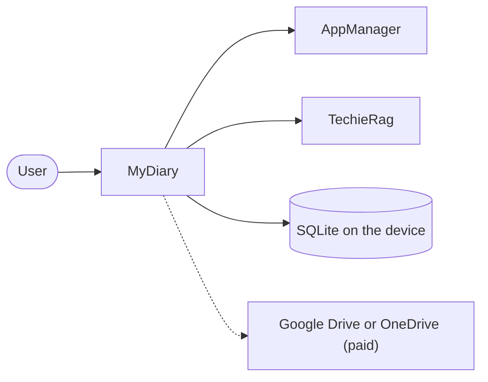

# MyDiary — Business Requirements

| | |
|---|---|
| App | MyDiary |
| Kind | app |
| Size | Medium |
| Stack answer set | dotnet |
| Status | Draft |
| Date | 2026-10-25 |

## 1. Summary

MyDiary is a private journaling app for phone, tablet and computer. Each person keeps one journal and can write it three ways: a 10-Thought Dump, a Free-Flow entry with formatting and photos, or Targeted Questioning sets such as Monthly Goals or Gratitude. Opening the app shows a short, warm story of what was written on this date in past years. A person can ask plain questions about their past, such as how many coffee bottles they opened last year, and get a counted answer that lists the entries it used. It is free on one device. A paid licence adds backup, use on several devices and a choice of AI model. Accounts, devices, licences, problem reports and data requests go through AppManager; all AI goes through TechieRag; MyDiary has no server of its own.

## 2. Scope

**In:**
- Account creation, sign-in, password reset, profile, password change, problem reports, data-copy and deletion requests, all inside the app.
- One journal per person with three ways to write, tags, stars and moods, a timeline and calendar, search and filters.
- On This Day stories, plain-words questions with counted answers, and side-by-side comparison of answers.
- Free plan on one device; paid plans (Pro: 2 devices, Pro-Plus: the number on the licence) with backup, sync, restore and a choice of AI model.
- JSON export and import, including a Day One export; PIN or fingerprint or face lock; reminders.
- The same screens on Android, iPhone, iPad, Windows and Mac.

**Out:**
- The purchase and landing page: a separate MyDiary web app in phase 2. Until then the admin assigns paid licences in AppManager and MyDiary has no Buy button.
- Taking payment inside the app, and app-store purchases.
- More than one journal, shared journals, and family groups sharing one licence.
- Sending journal text anywhere for a free user. Online AI only happens when a paid user enters their own key.
- iCloud, Dropbox and any other sync service.
- Map view, voice transcription, widgets, handwriting, sharing an entry as an image.

## 3. Users and roles

| Role | Who they are | What they need |
|---|---|---|
| User | Anyone with a MyDiary account. Free on one device, or paid on several. The screens are the same; paid features switch on from the licence. A goal reviewer is a user who runs monthly, yearly, health, fitness or project reviews and compares the answers over time. | Write privately, find and ask about the past, keep the journal safe, and (paid) back it up and choose the AI model. |
| Owner (admin) | The person who runs MyDiary. | Assigns paid licences and reads problem reports on the AppManager site. Does nothing inside MyDiary, so has no screens here. |

## 4. Screens and flow

One row per routed page. A dialog is a row under its parent screen with `on /route` in the Route column; it is not counted as a screen.

| Screen | Route | Role | Mockup | Fields |
|---|---|---|---|---|
| Sign in | `/signin` | User | [mockup](mockups/signin.html) | email, password |
| Create account | `/register` | User | [mockup](mockups/register.html) | first name, last name, email, password, confirm password |
| Forgot password | `/forgot-password` | User | [mockup](mockups/forgot-password.html) | email, reset code, new password |
| Home | `/` | User | [mockup](mockups/home.html) | today's entries, streak, On This Day card, due question set |
| Licence check needed (dialog) | on `/` | User | [mockup](mockups/home.html) | message, Try again |
| 10-Thought Dump | `/write/dump` | User | [mockup](mockups/write-dump.html) | ten numbered lines |
| Free-Flow | `/write/free-flow` | User | [mockup](mockups/write-free-flow.html) | title, formatted text, photos |
| Question sets | `/questions` | User | [mockup](mockups/question-sets.html) | set list, new set name, questions |
| New question set (dialog) | on `/questions` | User | [mockup](mockups/question-sets.html) | set name, questions |
| Answer a question set | `/questions/answer` | User | [mockup](mockups/question-answer.html) | one answer box per question |
| Entries | `/entries` | User | [mockup](mockups/entries.html) | search word, date, tag, question set, mood, photo, star, view |
| Entry | `/entries/{id}` | User | [mockup](mockups/entry-detail.html) | body, tags, star, mood, photos |
| Delete entry (dialog) | on `/entries/{id}` | User | [mockup](mockups/entry-detail.html) | confirm |
| On This Day | `/on-this-day` | User | [mockup](mockups/on-this-day.html) | one story per past year |
| Ask your journal | `/ask` | User | [mockup](mockups/ask.html) | question in plain words |
| Compare answers | `/compare` | User | [mockup](mockups/compare.html) | question, months or years |
| Account | `/account` | User | [mockup](mockups/account.html) | first name, last name, email |
| Change password (dialog) | on `/account` | User | [mockup](mockups/account.html) | current password, new password |
| Send a problem report (dialog) | on `/account` | User | [mockup](mockups/account.html) | title, what happened |
| Ask for a copy of my data (dialog) | on `/account` | User | [mockup](mockups/account.html) | confirm |
| Delete my account (dialog) | on `/account` | User | [mockup](mockups/account.html) | confirm email |
| Plan and devices | `/plan` | User | [mockup](mockups/plan-devices.html) | plan name, end date, device list |
| Forget device (dialog) | on `/plan` | User | [mockup](mockups/plan-devices.html) | confirm |
| Block device (dialog) | on `/plan` | User | [mockup](mockups/plan-devices.html) | confirm |
| AI model | `/ai-model` | User | [mockup](mockups/ai-model.html) | on-device model, online service, own key |
| Journal text will leave this device (dialog) | on `/ai-model` | User | [mockup](mockups/ai-model.html) | confirm |
| Backup and sync | `/backup` | User | [mockup](mockups/backup.html) | cloud choice, backup, sync, restore |
| Import and export | `/import-export` | User | [mockup](mockups/import-export.html) | JSON file |
| Lock and reminders | `/security` | User | [mockup](mockups/security.html) | PIN, fingerprint or face switch, reminder time and days |
| Unlock | `/lock` | User | [mockup](mockups/lock.html) | PIN |

**Primary journey:**
1. The user opens MyDiary for the first time, creates an account on Create account, and lands on Home.
2. Home shows today's entries, the streak, an On This Day story and any question set that is due.
3. The user writes a 10-Thought Dump, a Free-Flow entry or answers a question set, and the entry is saved.
4. The user browses or searches Entries, opens one, and adds a tag, star or mood.
5. The user asks a question on Ask your journal and sees a counted answer with its sources.
6. A paid user connects a cloud drive on Backup and sync and signs in on a second device.

## 5. Requirements

One item per thing the verifier will test. Each names its screen, links the mockup, and states its acceptance in the form the checklist will carry.

### Sign in

Lets a person sign in with their MyDiary account on this device.

- **BRD-1** — Sign in with email and password. *Screen:* Sign in · *Mockup:* [mockup](mockups/signin.html)
  - *Acceptance:* When a user enters a valid email and password and selects Sign in on Sign in, then the Home screen opens.
- **BRD-2** — Wrong password is refused. *Screen:* Sign in · *Mockup:* [mockup](mockups/signin.html)
  - *Acceptance:* When a user enters a wrong password on Sign in, then the message "Email or password is not right" shows and the user stays on Sign in.
- **BRD-3** — Free account refused on a second device. *Screen:* Sign in · *Mockup:* [mockup](mockups/signin.html)
  - *Acceptance:* When a free account signs in on a second device on Sign in, then sign-in is refused with a message that a paid licence allows more devices.
- **BRD-4** — Paid account refused over its device limit. *Screen:* Sign in · *Mockup:* [mockup](mockups/signin.html)
  - *Acceptance:* When a paid account already uses all its allowed devices and signs in on another on Sign in, then the message says how to free a slot.

### Create account

Lets a new person create a MyDiary account on first launch.

- **BRD-5** — Create an account. *Screen:* Create account · *Mockup:* [mockup](mockups/register.html)
  - *Acceptance:* When a new user fills in every field with matching passwords and selects Create account on Create account, then the account is made and Home opens.
- **BRD-6** — Passwords must match. *Screen:* Create account · *Mockup:* [mockup](mockups/register.html)
  - *Acceptance:* When the password and confirmation differ on Create account, then the message "The two passwords do not match" shows and no account is made.
- **BRD-7** — Email already used. *Screen:* Create account · *Mockup:* [mockup](mockups/register.html)
  - *Acceptance:* When a user enters an email that already has an account on Create account, then a message says so and offers Sign in.

### Forgot password

Lets a person who forgot their password get a code by email and choose a new one.

- **BRD-8** — Ask for a reset code. *Screen:* Forgot password · *Mockup:* [mockup](mockups/forgot-password.html)
  - *Acceptance:* When a user enters their email and selects Send reset code on Forgot password, then a message says a code was sent and the code fields appear.
- **BRD-9** — Choose a new password. *Screen:* Forgot password · *Mockup:* [mockup](mockups/forgot-password.html)
  - *Acceptance:* When a user enters a valid code and a new password and submits on Forgot password, then Sign in opens with a message that the password changed.
- **BRD-10** — Wrong code is refused. *Screen:* Forgot password · *Mockup:* [mockup](mockups/forgot-password.html)
  - *Acceptance:* When a user enters a wrong or expired code on Forgot password, then a message says the code is not valid and the password stays unchanged.

### Home

Shows what the user wrote today, their streak, a story from past years and any question set that is due.

- **BRD-11** — Today's entries are listed. *Screen:* Home · *Mockup:* [mockup](mockups/home.html)
  - *Acceptance:* When a user opens Home after writing today, then each entry from today appears in the Today list.
- **BRD-12** — Streak is shown. *Screen:* Home · *Mockup:* [mockup](mockups/home.html)
  - *Acceptance:* When a user has written on several days in a row and opens Home, then the streak card shows the number of days in a row.
- **BRD-13** — On This Day card is shown. *Screen:* Home · *Mockup:* [mockup](mockups/home.html)
  - *Acceptance:* When a user opens Home with entries from this date in past years, then the On This Day card shows a short story and a link to read all years.
- **BRD-14** — Due question set is suggested. *Screen:* Home · *Mockup:* [mockup](mockups/home.html)
  - *Acceptance:* When it is the 1st of the month and a user opens Home, then Monthly Goals is suggested with a Start button that opens the answer screen.
- **BRD-15** — Licence check needed after 30 days offline. *Screen:* Home · *Mockup:* [mockup](mockups/home.html)
  - *Acceptance:* When 30 days have passed since the last online licence check and a user opens Home, then a dialog asks them to connect and check again.

### 10-Thought Dump

Lets the user write ten numbered quick lines as one entry.

- **BRD-16** — Empty lines are dropped on save. *Screen:* 10-Thought Dump · *Mockup:* [mockup](mockups/write-dump.html)
  - *Acceptance:* When a user fills some lines and selects Save on 10-Thought Dump, then the saved entry holds only the filled lines.
- **BRD-17** — An empty dump is refused. *Screen:* 10-Thought Dump · *Mockup:* [mockup](mockups/write-dump.html)
  - *Acceptance:* When a user selects Save with every line empty on 10-Thought Dump, then nothing is saved and a message asks for at least one line.

### Free-Flow

Lets the user write a free entry with formatting and photos.

- **BRD-18** — Format text. *Screen:* Free-Flow · *Mockup:* [mockup](mockups/write-free-flow.html)
  - *Acceptance:* When a user selects text and picks Bold, Italic, List or Quote on Free-Flow, then the text shows that formatting in the editor.
- **BRD-19** — Add photos. *Screen:* Free-Flow · *Mockup:* [mockup](mockups/write-free-flow.html)
  - *Acceptance:* When a user adds a photo on Free-Flow, then a thumbnail of it appears under the editor.
- **BRD-20** — Save a Free-Flow entry. *Screen:* Free-Flow · *Mockup:* [mockup](mockups/write-free-flow.html)
  - *Acceptance:* When a user writes text and selects Save on Free-Flow, then the entry is saved and its page opens.

### Question sets

Lists the built-in and the user's own question sets, marks the one that is due, and builds new ones.

- **BRD-21** — Built-in sets are listed. *Screen:* Question sets · *Mockup:* [mockup](mockups/question-sets.html)
  - *Acceptance:* When a user opens Question sets, then Monthly Goals, Yearly Review, Health, Fitness, Weekly Retro, Project Retro and Gratitude are listed.
- **BRD-22** — Due set is marked. *Screen:* Question sets · *Mockup:* [mockup](mockups/question-sets.html)
  - *Acceptance:* When it is the 1st of the month and a user opens Question sets, then Monthly Goals shows a Due today badge.
- **BRD-23** — Build your own set. *Screen:* Question sets · *Mockup:* [mockup](mockups/question-sets.html)
  - *Acceptance:* When a user enters a name and questions in the New question set dialog and selects Save set, then the set appears in the list.
- **BRD-24** — Open a set to answer. *Screen:* Question sets · *Mockup:* [mockup](mockups/question-sets.html)
  - *Acceptance:* When a user selects a set on Question sets, then the answer screen for that set opens.

### Answer a question set

Shows the questions of one set so the user can answer them and save the answers as an entry.

- **BRD-25** — Questions of the set are shown. *Screen:* Answer a question set · *Mockup:* [mockup](mockups/question-answer.html)
  - *Acceptance:* When a user opens a set on Answer a question set, then every question of that set appears with its own answer box.
- **BRD-26** — Save answers as an entry. *Screen:* Answer a question set · *Mockup:* [mockup](mockups/question-answer.html)
  - *Acceptance:* When a user types answers and selects Save answers on Answer a question set, then one entry holding the answers is saved and opened.

### Entries

Lets the user browse entries by timeline or calendar and search and filter them.

- **BRD-27** — Timeline lists entries. *Screen:* Entries · *Mockup:* [mockup](mockups/entries.html)
  - *Acceptance:* When a user opens Entries in Timeline view, then entries are listed newest first with title, date, tags, star and mood.
- **BRD-28** — Calendar marks days. *Screen:* Entries · *Mockup:* [mockup](mockups/entries.html)
  - *Acceptance:* When a user switches to Calendar view on Entries, then days that have entries are marked and a day selects its entries.
- **BRD-29** — Search by keyword. *Screen:* Entries · *Mockup:* [mockup](mockups/entries.html)
  - *Acceptance:* When a user types a word and selects Search on Entries, then only entries containing that word are listed.
- **BRD-30** — Filter by date. *Screen:* Entries · *Mockup:* [mockup](mockups/entries.html)
  - *Acceptance:* When a user picks a date range filter on Entries, then only entries inside that range are listed.
- **BRD-31** — Filter by tag. *Screen:* Entries · *Mockup:* [mockup](mockups/entries.html)
  - *Acceptance:* When a user picks a tag filter on Entries, then only entries with that tag are listed.
- **BRD-32** — Filter by question set. *Screen:* Entries · *Mockup:* [mockup](mockups/entries.html)
  - *Acceptance:* When a user picks a question set filter on Entries, then only entries answering that set are listed.
- **BRD-33** — Filter by mood. *Screen:* Entries · *Mockup:* [mockup](mockups/entries.html)
  - *Acceptance:* When a user picks a mood filter on Entries, then only entries with that mood are listed.
- **BRD-34** — Filter for photos. *Screen:* Entries · *Mockup:* [mockup](mockups/entries.html)
  - *Acceptance:* When a user turns on Photos only on Entries, then only entries that have photos are listed.
- **BRD-35** — Filter for starred. *Screen:* Entries · *Mockup:* [mockup](mockups/entries.html)
  - *Acceptance:* When a user turns on Starred only on Entries, then only starred entries are listed.
- **BRD-36** — Open an entry. *Screen:* Entries · *Mockup:* [mockup](mockups/entries.html)
  - *Acceptance:* When a user selects an entry row on Entries, then the Entry screen for it opens.

### Entry

Shows one entry in full and lets the user tag, star, set a mood, edit and delete it.

- **BRD-37** — Entry is shown in full. *Screen:* Entry · *Mockup:* [mockup](mockups/entry-detail.html)
  - *Acceptance:* When a user opens an entry on Entry, then its title, date, kind, body, photos, tags, star and mood are shown.
- **BRD-38** — Add a tag. *Screen:* Entry · *Mockup:* [mockup](mockups/entry-detail.html)
  - *Acceptance:* When a user types a tag and selects Add on Entry, then the tag appears on the entry.
- **BRD-39** — Star an entry. *Screen:* Entry · *Mockup:* [mockup](mockups/entry-detail.html)
  - *Acceptance:* When a user selects Star on Entry, then the entry shows as starred and appears under Starred only.
- **BRD-40** — Pick a mood. *Screen:* Entry · *Mockup:* [mockup](mockups/entry-detail.html)
  - *Acceptance:* When a user picks a mood on Entry, then that mood is saved with the entry.
- **BRD-41** — Edit and save. *Screen:* Entry · *Mockup:* [mockup](mockups/entry-detail.html)
  - *Acceptance:* When a user changes the body and selects Save changes on Entry, then the new text is shown after reopening.
- **BRD-42** — Delete after confirming. *Screen:* Entry · *Mockup:* [mockup](mockups/entry-detail.html)
  - *Acceptance:* When a user selects Delete entry and confirms on Entry, then the entry is removed and Entries opens.

### On This Day

Tells, for each past year, a short warm story of what was written on this date or around it.

- **BRD-43** — One story per past year. *Screen:* On This Day · *Mockup:* [mockup](mockups/on-this-day.html)
  - *Acceptance:* When a user opens On This Day, then each past year with entries near this date shows one short warm story, not a list of entries.
- **BRD-44** — Stories use nearby dates. *Screen:* On This Day · *Mockup:* [mockup](mockups/on-this-day.html)
  - *Acceptance:* When a past year has no entry on this exact date but has one a few days away, then On This Day tells a story from the nearby entry.
- **BRD-45** — Years with nothing are left out. *Screen:* On This Day · *Mockup:* [mockup](mockups/on-this-day.html)
  - *Acceptance:* When a past year has no entry on or near this date, then On This Day does not show that year.

### Ask your journal

Answers a plain-words question about the past with a counted number and the entries it used.

- **BRD-46** — Counted answer. *Screen:* Ask your journal · *Mockup:* [mockup](mockups/ask.html)
  - *Acceptance:* When a user asks a counting question on Ask your journal, then the screen shows a number counted from matching entries.
- **BRD-47** — Sources are listed. *Screen:* Ask your journal · *Mockup:* [mockup](mockups/ask.html)
  - *Acceptance:* When an answer is shown on Ask your journal, then every entry used to reach it is listed under the answer.
- **BRD-48** — Open a source entry. *Screen:* Ask your journal · *Mockup:* [mockup](mockups/ask.html)
  - *Acceptance:* When a user selects a source entry on Ask your journal, then that Entry screen opens.
- **BRD-49** — No match is stated. *Screen:* Ask your journal · *Mockup:* [mockup](mockups/ask.html)
  - *Acceptance:* When no entry matches a question on Ask your journal, then it says there is nothing to count and shows no number.

### Compare answers

Shows one question's answers side by side across months or years.

- **BRD-50** — Pick a question. *Screen:* Compare answers · *Mockup:* [mockup](mockups/compare.html)
  - *Acceptance:* When a user picks a question on Compare answers, then the answers given to it appear in a table.
- **BRD-51** — Months side by side. *Screen:* Compare answers · *Mockup:* [mockup](mockups/compare.html)
  - *Acceptance:* When a user selects Months on Compare answers, then each month's answer is shown in its own row.
- **BRD-52** — Years side by side. *Screen:* Compare answers · *Mockup:* [mockup](mockups/compare.html)
  - *Acceptance:* When a user selects Years on Compare answers, then each year's answer is shown in its own row.

### Account

Lets the user edit their profile and change their password, send a problem report, and ask for their account data or its deletion.

- **BRD-53** — Edit profile. *Screen:* Account · *Mockup:* [mockup](mockups/account.html)
  - *Acceptance:* When a user changes their name and selects Save profile on Account, then the new name is saved and shown after reopening.
- **BRD-54** — Change password. *Screen:* Account · *Mockup:* [mockup](mockups/account.html)
  - *Acceptance:* When a user enters the current and a new password in the Change password dialog and confirms, then a message says the password changed.
- **BRD-55** — Wrong current password. *Screen:* Account · *Mockup:* [mockup](mockups/account.html)
  - *Acceptance:* When a user enters a wrong current password in the Change password dialog, then it says so and the password stays unchanged.
- **BRD-56** — Send a problem report. *Screen:* Account · *Mockup:* [mockup](mockups/account.html)
  - *Acceptance:* When a user fills the title and text in the Send a problem report dialog and selects Send report, then a message confirms the report was sent.
- **BRD-57** — Ask for a copy of my data. *Screen:* Account · *Mockup:* [mockup](mockups/account.html)
  - *Acceptance:* When a user selects Send request in the Ask for a copy of my data dialog, then a message confirms the request was made.
- **BRD-58** — Ask for account deletion. *Screen:* Account · *Mockup:* [mockup](mockups/account.html)
  - *Acceptance:* When a user types their own email and selects Send deletion request on Account, then a message says the request is waiting for review.
- **BRD-59** — Sign out. *Screen:* Account · *Mockup:* [mockup](mockups/account.html)
  - *Acceptance:* When a user selects Sign out on Account, then Sign in opens and the journal on this device is kept.

### Plan and devices

Shows the user's plan, when it ends and every signed-in device, and lets them forget or block a device.

- **BRD-60** — Plan name and end date. *Screen:* Plan and devices · *Mockup:* [mockup](mockups/plan-devices.html)
  - *Acceptance:* When a user opens Plan and devices with a paid licence, then the plan name and the date it ends are shown.
- **BRD-61** — Pro allows two devices. *Screen:* Plan and devices · *Mockup:* [mockup](mockups/plan-devices.html)
  - *Acceptance:* When the licence name is Pro, then Plan and devices shows 2 allowed devices.
- **BRD-62** — Pro-Plus device count. *Screen:* Plan and devices · *Mockup:* [mockup](mockups/plan-devices.html)
  - *Acceptance:* When the licence name is Pro-Plus, then Plan and devices shows the device number set on that licence.
- **BRD-63** — No paid licence means free. *Screen:* Plan and devices · *Mockup:* [mockup](mockups/plan-devices.html)
  - *Acceptance:* When no paid licence is returned, then Plan and devices shows the Free plan with one device allowed.
- **BRD-64** — Devices and slots in use. *Screen:* Plan and devices · *Mockup:* [mockup](mockups/plan-devices.html)
  - *Acceptance:* When a user opens Plan and devices, then every signed-in device is listed with how many of the allowed devices are in use.
- **BRD-65** — Forget a device. *Screen:* Plan and devices · *Mockup:* [mockup](mockups/plan-devices.html)
  - *Acceptance:* When a user confirms Forget on a device in Plan and devices, then the device leaves the list and a slot frees up.
- **BRD-66** — Block a device. *Screen:* Plan and devices · *Mockup:* [mockup](mockups/plan-devices.html)
  - *Acceptance:* When a user confirms Block on a device in Plan and devices, then the device shows as Blocked and cannot sign in.
- **BRD-67** — Ended licence keeps the journal. *Screen:* Plan and devices · *Mockup:* [mockup](mockups/plan-devices.html)
  - *Acceptance:* When a paid licence has ended, then Plan and devices shows the Free plan and the whole journal stays on this device.

### AI model

Shows which AI model the journal uses and lets a paid user choose another one.

- **BRD-68** — Free users get the built-in model. *Screen:* AI model · *Mockup:* [mockup](mockups/ai-model.html)
  - *Acceptance:* When a free user opens AI model, then the smallest built-in on-device model shows as in use and other choices are locked.
- **BRD-69** — Paid user picks another model. *Screen:* AI model · *Mockup:* [mockup](mockups/ai-model.html)
  - *Acceptance:* When a paid user picks a different model on AI model and saves, then that model shows as in use.
- **BRD-70** — Paid user enters an online key. *Screen:* AI model · *Mockup:* [mockup](mockups/ai-model.html)
  - *Acceptance:* When a paid user enters a service and key on AI model and confirms, then the key is saved and that service shows as in use.
- **BRD-71** — Warning before online use. *Screen:* AI model · *Mockup:* [mockup](mockups/ai-model.html)
  - *Acceptance:* When a paid user saves an online key on AI model, then a dialog warns that journal text will be sent to that service.

### Backup and sync

Lets a paid user back up the journal to their own cloud drive, keep devices in step and restore on a new device.

- **BRD-72** — Free users see backup locked. *Screen:* Backup and sync · *Mockup:* [mockup](mockups/backup.html)
  - *Acceptance:* When a free user opens Backup and sync, then the actions are disabled and a message says a paid licence is needed.
- **BRD-73** — Back up to Google Drive. *Screen:* Backup and sync · *Mockup:* [mockup](mockups/backup.html)
  - *Acceptance:* When a paid user connects Google Drive and selects Back up now on Backup and sync, then the journal is saved there and the time is shown.
- **BRD-74** — Back up to OneDrive. *Screen:* Backup and sync · *Mockup:* [mockup](mockups/backup.html)
  - *Acceptance:* When a paid user connects OneDrive and selects Back up now on Backup and sync, then the journal is saved there and the time is shown.
- **BRD-75** — Sync between devices. *Screen:* Backup and sync · *Mockup:* [mockup](mockups/backup.html)
  - *Acceptance:* When a paid user selects Sync between devices on Backup and sync, then entries changed on another device appear on this one.
- **BRD-76** — Restore on a new device. *Screen:* Backup and sync · *Mockup:* [mockup](mockups/backup.html)
  - *Acceptance:* When a paid user selects Restore on this device on Backup and sync, then the backed-up journal appears on this device.

### Import and export

Lets any user save the journal to a JSON file and bring one back, including a Day One export.

- **BRD-77** — Export to JSON. *Screen:* Import and export · *Mockup:* [mockup](mockups/import-export.html)
  - *Acceptance:* When a user selects Export to JSON on Import and export, then a JSON file holding every entry is saved.
- **BRD-78** — Import a MyDiary file. *Screen:* Import and export · *Mockup:* [mockup](mockups/import-export.html)
  - *Acceptance:* When a user picks a MyDiary JSON file on Import and export, then its entries are added and the count is shown.
- **BRD-79** — Import from Day One. *Screen:* Import and export · *Mockup:* [mockup](mockups/import-export.html)
  - *Acceptance:* When a user picks a Day One export on Import and export, then its entries are added and the count is shown.
- **BRD-80** — Bad file is refused. *Screen:* Import and export · *Mockup:* [mockup](mockups/import-export.html)
  - *Acceptance:* When a user picks a file that is not a MyDiary or Day One export, then a message says it could not be read and nothing is added.

### Lock and reminders

Lets the user lock the app with a PIN or fingerprint or face and set journaling reminders.

- **BRD-81** — Set a PIN. *Screen:* Lock and reminders · *Mockup:* [mockup](mockups/security.html)
  - *Acceptance:* When a user turns on Lock with a PIN, enters a 4 to 8 digit PIN and saves on Lock and reminders, then the app asks for it when reopened.
- **BRD-82** — Unlock with fingerprint or face. *Screen:* Lock and reminders · *Mockup:* [mockup](mockups/security.html)
  - *Acceptance:* When a user turns on fingerprint or face unlock on Lock and reminders, then the app offers it on the lock screen.
- **BRD-83** — Lock now. *Screen:* Lock and reminders · *Mockup:* [mockup](mockups/security.html)
  - *Acceptance:* When a user selects Lock now on Lock and reminders, then the lock screen opens.
- **BRD-84** — Add a reminder. *Screen:* Lock and reminders · *Mockup:* [mockup](mockups/security.html)
  - *Acceptance:* When a user picks a time and days and selects Add reminder on Lock and reminders, then the reminder appears in the list.
- **BRD-85** — Turn a reminder off. *Screen:* Lock and reminders · *Mockup:* [mockup](mockups/security.html)
  - *Acceptance:* When a user turns a reminder off on Lock and reminders, then it no longer notifies and stays in the list.

### Unlock

Asks for the PIN or fingerprint or face before showing the journal.

- **BRD-86** — Correct PIN opens the app. *Screen:* Unlock · *Mockup:* [mockup](mockups/lock.html)
  - *Acceptance:* When a user enters the right PIN on Unlock, then Home opens.
- **BRD-87** — Wrong PIN is refused. *Screen:* Unlock · *Mockup:* [mockup](mockups/lock.html)
  - *Acceptance:* When a user enters a wrong PIN on Unlock, then the message "That PIN is not right" shows and the app stays locked.
- **BRD-88** — Fingerprint or face unlock. *Screen:* Unlock · *Mockup:* [mockup](mockups/lock.html)
  - *Acceptance:* When a user passes the fingerprint or face check on Unlock, then Home opens.

## 6. Non-functional requirements

| Id | Area | Requirement | Measure |
|---|---|---|---|
| BRD-89 | Offline | The journal works with no network for up to 30 days after the last licence check; after that the app asks for an online check. | Offline use: 30 days, then the licence check dialog on Home |
| BRD-90 | Platforms | The same screens run on Android, iPhone, iPad, Windows and Mac. | Every screen reachable and usable on each of the five |
| BRD-91 | Privacy | Journal text never leaves the device for a free user; for a paid user it leaves only to their own backup folder, or to an online AI service they chose after the warning. | No network call carries entry text on the free plan |
| BRD-92 | Logging | Serilog writes log files from startup, under the build output folder in development and the app's log folder on a device. Journal text is never logged. | A log file exists after first start and holds no entry text |
| BRD-93 | Security | Passwords are encrypted before they are sent; the user's online AI key is kept in the device's secure storage and is never backed up or exported. | No plain password in any request; key absent from backups and exports |

## 7. Development status

Written by the status gate after every build, verify and handoff; not by hand.

**Snapshot as of 2026-10-25.** Live per-requirement status: `PROJECT-STATUS.md` and the Requirements Status table in `docs/MyDiary-Checklist.md`.

| Screen | Requirements | Verified | Open | Status |
|---|---|---|---|---|
| Sign in | 4 | 0 | 4 | Planned |
| Create account | 3 | 0 | 3 | Planned |
| Forgot password | 3 | 0 | 3 | Planned |
| Home | 5 | 0 | 5 | Planned |
| 10-Thought Dump | 2 | 0 | 2 | Planned |
| Free-Flow | 3 | 0 | 3 | Planned |
| Question sets | 4 | 0 | 4 | Planned |
| Answer a question set | 2 | 0 | 2 | Planned |
| Entries | 10 | 0 | 10 | Planned |
| Entry | 6 | 0 | 6 | Planned |
| On This Day | 3 | 0 | 3 | Planned |
| Ask your journal | 4 | 0 | 4 | Planned |
| Compare answers | 3 | 0 | 3 | Planned |
| Account | 7 | 0 | 7 | Planned |
| Plan and devices | 8 | 0 | 8 | Planned |
| AI model | 4 | 0 | 4 | Planned |
| Backup and sync | 5 | 0 | 5 | Planned |
| Import and export | 4 | 0 | 4 | Planned |
| Lock and reminders | 5 | 0 | 5 | Planned |
| Unlock | 3 | 0 | 3 | Planned |

## 8. Context diagram

## 9. Constraints and assumptions

- AppManager is reached with its installed-app key; that key cannot send a data-copy request yet, so that item is held (see the feedback file).
- Brief item: "the app decides what is paid from the licence key and licence name that AppManager's licence check returns".
- The smallest on-device model is downloaded once on first launch after the user accepts its terms; the brief says "installed with the app". <!-- inferred — please verify -->
- Password rules, the limits on text length and the PIN length (4 to 8 digits) are not in the brief. <!-- inferred — please verify -->
- Requirement count is 93 of the Medium cap of 100.

## 10. Risks

| Risk | Likelihood | Impact | Mitigation |
|---|---|---|---|
| The on-device model is too weak to count or write stories well | Medium | Ask and On This Day feel poor | Counts are added up in code, not by the model; test on real phones early |
| TechieRag's on-device model does not yet run on every platform | Medium | Free users get no AI on that platform | Check on all five platforms in the first build phase; file upstream if not |
| Two devices change the same entry | Medium | One change is lost | Newest change wins; deletions are kept as markers; show a note after sync |
| Cloud drive sign-in rules differ per platform | Medium | Backup fails on one platform | Choose the libraries early and test each platform |
