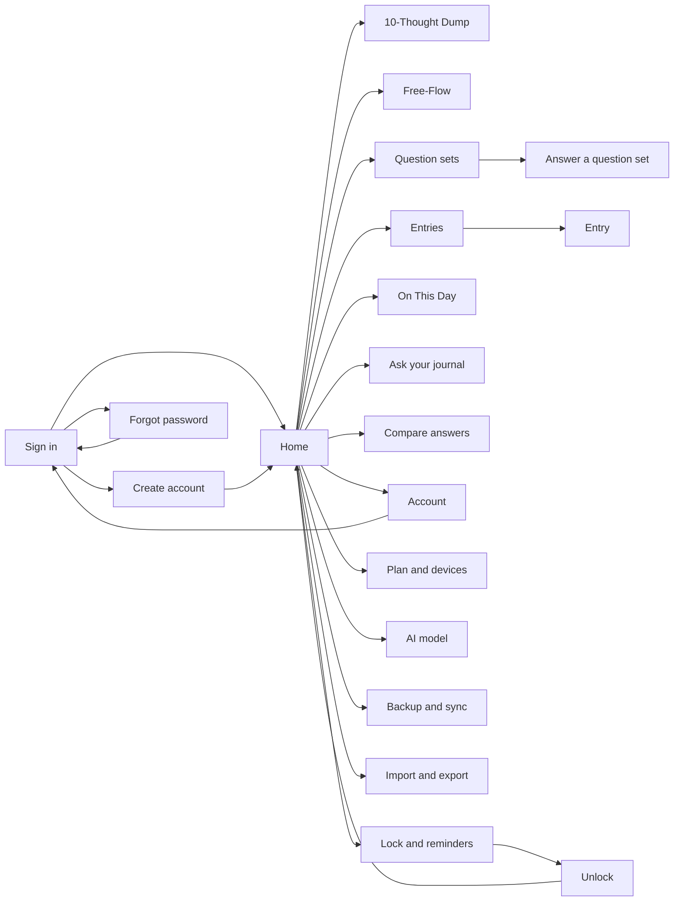

# MyDiary — UI Design

| | |
|---|---|
| App | MyDiary |
| Kind | app |
| Size | Medium |
| UI library | TrBlazeUI (TrBlazeUI.Components 2.1.9, icons from TrBlazeUI.Icons.Lucide) |
| Theme | both (follows the device setting) |

## Design system

- **Layout shell:** a Sidebar on tablet and computer with the twelve signed-in screens, a top bar holding the page title, a plan Badge and the "New entry" button. On a phone the sidebar becomes a scrolling menu strip. Sign in, Create account, Forgot password and Unlock use a single centred Card with no sidebar.
- **Theme:** TrBlazeUI's neutral shadcn theme in light and dark; warm off-white page, white cards, near-black primary button.
- **Shared controls:** Card, Button, Input, Textarea, Select, Switch, Tabs, Badge, Alert, Dialog and AlertDialog, Toast for confirmations, Calendar, RichTextEditor, Toolbar.
- **Rules:** 16 px card padding, 8 px gaps, 24 px page padding (16 px on a phone); one primary button per card; every error is an Alert, every confirmation a Toast.
- **Mockups:** the HTML files imitate TrBlazeUI's look with plain markup and one shared stylesheet; they use only controls that exist in the library. Drawn-in-another-state boxes (errors, empty states, dialogs) are marked so the verifier knows they are not always visible.

## Screens

### Screen: Sign in (`/signin`)

**Mockup:** [mockups/signin.html](mockups/signin.html) · **Roles:** User · **BRD:** BRD-1 to BRD-4

| Region | Control | Shows or binds |
|---|---|---|
| `signin-form` | Card | Sign-in form |
| `signin-email` | Input (Email) | Email |
| `signin-password` | Input (Password) | Password |
| `signin-submit` | Button (primary) | Signs in, opens Home |
| `signin-forgot` | Button (link) | Opens Forgot password |
| `signin-register` | Button (link) | Opens Create account |
| `signin-error-free-device` | Alert | Free account on a second device |
| `signin-error-over-limit` | Alert | Paid account over its device limit |
| `signin-error-credentials` | Alert | Wrong email or password |

| Field | Type | Required | Validation |
|---|---|---|---|
| Email | email | yes | A valid email address |
| Password | password | yes | Not empty; sent encrypted |

**Dialogs opened here:** none

**States:** empty: fields blank, no alert · loading: Sign in button shows a spinner and is disabled · error: one of the three alerts shows above the form

### Screen: Create account (`/register`)

**Mockup:** [mockups/register.html](mockups/register.html) · **Roles:** User · **BRD:** BRD-5 to BRD-7

| Region | Control | Shows or binds |
|---|---|---|
| `register-form` | Card | Form |
| `register-first` | Input | First name |
| `register-last` | Input | Last name |
| `register-email` | Input | Email |
| `register-password` | Input | Password |
| `register-confirm` | Input | Confirm password |
| `register-submit` | Button (primary) | Creates the account, opens Home |
| `register-signin` | Button (link) | Opens Sign in |
| `register-error-mismatch` | Alert | Passwords differ |
| `register-error-exists` | Alert | Email already used |

| Field | Type | Required | Validation |
|---|---|---|---|
| First name | text | yes | 1 to 60 characters |
| Last name | text | no | Up to 60 characters |
| Email | email | yes | A valid email address |
| Password | password | yes | Meets AppManager's password rule |
| Confirm password | password | yes | Equals Password |

**Dialogs opened here:** none

**States:** empty: fields blank · loading: button shows a spinner · error: alert above the form

### Screen: Forgot password (`/forgot-password`)

**Mockup:** [mockups/forgot-password.html](mockups/forgot-password.html) · **Roles:** User · **BRD:** BRD-8 to BRD-10

| Region | Control | Shows or binds |
|---|---|---|
| `forgot-form` | Card | Two-step form |
| `forgot-email` | Input | Email |
| `forgot-send` | Button (primary) | Sends the code |
| `forgot-sent-note` | Alert | Code sent |
| `forgot-code` | Input | Reset code |
| `forgot-new` | Input | New password |
| `forgot-submit` | Button (primary) | Sets the password, opens Sign in |
| `forgot-done` | Alert | Password changed |
| `forgot-back` | Button (link) | Opens Sign in |

| Field | Type | Required | Validation |
|---|---|---|---|
| Email | email | yes | A valid email address |
| Reset code | text | yes | The code from the email |
| New password | password | yes | Meets AppManager's password rule |

**Dialogs opened here:** none

**States:** empty: step 1 only · loading: button shows a spinner · error: alert says the code is not valid

### Screen: Home (`/`)

**Mockup:** [mockups/home.html](mockups/home.html) · **Roles:** User · **BRD:** BRD-11 to BRD-15

| Region | Control | Shows or binds |
|---|---|---|
| `home-today` | Card | Today's entries |
| `home-streak` | Card | Streak count |
| `home-on-this-day` | Card | One story from past years |
| `home-due-set` | Card | Suggested question set |
| `home-new` | Card | Three ways to write |
| `home-streak-count` | Typography | Streak days |
| `home-otd-open` | Button (link) | Opens On This Day |
| `home-due-start` | Button (primary) | Opens the answer screen |
| `home-licence-dialog` | Dialog | Licence check needed |

| Field | Type | Required | Validation |
|---|---|---|---|
| (none) | — | — | Home has no inputs |

**Dialogs opened here:** Licence check needed (dialog): message, Try again

**States:** empty: "Nothing written today yet" with the three write buttons · loading: skeleton cards · error: alert with Retry

### Screen: 10-Thought Dump (`/write/dump`)

**Mockup:** [mockups/write-dump.html](mockups/write-dump.html) · **Roles:** User · **BRD:** BRD-16 to BRD-17

| Region | Control | Shows or binds |
|---|---|---|
| `dump-form` | Card | Ten lines |
| `dump-line-1 … dump-line-10` | Input ×10 | Numbered lines |
| `dump-save` | Button (primary) | Saves, opens the entry |
| `dump-cancel` | Button (outline) | Back to Home |
| `dump-error-empty` | Alert | All lines empty |

| Field | Type | Required | Validation |
|---|---|---|---|
| Line 1 to 10 | text | no (one needed) | Up to 280 characters each |

**Dialogs opened here:** none

**States:** empty: ten blank lines · loading: Save shows a spinner · error: alert when every line is empty

### Screen: Free-Flow (`/write/free-flow`)

**Mockup:** [mockups/write-free-flow.html](mockups/write-free-flow.html) · **Roles:** User · **BRD:** BRD-18 to BRD-20

| Region | Control | Shows or binds |
|---|---|---|
| `flow-form` | Card | Editor form |
| `flow-title` | Input | Title |
| `flow-toolbar` | Toolbar + Toggle | Bold, italic, list, quote |
| `flow-editor` | RichTextEditor | Entry body |
| `flow-add-photo` | Button + FileUpload | Adds a photo |
| `flow-photos` | Item grid | Photo thumbnails |
| `flow-save` | Button (primary) | Saves, opens the entry |
| `flow-cancel` | Button (outline) | Back to Home |

| Field | Type | Required | Validation |
|---|---|---|---|
| Title | text | no | Up to 120 characters |
| Body | rich text | yes | At least one character |
| Photos | image files | no | JPEG, PNG or HEIC |

**Dialogs opened here:** none

**States:** empty: empty editor with a hint · loading: Save shows a spinner · error: alert if the photo cannot be read

### Screen: Question sets (`/questions`)

**Mockup:** [mockups/question-sets.html](mockups/question-sets.html) · **Roles:** User · **BRD:** BRD-21 to BRD-24

| Region | Control | Shows or binds |
|---|---|---|
| `set-list` | Card + Item list | All sets |
| `set-due-badge` | Badge | Due today |
| `set-build-own` | Button (primary) | Opens the New question set dialog |
| `question-sets-new-dialog` | Dialog | New set |
| `newset-name` | Input | Set name |
| `newset-questions` | Textarea | One question per line |
| `newset-save` | Button (primary) | Saves the set |

| Field | Type | Required | Validation |
|---|---|---|---|
| Set name | text | yes | 1 to 60 characters, not already used |
| Questions | multi-line text | yes | At least one non-empty line |

**Dialogs opened here:** New question set (dialog): set name, questions

**States:** empty: only the seven built-in sets · loading: skeleton list · error: alert when the set cannot be saved

### Screen: Answer a question set (`/questions/answer`)

**Mockup:** [mockups/question-answer.html](mockups/question-answer.html) · **Roles:** User · **BRD:** BRD-25 to BRD-26

| Region | Control | Shows or binds |
|---|---|---|
| `answer-form` | Card | Set questions |
| `answer-q1 … answer-q3` | Textarea per question | Answers |
| `answer-save` | Button (primary) | Saves the entry |
| `answer-cancel` | Button (outline) | Back to Question sets |

| Field | Type | Required | Validation |
|---|---|---|---|
| Answer | multi-line text | no (one needed) | Up to 4000 characters |

**Dialogs opened here:** none

**States:** empty: blank boxes · loading: Save shows a spinner · error: alert when every box is blank

### Screen: Entries (`/entries`)

**Mockup:** [mockups/entries.html](mockups/entries.html) · **Roles:** User · **BRD:** BRD-27 to BRD-36

| Region | Control | Shows or binds |
|---|---|---|
| `entries-search-card` | Card | Search and filters |
| `entries-search` | Input | Keyword |
| `entries-search-go` | Button (primary) | Runs the search |
| `entries-filters` | Select ×4 + Switch ×2 | Date, tag, set, mood, photos, starred |
| `entries-view-toggle` | Tabs | Timeline or Calendar |
| `entries-timeline` | Card + Item list | Entry rows |
| `entries-calendar` | Calendar | Month with marked days |
| `entries-empty` | Empty | No match message |

| Field | Type | Required | Validation |
|---|---|---|---|
| Search word | text | no | Any text |
| Date | select / range | no | Start not after end |
| Tag | select | no | An existing tag |
| Question set | select | no | An existing set |
| Mood | select | no | One of the moods |
| Photos only | switch | no | — |
| Starred only | switch | no | — |

**Dialogs opened here:** none

**States:** empty: "No entries match" or "You have not written anything yet" · loading: skeleton rows · error: alert with Retry

### Screen: Entry (`/entries/{id}`)

**Mockup:** [mockups/entry-detail.html](mockups/entry-detail.html) · **Roles:** User · **BRD:** BRD-37 to BRD-42

| Region | Control | Shows or binds |
|---|---|---|
| `entry-card` | Card | The entry |
| `entry-tags` | Badge row + Input | Tags |
| `entry-star` | Button (outline) | Toggles star |
| `entry-mood` | Select | Mood |
| `entry-body` | RichTextEditor | Body |
| `entry-photos` | Item grid | Photos |
| `entry-save` | Button (primary) | Saves changes |
| `entry-delete` | Button (destructive) | Opens the delete dialog |
| `entry-delete-dialog` | AlertDialog | Confirms delete |

| Field | Type | Required | Validation |
|---|---|---|---|
| Body | rich text | yes | At least one character |
| Tag | text | no | 1 to 30 characters |
| Mood | select | no | One of the moods |

**Dialogs opened here:** Delete entry (dialog): confirm

**States:** empty: not applicable · loading: skeleton body · error: alert "This entry could not be found"

### Screen: On This Day (`/on-this-day`)

**Mockup:** [mockups/on-this-day.html](mockups/on-this-day.html) · **Roles:** User · **BRD:** BRD-43 to BRD-45

| Region | Control | Shows or binds |
|---|---|---|
| `otd-year-2025` | Card | Story for 2025 |
| `otd-year-2024` | Card | Story for 2024 |
| `otd-year-2022` | Card | Story for 2022 |
| `otd-source-<year>` | Button (link) | Opens a source entry |

| Field | Type | Required | Validation |
|---|---|---|---|
| (none) | — | — | On This Day has no inputs |

**Dialogs opened here:** none

**States:** empty: "No past entries near this date yet" · loading: skeleton cards while the stories are written · error: alert "Stories could not be written" with Retry

### Screen: Ask your journal (`/ask`)

**Mockup:** [mockups/ask.html](mockups/ask.html) · **Roles:** User · **BRD:** BRD-46 to BRD-49

| Region | Control | Shows or binds |
|---|---|---|
| `ask-box` | Card | Question box |
| `ask-input` | Input | Question |
| `ask-go` | Button (primary) | Runs the question |
| `ask-answer` | Card | Answer |
| `ask-count` | Typography | Counted number |
| `ask-sources` | Item list | Entries used |
| `ask-none` | Alert | Nothing matches |

| Field | Type | Required | Validation |
|---|---|---|---|
| Question | text | yes | 1 to 300 characters |

**Dialogs opened here:** none

**States:** empty: example questions shown · loading: spinner with "Counting…" · error: alert "The model could not answer" with Retry

### Screen: Compare answers (`/compare`)

**Mockup:** [mockups/compare.html](mockups/compare.html) · **Roles:** User · **BRD:** BRD-50 to BRD-52

| Region | Control | Shows or binds |
|---|---|---|
| `compare-controls` | Card | Question and span |
| `compare-question` | Select | Question |
| `compare-span` | Tabs | Months or Years |
| `compare-result` | Card + Table | Answers by period |
| `compare-empty` | Empty | Needs two answers |

| Field | Type | Required | Validation |
|---|---|---|---|
| Question | select | yes | A question that has answers |

**Dialogs opened here:** none

**States:** empty: "Answer this question at least twice to compare" · loading: skeleton table · error: alert with Retry

### Screen: Account (`/account`)

**Mockup:** [mockups/account.html](mockups/account.html) · **Roles:** User · **BRD:** BRD-53 to BRD-59

| Region | Control | Shows or binds |
|---|---|---|
| `acct-profile` | Card | Profile form |
| `acct-save` | Button (primary) | Saves profile |
| `acct-actions` | Card | Account actions |
| `acct-change-password` | Button | Opens Change password |
| `acct-report` | Button | Opens Send a problem report |
| `acct-copy` | Button | Opens Ask for a copy of my data |
| `acct-delete` | Button (destructive) | Opens Delete my account |
| `acct-signout` | Button | Opens Sign in |
| `acct-password-dialog` | Dialog | Change password |
| `acct-report-dialog` | Dialog | Problem report |
| `acct-copy-dialog` | Dialog | Data copy request |
| `acct-delete-dialog` | AlertDialog | Deletion request |

| Field | Type | Required | Validation |
|---|---|---|---|
| First name | text | yes | 1 to 60 characters |
| Last name | text | no | Up to 60 characters |
| Email | email | yes | A valid email address |
| Current password | password | yes | Matches the account |
| New password | password | yes | Meets AppManager's password rule |
| Report title | text | yes | 1 to 120 characters |
| Report text | multi-line text | yes | At least 10 characters |
| Confirm email | email | yes | Equals the account email |

**Dialogs opened here:** Change password (dialog): current password, new password; Send a problem report (dialog): title, what happened; Ask for a copy of my data (dialog): confirm; Delete my account (dialog): confirm email

**States:** empty: not applicable · loading: buttons show spinners · error: alert inside the dialog or above the form

### Screen: Plan and devices (`/plan`)

**Mockup:** [mockups/plan-devices.html](mockups/plan-devices.html) · **Roles:** User · **BRD:** BRD-60 to BRD-67

| Region | Control | Shows or binds |
|---|---|---|
| `plan-card` | Card | Plan summary |
| `plan-name` | Typography | Licence name |
| `plan-ends` | Typography | End date |
| `plan-devices-used` | Badge | Devices in use of allowed |
| `plan-free-note` | Card | Shown on the free plan or after a licence ends |
| `plan-devices-card` | Card + Table | Devices |
| `device-forget-1` | Button | Opens Forget dialog |
| `device-block-1` | Button | Opens Block dialog |
| `device-forget-dialog` | AlertDialog | Confirm forget |
| `device-block-dialog` | AlertDialog | Confirm block |

| Field | Type | Required | Validation |
|---|---|---|---|
| (none) | — | — | Plan and devices has no inputs |

**Dialogs opened here:** Forget device (dialog): confirm; Block device (dialog): confirm

**States:** empty: only this device listed · loading: skeleton card and rows · error: alert "Plan could not be loaded" with Retry; the cached plan is shown when offline

### Screen: AI model (`/ai-model`)

**Mockup:** [mockups/ai-model.html](mockups/ai-model.html) · **Roles:** User · **BRD:** BRD-68 to BRD-71

| Region | Control | Shows or binds |
|---|---|---|
| `ai-builtin` | Card | Built-in model |
| `ai-builtin-badge` | Badge | In use |
| `ai-others` | Card | Other models |
| `ai-locked` | Typography | Locked message for free users |
| `ai-choose` | Select | On-device model |
| `ai-service` | Input | Online service |
| `ai-key` | Input (Password) | Own key |
| `ai-save-key` | Button (primary) | Opens the warning |
| `ai-warning-dialog` | AlertDialog | Journal text will leave this device |

| Field | Type | Required | Validation |
|---|---|---|---|
| On-device model | select | no | Models TechieRag lists |
| Online service | text | no | A service TechieRag supports |
| Own key | password | if service set | Not empty |

**Dialogs opened here:** Journal text will leave this device (dialog): confirm

**States:** empty: built-in model in use · loading: spinner while a model downloads · error: alert "Model could not be loaded" with Retry

### Screen: Backup and sync (`/backup`)

**Mockup:** [mockups/backup.html](mockups/backup.html) · **Roles:** User · **BRD:** BRD-72 to BRD-76

| Region | Control | Shows or binds |
|---|---|---|
| `backup-locked` | Card | Shown to free users |
| `backup-targets` | Card | Cloud choice |
| `backup-google` | Button (outline) | Connects Google Drive |
| `backup-onedrive` | Button (outline) | Connects OneDrive |
| `backup-status` | Typography | Connection and last backup |
| `backup-actions` | Card | Actions |
| `backup-now` | Button (primary) | Backs up |
| `backup-sync` | Button (outline) | Syncs |
| `backup-restore` | Button (outline) | Restores |

| Field | Type | Required | Validation |
|---|---|---|---|
| (none) | — | — | Backup and sync has no inputs; the cloud sign-in is done in the cloud provider's own window |

**Dialogs opened here:** none

**States:** empty: not connected to any cloud · loading: progress bar during backup or restore · error: alert with the cloud's reason and Retry

### Screen: Import and export (`/import-export`)

**Mockup:** [mockups/import-export.html](mockups/import-export.html) · **Roles:** User · **BRD:** BRD-77 to BRD-80

| Region | Control | Shows or binds |
|---|---|---|
| `export-card` | Card | Export |
| `export-json` | Button (primary) | Saves the JSON file |
| `import-card` | Card + FileUpload | Import |
| `import-json` | Button (outline) | Imports a MyDiary file |
| `import-dayone` | Button (outline) | Imports a Day One file |
| `import-error` | Alert | File not readable |

| Field | Type | Required | Validation |
|---|---|---|---|
| Import file | file (.json, .zip) | yes | A MyDiary or Day One export |

**Dialogs opened here:** none

**States:** empty: not applicable · loading: progress bar · error: alert "That file could not be read"

### Screen: Lock and reminders (`/security`)

**Mockup:** [mockups/security.html](mockups/security.html) · **Roles:** User · **BRD:** BRD-81 to BRD-85

| Region | Control | Shows or binds |
|---|---|---|
| `sec-lock-card` | Card | Lock settings |
| `sec-pin-switch` | Switch | PIN on or off |
| `sec-pin` | Input (Password) | PIN |
| `sec-bio-switch` | Switch | Fingerprint or face |
| `sec-lock-now` | Button (outline) | Opens the lock screen |
| `sec-reminders` | Card | Reminders |
| `sec-rem-1-switch` | Switch | Reminder on or off |
| `sec-rem-time` | Select | Time |
| `sec-rem-days` | Select | Days |
| `sec-rem-add` | Button (primary) | Adds a reminder |

| Field | Type | Required | Validation |
|---|---|---|---|
| PIN | password | if PIN on | 4 to 8 digits |
| Time | time | yes | A time of day |
| Days | select | yes | Every day, weekdays or weekends |

**Dialogs opened here:** none

**States:** empty: no PIN, no reminders · loading: not applicable · error: alert when the device refuses notifications or biometrics

### Screen: Unlock (`/lock`)

**Mockup:** [mockups/lock.html](mockups/lock.html) · **Roles:** User · **BRD:** BRD-86 to BRD-88

| Region | Control | Shows or binds |
|---|---|---|
| `lock-card` | Card | Lock |
| `lock-pin-dots` | InputOTP | PIN dots |
| `lock-pin` | Input (Password) | PIN |
| `lock-unlock` | Button (primary) | Opens Home |
| `lock-bio` | Button (outline) | Fingerprint or face |
| `lock-error` | Alert | Wrong PIN |

| Field | Type | Required | Validation |
|---|---|---|---|
| PIN | password | yes | The saved 4 to 8 digit PIN |

**Dialogs opened here:** none

**States:** empty: PIN dots blank · loading: biometric prompt open · error: alert "That PIN is not right"

## Click-through flow

