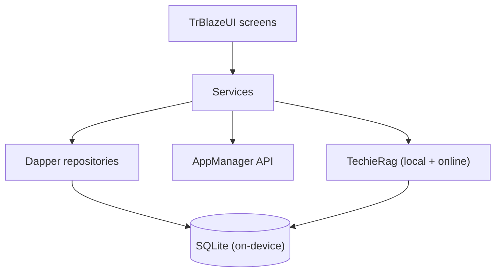
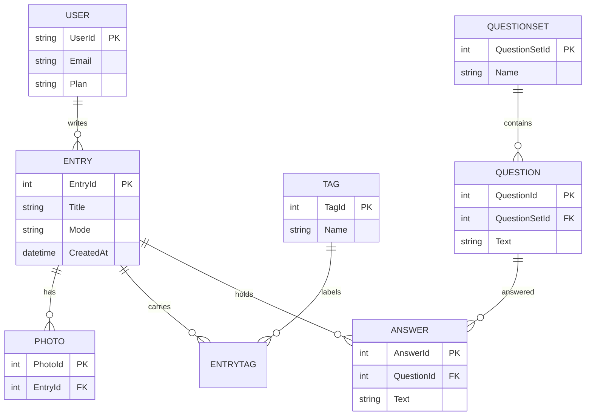

# MyDiary — Architecture

| | |
|---|---|
| App | MyDiary |
| Kind | app |
| Size | Medium |
| Stack answer set | dotnet |
| Date | 2026-10-25 |

## 1. Stack decisions

| Q | Topic | Decision | Source |
|---|---|---|---|
| Q1 | Configuration | `appsettings.json`, layered by `appsettings.{Environment}.json`. No other configuration mechanism. | answer set: dotnet |
| Q2 | Secrets in development | `dotnet user-secrets`, never committed; a `secrets.example.json` lists every key the app reads (the AppManager installed-app key, the online-AI key slot). `appsettings.Development.json` never holds a real secret. | answer set: dotnet |
| Q3 | Database | No server database. The journal lives in a local SQLite database on the device, so the app keeps working offline and no journal text reaches a server. The answer set's PostgreSQL-in-Docker does not apply — the brief fixes "MyDiary has no server of its own". | brief (concept), overriding the answer set |
| Q4 | Authentication | AppManager, the shared platform for identity, roles, licences and subscriptions. Sign-in, devices, licence checks, password reset, problem reports and account-data requests all call the AppManager API (`docs/AppManager-api-usage-guide.md`) with MyDiary's installed-app key; MyDiary writes no identity code of its own. | brief (fixed choice) + answer set Q4 |
| Q5 | Logging | Serilog, with a rolling file sink wired at startup before anything else can fail. Journal text is never logged. | answer set: dotnet |
| Q6 | Tests | xUnit; a test project exists from day one. | answer set: dotnet |
| Q7 | Layout and naming | `src/` and `tests/` at the root. The primary head is named exactly `MyDiary`; `<App>.App` is banned. Secondary projects take a descriptive suffix. | answer set: dotnet |
| Q8 | User interface | TrBlazeUI (`TrBlazeUI.Components`, which brings `TrBlazeUI.Primitives`) for the one MAUI Blazor Hybrid head; icons from `TrBlazeUI.Icons.Lucide`. Rendering mode: InteractiveServer, because Blazor Hybrid renders on the device. | brief (fixed choice) + answer set Q8 |
| Q11 | Standing rules | The answer set's rules: no NuGet package without an Architecture row saying why; no second configuration mechanism; a missing internal-library feature goes to that library's feedback file and the feature is held, never worked around; data access is Dapper; migrations live in a `MyDiaryDb` project using DbUp; log files under the build output folder; no unnecessary folders at the repository root. | answer set: dotnet |

Required packages: `TrBlazeUI.Components`, `TrBlazeUI.Icons.Lucide`, `TechieRag`, `TechieRag.Local`, `TechieRag.Embedded`.

## 2. Solution structure

| Project | Kind | Purpose |
|---|---|---|
| `MyDiary` | MAUI Blazor Hybrid app | The primary (and only) head. Targets Android, iOS, Mac Catalyst and Windows; the one app runs on all five device kinds the brief names. |
| `MyDiary.Core` | class library | Domain models, journal services, the AppManager client, TechieRag orchestration, and Dapper data access. |
| `MyDiaryDb` | migrations project | DbUp migrations for the on-device SQLite schema, run at app startup. |
| `MyDiary.Tests` | test project | xUnit tests for the Core services and the AppManager client. |

## 3. Component map

**How a request travels** (two typical requests; per-screen detail is in the DevGuide):

1. Ask a question: the Ask screen calls `AskService`.
2. `AskService` hands the question to TechieRag, which searches the on-device vector store (embedded embeddings over the SQLite journal).
3. TechieRag's local model (free) or the user's chosen model (paid) produces a counted answer with the source entries.
4. The count and the list of source entries are shown on the Ask screen.

1. Sign in: on first launch the Sign in screen calls the AppManager client in `MyDiary.Core`.
2. The client calls AppManager's register or login, then the licence check, and stores the token in the device's secure storage.
3. AppManager returns the token, the licence key and name, and the device list.
4. The user lands on Home with their plan applied.

## 4. Data model

| Entity | Key fields | Notes |
|---|---|---|
| `User` | `UserId`, `Email`, `FirstName`, `LastName`, `Plan`, `PlanEndsAt` | A local cache of the AppManager profile; the source of truth is AppManager. |
| `Entry` | `EntryId`, `Title`, `Body`, `Mode`, `Mood`, `Starred`, `CreatedAt`, `UpdatedAt`, `DeviceId` | `Mode` is dump, free-flow or question-answer. |
| `Tag` | `TagId`, `Name` | Free-form tags added to entries. |
| `EntryTag` | `EntryId`, `TagId` | The join table between entries and tags. |
| `Photo` | `PhotoId`, `EntryId`, `FilePath` | Photos attached to a Free-Flow entry, stored on the device. |
| `QuestionSet` | `QuestionSetId`, `Name`, `IsBuiltIn` | The seven built-in sets plus the user's own. |
| `Question` | `QuestionId`, `QuestionSetId`, `Text`, `SortOrder` | One question in a set. |
| `Answer` | `AnswerId`, `EntryId`, `QuestionId`, `Text` | An answer to one question, saved as part of an entry. |
| `Setting` | `Key`, `Value` | Key-value store for the PIN hash, reminder times, theme and the zoom level. |

## 5. Cross-cutting

- **Identity:** AppManager API (`docs/AppManager-api-usage-guide.md`), with MyDiary's installed-app key.
- **Configuration:** `appsettings.json` layered by environment.
- **Logging:** Serilog rolling file, wired at startup, under the build output folder in development and the app's log folder on a device.
- **Errors:** Unhandled exceptions are logged at the boundary and shown as the TrBlazeUI alert; AppManager and TechieRag failures surface through their documented error shapes.

## 6. Decisions log

| Date | Decision | Why | Status |
|---|---|---|---|
| 2026-10-25 | On-device SQLite instead of PostgreSQL-in-Docker | The brief fixes "no server of its own"; the journal must work offline. | decided |
| 2026-10-25 | One MAUI Blazor Hybrid head for all five device kinds | The brief requires the same screens on Android, iPhone, iPad, Windows and Mac. | decided |
| 2026-10-25 | `TrBlazeUI.Components` and `TrBlazeUI.Icons.Lucide` | Fixed by the brief and the answer set's Q8. | decided |
| 2026-10-25 | `TechieRag`, `TechieRag.Local`, `TechieRag.Embedded` | Fixed by the brief: every AI feature, built-in or online, goes through TechieRag; the free model runs on-device. | decided |
| 2026-10-25 | Dapper for data access, DbUp migrations in `MyDiaryDb` | The answer set's standing rules Q11.4 and Q11.5. | decided |
| 2026-10-25 | Serilog for logging, xUnit for tests | The answer set's Q5 and Q6. | decided |

## 7. Module responsibilities

| Module | Responsibility | Depends on |
|---|---|---|
| `MyDiary` (head) | The TrBlazeUI screens, routing, the app shell, and the Blazor Hybrid WebView zoom hook. | `MyDiary.Core` |
| `MyDiary.Core` | Journal services, search and ask, the AppManager client, TechieRag orchestration, Dapper repositories. | TechieRag packages |
| `MyDiaryDb` | The DbUp migrations that build the SQLite schema. | `MyDiary.Core` |
| `MyDiary.Tests` | Unit and integration tests for the Core services. | `MyDiary.Core` |

## 8. Open questions

- The exact AppManager licence product names and device counts ("Pro" allows 2, "Pro-Plus" more) come from AppManager's licence check response; the app reads them at runtime rather than hard-coding them (brief item 7).
- The Mac Catalyst keychain-versus-signing choice is made before the first Mac build (coding standards §9).
- The list of online AI services TechieRag supports is read from TechieRag's connector catalogue, not fixed in MyDiary (brief item 20).
