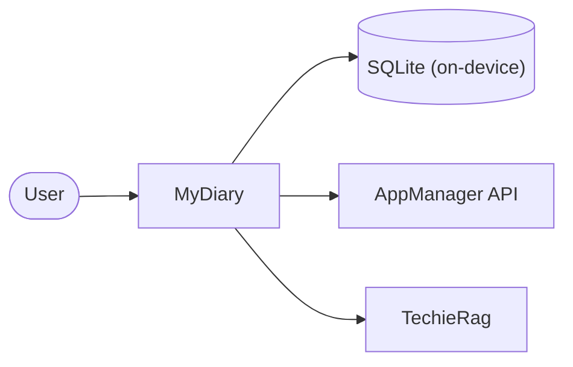

# MyDiary — Business Requirements

| | |
|---|---|
| App | MyDiary |
| Kind | app |
| Size | Medium |
| Stack answer set | dotnet |
| Status | Draft |
| Date | 2026-10-25 |

## 1. Summary

MyDiary is a private journaling app for phone, tablet and computer. Each person keeps one journal and can write it three ways: a 10-Thought Dump, a Free-Flow entry with formatting and photos, or Targeted Questioning sets such as Monthly Goals or Gratitude. Opening the app shows a short, warm story of what was written on this date in past years. A person can ask plain questions about their past and get a counted answer that lists the entries it used. It is free on one device. A paid licence adds backup, use on several devices and a choice of AI model. Accounts, devices, licences, problem reports and data requests go through AppManager; all AI goes through TechieRag; MyDiary has no server of its own and the journal stays on the device.

## 2. Scope

**In:**
- One private journal per person, with three ways to write and a way to look back (On This Day, search, questions).
- AppManager for accounts, sign-in, devices, licences, problem reports and account-data requests.
- TrBlazeUI for every screen; TechieRag for every AI feature.
- Backup to Google Drive or OneDrive, sync and restore for paid users; JSON and Day One import and export for everyone.
- PIN and biometric lock, and journaling reminders.

**Out:**
- The purchase and landing page, and any in-app or app-store payment (a separate phase-2 web app buys licences).
- More than one journal, shared journals and family groups.
- Sending journal text anywhere for a free user.
- iCloud, Dropbox and any other sync service.
- Map view, voice transcription, widgets, handwriting, and sharing an entry as an image.

## 3. Users and roles

| Role | Who they are | What they need |
|---|---|---|
| Free user | Writes on one device; everything stays on that device. | Write the three ways, search and ask questions, On This Day, export and import. |
| Paid user | Writes on several devices, backs up and restores, picks their own AI model or online service. | Everything the free user has, plus backup, sync and a model choice. |
| Goal reviewer | A free or paid user running monthly, yearly, health, fitness or project reviews. | The same answers side by side over time (Compare answers). |
| Owner (admin) | Assigns paid licences and reads problem reports on the AppManager site. | Does nothing inside MyDiary. |

## 4. Screens and flow

One row per routed page. A dialog is a row under its parent screen with `on /route` in the Route column; it is not counted as a screen.

| Screen | Route | Role | Mockup | Fields |
|---|---|---|---|---|
| Sign in | `/signin` | Free user, Paid user | [mockup](mockups/signin.html) | email, password |
| Create account | `/register` | Free user, Paid user | [mockup](mockups/register.html) | first name, last name, email, password, confirm password |
| Forgot password | `/forgot-password` | Free user, Paid user | [mockup](mockups/forgot-password.html) | email, reset code, new password |
| Home | `/` | Free user, Paid user | [mockup](mockups/home.html) | today's entries, streak, On This Day card, due question set |
| Licence check needed (dialog) | on `/` | Free user, Paid user | [mockup](mockups/home.html) | message, Try again |
| 10-Thought Dump | `/write/dump` | Free user, Paid user | [mockup](mockups/write-dump.html) | ten numbered lines |
| Free-Flow | `/write/free-flow` | Free user, Paid user | [mockup](mockups/write-free-flow.html) | title, formatted text, photos |
| Question sets | `/questions` | Free user, Paid user | [mockup](mockups/questions.html) | set list, new set name, questions |
| New question set (dialog) | on `/questions` | Free user, Paid user | [mockup](mockups/questions.html) | set name, questions |
| Answer a question set | `/questions/answer` | Free user, Paid user | [mockup](mockups/question-answer.html) | one answer box per question |
| Entries | `/entries` | Free user, Paid user | [mockup](mockups/entries.html) | search word, date, tag, question set, photo, star, mood, view |
| Entry | `/entries/{id}` | Free user, Paid user | [mockup](mockups/entry-detail.html) | body, tags, star, mood, photos |
| Delete entry (dialog) | on `/entries/{id}` | Free user, Paid user | [mockup](mockups/entry-detail.html) | confirm |
| On This Day | `/on-this-day` | Free user, Paid user | [mockup](mockups/on-this-day.html) | one story per past year |
| Ask your journal | `/ask` | Free user, Paid user | [mockup](mockups/ask.html) | question in plain words |
| Compare answers | `/compare` | Free user, Paid user | [mockup](mockups/compare.html) | question, months or years |
| Account | `/account` | Free user, Paid user | [mockup](mockups/account.html) | first name, last name, email |
| Change password (dialog) | on `/account` | Free user, Paid user | [mockup](mockups/account.html) | current password, new password |
| Send a problem report (dialog) | on `/account` | Free user, Paid user | [mockup](mockups/account.html) | title, what happened |
| Ask for a copy of my data (dialog) | on `/account` | Free user, Paid user | [mockup](mockups/account.html) | confirm |
| Delete my account (dialog) | on `/account` | Free user, Paid user | [mockup](mockups/account.html) | confirm email |
| Plan and devices | `/plan` | Free user, Paid user | [mockup](mockups/plan.html) | plan name, end date, device list |
| Forget device (dialog) | on `/plan` | Free user, Paid user | [mockup](mockups/plan.html) | confirm |
| Block device (dialog) | on `/plan` | Free user, Paid user | [mockup](mockups/plan.html) | confirm |
| AI model | `/ai-model` | Free user, Paid user | [mockup](mockups/ai-model.html) | on-device model, online service, own key |
| Journal text will leave this device (dialog) | on `/ai-model` | Paid user | [mockup](mockups/ai-model.html) | confirm |
| Backup and sync | `/backup` | Paid user | [mockup](mockups/backup.html) | cloud choice, backup, sync, restore |
| Import and export | `/import-export` | Free user, Paid user | [mockup](mockups/import-export.html) | JSON file |
| Lock and reminders | `/security` | Free user, Paid user | [mockup](mockups/security.html) | PIN, fingerprint or face switch, reminder time and days |
| Unlock | `/lock` | Free user, Paid user | [mockup](mockups/lock.html) | PIN |

**Primary journey:**
1. The user opens MyDiary for the first time, creates an account on Create account, and lands on Home.
2. Home shows today's entries, the streak, an On This Day story and any question set that is due.
3. The user writes a 10-Thought Dump, a Free-Flow entry or answers a question set, and the entry is saved.
4. The user browses or searches Entries, opens one, and adds a tag, star or mood.
5. The user asks a question on Ask your journal and sees a counted answer with its sources.
6. A paid user connects a cloud drive on Backup and sync and signs in on a second device.

## 5. Requirements

One item per thing the verifier will test. Each names its screen, links the mockup, and states its acceptance in the form the checklist will carry.

### Sign in

Sign in lets a user into their journal, checks the licence, and enforces the device limit.

- **BRD-1** — Sign in with email and password. *Screen:* Sign in · *Mockup:* [mockup](mockups/signin.html)
  - *Acceptance:* When a user signs in with correct email and password on Sign in, then Home opens.
- **BRD-2** — Wrong password is refused. *Screen:* Sign in · *Mockup:* [mockup](mockups/signin.html)
  - *Acceptance:* When a user enters a wrong password on Sign in, then an error shows and Home stays closed.
- **BRD-3** — Sign-in runs the licence check. *Screen:* Sign in · *Mockup:* [mockup](mockups/signin.html)
  - *Acceptance:* When a user signs in on Sign in, then the plan from the licence check is applied.
- **BRD-4** — Free account is refused on a second device. *Screen:* Sign in · *Mockup:* [mockup](mockups/signin.html)
  - *Acceptance:* When a free user signs in on a second device, then a message says a paid licence allows more.

### Create account

Create account makes a new AppManager account and registers the first device.

- **BRD-5** — Create an account. *Screen:* Create account · *Mockup:* [mockup](mockups/register.html)
  - *Acceptance:* When a user fills valid fields on Create account, then the account is created and Home opens.
- **BRD-6** — Invalid fields are shown. *Screen:* Create account · *Mockup:* [mockup](mockups/register.html)
  - *Acceptance:* When a user enters an invalid email or short password on Create account, then an error names the field.
- **BRD-7** — First device is registered. *Screen:* Create account · *Mockup:* [mockup](mockups/register.html)
  - *Acceptance:* When an account is created on Create account, then this device is registered to the account.

### Forgot password

Forgot password resets the password through AppManager.

- **BRD-8** — Request a reset code. *Screen:* Forgot password · *Mockup:* [mockup](mockups/forgot-password.html)
  - *Acceptance:* When a user enters their email on Forgot password, then a reset code is sent.
- **BRD-9** — Set a new password. *Screen:* Forgot password · *Mockup:* [mockup](mockups/forgot-password.html)
  - *Acceptance:* When a user enters the code and a new password on Forgot password, then the password is reset.
- **BRD-10** — Sign in with the new password. *Screen:* Sign in · *Mockup:* [mockup](mockups/signin.html)
  - *Acceptance:* When a user signs in with the new password on Sign in, then Home opens.

### Home

Home shows today's writing, the streak, and the On This Day card.

- **BRD-11** — Today's entries are listed. *Screen:* Home · *Mockup:* [mockup](mockups/home.html)
  - *Acceptance:* When a user opens Home, then today's entries are shown.
- **BRD-12** — The streak is shown. *Screen:* Home · *Mockup:* [mockup](mockups/home.html)
  - *Acceptance:* When a user opens Home, then the current streak is shown.
- **BRD-13** — The On This Day card is shown. *Screen:* Home · *Mockup:* [mockup](mockups/home.html)
  - *Acceptance:* When a user opens Home, then the On This Day card is shown.
- **BRD-14** — A due question set is suggested. *Screen:* Home · *Mockup:* [mockup](mockups/home.html)
  - *Acceptance:* When a question set is due on Home, then the app suggests it.
- **BRD-15** — Licence check after 30 days offline. *Screen:* Home · *Mockup:* [mockup](mockups/home.html)
  - *Acceptance:* When 30 days have passed offline on Home, then a dialog asks for an online licence check.

### 10-Thought Dump

The 10-Thought Dump writes ten numbered quick lines and drops the empty ones.

- **BRD-16** — Ten numbered lines. *Screen:* 10-Thought Dump · *Mockup:* [mockup](mockups/write-dump.html)
  - *Acceptance:* When a user opens 10-Thought Dump, then ten numbered lines are shown.
- **BRD-17** — Empty lines are dropped. *Screen:* 10-Thought Dump · *Mockup:* [mockup](mockups/write-dump.html)
  - *Acceptance:* When a user saves with empty lines on 10-Thought Dump, then the empty lines are dropped.
- **BRD-18** — Save the dump. *Screen:* 10-Thought Dump · *Mockup:* [mockup](mockups/write-dump.html)
  - *Acceptance:* When a user saves on 10-Thought Dump, then the entry is saved and Home opens.

### Free-Flow

The Free-Flow entry writes formatted text and photos.

- **BRD-19** — Write title and formatted text. *Screen:* Free-Flow · *Mockup:* [mockup](mockups/write-free-flow.html)
  - *Acceptance:* When a user writes a title and text on Free-Flow, then both are saved.
- **BRD-20** — Attach photos. *Screen:* Free-Flow · *Mockup:* [mockup](mockups/write-free-flow.html)
  - *Acceptance:* When a user attaches a photo on Free-Flow, then the photo is saved with the entry.
- **BRD-21** — Formatting controls apply. *Screen:* Free-Flow · *Mockup:* [mockup](mockups/write-free-flow.html)
  - *Acceptance:* When a user applies bold on Free-Flow, then the text is shown bold.
- **BRD-22** — Save the entry. *Screen:* Free-Flow · *Mockup:* [mockup](mockups/write-free-flow.html)
  - *Acceptance:* When a user saves on Free-Flow, then the entry is saved and Home opens.

### Question sets

Question sets lists the built-in and custom sets and builds new ones.

- **BRD-23** — The built-in sets are listed. *Screen:* Question sets · *Mockup:* [mockup](mockups/questions.html)
  - *Acceptance:* When a user opens Question sets, then the seven built-in sets are listed.
- **BRD-24** — Custom sets are listed. *Screen:* Question sets · *Mockup:* [mockup](mockups/questions.html)
  - *Acceptance:* When a user has built sets on Question sets, then their sets are listed.
- **BRD-25** — Build a new set. *Screen:* Question sets · *Mockup:* [mockup](mockups/questions.html)
  - *Acceptance:* When a user adds a name and questions on Question sets, then the set is built.
- **BRD-26** — A due set is marked. *Screen:* Question sets · *Mockup:* [mockup](mockups/questions.html)
  - *Acceptance:* When a set is due on Question sets, then it is marked due.

### Answer a question set

Answer a question set records one answer per question as an entry.

- **BRD-27** — One box per question. *Screen:* Answer a question set · *Mockup:* [mockup](mockups/question-answer.html)
  - *Acceptance:* When a user opens a set on Answer a question set, then each question has an answer box.
- **BRD-28** — Answers save as an entry. *Screen:* Answer a question set · *Mockup:* [mockup](mockups/question-answer.html)
  - *Acceptance:* When a user saves on Answer a question set, then the answers save as one entry.

### Entries

Entries browses by timeline or calendar and filters by every facet.

- **BRD-29** — Browse by timeline. *Screen:* Entries · *Mockup:* [mockup](mockups/entries.html)
  - *Acceptance:* When a user opens Entries, then entries are listed by date.
- **BRD-30** — Browse by calendar. *Screen:* Entries · *Mockup:* [mockup](mockups/entries.html)
  - *Acceptance:* When a user picks the calendar view on Entries, then entries open by day.
- **BRD-31** — Search by keyword. *Screen:* Entries · *Mockup:* [mockup](mockups/entries.html)
  - *Acceptance:* When a user types a word on Entries, then matching entries are shown.
- **BRD-32** — Filter by date. *Screen:* Entries · *Mockup:* [mockup](mockups/entries.html)
  - *Acceptance:* When a user picks a date on Entries, then entries from that date are shown.
- **BRD-33** — Filter by tag. *Screen:* Entries · *Mockup:* [mockup](mockups/entries.html)
  - *Acceptance:* When a user picks a tag on Entries, then entries with that tag are shown.
- **BRD-34** — Filter by question set. *Screen:* Entries · *Mockup:* [mockup](mockups/entries.html)
  - *Acceptance:* When a user picks a question set on Entries, then its entries are shown.
- **BRD-35** — Filter by photo. *Screen:* Entries · *Mockup:* [mockup](mockups/entries.html)
  - *Acceptance:* When a user picks photos on Entries, then only entries with photos are shown.
- **BRD-36** — Filter by star. *Screen:* Entries · *Mockup:* [mockup](mockups/entries.html)
  - *Acceptance:* When a user picks starred on Entries, then only starred entries are shown.
- **BRD-37** — Filter by mood. *Screen:* Entries · *Mockup:* [mockup](mockups/entries.html)
  - *Acceptance:* When a user picks a mood on Entries, then entries with that mood are shown.
- **BRD-38** — Open an entry. *Screen:* Entries · *Mockup:* [mockup](mockups/entries.html)
  - *Acceptance:* When a user taps an entry on Entries, then the entry opens.

### Entry

Entry shows one entry and lets the user tag, star, mood and edit it.

- **BRD-39** — View the entry body. *Screen:* Entry · *Mockup:* [mockup](mockups/entry-detail.html)
  - *Acceptance:* When a user opens Entry, then the full entry body is shown.
- **BRD-40** — Add a tag. *Screen:* Entry · *Mockup:* [mockup](mockups/entry-detail.html)
  - *Acceptance:* When a user adds a tag on Entry, then the tag is saved on the entry.
- **BRD-41** — Star the entry. *Screen:* Entry · *Mockup:* [mockup](mockups/entry-detail.html)
  - *Acceptance:* When a user taps star on Entry, then the entry is starred.
- **BRD-42** — Pick a mood. *Screen:* Entry · *Mockup:* [mockup](mockups/entry-detail.html)
  - *Acceptance:* When a user picks a mood on Entry, then the mood is saved on the entry.
- **BRD-43** — Edit the entry. *Screen:* Entry · *Mockup:* [mockup](mockups/entry-detail.html)
  - *Acceptance:* When a user edits the text on Entry, then the change is saved.
- **BRD-44** — Delete the entry. *Screen:* Entry · *Mockup:* [mockup](mockups/entry-detail.html)
  - *Acceptance:* When a user confirms delete on Entry, then the entry is removed.

### On This Day

On This Day tells a warm story of this date in past years.

- **BRD-45** — One story per past year. *Screen:* On This Day · *Mockup:* [mockup](mockups/on-this-day.html)
  - *Acceptance:* When a user opens On This Day, then one story per past year is shown.
- **BRD-46** — A narrative, not a list. *Screen:* On This Day · *Mockup:* [mockup](mockups/on-this-day.html)
  - *Acceptance:* When a user reads a story on On This Day, then it reads as a short story.
- **BRD-47** — Open the entry behind a story. *Screen:* On This Day · *Mockup:* [mockup](mockups/on-this-day.html)
  - *Acceptance:* When a user taps a story on On This Day, then the entry opens.

### Ask your journal

Ask your journal turns a plain question into a counted answer with its sources.

- **BRD-48** — Ask a question. *Screen:* Ask your journal · *Mockup:* [mockup](mockups/ask.html)
  - *Acceptance:* When a user types a question on Ask your journal, then an answer is returned.
- **BRD-49** — A counted answer. *Screen:* Ask your journal · *Mockup:* [mockup](mockups/ask.html)
  - *Acceptance:* When a user asks how many on Ask your journal, then a count is shown.
- **BRD-50** — Source entries are listed. *Screen:* Ask your journal · *Mockup:* [mockup](mockups/ask.html)
  - *Acceptance:* When an answer is shown on Ask your journal, then the source entries are listed.
- **BRD-51** — No match says so. *Screen:* Ask your journal · *Mockup:* [mockup](mockups/ask.html)
  - *Acceptance:* When nothing matches on Ask your journal, then the app says no entry matches.

### Compare answers

Compare answers shows one question's answers side by side over time.

- **BRD-52** — Pick a question. *Screen:* Compare answers · *Mockup:* [mockup](mockups/compare.html)
  - *Acceptance:* When a user picks a question on Compare answers, then its answers are shown.
- **BRD-53** — Side by side over months or years. *Screen:* Compare answers · *Mockup:* [mockup](mockups/compare.html)
  - *Acceptance:* When a user picks a range on Compare answers, then answers are shown side by side.
- **BRD-54** — Choose the range. *Screen:* Compare answers · *Mockup:* [mockup](mockups/compare.html)
  - *Acceptance:* When a user toggles months or years on Compare answers, then the range changes.

### Account

Account edits the profile and handles password, reports and data requests.

- **BRD-55** — Edit the profile. *Screen:* Account · *Mockup:* [mockup](mockups/account.html)
  - *Acceptance:* When a user edits their name on Account, then the change is saved.
- **BRD-56** — Change the password. *Screen:* Account · *Mockup:* [mockup](mockups/account.html)
  - *Acceptance:* When a user enters old and new passwords on Account, then the password changes.
- **BRD-57** — Send a problem report. *Screen:* Account · *Mockup:* [mockup](mockups/account.html)
  - *Acceptance:* When a user sends a report on Account, then the report reaches AppManager.
- **BRD-58** — Ask for a copy of data. *Screen:* Account · *Mockup:* [mockup](mockups/account.html)
  - *Acceptance:* When a user asks for a copy on Account, then the request is sent.
- **BRD-59** — Ask to delete the account. *Screen:* Account · *Mockup:* [mockup](mockups/account.html)
  - *Acceptance:* When a user confirms deletion on Account, then the delete request is sent.
- **BRD-60** — See the signed-in email. *Screen:* Account · *Mockup:* [mockup](mockups/account.html)
  - *Acceptance:* When a user opens Account, then their email is shown.

### Plan and devices

Plan and devices shows the plan, its end date and every device.

- **BRD-61** — See the plan and end date. *Screen:* Plan and devices · *Mockup:* [mockup](mockups/plan.html)
  - *Acceptance:* When a user opens Plan and devices, then the plan and end date are shown.
- **BRD-62** — See every signed-in device. *Screen:* Plan and devices · *Mockup:* [mockup](mockups/plan.html)
  - *Acceptance:* When a user opens Plan and devices, then every device is listed.
- **BRD-63** — See devices in use against the allowance. *Screen:* Plan and devices · *Mockup:* [mockup](mockups/plan.html)
  - *Acceptance:* When a user opens Plan and devices, then used and allowed counts are shown.
- **BRD-64** — Forget a device. *Screen:* Plan and devices · *Mockup:* [mockup](mockups/plan.html)
  - *Acceptance:* When a user confirms forget on Plan and devices, then the device is removed.
- **BRD-65** — Block a device. *Screen:* Plan and devices · *Mockup:* [mockup](mockups/plan.html)
  - *Acceptance:* When a user confirms block on Plan and devices, then the device is blocked.
- **BRD-66** — Free account shows one device. *Screen:* Plan and devices · *Mockup:* [mockup](mockups/plan.html)
  - *Acceptance:* When a free user opens Plan and devices, then one allowed device is shown.
- **BRD-67** — Over-limit refusal names the fix. *Screen:* Sign in · *Mockup:* [mockup](mockups/signin.html)
  - *Acceptance:* When a paid user exceeds their devices on Sign in, then the message says how to free a slot.
- **BRD-68** — Licence ends, journal is kept. *Screen:* Plan and devices · *Mockup:* [mockup](mockups/plan.html)
  - *Acceptance:* When a paid licence ends on Plan and devices, then free features and the journal are kept.

### AI model

AI model chooses the built-in model or a paid user's own.

- **BRD-69** — Built-in model is the default. *Screen:* AI model · *Mockup:* [mockup](mockups/ai-model.html)
  - *Acceptance:* When a free user opens AI model, then the built-in on-device model is selected.
- **BRD-70** — Choose a different model. *Screen:* AI model · *Mockup:* [mockup](mockups/ai-model.html)
  - *Acceptance:* When a paid user picks a model on AI model, then that model is used.
- **BRD-71** — Enter an own key. *Screen:* AI model · *Mockup:* [mockup](mockups/ai-model.html)
  - *Acceptance:* When a paid user enters a key on AI model, then the online service is used.
- **BRD-72** — Warn that text leaves the device. *Screen:* AI model · *Mockup:* [mockup](mockups/ai-model.html)
  - *Acceptance:* When a paid user enters a key on AI model, then a warning about leaving the device is shown.

### Backup and sync

Backup and sync copies the journal to a cloud drive and restores it.

- **BRD-73** — Back up to Google Drive. *Screen:* Backup and sync · *Mockup:* [mockup](mockups/backup.html)
  - *Acceptance:* When a paid user backs up on Backup and sync, then Google Drive is offered.
- **BRD-74** — Back up to OneDrive. *Screen:* Backup and sync · *Mockup:* [mockup](mockups/backup.html)
  - *Acceptance:* When a paid user backs up on Backup and sync, then OneDrive is offered.
- **BRD-75** — Sync between devices. *Screen:* Backup and sync · *Mockup:* [mockup](mockups/backup.html)
  - *Acceptance:* When a paid user syncs on Backup and sync, then devices share the journal.
- **BRD-76** — Restore on a new device. *Screen:* Backup and sync · *Mockup:* [mockup](mockups/backup.html)
  - *Acceptance:* When a paid user restores on Backup and sync, then the journal is restored.
- **BRD-77** — Backup is paid-only. *Screen:* Backup and sync · *Mockup:* [mockup](mockups/backup.html)
  - *Acceptance:* When a free user opens Backup and sync, then a paid licence is required.

### Import and export

Import and export moves the journal as JSON, including Day One.

- **BRD-78** — Export to JSON. *Screen:* Import and export · *Mockup:* [mockup](mockups/import-export.html)
  - *Acceptance:* When a user exports on Import and export, then a JSON file is produced.
- **BRD-79** — Import a JSON export. *Screen:* Import and export · *Mockup:* [mockup](mockups/import-export.html)
  - *Acceptance:* When a user imports a JSON file on Import and export, then entries are added.
- **BRD-80** — Import a Day One export. *Screen:* Import and export · *Mockup:* [mockup](mockups/import-export.html)
  - *Acceptance:* When a user imports a Day One file on Import and export, then entries are added.
- **BRD-81** — Import works for any user. *Screen:* Import and export · *Mockup:* [mockup](mockups/import-export.html)
  - *Acceptance:* When a free user imports on Import and export, then the import works.

### Lock and reminders

Lock and reminders sets the PIN, biometric lock and journaling reminders.

- **BRD-82** — Set a PIN. *Screen:* Lock and reminders · *Mockup:* [mockup](mockups/security.html)
  - *Acceptance:* When a user sets a PIN on Lock and reminders, then the app locks with it.
- **BRD-83** — Enable fingerprint or face. *Screen:* Lock and reminders · *Mockup:* [mockup](mockups/security.html)
  - *Acceptance:* When a user enables biometrics on Lock and reminders, then the app locks with it.
- **BRD-84** — Set a reminder time. *Screen:* Lock and reminders · *Mockup:* [mockup](mockups/security.html)
  - *Acceptance:* When a user sets a time on Lock and reminders, then a reminder is saved.
- **BRD-85** — Choose reminder days. *Screen:* Lock and reminders · *Mockup:* [mockup](mockups/security.html)
  - *Acceptance:* When a user picks days on Lock and reminders, then the reminder fires on those days.
- **BRD-86** — The lock settings apply. *Screen:* Lock and reminders · *Mockup:* [mockup](mockups/security.html)
  - *Acceptance:* When lock settings are saved on Lock and reminders, then Unlock appears on next open.

### Unlock

Unlock opens the app with the PIN or biometrics.

- **BRD-87** — Unlock with the PIN. *Screen:* Unlock · *Mockup:* [mockup](mockups/lock.html)
  - *Acceptance:* When a user enters the right PIN on Unlock, then Home opens.
- **BRD-88** — Unlock with fingerprint or face. *Screen:* Unlock · *Mockup:* [mockup](mockups/lock.html)
  - *Acceptance:* When a user scans a finger or face on Unlock, then Home opens.
- **BRD-89** — Wrong PIN is refused. *Screen:* Unlock · *Mockup:* [mockup](mockups/lock.html)
  - *Acceptance:* When a user enters a wrong PIN on Unlock, then Home stays locked.

## 6. Non-functional requirements

| Id | Area | Requirement | Measure |
|---|---|---|---|
| BRD-90 | Logging | Serilog writes rolling log files from startup, under the build output folder in development and the app's log folder on a device. Journal text is never logged. | A log file exists after first start and holds no entry text |
| BRD-91 | Zoom | The Windows and Mac heads draw their screens in a BlazorWebView and zoom with Cmd/Ctrl + =, - and 0 from 50% to 300% in 10% steps; the level is kept across restarts. | zoom-check: keys · zoom-check: kept |
| BRD-92 | Offline | The journal works with no network for up to 30 days after the last licence check; after that the app asks for an online check. | Offline use: 30 days, then the licence check dialog on Home |
| BRD-93 | Privacy | Journal text never leaves the device for a free user; for a paid user it leaves only to their own backup folder, or to an online AI service they chose after the warning. | No network call carries entry text on the free plan |
| BRD-94 | Platforms | The same screens run on Android, iPhone, iPad, Windows and Mac. | Every screen reachable and usable on each of the five |

## 7. Development status

Written by the status gate after every build, verify and handoff; not by hand.

**Snapshot as of 2026-10-25.** Live per-requirement status: `PROJECT-STATUS.md` and the Requirements Status table in `docs/MyDiary-Checklist.md`.

| Screen | Requirements | Verified | Open | Status |
|---|---|---|---|---|
| Sign in | 5 | 0 | 5 | Planned |
| Create account | 3 | 0 | 3 | Planned |
| Forgot password | 3 | 0 | 3 | Planned |
| Home | 5 | 0 | 5 | Planned |
| 10-Thought Dump | 3 | 0 | 3 | Planned |
| Free-Flow | 4 | 0 | 4 | Planned |
| Question sets | 4 | 0 | 4 | Planned |
| Answer a question set | 2 | 0 | 2 | Planned |
| Entries | 10 | 0 | 10 | Planned |
| Entry | 6 | 0 | 6 | Planned |
| On This Day | 3 | 0 | 3 | Planned |
| Ask your journal | 4 | 0 | 4 | Planned |
| Compare answers | 3 | 0 | 3 | Planned |
| Account | 6 | 0 | 6 | Planned |
| Plan and devices | 8 | 0 | 8 | Planned |
| AI model | 4 | 0 | 4 | Planned |
| Backup and sync | 5 | 0 | 5 | Planned |
| Import and export | 4 | 0 | 4 | Planned |
| Lock and reminders | 5 | 0 | 5 | Planned |
| Unlock | 3 | 0 | 3 | Planned |

## 8. Context diagram

## 9. Constraints and assumptions

- One journal per person; there is no list of journals to pick from (brief item 9).
- The app decides what is paid from the licence key and name AppManager's licence check returns: "Pro" allows 2 devices, "Pro-Plus" more (brief item 7).
- There is no "Buy" button; the admin assigns paid licences in AppManager until the phase-2 web app exists.
- Online AI happens only when a paid user enters their own key; a free user's AI is the built-in on-device model.

## 10. Risks

| Risk | Likelihood | Impact | Mitigation |
|---|---|---|---|
| The local AI model is too large or slow on a low-end phone | Medium | High | Use the smallest built-in model and embedded embeddings; let the free user stay on-device only. |
| Backup sync conflicts when two devices edit offline | Medium | Medium | Sync merges by last-write-wins per entry and keeps the journal on the device. |
| AppManager licence names change | Low | Medium | Read plan and device counts from the licence check response, never hard-code them. |
| The Mac build fails on keychain or signing | Medium | Low | Decide the keychain-versus-signing choice before the first Mac build (coding standards §9). |

## 11. Glossary

- **10-Thought Dump** — ten numbered quick lines, empty ones dropped on save.
- **Free-Flow** — a long-form entry with formatting and photos.
- **On This Day** — a short, warm story of what was written on this date in past years.
- **Targeted Questioning** — a guided set of questions such as Monthly Goals or Gratitude.
