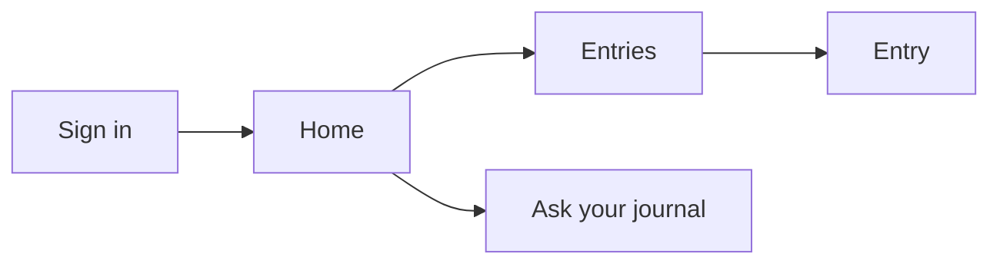

# MyDiary — UI Design

| | |
|---|---|
| App | MyDiary |
| Kind | app |
| Size | Medium |
| UI library | TrBlazeUI 2.1.x |
| Theme | light and dark |

## Design system

- **Layout shell:** `SidebarProvider` + `Sidebar` on wide screens; the same menu slides out as a `Sheet` below 768px. Every authenticated screen sits inside `SidebarInset` with a top header and `@Body`.
- **Theme:** light and dark, both from the TrBlazeUI tokens; no custom palette.
- **Shared controls:** `Button`, `Card`, `Input`, `Textarea`, `Select`, `Switch`, `Badge`, `Dialog`, `AlertDialog`, `Toast`, `Empty`, `Spinner`.
- **Rules:** one spacing scale (Tailwind `p-4`/`p-6`); `Comfortable` density for tables; the `sm:` breakpoint hides sidebar into a sheet and drops narrow table columns with `HideBelow`.

## Screens

### Screen: Sign in (`/signin`)

**Mockup:** [mockups/signin.html](mockups/signin.html) · **Roles:** Free user, Paid user · **BRD:** BRD-1, BRD-2, BRD-3, BRD-4, BRD-10, BRD-67

| Region | Control | Shows or binds |
|---|---|---|
| Centered card | `Card` | The sign-in form |
| Email | `Input` (`InputType.Email`) | The email |
| Password | `Input` (`InputType.Password`) | The password |
| Submit | `Button` (`Submit`) | Signs in |
| Create account link | `Button` (`Link`) | Opens Create account |
| Forgot link | `Button` (`Link`) | Opens Forgot password |
| Refusal | `Alert` | The second-device or over-limit message |

| Field | Type | Required | Validation |
|---|---|---|---|
| Email | email | yes | valid email |
| Password | password | yes | non-empty |

**Dialogs opened here:** none

**States:** empty: blank form · loading: `Spinner` on the submit button · error: `Alert` with the refusal or wrong-password message

### Screen: Create account (`/register`)

**Mockup:** [mockups/register.html](mockups/register.html) · **Roles:** Free user, Paid user · **BRD:** BRD-5, BRD-6, BRD-7

| Region | Control | Shows or binds |
|---|---|---|
| Centered card | `Card` | The form |
| Names | `Input` | First and last name |
| Email | `Input` (`InputType.Email`) | The email |
| Password | `Input` (`InputType.Password`) | Password and confirm |
| Submit | `Button` (`Submit`) | Creates the account |

| Field | Type | Required | Validation |
|---|---|---|---|
| First name | text | yes | non-empty |
| Last name | text | yes | non-empty |
| Email | email | yes | valid email |
| Password | password | yes | minimum length |
| Confirm password | password | yes | matches password |

**Dialogs opened here:** none

**States:** empty: blank form · loading: `Spinner` while the account is created · error: `Alert` naming the invalid field

### Screen: Forgot password (`/forgot-password`)

**Mockup:** [mockups/forgot-password.html](mockups/forgot-password.html) · **Roles:** Free user, Paid user · **BRD:** BRD-8, BRD-9

| Region | Control | Shows or binds |
|---|---|---|
| Centered card | `Card` | The reset form |
| Email | `Input` (`InputType.Email`) | Where the code is sent |
| Reset code | `Input` | The code from email |
| New password | `Input` (`InputType.Password`) | The new password |
| Submit | `Button` (`Submit`) | Resets the password |

| Field | Type | Required | Validation |
|---|---|---|---|
| Email | email | yes | valid email |
| Reset code | text | yes | non-empty |
| New password | password | yes | minimum length |

**Dialogs opened here:** none

**States:** empty: blank form · loading: `Spinner` while the code is sent · error: `Alert` for a wrong code

### Screen: Home (`/`)

**Mockup:** [mockups/home.html](mockups/home.html) · **Roles:** Free user, Paid user · **BRD:** BRD-11, BRD-12, BRD-13, BRD-14, BRD-15

| Region | Control | Shows or binds |
|---|---|---|
| Sidebar | `Sidebar` | Navigation |
| Streak | `Stat` | The current streak |
| On This Day | `Card` | The story for this date |
| Today's entries | list of `Card` | Today's writing |
| Due question set | `Alert` | The suggested set |
| New entry | `Button` | Opens the writing screens |

| Field | Type | Required | Validation |
|---|---|---|---|
| — | — | — | — |

**Dialogs opened here:** Licence check needed (`AlertDialog`: message, Try again)

**States:** empty: `Empty` "Nothing written today" · loading: `Skeleton` cards · error: `Alert` for a failed licence check

### Screen: 10-Thought Dump (`/write/dump`)

**Mockup:** [mockups/write-dump.html](mockups/write-dump.html) · **Roles:** Free user, Paid user · **BRD:** BRD-16, BRD-17, BRD-18

| Region | Control | Shows or binds |
|---|---|---|
| Lines | ten `Textarea` | One numbered thought each |
| Save | `Button` (`Submit`) | Saves, drops empties |

| Field | Type | Required | Validation |
|---|---|---|---|
| Line 1..10 | text | no | empty lines dropped on save |

**Dialogs opened here:** none

**States:** empty: ten blank numbered lines · loading: `Spinner` on save · error: `Toast` if save fails

### Screen: Free-Flow (`/write/free-flow`)

**Mockup:** [mockups/write-free-flow.html](mockups/write-free-flow.html) · **Roles:** Free user, Paid user · **BRD:** BRD-19, BRD-20, BRD-21, BRD-22

| Region | Control | Shows or binds |
|---|---|---|
| Title | `Input` | The entry title |
| Body | `RichTextEditor` | Formatted text |
| Photos | `FileUpload` | Attached photos |
| Save | `Button` (`Submit`) | Saves the entry |

| Field | Type | Required | Validation |
|---|---|---|---|
| Title | text | yes | non-empty |
| Body | richtext | no | — |
| Photos | file | no | image types |

**Dialogs opened here:** none

**States:** empty: blank title and body · loading: `Spinner` on save · error: `Toast` if the photo or save fails

### Screen: Question sets (`/questions`)

**Mockup:** [mockups/questions.html](mockups/questions.html) · **Roles:** Free user, Paid user · **BRD:** BRD-23, BRD-24, BRD-25, BRD-26

| Region | Control | Shows or binds |
|---|---|---|
| Set list | list of `Card` | Built-in and custom sets |
| Due mark | `Badge` | "Due" on a due set |
| New set | `Button` | Opens the new-set dialog |

| Field | Type | Required | Validation |
|---|---|---|---|
| — | — | — | — |

**Dialogs opened here:** New question set (`Dialog`: set name, questions)

**States:** empty: `Empty` "No question sets" · loading: `Skeleton` list · error: `Alert` on a failed load

### Screen: Answer a question set (`/questions/answer`)

**Mockup:** [mockups/question-answer.html](mockups/question-answer.html) · **Roles:** Free user, Paid user · **BRD:** BRD-27, BRD-28

| Region | Control | Shows or binds |
|---|---|---|
| Progress | `Stepper` | Which question is open |
| Answer boxes | one `Textarea` per question | Each answer |
| Save | `Button` (`Submit`) | Saves all answers |

| Field | Type | Required | Validation |
|---|---|---|---|
| Answer | text | no | — |

**Dialogs opened here:** none

**States:** empty: blank answer boxes · loading: `Spinner` on save · error: `Toast` if save fails

### Screen: Entries (`/entries`)

**Mockup:** [mockups/entries.html](mockups/entries.html) · **Roles:** Free user, Paid user · **BRD:** BRD-29, BRD-30, BRD-31, BRD-32, BRD-33, BRD-34, BRD-35, BRD-36, BRD-37, BRD-38

| Region | Control | Shows or binds |
|---|---|---|
| View switch | `ToggleGroup` | Timeline or calendar |
| Calendar | `Calendar` | Pick a day |
| Search | `Input` (`InputType.Search`) | Keyword |
| Filters | `Select` ×5, `Switch` ×2 | date, tag, set, mood, photo, star |
| Entry list | list of `Card` | Matching entries |

| Field | Type | Required | Validation |
|---|---|---|---|
| Search | text | no | — |

**Dialogs opened here:** none

**States:** empty: `Empty` "No entries match" · loading: `Skeleton` list · error: `Alert` on a failed load

### Screen: Entry (`/entries/{id}`)

**Mockup:** [mockups/entry-detail.html](mockups/entry-detail.html) · **Roles:** Free user, Paid user · **BRD:** BRD-39, BRD-40, BRD-41, BRD-42, BRD-43, BRD-44

| Region | Control | Shows or binds |
|---|---|---|
| Body | `Prose` | The entry text and photos |
| Tags | `Badge` list | The entry's tags |
| Star | `Button` (`Icon`) | Toggle star |
| Mood | `Select` | The mood |
| Edit / Delete | `Button` | Edit or delete |

| Field | Type | Required | Validation |
|---|---|---|---|
| Tag | text | no | — |
| Mood | select | no | one of the moods |

**Dialogs opened here:** Delete entry (`AlertDialog`: confirm)

**States:** empty: entry with no text · loading: `Skeleton` · error: `Alert` if the entry is missing

### Screen: On This Day (`/on-this-day`)

**Mockup:** [mockups/on-this-day.html](mockups/on-this-day.html) · **Roles:** Free user, Paid user · **BRD:** BRD-45, BRD-46, BRD-47

| Region | Control | Shows or binds |
|---|---|---|
| Stories | one `Card` per year | The warm story |
| Open | `Button` (`Link`) | Opens the entry behind a story |

| Field | Type | Required | Validation |
|---|---|---|---|
| — | — | — | — |

**Dialogs opened here:** none

**States:** empty: `Empty` "Nothing on this date yet" · loading: `Skeleton` cards · error: `Alert` on a failed load

### Screen: Ask your journal (`/ask`)

**Mockup:** [mockups/ask.html](mockups/ask.html) · **Roles:** Free user, Paid user · **BRD:** BRD-48, BRD-49, BRD-50, BRD-51

| Region | Control | Shows or binds |
|---|---|---|
| Question | `Input` or `Textarea` | The plain question |
| Ask | `Button` | Runs the question |
| Answer | `Card` | The counted answer |
| Sources | list of `Card` | The entries used |

| Field | Type | Required | Validation |
|---|---|---|---|
| Question | text | yes | non-empty |

**Dialogs opened here:** none

**States:** empty: blank question · loading: `Progress Indeterminate` while the answer is written · error: "No entry matches" `Alert`

### Screen: Compare answers (`/compare`)

**Mockup:** [mockups/compare.html](mockups/compare.html) · **Roles:** Free user, Paid user · **BRD:** BRD-52, BRD-53, BRD-54

| Region | Control | Shows or binds |
|---|---|---|
| Question | `Select` | Which question to compare |
| Range | `ToggleGroup` | Months or years |
| Answers | `DataTable` | Answers side by side |

| Field | Type | Required | Validation |
|---|---|---|---|
| — | — | — | — |

**Dialogs opened here:** none

**States:** empty: `Empty` "No answers yet" · loading: `Skeleton` table · error: `Alert` on a failed load

### Screen: Account (`/account`)

**Mockup:** [mockups/account.html](mockups/account.html) · **Roles:** Free user, Paid user · **BRD:** BRD-55, BRD-56, BRD-57, BRD-58, BRD-59, BRD-60

| Region | Control | Shows or binds |
|---|---|---|
| Profile | `Card` with `Input` | Name and email |
| Actions | `Button` list | Change password, report, data requests |

| Field | Type | Required | Validation |
|---|---|---|---|
| First name | text | no | — |
| Last name | text | no | — |
| Email | email | no | read-only here |

**Dialogs opened here:** Change password (`Dialog`: current, new) · Send a problem report (`Dialog`: title, what happened) · Ask for a copy (`AlertDialog`: confirm) · Delete my account (`AlertDialog`: confirm email)

**States:** empty: profile loaded with blanks · loading: `Skeleton` · error: `Alert` if the profile fails to load

### Screen: Plan and devices (`/plan`)

**Mockup:** [mockups/plan.html](mockups/plan.html) · **Roles:** Free user, Paid user · **BRD:** BRD-61, BRD-62, BRD-63, BRD-64, BRD-65, BRD-66, BRD-68

| Region | Control | Shows or binds |
|---|---|---|
| Plan | `Card` + `Stat` | Plan name, end date, used vs allowed |
| Devices | `DataTable` | Each device with Forget and Block |

| Field | Type | Required | Validation |
|---|---|---|---|
| — | — | — | — |

**Dialogs opened here:** Forget device (`AlertDialog`: confirm) · Block device (`AlertDialog`: confirm)

**States:** empty: `Empty` "No devices" · loading: `Skeleton` table · error: `Alert` on a failed load

### Screen: AI model (`/ai-model`)

**Mockup:** [mockups/ai-model.html](mockups/ai-model.html) · **Roles:** Free user, Paid user · **BRD:** BRD-69, BRD-70, BRD-71, BRD-72

| Region | Control | Shows or binds |
|---|---|---|
| Model choice | `RadioGroup` or `Select` | Built-in or chosen model |
| Own key | `Input` (`InputType.Password`) | The online service key |

| Field | Type | Required | Validation |
|---|---|---|---|
| Model | select | no | one of the offered models |
| API key | password | no | non-empty when online |

**Dialogs opened here:** Journal text will leave this device (`AlertDialog`: confirm)

**States:** empty: built-in selected · loading: `Spinner` while models load · error: `Alert` if the model list fails

### Screen: Backup and sync (`/backup`)

**Mockup:** [mockups/backup.html](mockups/backup.html) · **Roles:** Paid user · **BRD:** BRD-73, BRD-74, BRD-75, BRD-76, BRD-77

| Region | Control | Shows or binds |
|---|---|---|
| Cloud choice | `RadioGroup` | Google Drive or OneDrive |
| Actions | `Button` list | Back up, sync, restore |

| Field | Type | Required | Validation |
|---|---|---|---|
| — | — | — | — |

**Dialogs opened here:** none

**States:** empty: no cloud connected · loading: `Progress` while backing up · error: `Alert` on a failed backup

### Screen: Import and export (`/import-export`)

**Mockup:** [mockups/import-export.html](mockups/import-export.html) · **Roles:** Free user, Paid user · **BRD:** BRD-78, BRD-79, BRD-80, BRD-81

| Region | Control | Shows or binds |
|---|---|---|
| Export | `Button` | Download JSON |
| Import | `FileUpload` | Choose JSON or Day One |

| Field | Type | Required | Validation |
|---|---|---|---|
| File | file | yes | `.json` or Day One export |

**Dialogs opened here:** none

**States:** empty: no file chosen · loading: `Progress` while importing · error: `Alert` for an unreadable file

### Screen: Lock and reminders (`/security`)

**Mockup:** [mockups/security.html](mockups/security.html) · **Roles:** Free user, Paid user · **BRD:** BRD-82, BRD-83, BRD-84, BRD-85, BRD-86

| Region | Control | Shows or binds |
|---|---|---|
| PIN | `Input` (`InputType.Password`) | The lock PIN |
| Biometrics | `Switch` | Fingerprint or face |
| Reminder time | `TimePicker` | The reminder time |
| Days | `ToggleGroup` (`Multiple`) | Which days |

| Field | Type | Required | Validation |
|---|---|---|---|
| PIN | password | no | 4–6 digits |
| Time | time | no | — |

**Dialogs opened here:** none

**States:** empty: no lock set · loading: — · error: `Toast` if the PIN is too short

### Screen: Unlock (`/lock`)

**Mockup:** [mockups/lock.html](mockups/lock.html) · **Roles:** Free user, Paid user · **BRD:** BRD-87, BRD-88, BRD-89

| Region | Control | Shows or binds |
|---|---|---|
| PIN pad | `InputOTP` or `Input` (`InputType.Password`) | The PIN |
| Biometrics | `Button` | Fingerprint or face |
| Unlock | `Button` (`Submit`) | Opens Home |

| Field | Type | Required | Validation |
|---|---|---|---|
| PIN | password | yes | matches the set PIN |

**Dialogs opened here:** none

**States:** empty: blank PIN · loading: `Spinner` while checking · error: wrong-PIN message

## Click-through flow

## Branding guide

No custom colours or type: the mockups use the TrBlazeUI default theme tokens.
