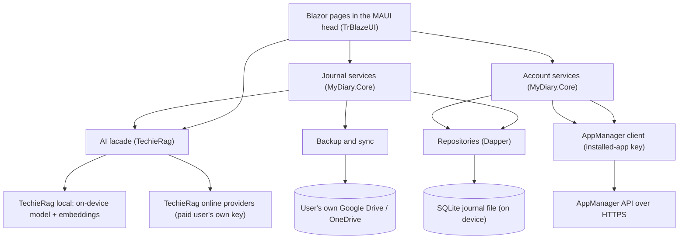
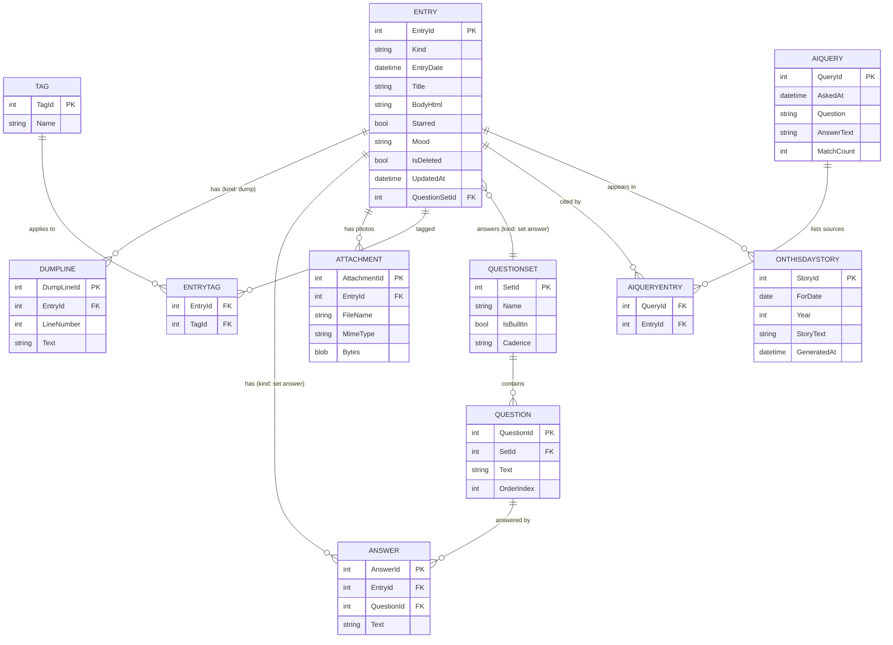

<!-- tf-schema
doc: architecture
file: docs/MyDiary-Architecture.md
header: App, Kind, Size, Stack answer set, Date
section: Stack decisions | required
section: Solution structure | required
section: Component map | required
section: Data model | required
section: Cross-cutting | required
section: Decisions log | required
section: Module responsibilities | optional-small
section: Open questions | optional
-->

# MyDiary — Architecture

| | |
|---|---|
| App | MyDiary |
| Kind | app |
| Size | Medium |
| Stack answer set | dotnet (`.tfcore/templates/stack-defaults/dotnet.md`, "TechieFlow — Stack Defaults: .NET") |
| Date | 2026-10-25 |

## 1. Stack decisions

One row per stack question (`.tfcore/templates/stack-questions.md`). "Source" says where the answer came from: the brief (`docs/MyDiary-Brief.md`), the answer set, or a default recorded on the owner's instruction at day-1 ("where the brief is silent, take the answer set's default and record the choice").

| Q | Topic | Decision | Source |
|---|---|---|---|
| Q1 | Configuration | Non-secret configuration lives in `appsettings.json`, layered by `appsettings.{Environment}.json`; no other configuration mechanism is created. The MAUI head bundles `appsettings.json` as a raw asset and reads it at startup; `Development` layering applies on the developer machine only. | answer set: dotnet (default; brief silent) |
| Q2 | Secrets in development | Project user secrets (`dotnet user-secrets`) on the developer machine, never committed. `appsettings.Development.json` is committed and never holds a real secret. A `secrets.example.json` in the project lists every key the application reads. Two MyDiary specifics: the AppManager **installed-app key** (`pk_live_…`) is public by design — it ships inside the installed app and carries no secret, so it is configuration, not a secret; a paid user's own AI-service key and the app-lock PIN are user data and live in the device's OS secure storage, never in `appsettings`. | answer set: dotnet (default; brief silent), plus the brief's installed-app-key rule |
| Q3 | Database | SQLite on every device, one journal file in the app's private storage. The brief fixes the shape: MyDiary has no server of its own, a free user's "everything stays on that device", and a paid user's sync goes to **their own** Google Drive or OneDrive — so there is no server database anywhere in this product. The answer set's default engine (PostgreSQL in Docker) is a server engine and cannot run on a phone; the brief's constraint wins, and the engine left unnamed by the brief is taken as SQLite (`Microsoft.Data.Sqlite`), the .NET on-device standard. Docker and PostgreSQL are not used by this project at all. | brief (device-local journal, no server) + recorded default for the engine |
| Q4 | Authentication | **AppManager** (`docs/AppManager-api-usage-guide.md`), with its **installed-app key**: `X-Api-Key: pk_live_…` alone (no secret) plus `X-Device-Id` on every call — the brief fixes this and AppManager counts as part of the application, not an external integration. Sign-up uses `POST /AuthSvc/device-register`, sign-in `POST /AuthSvc/device-login` (both require a `deviceInfo.deviceId` generated once per installation and persisted), password reset `POST /AuthSvc/forgot-password` then `/AuthSvc/reset-password`, refresh `POST /AuthSvc/refresh`, and every password field is RSA-encrypted (`GET /AuthSvc/public-key`, RSA-OAEP-SHA256, base64). Profile: `GET`/`PUT /UserSvc/profile`; change password `POST /UserSvc/change-password`; licence `POST /LicenseSvc/validate` and `GET /LicenseSvc`; devices `GET /AuthSvc/devices`, forget `DELETE /AuthSvc/devices/{aUserDeviceId}`, block and unblock `POST /AuthSvc/devices/{aUserDeviceId}/block` / `unblock`; problem reports `POST /IssueSvc`; data copy `POST /UserSvc/data-export`; account deletion `POST /UserSvc/delete-request` — every endpoint an installed-app key may call, and all the brief asks for. AppManager never sees journal text. Roles and licences are owned by AppManager; MyDiary only reads what the licence check returns. | brief |
| Q4a | Test users of an AppManager app | MyDiary registers its own test users on AppManager through the register call under MyDiary's application id: `mydiary-owner@…` (owner walkthrough), `mydiary-second@…` (second device / cap tests), `mydiary-yolo-tester@…` (unattended runs). A script in the project (`tests/verify/register-test-users.mjs`) generates each password and writes it only to the project's git-ignored secrets (user secrets or a git-ignored `.env.local`). The UsageGuide's Test users table lists the three, names where each password is kept, and never holds a password. An agent never asks for, stores or uses the owner's personal AppManager account. | answer set: dotnet (follows from Q4) |
| Q5 | Logging | Serilog, always, with file logging wired at startup before anything else can fail. During development the file sits under the build output folder (`bin/`, git-ignored); on an installed device it sits in the OS app-data folder. Nothing about the user's journal text is written to the log. | answer set: dotnet (default; brief silent) |
| Q6 | Tests | xUnit, always. A test project exists from day-1 (`tests/unit`, project `MyDiary.Tests`): domain logic (dump save rules, streak, on-this-day date matching, licence-name mapping, Day One import mapping), services, and bUnit component tests for the Blazor UI. The `tests/playwright` folder (present in the repo scaffold) is kept for the verification harness's web sweeps; the MAUI heads themselves are driven by FlaUI / Appium per the build invocation ladder. | answer set: dotnet (default; brief silent) |
| Q7 | Layout and naming | `src/` and `tests/` at the root. The primary executable project is named exactly `MyDiary` (the MAUI Blazor Hybrid app, multi-targeting Android, iOS/iPadOS, Mac Catalyst and Windows); `MyDiary.App` is banned. No secondary heads: one multi-targeted project serves all five platforms, which is what the brief demands ("the same screens work on Android, iPhone, iPad, Windows and Mac"). Supporting projects take descriptive names: `MyDiary.Core` (class library), `MyDiaryDb` (migrations). | answer set: dotnet (default; brief silent) |
| Q8 | User interface | **TrBlazeUI** (brief: fixed choice) on a **MAUI Blazor Hybrid** head: NuGet package `TrBlazeUI.Components` (it brings `TrBlazeUI.Primitives`), icons from `TrBlazeUI.Icons.Lucide`. Rendering mode: **Blazor Hybrid** — the MAUI app hosts the UI in a `BlazorWebView`, fully interactive, no server and no SSR; the same Blazor component set renders on every platform. The answer set leaves the rendering mode per project; this is the recorded choice, and the only one that gives one UI for five platforms. | brief (TrBlazeUI, five platforms) + rendering mode recorded |
| Q9 | Hosting | Not yet asked (UAT). MyDiary is an installed app, not a hosted service; the phase-2 purchase/landing web app is a separate project with its own day-1. | per the questionnaire |
| Q10 | Production secrets | Not yet asked (production). Nothing in this document states where production secrets live. | per the questionnaire |
| Q11 | Standing rules | From the answer set, each holding here: 1. Never add a NuGet package without a line in this document saying why (every package is listed below with its reason). 2. Never create a second configuration mechanism. 3. When TechieFlow, TrBlazeUI, TechieRag or any other internal library lacks something, record it in that library's feedback file (`docs/MyDiary-TrBlazeUI-Feedback.md`, `docs/MyDiary-TechieRag-Feedback.md`, `docs/MyDiary-AppManager-Feedback.md`) and hold the feature until the library is fixed; never implement a workaround. 4. Data access is always Dapper (over `Microsoft.Data.Sqlite` here). 5. Database migrations live in a dedicated project named `MyDiaryDb` using the DbUp package; the app runs the migration at startup; never a `database` folder of loose scripts at the repository root. 6. Log files are written under the build output folder (`bin/`), git-ignored, never at the repository root (on an installed device, the OS app-data folder). 7. No unnecessary folders at the repository root (`data`, `database`, `scripts` and the like); everything sits under `src/` or `tests/` according to what it belongs to. | answer set: dotnet |

Required packages: `TrBlazeUI.Components`, `TrBlazeUI.Icons.Lucide`, `TechieRag`, `TechieRag.Embedded`, `TechieRag.Local`, `Microsoft.Data.Sqlite`, `Dapper`, `DbUp` (SQLite provider), `Google.Apis.Drive.v3`, `Microsoft.Graph`, `Plugin.Fingerprint`

Each required package's reason is a row in the Decisions log below (rule Q11.1). The answer set's own required-packages line names `TrBlazeUI.Components` for a project with a Blazor or MAUI Blazor Hybrid head, and `tf-stack-check.sh` fails the build check if no project file references it; the rest are this project's own additions, each with a logged why.

## 2. Solution structure

| Project | Kind | Purpose |
|---|---|---|
| `MyDiary` | MAUI Blazor Hybrid app (the primary executable, named exactly `MyDiary`, at `src/MyDiary`) | The one head: Android, iPhone, iPad, Windows and Mac from a single multi-targeted project (`net10.0-android`, `net10.0-ios`, `net10.0-maccatalyst`, `net10.0-windows10`). Holds the Blazor pages and layout (TrBlazeUI), the app shell, platform services (biometric unlock, reminders/local notifications, file pickers, secure storage, the installed-app key and device id) and startup wiring: Serilog first, then the `MyDiaryDb` migration, then the Blazor WebView. |
| `MyDiary.Core` | class library (at `src/MyDiary.Core`) | The journal domain and every service, with no UI and no MAUI dependency: entries (10-Thought Dump, Free-Flow, set answers), question sets, tags, moods, stars, streak, On This Day story generation, Ask (plain-language questions over the journal), compare, search and filters, export/import (JSON and Day One), backup/sync to the user's own Drive or OneDrive, the AppManager API client, the licence rule (free / Pro / Pro-Plus) and the offline 30-day grace. Also home to the TechieRag facade — MyDiary writes no AI code of its own. |
| `MyDiaryDb` | migrations project (library, at `src/MyDiaryDb`) | The on-device SQLite schema as DbUp migrations: entries, dump lines, question sets and questions, answers, tags, attachments, AI queries and their source entries, On This Day story cache, app settings, sync state and tombstones. Run by the app at startup, before the first page renders. |
| `MyDiary.Tests` | xUnit test project (at `tests/unit`) | Domain and service tests: dump save rules, streak counting, On This Day date windows, licence-name mapping, device-cap refusal rules, offline grace, Day One import mapping, backup file format; bUnit component tests for the Blazor screens. |
| `tests/playwright` | (scaffold, kept) | Reserved for the verification harness's Playwright sweeps against the web view; the MAUI heads are driven per the build invocation ladder (FlaUI / Appium on the Windows head). Empty until the build. |

## 3. Component map

**How a request travels** (one typical request — asking the journal a plain question, which touches every layer):

1. The Ask page calls the AI facade with the user's question; the facade is the only door to TechieRag, and MyDiary writes no AI code of its own.
2. The facade retrieves candidate entries from the journal repository (semantic match over the local vector index built by TechieRag, plus keyword filtering by date, tag, set, photo, star and mood), then asks the configured model — for a free user always the smallest built-in model, installed with the app and running on the device; for a paid user, the model they chose, or the online service whose key they entered (with the warning that journal text will then be sent to that service).
3. The repository reads the SQLite journal file through Dapper and returns the matching entries, each carrying its tags, mood, star and photos.
4. The answer page shows the counted answer ("how many coffee bottles did I open last year?") with the source entries listed beneath it; when no entry matches, it says so and never makes one up — the facade returns a "no match" verdict instead of an answer.

A sign-in travels differently, and it is worth spelling out because it is where MyDiary's own rules bite. The account service calls AppManager's `POST /AuthSvc/device-login` with the installed-app key, the persisted `deviceId` in the required `deviceInfo` block, and the RSA-encrypted password. AppManager answers with tokens, the signing-in device's record and — when a device-capped licence applies — a `deviceCap` block (`deviceCount`, `maxDevices`, `isOverCap`, `warning`). That answer is the raw material for MyDiary's licence rule: no active licence means free, so the account service checks `GET /AuthSvc/devices` and, if another device already holds the one free slot, refuses the sign-in with the brief's message that a paid licence allows more; a Pro or Pro-Plus user over their number is refused with the message that says how to free a slot. Only when the rule passes does the app store the tokens, cache the licence (name, key, devices allowed and used, plan end), stamp the last-check time, and let the user through to Home.

Writing while offline travels the shortest path of all: the 10-Thought Dump page saves its ten numbered lines straight to the repository — the empty ones dropped on save — and the streak, timeline and calendar the Home screen shows are all local queries against the SQLite file. Nothing in that flow touches the network, which is what keeps the app usable offline for 30 days and what keeps a free user's journal text on their device, always.

## 4. Data model

One journal per installation, in one SQLite file on the device. Every row carries `UpdatedAt` and a tombstone (`IsDeleted`) so a paid user's sync can move changes between devices without losing deletes.

| Entity | Key fields | Notes |
|---|---|---|
| Entry | Kind (`Dump` / `FreeFlow` / `SetAnswer`), EntryDate, Title, BodyHtml, Starred, Mood, IsDeleted, UpdatedAt, QuestionSetId | One row per written thing. A 10-Thought Dump saves its non-empty lines as DumpLine rows (empty ones are dropped on save); a Free-Flow entry holds formatted HTML and its photos as Attachment rows; a set answer links the QuestionSet it answered. There is no journal table and no journal picker — a user keeps exactly one journal (brief item 9), so no Journal entity exists at all. |
| QuestionSet | Name, IsBuiltIn, Cadence | The seven built-in sets the brief names (Monthly Goals, Yearly Review, Health, Fitness, Weekly Retro, Project Retro, Gratitude) plus sets the user builds. Cadence drives the due suggestion on Home (for example Monthly Goals due on the 1st). |
| Question | SetId, Text, OrderIndex | The questions inside a set; a user building their own set adds these. |
| Answer | EntryId, QuestionId, Text | One answer per question per answering session; Compare reads these across months and years for one question. |
| Tag / EntryTag | Name / EntryId, TagId | Tags a user adds to entries; the Search filter and the timeline use them. |
| Attachment | EntryId, FileName, MimeType, Bytes | Photos on a Free-Flow entry; the Search "photo" filter means an entry that has at least one. |
| AiQuery / AiQueryEntry | Question, AnswerText, MatchCount / QueryId, EntryId | The Ask history: what was asked, the counted answer, and the entries it was computed from, so the source list can be reopened. MatchCount 0 is stored as a no-match answer, never a made-up one. |
| OnThisDayStory | ForDate, Year, StoryText, GeneratedAt | The generated warm story per past year for a date, cached so it is generated once and shown every time that date comes round. |
| AppSetting (and OS secure storage) | Key, Value | Journaling reminders, chosen AI model, sync state, the device installation id, the cached licence (name, key, devices allowed and used, plan end) and the last licence-check time that drives the 30-day offline grace. The lock PIN hash and any AI-service key a paid user entered live in the OS secure storage, not in the database. |

## 5. Cross-cutting

- **Identity:** AppManager, with the installed-app key (`pk_live_…`, no secret) and a `X-Device-Id` generated once per installation and persisted. Every call sends `X-Api-Key` and `X-Device-Id`; passwords are RSA-encrypted with AppManager's cached public key; access tokens refresh through `/AuthSvc/refresh`. The device-rate limit (60 requests a minute per device) is respected with the client's own retry-after handling.
- **The licence rule (MyDiary's own, from the brief):** what is paid is decided from the licence key and licence name that `POST /LicenseSvc/validate` returns — "Pro" allows 2 devices, "Pro-Plus" allows more than 2 (the number set on the licence in AppManager, read from `devicesAllowed`), and no paid licence means free. AppManager's `device-login` deliberately does **not** refuse a sign-in over the cap (it issues tokens and reports `deviceCap.isOverCap`), so MyDiary enforces the brief's refusals itself: a free account may use only its one registered device, and a paid account only up to its licence's number; a device beyond that is refused with the brief's messages ("a paid licence allows more" / "how to free a slot"). When a paid licence ends, the app falls back to free mode and the journal stays whole on the current device.
- **Offline:** the app keeps working offline for up to 30 days from the last successful licence check, then must check the licence online again; the last-check time is an app setting. Everything journal-related (write, browse, search, Ask on the free on-device model, On This Day) works offline — journal text never leaves the device for a free user.
- **Configuration:** `appsettings.json` (bundled asset) with `appsettings.{Environment}.json` layering on the developer machine; nothing else.
- **Logging:** Serilog wired at startup before anything else can fail; files under `bin/` (development) or the OS app-data folder (installed); no journal text in logs.
- **Errors:** AppManager error codes (`DEVICE_BLOCKED`, `INVALID_RESET_TOKEN`, `EMAIL_MISMATCH`, `RATE_LIMITED`, and the rest) are mapped to the brief's plain messages; an unreachable AppManager inside the 30-day grace degrades to offline mode, and beyond it the app asks to go online; the AI facade's no-match verdict is a first-class result, never an error and never an invented answer.
- **The paid AI warning:** when a paid user opens the model picker, the page warns in place that entering their own key for an online service (any service TechieRag supports, such as OpenAI) means journal text will be sent to that service. The choice, the key and the warning's acknowledgement are per-device settings; a free user never sees an online option, because sending journal text anywhere for a free user is out of scope by the brief.
- **Sync and tombstones:** every journal row carries `UpdatedAt` and `IsDeleted`, so a paid user's sync between devices moves forward the rows that changed and the deletions that happened, without a server of MyDiary's own — the user's Drive or OneDrive folder holds the journal file and the change log, and each device reconciles against it when it can reach it.

## 6. Decisions log

| Date | Decision | Why | Status |
|---|---|---|---|
| 2026-10-25 | One MAUI Blazor Hybrid project for all five platforms (Android, iPhone, iPad, Windows, Mac) | Brief item 24: the same screens on all five; one UI codebase is the only way to keep them the same | decided |
| 2026-10-25 | SQLite as the on-device journal store (`Microsoft.Data.Sqlite`) | Brief: no server of its own, free user's data stays on the device, sync goes to the user's own Drive/OneDrive; a phone cannot run the answer set's PostgreSQL default | decided |
| 2026-10-25 | Package `TrBlazeUI.Components` (+ `TrBlazeUI.Primitives`, which it brings) and `TrBlazeUI.Icons.Lucide` | Brief fixed choice: screens are built with TrBlazeUI | decided |
| 2026-10-25 | Package `TechieRag` | Brief: every AI feature, built-in or online, is done through TechieRag; the core library brings the online providers (OpenAI and friends) a paid user's own key unlocks, and the local vector store (SQLite-vec) that Ask and semantic search read | decided |
| 2026-10-25 | Package `TechieRag.Embedded` | Brief: the free tier's AI runs on the device; TechieRag.Embedded provides the offline ONNX embeddings that keep retrieval local | decided |
| 2026-10-25 | Package `TechieRag.Local` | Brief: free users get the smallest built-in AI model, installed with the app, running on the device; TechieRag.Local provides the in-process language model (the exact model id is confirmed at build against the version then current) | decided |
| 2026-10-25 | Package `Dapper` | Answer set standing rule 4: data access is always Dapper | decided |
| 2026-10-25 | Package `DbUp` (SQLite provider) in `src/MyDiaryDb`, run at app startup | Answer set standing rule 5: migrations in a dedicated `<App>Db` project, run by the application at startup | decided |
| 2026-10-25 | Package `Google.Apis.Drive.v3` | Brief item 21: a paid user backs the journal up to their **own** Google Drive; the Drive client is the Google-supported way | decided |
| 2026-10-25 | Package `Microsoft.Graph` | Brief item 21: the same for OneDrive, via the Graph SDK | decided |
| 2026-10-25 | Package `Plugin.Fingerprint` | Brief item 23: fingerprint/face unlock next to the PIN; the MAUI biometric plugin wraps Android BiometricPrompt / iOS LAContext / Windows Hello | decided |
| 2026-10-25 | MyDiary enforces the device caps itself (free = 1 device; Pro = 2; Pro-Plus = the number set in AppManager) | Brief items 4-7 and 8: AppManager's sign-in never refuses over-cap; the refusal messages ("a paid licence allows more", "how to free a slot") are MyDiary's | decided |
| 2026-10-25 | On This Day stories are generated (TechieRag, on-device model for free) and cached per date-and-year | Brief item 15: a short warm story per past year, not a list of entries | decided |
| 2026-10-25 | Ask answers are grounded: counted answer plus the source entries listed; a no-match verdict is returned, never an invented answer | Brief item 17 | decided |
| 2026-10-25 | Backup and sync write to the user's own Drive/OneDrive folder; the journal file is never sent anywhere else | Brief item 21 and the out-of-scope rule: no other sync service, no journal text sent anywhere for a free user | decided |
| 2026-10-25 | Import accepts a Day One export in addition to MyDiary's own JSON | Brief item 22 | decided |
| 2026-10-25 | The 30-day offline grace from the last successful licence check, then an online check is required | Brief item 2 | decided |
| 2026-10-25 | No Buy button, no in-app payment; the admin assigns paid licences in AppManager until the phase-2 purchase web app exists | Brief out-of-scope: purchase and landing page are a separate web app in phase 2 | decided |
| 2026-10-25 | PIN hash, biometric setting and any paid user's AI-service key live in the OS secure storage | Lock and keys are device secrets, not journal data; keeps them out of the SQLite file and of any backup of it | decided |

## 7. Module responsibilities

| Module | Responsibility | Depends on |
|---|---|---|
| `src/MyDiary` (head) | The Blazor pages and layout (TrBlazeUI), navigation, the app shell and startup order (Serilog → migration → WebView), platform services: biometric unlock, reminders as local notifications, photo picker, export/import file pickers, secure storage, the installed-app key and the installation's `deviceId` | MyDiary.Core, MyDiaryDb |
| `MyDiary.Core` — journal | Entries of the three kinds, dump lines (empty ones dropped on save), question sets (seven built-in plus user-built), answers, tags, stars, moods, photos, timeline and calendar queries, streak, search with all six filters | Dapper, Microsoft.Data.Sqlite |
| `MyDiary.Core` — reflection | On This Day (per-year warm stories, cached), Ask (plain-language questions, counted answers, source entries, no-match verdict), Compare (one question's answers across months and years) | TechieRag facade, journal module |
| `MyDiary.Core` — AI facade | The only door to TechieRag: provider configuration per tier (free: smallest built-in on-device model; paid: chosen model, or own-key online service with the journal-text warning), retrieval over the local vector index, story and answer generation, token/cost accounting | TechieRag, TechieRag.Embedded, TechieRag.Local |
| `MyDiary.Core` — account | AppManager client (installed-app key, `X-Device-Id`, RSA password encryption, token refresh), the licence rule and device-cap enforcement, plan and device list, problem reports, data copy and deletion requests, the 30-day offline grace | AppManager API over HTTPS |
| `MyDiary.Core` — backup | Backup to and restore from the user's own Google Drive or OneDrive (paid), sync between the paid user's devices via the backup file and per-row change tracking, export to JSON and import from JSON (any user), Day One import mapping | journal module, Google.Apis.Drive.v3, Microsoft.Graph |
| `MyDiaryDb` | The SQLite schema as DbUp migrations, run at startup | DbUp |
| `MyDiary.Tests` | Domain, service and component tests named in Q6 | MyDiary.Core, bUnit, xUnit |

## 8. Open questions

- The AppManager administrator must register MyDiary as an application and issue its installed-app key (`pk_live_…`) before the build can sign in; the dev/test key arrives from the owner — an assumption recorded here, not decided in this document.
- The exact model id TechieRag.Local ships as the "smallest built-in model" is confirmed at build time against the TechieRag version then current; the brief fixes the behaviour (installed with the app, runs on the device), not the id.
- Reminders on iOS and Mac Catalyst need notification permission; the exact local-notification scheduling per platform is a build-time detail of the head project.
- The phase-2 purchase/landing web app is a separate project with its own day-1; nothing here designs for it beyond the exclusion of a Buy button.
