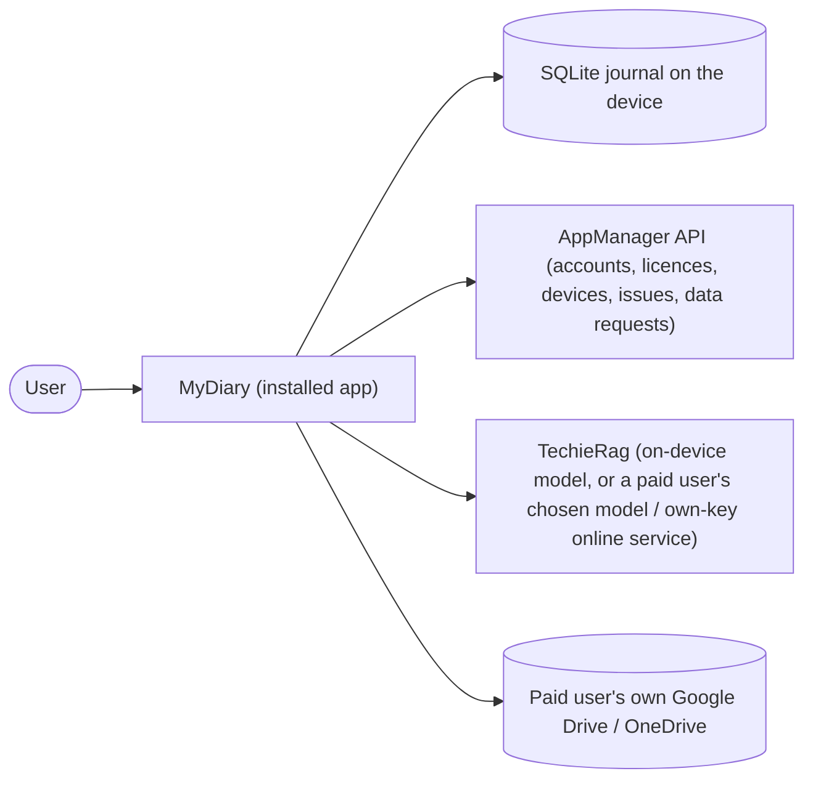

<!-- tf-schema
doc: brd
file: docs/MyDiary-BRD.md
header: App, Kind, Size, Stack answer set, Status, Date
section: Summary | required | max 200
section: Scope | required
section: Users and roles | required
section: Screens and flow | required
section: Requirements | required
section: Non-functional requirements | required
section: Development status | required
section: Context diagram | optional-small
section: Constraints and assumptions | optional-small
section: Risks | optional-small
section: Glossary | optional
budget: S 6000 8000 | M 10000 15000 | L 10000 15000
rule: brd-ledger
rule: screens-table
rule: mockup-links
-->

# MyDiary — Business Requirements

| | |
|---|---|
| App | MyDiary |
| Kind | app |
| Size | Medium |
| Stack answer set | dotnet (`.tfcore/templates/stack-defaults/dotnet.md`) |
| Status | Draft |
| Date | 2026-10-25 |

## 1. Summary

MyDiary is a private journaling app for phone, tablet and computer: one journal per person, three ways to write — a 10-Thought Dump of ten numbered quick lines, a Free-Flow entry with formatting and photos, and Targeted Questioning sets (Monthly Goals, Yearly Review, Health, Fitness, Weekly Retro, Project Retro, Gratitude, and sets you build yourself). Opening it shows a short, warm story of what you wrote on this date in past years, a streak, and today's entries; you can ask plain questions about your past ("how many coffee bottles did I open last year?") and get a counted answer listing the entries it used, or see one question's answers side by side across months or years. It is free on one device with the smallest built-in AI model running on the device; a paid licence adds backup and use on several devices, and a choice of AI model. Accounts, sign-in, devices, licences, problem reports and account-data requests all use the AppManager API; screens are built with TrBlazeUI; every AI feature goes through TechieRag.

## 2. Scope

**In:**

- Creating a MyDiary account, or signing in, on first launch — through AppManager's device endpoints, with the installed-app key.
- Working offline for up to 30 days from the last licence check; then an online licence check is required again.
- Resetting a forgotten password, editing the profile, changing the password — all from inside the app.
- The free tier: one device only. Signing in on a second device is refused, with a message saying a paid licence allows more.
- The paid tiers: "Pro" allows 2 devices; "Pro-Plus" allows more than 2 — the number set on the licence in AppManager. A device over that number is refused, and the message says how to free a slot. No paid licence means free.
- Seeing the plan, when it ends, and every device signed in to the account, with how many of the allowed devices are in use; forgetting or blocking a device; unblocking one's own.
- When a paid licence ends: the user keeps every free feature and their whole journal on the current device.
- One journal per person, always. There is no list of journals to pick from.
- Writing a 10-Thought Dump: ten numbered quick lines, empty ones dropped on save.
- Writing a Free-Flow entry with formatting and photos.
- Answering Targeted Questioning sets — the seven built-in sets and sets the user builds.
- The app suggesting a question set when it is due (for example Monthly Goals on the 1st).
- The home screen: today's entries, a streak, and the On This Day card.
- On This Day: for each past year, a short warm story of what was written on this date or around it — a story, not a list of entries.
- Browsing entries by timeline or calendar; adding tags, starring entries, picking a mood.
- Search by keyword, with filters for date, tag, question set, photo, star and mood.
- Asking questions in plain words and getting counted answers with the source entries listed; when no entry matches, it says so and never makes one up.
- Seeing one question's answers side by side across months or years.
- Free users get the smallest built-in AI model, installed with the app, running on the device.
- A paid user can choose a different AI model, or enter their own key for any online AI service TechieRag supports (such as OpenAI) — with a warning that journal text will then be sent to that service.
- A paid user can back the journal up to their own Google Drive or OneDrive, sync it between devices, and restore it on a new device.
- Any user, free or paid, can export the journal to a JSON file and import one — including an export from Day One.
- Locking the app with a PIN or fingerprint/face, and setting journaling reminders.
- The same screens on Android, iPhone, iPad, Windows and Mac.
- Problem reports and account-data requests (a copy, or deletion) sent from inside the app through AppManager.

**Out:**

- The purchase and landing page: a separate MyDiary web app in phase 2, which buys licences through AppManager. Until then the admin assigns paid licences in AppManager, and MyDiary has no "Buy" button.
- Taking payment inside the app, and app-store purchases.
- More than one journal, shared journals, and family groups sharing one licence.
- Sending journal text anywhere for a free user. Online AI only happens when a paid user enters their own key.
- iCloud, Dropbox and any other sync service.
- Map view, voice transcription, widgets, handwriting, sharing an entry as an image.

## 3. Users and roles

| Role | Who they are | What they need |
|---|---|---|
| Free user | Writes on one device; everything stays on that device | The full journaling experience on one device — all three ways to write, browse, search, Ask, On This Day, compare, export/import, lock and reminders — with the smallest built-in AI model running on the device, offline working for 30 days, and journal text never sent anywhere |
| Paid user | Holds a Pro or Pro-Plus licence assigned in AppManager | Everything a free user has, plus use on several devices (Pro: 2; Pro-Plus: the number set on the licence), backup to and restore from their own Google Drive or OneDrive, sync between devices, and a choice of AI model — including their own key for an online service, with the warning that journal text will then be sent to it |
| Goal reviewer | A free or paid user who runs monthly, yearly, health, fitness or project reviews | The Targeted Questioning sets front and centre: the set that is due suggested on Home, the answers saved with the entry they belong to, and one question's answers side by side across months or years on the Compare screen |
| Owner (admin) | Assigns paid licences and reads problem reports on the AppManager site | Does nothing inside MyDiary — no in-app admin screens exist; the app only shows the plan and devices AppManager reports back |

## 4. Screens and flow

One row per routed page. A dialog is a row under its parent screen with `on /route` in the Route column; it is not counted as a screen.

| Screen | Route | Role | Mockup | Fields |
|---|---|---|---|---|
| Sign in | `/signin` | Free user, Paid user, Goal reviewer | [mockup](mockups/signin.html) | email, password, sign-in button, create-account link, forgot-password link |
| Create account (dialog) | on `/signin` | Free user, Paid user, Goal reviewer | [mockup](mockups/signin-create-account.html) | first name, last name, email, password, confirm password, device name |
| Forgot password (dialog) | on `/signin` | Free user, Paid user, Goal reviewer | [mockup](mockups/signin-forgot-password.html) | email; then reset token, new password |
| Home | `/home` | Free user, Paid user, Goal reviewer | [mockup](mockups/home.html) | today's entries list, streak count, On This Day card per year, due-set suggestion |
| Unlock (dialog) | on `/home` | Free user, Paid user, Goal reviewer | [mockup](mockups/home-unlock.html) | PIN digits, use fingerprint/face button |
| 10-Thought Dump | `/write/dump` | Free user, Paid user, Goal reviewer | [mockup](mockups/write-dump.html) | ten numbered lines, save button |
| Free-Flow | `/write/free` | Free user, Paid user, Goal reviewer | [mockup](mockups/write-free.html) | title, rich-text body, photos, save button |
| Question sets | `/sets` | Goal reviewer (any user) | [mockup](mockups/sets.html) | set cards with due state, build-your-own button, answer button per set |
| Build your own set (dialog) | on `/sets` | Goal reviewer (any user) | [mockup](mockups/sets-build-own.html) | set name, cadence, question rows, save |
| Answer a set | `/sets/answer` | Goal reviewer (any user) | [mockup](mockups/sets-answer.html) | question steps, answer textarea, save button |
| Timeline | `/timeline` | Free user, Paid user, Goal reviewer | [mockup](mockups/timeline.html) | date-grouped entry rows, open, new-entry buttons |
| Entry (dialog) | on `/timeline` | Free user, Paid user, Goal reviewer | [mockup](mockups/timeline-entry.html) | entry text, tags, mood, star, edit, delete |
| Calendar | `/calendar` | Free user, Paid user, Goal reviewer | [mockup](mockups/calendar.html) | month grid with entry counts, month switcher |
| Day entries (dialog) | on `/calendar` | Free user, Paid user, Goal reviewer | [mockup](mockups/calendar-day.html) | the day's entries, open button per entry |
| Search | `/search` | Free user, Paid user, Goal reviewer | [mockup](mockups/search.html) | keyword, date range, tag, question set, photo, star, mood, results list |
| Ask | `/ask` | Free user, Paid user, Goal reviewer | [mockup](mockups/ask.html) | chat thread, composer, counted answer, source entries |
| Compare | `/compare` | Goal reviewer (any user) | [mockup](mockups/compare.html) | set picker, question picker, side-by-side answers |
| Settings | `/settings` | Free user, Paid user, Goal reviewer | [mockup](mockups/settings.html) | profile fields, password fields, lock PIN and biometric, reminders, AI model picker |
| Plan & devices | `/settings/plan` | Free user, Paid user, Goal reviewer | [mockup](mockups/settings-plan.html) | plan name, end date, devices used of allowed, device table, forget, block |
| Backup & sync | `/settings/backup` | Paid user (free user sees export/import) | [mockup](mockups/settings-backup.html) | connect Drive, connect OneDrive, sync status, backup now, restore, export JSON, import JSON |
| Support & privacy | `/settings/support` | Free user, Paid user, Goal reviewer | [mockup](mockups/settings-support.html) | problem report fields, request data copy, request account deletion |
| Confirm deletion (dialog) | on `/settings/support` | Free user, Paid user, Goal reviewer | [mockup](mockups/settings-support-delete.html) | confirm email, reason, confirm button |

**Primary journey:**

1. A new user opens MyDiary on first launch, creates an account in the Create account dialog on `/signin` (or signs in), and lands on Home.
2. Home shows today's entries, the streak, the On This Day card, and — on the 1st of a month — the suggestion to answer Monthly Goals.
3. The user taps the suggestion (or opens Question sets), answers the set's questions on `/sets/answer`, and saves; the answers join the journal.
4. Days later the user writes a 10-Thought Dump from the sidebar, then browses the Timeline, opens an entry, adds a tag and stars it.
5. The user opens Ask, types "how many coffee bottles did I open last year?", and reads the counted answer with the source entries listed.
6. In Settings the user sets a journaling reminder and locks the app with a PIN; in Plan & devices a paid user sees 2 of 3 devices in use and forgets an old phone.

## 5. Requirements

One item per thing the verifier will test. Each names its screen, links the mockup, and states its acceptance in the form the checklist will carry. Items are grouped under a `###` heading per screen that opens with one plain sentence saying what the screen does.

### Sign in

The first screen of the app: sign in, create an account, or reset a forgotten password — all through AppManager with the installed-app key.

- **BRD-1** — Create an account. *Screen:* Sign in · *Mockup:* [mockup](mockups/signin-create-account.html)
  - *Acceptance:* When a new user confirms the Create account dialog, then the account is created and Home opens signed in.
- **BRD-2** — Sign in. *Screen:* Sign in · *Mockup:* [mockup](mockups/signin.html)
  - *Acceptance:* When a returning user presses Sign in with email and password, then Home opens.
- **BRD-3** — Reset a forgotten password. *Screen:* Sign in · *Mockup:* [mockup](mockups/signin-forgot-password.html)
  - *Acceptance:* When a user submits the emailed token with a new password, then the password is reset.
- **BRD-4** — Free account second device refused. *Screen:* Sign in · *Mockup:* [mockup](mockups/signin.html)
  - *Acceptance:* When a free user signs in on a second device, then the refusal message says a paid licence allows more.
- **BRD-5** — Paid device over the limit refused. *Screen:* Sign in · *Mockup:* [mockup](mockups/signin.html)
  - *Acceptance:* When a paid user signs in beyond their licence's device number, then the message says how to free a slot.

### Home

The screen the app opens on: today's entries, the streak, the On This Day card, and the due-set suggestion.

- **BRD-6** — Today's entries. *Screen:* Home · *Mockup:* [mockup](mockups/home.html)
  - *Acceptance:* When the user opens Home, then every entry written today is listed, newest first.
- **BRD-7** — Streak. *Screen:* Home · *Mockup:* [mockup](mockups/home.html)
  - *Acceptance:* When the user opens Home, then the streak shows the days in a row with at least one entry.
- **BRD-8** — On This Day story. *Screen:* Home · *Mockup:* [mockup](mockups/home.html)
  - *Acceptance:* When the user opens Home, then each past year with entries on this date shows one short warm story.
- **BRD-9** — Due-set suggestion. *Screen:* Home · *Mockup:* [mockup](mockups/home.html)
  - *Acceptance:* When a question set is due, then Home shows a suggestion card that opens that set's answer page.
- **BRD-10** — Works offline. *Screen:* Home · *Mockup:* [mockup](mockups/home.html)
  - *Acceptance:* When the device is offline within 30 days of the last licence check, then Home opens and journaling works.
- **BRD-11** — Licence recheck after 30 days. *Screen:* Home · *Mockup:* [mockup](mockups/home.html)
  - *Acceptance:* When 30 days pass without an online licence check, then the app requires a licence check online before continuing.
- **BRD-12** — Unlock with PIN. *Screen:* Home · *Mockup:* [mockup](mockups/home-unlock.html)
  - *Acceptance:* When the app is locked and the user enters the PIN correctly, then the app unlocks to Home.
- **BRD-13** — Unlock with fingerprint or face. *Screen:* Home · *Mockup:* [mockup](mockups/home-unlock.html)
  - *Acceptance:* When the app is locked and the user uses fingerprint or face, then the app unlocks to Home.

### 10-Thought Dump

Ten numbered quick lines, the fast way to write.

- **BRD-14** — Ten numbered lines. *Screen:* 10-Thought Dump · *Mockup:* [mockup](mockups/write-dump.html)
  - *Acceptance:* When the user opens the 10-Thought Dump, then ten numbered input lines are shown.
- **BRD-15** — Empty lines dropped on save. *Screen:* 10-Thought Dump · *Mockup:* [mockup](mockups/write-dump.html)
  - *Acceptance:* When the user saves a dump with empty lines, then the saved entry keeps only the non-empty lines.

### Free-Flow

A longer entry with formatting and photos.

- **BRD-16** — Write with formatting. *Screen:* Free-Flow · *Mockup:* [mockup](mockups/write-free.html)
  - *Acceptance:* When the user saves a Free-Flow entry with bold and list formatting, then the saved entry shows that formatting.
- **BRD-17** — Add photos. *Screen:* Free-Flow · *Mockup:* [mockup](mockups/write-free.html)
  - *Acceptance:* When the user attaches photos to a Free-Flow entry and saves, then the photos show with the entry.

### Question sets

The Targeted Questioning library: seven built-in sets plus the user's own.

- **BRD-18** — The seven built-in sets listed (Monthly Goals, Yearly Review, Health, Fitness, Weekly Retro, Project Retro, Gratitude). *Screen:* Question sets · *Mockup:* [mockup](mockups/sets.html)
  - *Acceptance:* When the user opens Question sets, then all seven built-in sets are listed by name.
- **BRD-19** — Build your own set. *Screen:* Question sets · *Mockup:* [mockup](mockups/sets-build-own.html)
  - *Acceptance:* When the user saves a new set with questions, then the set appears in the set list.

### Answer a set

Answering a set's questions, one entry saved with all its answers.

- **BRD-20** — Answer and save a set. *Screen:* Answer a set · *Mockup:* [mockup](mockups/sets-answer.html)
  - *Acceptance:* When the user answers a set's questions and saves, then the answers are stored with today's date.
- **BRD-21** — Past answers open from a set. *Screen:* Answer a set · *Mockup:* [mockup](mockups/sets-answer.html)
  - *Acceptance:* When the user opens a set answered before, then its past answers are shown.

### Timeline

Browsing the journal by date, opening an entry, tagging, starring, mood.

- **BRD-22** — Browse by timeline. *Screen:* Timeline · *Mockup:* [mockup](mockups/timeline.html)
  - *Acceptance:* When the user opens the Timeline, then entries are grouped under their dates, newest date first.
- **BRD-23** — Open an entry. *Screen:* Timeline · *Mockup:* [mockup](mockups/timeline-entry.html)
  - *Acceptance:* When the user taps an entry on the Timeline, then the Entry dialog shows the entry's full text.
- **BRD-24** — Tag an entry. *Screen:* Timeline · *Mockup:* [mockup](mockups/timeline-entry.html)
  - *Acceptance:* When the user adds a tag in the Entry dialog, then the tag shows on the entry.
- **BRD-25** — Star an entry. *Screen:* Timeline · *Mockup:* [mockup](mockups/timeline-entry.html)
  - *Acceptance:* When the user stars an entry, then the star shows on the entry.
- **BRD-26** — Pick a mood. *Screen:* Timeline · *Mockup:* [mockup](mockups/timeline-entry.html)
  - *Acceptance:* When the user picks a mood for an entry, then the mood shows on the entry.
- **BRD-27** — Edit an entry. *Screen:* Timeline · *Mockup:* [mockup](mockups/timeline-entry.html)
  - *Acceptance:* When the user edits an entry from the Entry dialog and saves, then the change shows on reopening.

### Calendar

Browsing by month, days showing their entries.

- **BRD-28** — Browse by calendar. *Screen:* Calendar · *Mockup:* [mockup](mockups/calendar.html)
  - *Acceptance:* When the user opens the Calendar, then every day with entries is marked in the month grid.
- **BRD-29** — Open a day's entries. *Screen:* Calendar · *Mockup:* [mockup](mockups/calendar-day.html)
  - *Acceptance:* When the user taps a marked day, then that day's entries are listed and can be opened.

### Search

Finding entries by keyword and by the six filters.

- **BRD-30** — Search by keyword. *Screen:* Search · *Mockup:* [mockup](mockups/search.html)
  - *Acceptance:* When the user types a keyword and searches, then every entry containing it is listed.
- **BRD-31** — Filter by date, tag, set, photo, star, mood. *Screen:* Search · *Mockup:* [mockup](mockups/search.html)
  - *Acceptance:* When the user applies filters and searches, then only entries matching every chosen filter are listed.

### Ask

Plain-language questions over the past, answered with a count and the sources.

- **BRD-32** — Ask a plain question. *Screen:* Ask · *Mockup:* [mockup](mockups/ask.html)
  - *Acceptance:* When the user asks a plain question about their past, then a counted answer is shown with its source entries.
- **BRD-33** — No match is said, never invented. *Screen:* Ask · *Mockup:* [mockup](mockups/ask.html)
  - *Acceptance:* When the user asks a question no entry matches, then the app says so and invents nothing.

### Compare

One question's answers side by side across time.

- **BRD-34** — Compare one question. *Screen:* Compare · *Mockup:* [mockup](mockups/compare.html)
  - *Acceptance:* When the user picks a question on Compare, then its answers appear side by side across the years.

### Settings

Profile, password, lock, reminders, and the AI model.

- **BRD-35** — Edit profile. *Screen:* Settings · *Mockup:* [mockup](mockups/settings.html)
  - *Acceptance:* When the user edits their profile fields and saves, then the profile is updated and shown.
- **BRD-36** — Change password. *Screen:* Settings · *Mockup:* [mockup](mockups/settings.html)
  - *Acceptance:* When the user confirms a new password in Settings, then the new password signs in on `/signin`.
- **BRD-37** — Lock with a PIN. *Screen:* Settings · *Mockup:* [mockup](mockups/settings.html)
  - *Acceptance:* When the user sets a lock PIN, then the next launch asks for that PIN before Home opens.
- **BRD-38** — Lock with fingerprint or face. *Screen:* Settings · *Mockup:* [mockup](mockups/settings.html)
  - *Acceptance:* When the user turns on fingerprint or face lock, then the next launch unlocks with that biometric.
- **BRD-39** — Journaling reminders. *Screen:* Settings · *Mockup:* [mockup](mockups/settings.html)
  - *Acceptance:* When the user sets a journaling reminder, then the reminder arrives at the chosen time.
- **BRD-40** — Free AI is on-device. *Screen:* Settings · *Mockup:* [mockup](mockups/settings.html)
  - *Acceptance:* When a free user opens the AI settings, then the on-device built-in model is the only choice.
- **BRD-41** — Paid user chooses a model or own key. *Screen:* Settings · *Mockup:* [mockup](mockups/settings.html)
  - *Acceptance:* When a paid user opens the AI settings, then other models and an own-key online option are offered.
- **BRD-42** — Online AI warning. *Screen:* Settings · *Mockup:* [mockup](mockups/settings.html)
  - *Acceptance:* When a paid user enters their own online key, then a warning says journal text will be sent there.

### Plan & devices

What the user pays for, when it ends, and the devices signed in.

- **BRD-43** — Plan and end date. *Screen:* Plan & devices · *Mockup:* [mockup](mockups/settings-plan.html)
  - *Acceptance:* When the user opens Plan & devices, then the plan name and when it ends are shown.
- **BRD-44** — Devices in use. *Screen:* Plan & devices · *Mockup:* [mockup](mockups/settings-plan.html)
  - *Acceptance:* When the user opens Plan & devices, then every signed-in device is listed with the in-use count of allowed.
- **BRD-45** — Forget a device. *Screen:* Plan & devices · *Mockup:* [mockup](mockups/settings-plan.html)
  - *Acceptance:* When the user forgets a device, then it disappears from the list and its slot is free.
- **BRD-46** — Block a device. *Screen:* Plan & devices · *Mockup:* [mockup](mockups/settings-plan.html)
  - *Acceptance:* When the user blocks a device, then the device is marked blocked in the list.
- **BRD-47** — Licence ends, free mode keeps working. *Screen:* Plan & devices · *Mockup:* [mockup](mockups/settings-plan.html)
  - *Acceptance:* When a paid licence ends, then the app works in free mode with every free feature.
- **BRD-48** — Licence ends, journal kept. *Screen:* Plan & devices · *Mockup:* [mockup](mockups/settings-plan.html)
  - *Acceptance:* When a paid licence ends, then the whole journal stays on the current device.

### Backup & sync

Backup to the user's own cloud, sync between devices, export and import.

- **BRD-49** — Backup to own Drive or OneDrive. *Screen:* Backup & sync · *Mockup:* [mockup](mockups/settings-backup.html)
  - *Acceptance:* When a paid user connects their own Drive or OneDrive and backs up, then the backup time is shown.
- **BRD-50** — Sync between devices. *Screen:* Backup & sync · *Mockup:* [mockup](mockups/settings-backup.html)
  - *Acceptance:* When a paid user writes on one device and opens another, then the new entry arrives through sync.
- **BRD-51** — Restore on a new device. *Screen:* Backup & sync · *Mockup:* [mockup](mockups/settings-backup.html)
  - *Acceptance:* When a paid user restores on a new device, then the whole journal from the backup is present on it.
- **BRD-52** — Export to JSON. *Screen:* Backup & sync · *Mockup:* [mockup](mockups/settings-backup.html)
  - *Acceptance:* When any user exports the journal, then a JSON file of every entry is written.
- **BRD-53** — Import from JSON, Day One included. *Screen:* Backup & sync · *Mockup:* [mockup](mockups/settings-backup.html)
  - *Acceptance:* When a user imports a JSON file, then its entries are added to the journal.

### Support & privacy

Problem reports and account-data requests, from inside the app.

- **BRD-54** — Send a problem report. *Screen:* Support & privacy · *Mockup:* [mockup](mockups/settings-support.html)
  - *Acceptance:* When the user submits a problem report, then AppManager accepts it and the issue number is shown.
- **BRD-55** — Request a copy of account data. *Screen:* Support & privacy · *Mockup:* [mockup](mockups/settings-support.html)
  - *Acceptance:* When the user requests a copy of their account data, then its estimated completion is shown.
- **BRD-56** — Request account deletion. *Screen:* Support & privacy · *Mockup:* [mockup](mockups/settings-support-delete.html)
  - *Acceptance:* When the user confirms the deletion request with their email, then its estimated completion is shown.

## 6. Non-functional requirements

| Id | Area | Requirement | Measure |
|---|---|---|---|
| BRD-57 | Platforms | The same screens work on Android, iPhone, iPad, Windows and Mac — one MAUI Blazor Hybrid UI, TrBlazeUI components throughout | five-platform matrix |
| BRD-58 | Privacy | Journal text never leaves the device for a free user; no server of MyDiary's own exists; AppManager never sees journal text | code review |
| BRD-59 | AI | Every AI feature, built-in or online, goes through TechieRag; MyDiary writes no AI code of its own | code review |
| BRD-60 | Logging | Serilog with file logging wired at startup before anything else can fail; files under `bin/` (development) or the OS app-data folder (installed); never journal text in logs | startup check |
| BRD-61 | Zoom (a desktop head drawn in a web view) | Cmd/Ctrl+=, - and 0 zoom 50% to 300% in 10% steps; the level is kept across restarts | zoom-check: keys · zoom-check: kept |

The brief states no performance numbers, so no `perf-budget:` row is written. The zoom row applies because the Windows and Mac heads draw their screens in a web view (Blazor Hybrid).

## 7. Development status

Written by the status gate after every build, verify and handoff; not by hand.

**Snapshot as of 2026-10-25.** Live per-requirement status: `PROJECT-STATUS.md` and the Requirements Status table in `docs/MyDiary-Checklist.md`.

| Screen | Requirements | Verified | Open | Status |
|---|---|---|---|---|
| Sign in | 5 | 0 | 5 | Planned |
| Home | 8 | 0 | 8 | Planned |
| 10-Thought Dump | 2 | 0 | 2 | Planned |
| Free-Flow | 2 | 0 | 2 | Planned |
| Question sets | 2 | 0 | 2 | Planned |
| Answer a set | 2 | 0 | 2 | Planned |
| Timeline | 6 | 0 | 6 | Planned |
| Calendar | 2 | 0 | 2 | Planned |
| Search | 2 | 0 | 2 | Planned |
| Ask | 2 | 0 | 2 | Planned |
| Compare | 1 | 0 | 1 | Planned |
| Settings | 8 | 0 | 8 | Planned |
| Plan & devices | 6 | 0 | 6 | Planned |
| Backup & sync | 5 | 0 | 5 | Planned |
| Support & privacy | 3 | 0 | 3 | Planned |

## 8. Context diagram

## 9. Constraints and assumptions

- Accounts, sign-in, devices, licences, problem reports and account-data requests use the AppManager API with its installed-app key; MyDiary has no server of its own, and AppManager never sees journal text.
- Screens are built with TrBlazeUI. Every AI feature is done through TechieRag; MyDiary writes no AI code of its own.
- A user keeps one journal; there is no list of journals to pick from, so no screen offers one.
- The app decides what is paid from the licence key and licence name that AppManager's licence check returns: "Pro" allows 2 devices, "Pro-Plus" allows more than 2 (the number set on the licence in AppManager); no paid licence means free.
- The purchase and landing page is a separate phase-2 web app; MyDiary has no "Buy" button until it exists, and no in-app payment or app-store purchases.
- The AppManager administrator has registered MyDiary as an application and issues the installed-app key before the build signs in (an assumption recorded in the Architecture's open questions).
- Goal reviewer is not a separate account type — it is any free or paid user who runs the review sets; the Owner (admin) does everything on the AppManager site and nothing inside MyDiary.

## 10. Risks

| Risk | Likelihood | Impact | Mitigation |
|---|---|---|---|
| AppManager's sign-in never refuses an over-cap device, so the brief's refusals are MyDiary's to implement and test | certain (documented behaviour) | high | The licence rule lives in one `MyDiary.Core` module with its own tests; sign-in, plan and device flows all call it |
| On-device model performance varies per device; Ask and On This Day could feel slow on old phones | medium | medium | The smallest built-in model is the free default; stories and answers are cached (OnThisDayStory, AiQuery) so they are generated once |
| Sync between devices over the user's own Drive/OneDrive has no server to resolve conflicts | medium | high | Per-row `UpdatedAt` with tombstones; last-write-wins on a row, never a merge of text; conflict count surfaced in sync status |
| Online AI with a user's own key sends journal text off device — a privacy step the user must own | medium | high | The in-place warning before the key is saved; free users never see an online option |
| Five platforms, one codebase: platform differences (biometrics, notifications, file pickers) can drift | medium | medium | Platform services isolated in the head project behind one interface; the core stays platform-free and tested |

## 11. Glossary

- **10-Thought Dump** — a journal entry of ten numbered quick lines; empty lines are dropped on save.
- **Free-Flow** — a journal entry with formatting and photos.
- **Targeted Questioning** — answering a question set (Monthly Goals, Yearly Review, Health, Fitness, Weekly Retro, Project Retro, Gratitude, or one built by the user).
- **On This Day** — for each past year, a short warm story of what was written on this date or around it.
- **Streak** — the number of days in a row with at least one entry.
- **Ask** — asking the journal a plain question and getting a counted answer with the source entries listed.
- **Compare** — one question's answers shown side by side across months or years.
- **AppManager** — the shared platform for accounts, sign-in, devices, licences, problem reports and account-data requests; used with its installed-app key.
- **Installed-app key** — AppManager's public key for an app installed on users' own devices (`pk_live_…`, no secret, sent with a device id).
- **Pro / Pro-Plus** — the paid licence names; Pro allows 2 devices, Pro-Plus more than 2 (the number set on the licence in AppManager).
- **TechieRag** — the library every AI feature goes through: the on-device model for free users, or a paid user's chosen model / own-key online service.
- **TrBlazeUI** — the component library all MyDiary screens are built with.
- **Day One** — an existing journaling app whose export format MyDiary's import accepts.
