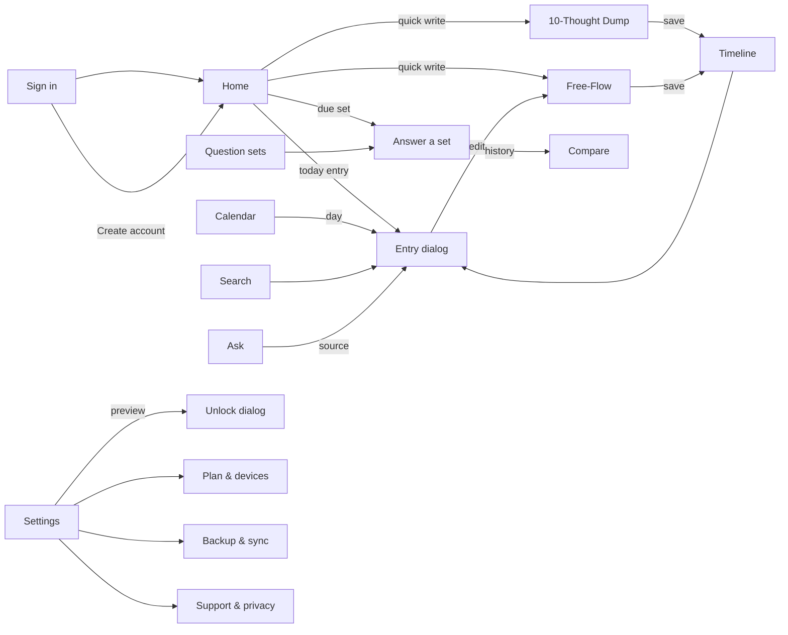

<!-- tf-schema
doc: uidesign
file: docs/MyDiary-UIDesign.md
header: App, Kind, Size, UI library, Theme
section: Design system | required | max 300
section: Screens | required
section: Click-through flow | optional-small
section: Branding guide | optional
entries: Screens | Screen:
per-entry: 250 400
rule: entry-mockup
rule: entry-regions-table
rule: entry-fields-table
rule: entry-states
rule: mockup-links
-->

# MyDiary — UI Design

| | |
|---|---|
| App | MyDiary |
| Kind | app |
| Size | Medium |
| UI library | TrBlazeUI 2.1.9 (`TrBlazeUI.Components`, icons from `TrBlazeUI.Icons.Lucide`) |
| Theme | light (the library's default OKLCH palette; dark mode available via the library's `.dark`) |

## Design system

- **Layout shell:** `SidebarProvider` + `Sidebar` (left, 16rem, collapsible) + `SidebarInset` on every routed screen except Sign in, which uses `CenteredPanel`. The sidebar footer holds the user's `Avatar`, plan line and sign-out icon button; dialogs are `Dialog` (and `AlertDialog` where the action is destructive).
- **Theme:** TrBlazeUI default light theme, OKLCH variables, `--radius` 0.625rem; a warm, quiet reading feel, nothing louder than the library defaults.
- **Shared controls:** `Card` family for every block; `Badge` for kinds, due states and counts; `StatTile`/`StatGroup` for the streak and counters; `Button` variants (primary, outline, ghost, destructive); `Field` + `Input`/`Textarea`/`Select` for all forms; `Tabs` on Settings; `Empty` for empty states; `Alert` for warnings and info.
- **Rules:** 24px between blocks, 16px inside grids; 24px content padding, max-width 960px; 14px base text; 56px page header bar with the page title left and the primary action right; sample data carries `data-tf-sample`; state-only boxes carry `data-tf-state`. Below 768px the sidebar becomes the library's mobile sheet.

## Screens

### Screen: Sign in (`/signin`)

**Mockup:** [mockups/signin.html](mockups/signin.html) · **Roles:** Free user, Paid user, Goal reviewer · **BRD:** BRD-1, BRD-2, BRD-4, BRD-5

| Region | Control | Shows or binds |
|---|---|---|
| Centered panel | `CenteredPanel` + `Card` | The app mark, name, and the one-line promise that the journal stays on the device |
| Sign-in form | `Field` + `Input` | Email and password; the primary `Button` signs in through AppManager's device-login |
| Refusal message | `Alert` (warning, `data-tf-state="error"`) | The free-second-device refusal: "a paid licence allows more" |
| Links | `Button` ghost links | Create an account → the Create account dialog; Forgot password → its dialog |

| Field | Type | Required | Validation |
|---|---|---|---|
| Email | email | yes | AppManager account email; must exist to sign in |
| Password | password | yes | Sent RSA-encrypted, never stored by MyDiary |

**Dialogs opened here:** Create account ([mockup](mockups/signin-create-account.html)): first name, last name, email, password with `PasswordStrength`, confirm password, device name — creates the account and lands on Home; Forgot password ([mockup](mockups/signin-forgot-password.html)): email, then reset token and new password — resets through AppManager.

**States:** empty: the plain form · loading: the button shows a `Spinner` while AppManager answers · error: wrong credentials and the device refusals show as the `Alert`.

### Screen: Home (`/home`)

**Mockup:** [mockups/home.html](mockups/home.html) · **Roles:** Free user, Paid user, Goal reviewer · **BRD:** BRD-6, BRD-7, BRD-8, BRD-9, BRD-10, BRD-11

| Region | Control | Shows or binds |
|---|---|---|
| Stats row | `StatGroup` + `StatTile` | Streak days, entries today, entries this month |
| Due-set card | `Card` + `Badge` success + `Button` | The set that is due (Monthly Goals on the 1st) with a button into its answer page |
| On This Day card | `Card` + `Badge` outline | One warm story per past year, generated on device and cached — never a list of entries |
| Today card | `Card` + entry rows | Today's entries: kind badge, snippet, time, star, mood; a row opens the Entry dialog |
| Header actions | `Button` | 10-Thought Dump and Free-Flow quick starts |

| Field | Type | Required | Validation |
|---|---|---|---|
| (no inputs — the screen is read-and-tap) | | | |

**Dialogs opened here:** Unlock ([mockup](mockups/home-unlock.html)): the lock overlay shown at launch when a PIN or biometric is set — `InputOTP` digits or the fingerprint/face button unlocks to Home.

**States:** empty: "Nothing written today — the day is open" `Empty`; loading: `Skeleton` rows while the journal loads; error: journal file problem shows an `Alert` with the support link.

### Screen: 10-Thought Dump (`/write/dump`)

**Mockup:** [mockups/write-dump.html](mockups/write-dump.html) · **Roles:** Free user, Paid user, Goal reviewer · **BRD:** BRD-14, BRD-15

| Region | Control | Shows or binds |
|---|---|---|
| Ten numbered lines | `Field` + `Input` rows | Ten single-line inputs, numbered 1-10 |
| Save action | `Button` primary | Saves the dump; empty lines are dropped on save |

| Field | Type | Required | Validation |
|---|---|---|---|
| Thought 1-10 | text | no | Empty lines dropped at save; no length games — a thought is short |

**Dialogs opened here:** none.

**States:** empty: ten empty numbered lines, cursor in line 1 · loading: the save button spins · error: a save failure keeps the lines on screen with an `Alert`.

### Screen: Free-Flow (`/write/free`)

**Mockup:** [mockups/write-free.html](mockups/write-free.html) · **Roles:** Free user, Paid user, Goal reviewer · **BRD:** BRD-16, BRD-17

| Region | Control | Shows or binds |
|---|---|---|
| Title | `Field` + `Input` | The entry's title |
| Body | `RichTextEditor` | Formatting: bold, italic, lists, quote — stored as HTML |
| Photos | `FileUpload` + thumbnails | Photos attached to the entry, stored on the device |

| Field | Type | Required | Validation |
|---|---|---|---|
| Title | text | no | 1-120 characters |
| Body | rich text | yes (a non-empty entry) | Formatting kept on save |
| Photos | image files | no | Device photo formats; each stays on the device |

**Dialogs opened here:** none (the photo picker is a platform sheet).

**States:** empty: title placeholder and a blank editor · loading: save spins · error: an attachment that fails shows an `Alert` naming the photo.

### Screen: Question sets (`/sets`)

**Mockup:** [mockups/sets.html](mockups/sets.html) · **Roles:** Goal reviewer (any user) · **BRD:** BRD-18, BRD-19

| Region | Control | Shows or binds |
|---|---|---|
| Built-in set cards | `Card` grid + `Badge` | The seven built-in sets, each with its due badge ("Due today") or answered-count badge |
| Answer action | `Button` outline per card | Opens the set's answer page |
| Build-your-own card | dashed `Card` | Opens the Build your own set dialog |

| Field | Type | Required | Validation |
|---|---|---|---|
| (no inputs — the screen is a library) | | | |

**Dialogs opened here:** Build your own set ([mockup](mockups/sets-build-own.html)): set name, cadence (`Select`: none, monthly on the 1st, yearly, weekly), question rows with add and remove — the created set joins the list and is answerable.

**States:** empty: even a fresh app lists the seven built-in sets, so the screen is never empty · loading: `Skeleton` cards · error: none expected beyond the general alert.

### Screen: Answer a set (`/sets/answer`)

**Mockup:** [mockups/sets-answer.html](mockups/sets-answer.html) · **Roles:** Goal reviewer (any user) · **BRD:** BRD-20, BRD-21

| Region | Control | Shows or binds |
|---|---|---|
| History alert | `Alert` info | "Answered N times before — last on …" with a link into Compare |
| Progress | `Stepper` + `StepperItem` | Question 1..N; the current question carries `aria-current` |
| Question cards | `Card` + `Textarea` | One card per question in the set, answer beside it |
| Save action | `Button` primary | Saves all answers as today's set entry |

| Field | Type | Required | Validation |
|---|---|---|---|
| Answer per question | long text | no | Unanswered questions are saved empty; the entry is stored with today's date |

**Dialogs opened here:** none.

**States:** empty: every textarea blank with its placeholder · loading: save spins · error: an `Alert` keeps the answers on screen if saving fails.

### Screen: Timeline (`/timeline`)

**Mockup:** [mockups/timeline.html](mockups/timeline.html) · **Roles:** Free user, Paid user, Goal reviewer · **BRD:** BRD-22, BRD-23, BRD-24, BRD-25, BRD-26, BRD-27

| Region | Control | Shows or binds |
|---|---|---|
| Date groups | `Timeline` + `TimelineItem` | Entries grouped under their dates, newest first |
| Entry rows | row cards + `Badge` + chips | Kind badge, snippet, time, star, mood chip, tag chips; a row opens the Entry dialog |
| Header actions | `Button` | 10-Thought Dump and Free-Flow starts |

| Field | Type | Required | Validation |
|---|---|---|---|
| (no inputs — the screen is browse-and-tap) | | | |

**Dialogs opened here:** Entry ([mockup](mockups/timeline-entry.html)): the entry's full text and photos, star, tags (add-tag chip), mood `Select`, and Edit (opens the matching writer) and Delete (`AlertDialog` confirm).

**States:** empty: "Your journal starts with the first thought" `Empty` with a write button · loading: `Skeleton` rows · error: an `Alert` on a journal read failure.

### Screen: Calendar (`/calendar`)

**Mockup:** [mockups/calendar.html](mockups/calendar.html) · **Roles:** Free user, Paid user, Goal reviewer · **BRD:** BRD-28, BRD-29

| Region | Control | Shows or binds |
|---|---|---|
| Month switcher | icon buttons + label | Previous / next month; the label names the month |
| Month grid | `Calendar` | Days with entries carry a count badge and open the Day entries dialog; today is ringed |

| Field | Type | Required | Validation |
|---|---|---|---|
| (no inputs — a tap on a counted day opens it) | | | |

**Dialogs opened here:** Day entries ([mockup](mockups/calendar-day.html)): that day's entries as rows opening the Entry dialog, plus a 10-Thought Dump start for the day.

**States:** empty: a month with no entries shows a clean grid, no counts · loading: the grid builds in one pass · error: an `Alert` on a journal read failure.

### Screen: Search (`/search`)

**Mockup:** [mockups/search.html](mockups/search.html) · **Roles:** Free user, Paid user, Goal reviewer · **BRD:** BRD-30, BRD-31

| Region | Control | Shows or binds |
|---|---|---|
| Keyword | `Field` + `Input` | The keyword, matched over the whole journal |
| Filters | `DatePicker` pair, `Select`s, `Switch`es | Date range, tag, question set, mood; "only with photos" and "only starred" switches |
| Results | `Card` + result rows | The match count, then rows with the keyword highlighted, opening the Entry dialog |

| Field | Type | Required | Validation |
|---|---|---|---|
| Keyword | text | no | Empty keyword with filters set still filters |
| Date range | dates | no | From <= To when both set |
| Tag / set / mood | select | no | Options come from the journal's own tags, sets and moods |

**Dialogs opened here:** Entry (from a result row).

**States:** empty: "No entries match — try fewer filters" `Empty`, drawn with `data-tf-state="empty"` · loading: the results area shows `Skeleton` rows · error: an `Alert` on a search failure.

### Screen: Ask (`/ask`)

**Mockup:** [mockups/ask.html](mockups/ask.html) · **Roles:** Free user, Paid user, Goal reviewer · **BRD:** BRD-32, BRD-33

| Region | Control | Shows or binds |
|---|---|---|
| Thread | `ChatThread` + `ChatMessage` | User question, then the counted answer with source-entry chips (each opens the Entry dialog) and a footer line ("answered on device · N sources") |
| No-match answer | `ChatMessage` (`data-tf-state="nomatch"`) | "Nothing in your journal matches that — I won't guess." |
| Composer | `ChatComposer` | The question box with the Ask button; a note names the plan's model |

| Field | Type | Required | Validation |
|---|---|---|---|
| Question | long text | yes | Trimmed; never sent empty |

**Dialogs opened here:** Entry (from a source chip).

**States:** empty: a fresh thread invites the first question · loading: the assistant bubble shows `Typing` (`Streaming`) · error: the model being unreachable shows an `Alert`; no-match is a result, not an error.

### Screen: Compare (`/compare`)

**Mockup:** [mockups/compare.html](mockups/compare.html) · **Roles:** Goal reviewer (any user) · **BRD:** BRD-34

| Region | Control | Shows or binds |
|---|---|---|
| Pickers | `Select` pair | The set, then the question inside it |
| Count line | muted text | "N answers across … months" |
| Answers grid | `Card` + `Badge` outline | One card per period the question was answered in, side by side |

| Field | Type | Required | Validation |
|---|---|---|---|
| Set | select | yes | Defaults to the set you came from |
| Question | select | yes | Defaults to the set's first question |

**Dialogs opened here:** none.

**States:** empty: "Answer the set once and the comparisons start" `Empty` · loading: `Skeleton` cards · error: an `Alert` on a read failure.

### Screen: Settings (`/settings`)

**Mockup:** [mockups/settings.html](mockups/settings.html) · **Roles:** Free user, Paid user, Goal reviewer · **BRD:** BRD-35, BRD-36, BRD-37, BRD-38, BRD-39, BRD-40, BRD-41, BRD-42

| Region | Control | Shows or binds |
|---|---|---|
| Tabs | `Tabs` | Profile · Password & lock · Reminders · AI model |
| Profile | `Field` + `Input` | First and last name editable; email read-only (the AppManager sign-in) |
| Change password | `Field` + `Input` + `PasswordStrength` | Current, new, confirm; changed through AppManager |
| App lock | `Switch` + `InputOTP` | Lock on/off, PIN digits, biometric switch, lock preview link |
| Reminders | `Switch` + time `Input` + day chips | Time and weekdays |
| AI model | `Select` (+ paid block, `data-tf-state="paid"`) | Free: on-device model only; paid: model, provider, own key, journal-text warning |

| Field | Type | Required | Validation |
|---|---|---|---|
| First / last name | text | yes | 1-60 characters |
| Email | email | — | Read-only; changes go through AppManager |
| Current / new password | password | yes on change | New password confirmed twice; `PasswordStrength` shown |
| PIN | digits | yes when lock is on | 6 digits set through the OTP field |
| Reminder time | time | yes when on | A valid time; weekdays at least one |
| AI key | password | no | Paid only; kept in the OS secure storage, never in the journal store |

**Dialogs opened here:** Unlock (the preview link shows the real lock screen).

**States:** empty: the free AI view shows the single built-in model with the upsell info · loading: each save spins · error: AppManager password errors and weak PINs show as `Alert`s.

### Screen: Plan & devices (`/settings/plan`)

**Mockup:** [mockups/settings-plan.html](mockups/settings-plan.html) · **Roles:** Free user (sees Free), Paid user · **BRD:** BRD-43, BRD-44, BRD-45, BRD-46, BRD-47, BRD-48

| Region | Control | Shows or binds |
|---|---|---|
| Plan card | `Card` + `Badge` | Plan name (Free, Pro, Pro-Plus), when it ends, devices n of m in use, and the free fallback note |
| Devices table | `Table` | Every signed-in device: name, this-device badge, last seen; Forget and Block per row; a blocked row shows its badge and Unblock |
| Grace note | `Alert` info | Works offline 30 days from the last licence check |

| Field | Type | Required | Validation |
|---|---|---|---|
| (no inputs — actions on rows) | | | |

**Dialogs opened here:** Forget confirm (`AlertDialog`): forgetting frees the slot at once.

**States:** empty: a free user sees "Free · 1 device" with the upgrade note · loading: the table shows `Skeleton` rows · error: AppManager unreachable inside the grace shows the offline `Alert`.

### Screen: Backup & sync (`/settings/backup`)

**Mockup:** [mockups/settings-backup.html](mockups/settings-backup.html) · **Roles:** Paid user (cloud, sync, restore); Free user (export & import only) · **BRD:** BRD-49, BRD-50, BRD-51, BRD-52, BRD-53

| Region | Control | Shows or binds |
|---|---|---|
| Cloud card | provider rows + `Button` | Connect the user's own Google Drive or OneDrive; Backup now; last backup time |
| Sync | `Switch` + status line | Sync between the paid devices, last sync time and device count |
| Restore card | `Card` + `Button` | Restore the whole journal on a new device (paid) |
| Export & import | `Card` + `Button` pair | Export to JSON, import from JSON — any plan; Day One exports understood |

| Field | Type | Required | Validation |
|---|---|---|---|
| (no text fields — cloud sign-in happens in the platform browser) | | | |

**Dialogs opened here:** Import choose-file (`AlertDialog`-style confirm before merging a big import).

**States:** empty: nothing connected — two connect buttons and an export/import card · loading: backup/sync buttons spin with `Progress` · error: cloud unreachable keeps the last good backup noted in an `Alert`.

### Screen: Support & privacy (`/settings/support`)

**Mockup:** [mockups/settings-support.html](mockups/settings-support.html) · **Roles:** Free user, Paid user, Goal reviewer · **BRD:** BRD-54, BRD-55, BRD-56

| Region | Control | Shows or binds |
|---|---|---|
| Problem report | `Field` + `Input` + `Textarea` + `Select` | Title, description, type (Bug, Feature, Support, Feedback) — sent through AppManager with device details |
| Account data card | `Card` + `Button` pair | Request a copy of account data; Delete my account — opens the confirm dialog |

| Field | Type | Required | Validation |
|---|---|---|---|
| Title | text | yes | 1-120 characters |
| Description | long text | yes | What happened, what you expected |
| Type | select | no | Defaults to Bug |

**Dialogs opened here:** Confirm deletion ([mockup](mockups/settings-support-delete.html)): type-your-email field and optional reason — the request goes to AppManager and its estimated completion is shown; the journal on the device is noted as never uploaded.

**States:** empty: the plain form · loading: send spins and returns the issue number · error: AppManager errors (bad token, mismatched email) show as `Alert`s.

## Click-through flow

Every routed screen also carries the sidebar, whose items link to every other screen, and whose footer signs out to Sign in.
