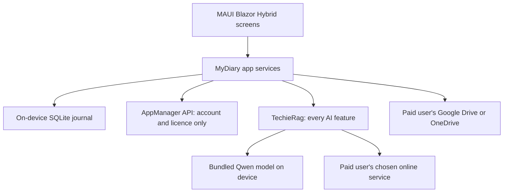
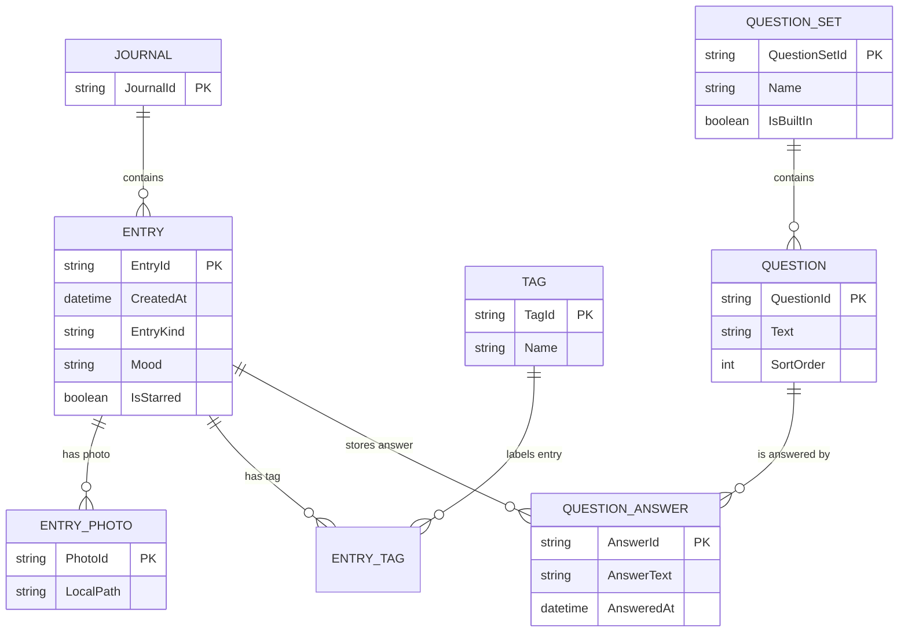

# MyDiary — Architecture

| | |
|---|---|
| App | MyDiary |
| Kind | app |
| Size | Medium |
| Stack answer set | DotNet |
| Date | 2026-10-25 |

## 1. Stack decisions

| Q | Topic | Decision | Source |
|---|---|---|---|
| Q1 | Configuration | Non-secret settings use `appsettings.json` and `appsettings.{Environment}.json`. | DotNet answer set |
| Q2 | Secrets in development | Developer secrets use `dotnet user-secrets`; `appsettings.Development.json` contains no real secrets; `secrets.example.json` lists the keys the app reads. A paid user's own online-service key is stored in the platform's secure storage, not in app settings. | DotNet answer set; secure storage inferred from the private-key requirement |
| Q3 | Database | The journal is stored in an on-device SQLite database in development and production. No MyDiary server or database container is created. Dapper is used for data access; `MyDiaryDb` holds SQLite schema migrations using DbUp. | Owner's brief says the journal stays on the device and MyDiary has no server; SQLite is the implementation choice that fits those constraints, instead of the answer set's PostgreSQL server default |
| Q4 | Authentication | AppManager API handles accounts, sign-in, devices, licences, problem reports and account-data requests using its installed-app key. MyDiary sends no journal text to AppManager. | Owner's brief |
| Q5 | Logging | Serilog is configured before other startup work and writes rolling files. MAUI heads use their private app-data folder because a phone or tablet cannot write into the build folder; logs never go in the repository root. | DotNet answer set and its MAUI logging standard |
| Q6 | Tests | xUnit; the test project exists from day one. | DotNet answer set |
| Q7 | Layout and naming | Source is under `src/`, tests under `tests/`, and the primary executable project is exactly `MyDiary`. Secondary projects use descriptive names. Target .NET 10 because TechieRag Local 1.1.5 requires it. | DotNet answer set; TechieRag reference |
| Q8 | User interface | .NET 10 MAUI Blazor Hybrid targets Android, iPhone, iPad, Windows and Mac. TrBlazeUI Components 2.1.9 supplies the screens. Rendering is local in the app's embedded WebView; no MyDiary web server is required. | Owner's platform and UI choices; TrBlazeUI 2.1.9 reference |
| Q11 | Standing rules | Keep the answer set's rules: explain every NuGet package in this Architecture; use one configuration system; file internal-library gaps and do not work around them; use Dapper; keep migrations in `MyDiaryDb` with DbUp; keep logs out of the repository root; and keep root folders limited to `src/` and `tests/`. For MAUI log files, use the platform-private app-data folder described in Q5. | DotNet answer set, with its more specific MAUI logging rule |

Required packages: `TrBlazeUI.Components` 2.1.9 and `TrBlazeUI.Icons.Lucide` for screens and icons; `TechieRag` 1.1.5, `TechieRag.Embedded` and `TechieRag.Local` for all AI and on-device models; `Dapper` and `DbUp` for local SQLite access and migrations; `Serilog` with its file sink for logs; xUnit for tests. `TrBlazeUI.Components` brings `TrBlazeUI.Primitives`.

## 2. Solution structure

| Project | Kind | Purpose |
|---|---|---|
| `MyDiary` | MAUI Blazor Hybrid app | The primary app for Android, iOS, Mac Catalyst and Windows. |
| `MyDiary.Core` | class library | Journal, licence and question-set rules that do not depend on a screen or platform. |
| `MyDiary.Storage` | class library | On-device SQLite access through Dapper, local files and provider-specific backup/sync adapters. |
| `MyDiaryDb` | migration project | DbUp migrations for the on-device SQLite schema. |
| `MyDiary.Tests` | xUnit test project | Unit and integration tests for the app's rules and storage. |

There is no MyDiary API project. AppManager and the user's chosen cloud or AI providers are services called by the app, not places where MyDiary hosts journal data.

## 3. Component map

**How a request travels**
1. A screen sends a user action to a MyDiary app service.
2. Journal reads and writes use the local SQLite database; account and licence actions use AppManager.
3. AI requests go through TechieRag. The bundled Qwen model and its search index run on the device; an online request is available only to a paid user who supplied a key and saw the data-sharing warning.
4. Paid backup and sync use the user's Google Drive or OneDrive. The app shows the returned result on the same device screen.

## 4. Data model

| Entity | Key fields | Notes |
|---|---|---|
| Journal | `JournalId` | One journal per person; no journal picker. |
| Entry | `EntryId`, date, type, mood, starred state | Holds either a 10-Thought Dump or a Free-Flow entry. |
| Entry photo | `PhotoId`, local path | Photo files stay with the local journal and are included in paid backup/export as applicable. |
| Tag | `TagId`, name | Linked to entries through `ENTRY_TAG`. |
| Question set, question and answer | IDs, text, order and answer time | Holds built-in and user-created sets and their answers. |

The exact SQLite tables and migration details are finalized when implementation starts. Account credentials and licence authority remain with AppManager; MyDiary keeps only the local state needed to work offline and apply the last successful licence check.

TechieRag's embeddings and vector index are also local. They are derived from journal entries and are never sent to AppManager. The smallest supported model, Qwen2.5 0.5B (333 MB), is bundled with the app through TechieRag's host-supplied model-folder API so it is installed with MyDiary instead of downloaded on first use. <!-- inferred — please verify -->

## 5. Cross-cutting

- **Identity:** AppManager API, using the installed-app key. Never use the owner's personal AppManager account in tests.
- **Configuration:** `appsettings.json` plus environment-specific settings; developer-only secrets use user secrets. A user's provider key is protected by platform secure storage.
- **Logging:** Serilog is started first. MAUI log files go to the platform-private app-data directory; no journal text or credentials are written to logs.
- **Errors:** Keep journal work available offline within the 30-day licence window. Show clear messages when a licence check, provider call, backup or restore cannot finish; do not replace a failed AI answer with invented content.
- **Privacy:** Free journal content stays on the device. AppManager never receives journal text. Text is sent to an online AI service only after a paid user enters that service's key and accepts a warning.
- **Platforms:** Keep the screens and user actions consistent across Android, iPhone, iPad, Windows and Mac. Native file, biometric and reminder features are behind platform adapters.
- **AI support boundary:** TechieRag Local 1.1.5 supports Android, iOS, Windows and Apple-silicon Mac, but not Intel Mac. The app's screens still target Mac; on-device AI on Intel Mac remains blocked until the library supports it. Do not add another AI implementation.

## 6. Decisions log

| Date | Decision | Why | Status |
|---|---|---|---|
| 2026-10-25 | Use .NET 10 MAUI Blazor Hybrid with TrBlazeUI Components 2.1.9 on the five named platforms. | It fits one shared screen set, offline use and device features; the library reference confirms this version. | decided |
| 2026-10-25 | Add `TrBlazeUI.Components` 2.1.9. | The brief requires TrBlazeUI screens on every target. | decided |
| 2026-10-25 | Add `TrBlazeUI.Icons.Lucide`. | It supplies the icons used by TrBlazeUI screens. | decided |
| 2026-10-25 | Use local SQLite, Dapper and a `MyDiaryDb` DbUp migration project; create no MyDiary server. | The brief says journal text stays with the person and MyDiary has no server. | decided |
| 2026-10-25 | Add Dapper. | The DotNet answer set requires Dapper for data access. | decided |
| 2026-10-25 | Add DbUp. | The DotNet answer set requires schema migrations in `MyDiaryDb`. | decided |
| 2026-10-25 | Use AppManager only for account, licence, device, problem-report and account-data requests. | The brief makes AppManager the fixed shared service and bars journal text from it. | decided |
| 2026-10-25 | Route every AI feature through TechieRag. | The brief prohibits MyDiary from implementing its own AI code. | decided |
| 2026-10-25 | Add `TechieRag` 1.1.5. | It is the required entry point for every AI feature. | decided |
| 2026-10-25 | Add `TechieRag.Embedded`. | It supplies on-device embeddings and local search for the journal. | decided |
| 2026-10-25 | Add `TechieRag.Local`. | It supplies the in-process model used by free users. | decided |
| 2026-10-25 | Bundle TechieRag's Qwen2.5 0.5B model with the app. | The brief says the free model is installed with the app; the supported host-folder API avoids a first-use model download. | decided |
| 2026-10-25 | Target .NET 10 and TechieRag 1.1.5. | The TechieRag local-model packages require .NET 10. | decided |
| 2026-10-25 | Add Serilog and Serilog.Sinks.File. | The DotNet answer set requires structured file logging at startup. | decided |
| 2026-10-25 | Add xUnit. | The DotNet answer set requires a test project from day one. | decided |
| 2026-10-25 | Use platform-private storage for MAUI log files. | The .NET MAUI standard gives a writable app-data location; the generic build-folder rule cannot be used on mobile. | decided |

## 7. Module responsibilities

| Module | Responsibility | Depends on |
|---|---|---|
| Screens | Shared navigation, forms, journal views and status messages | TrBlazeUI, app services |
| Account and licence service | AppManager calls, licence cache and device-limit results | AppManager API guide (see open question) |
| Journal service | Entries, photos, tags, moods, stars, timeline and calendar | `MyDiary.Core`, `MyDiary.Storage` |
| Questioning service | Built-in and custom question sets, due prompts and comparisons | Local journal storage |
| AI service | Plain-language journal questions and summaries through TechieRag | TechieRag; local model or paid user's configured online service |
| Backup and transfer | Drive/OneDrive backup, sync, restore, JSON and Day One import | Local storage and provider adapters |

## 8. Open questions

- The brief points to `docs/AppManager-api-usage-guide.md`, but that file is not present in this workspace. Obtain it before implementation so calls, device operations and account-data requests match the service.
- TechieRag 1.1.5 does not guarantee exact counts or refusal when no entry matches. BRD-34 and BRD-36 are blocked by `docs/MyDiary-TechieRag-Feedback.md` (TR-RAG-001); do not add an app-owned AI workaround.
- TechieRag Local 1.1.5 does not run on Intel Macs. The same screens target Mac, but built-in on-device AI on Intel Macs is blocked by TR-RAG-003; do not add another AI runtime.
- The chosen size is Medium: 20 routed screens, one in-app journal-user role, and 76 total requirements. The brief did not name a size; this is the closest fit to the documented limits.
