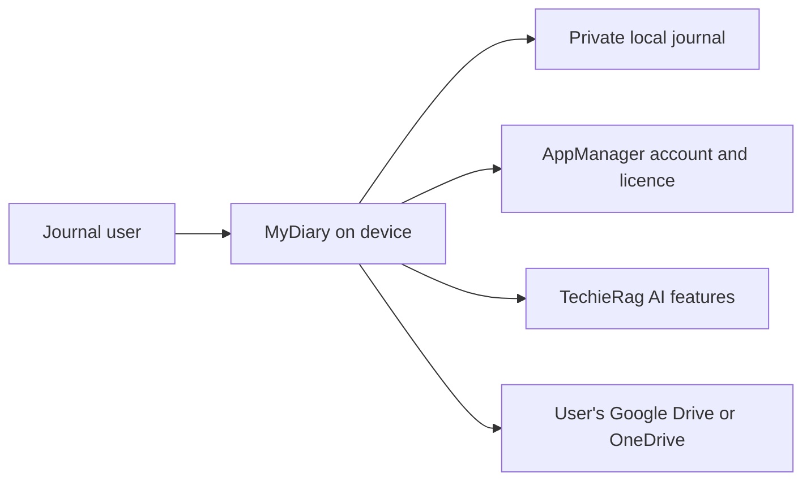

# MyDiary — Business Requirements

| | |
|---|---|
| App | MyDiary |
| Kind | app |
| Size | Medium |
| Stack answer set | DotNet |
| Status | Draft |
| Date | 2026-10-25 |

## 1. Summary

MyDiary is a private journal for phones, tablets and computers. A person keeps one journal and can write quick numbered thoughts, free-flow entries with formatting and photos, or answers to guided question sets. The home screen brings back entries from this date in past years. Users can search and ask plain-language questions about their own writing, with counted answers and source entries. Free use stays on one device with a built-in on-device AI model. A paid licence adds more devices, backup and sync, and a choice of AI model or an online service key.

## 2. Scope

**In:**
- A cross-platform, offline-capable personal journal with one journal per person.
- AppManager account, sign-in, licence, device, problem-report and account-data actions.
- Writing, browsing, searching, guided question sets, AI-assisted reflection and answer comparison.
- Paid backup, sync and restore through the user's Google Drive or OneDrive; JSON transfer and Day One import.
- PIN or biometric app lock and journaling reminders.

**Out:**
- The separate purchase and landing-page web app planned for a later phase; no purchase button or in-app payment.
- App-store purchases, shared or family journals, multiple journals, iCloud, Dropbox and other sync providers.
- Sending free-user journal text to an online AI service; the free model runs on the device.
- Map view, voice transcription, widgets, handwriting, sharing an entry as an image.

## 3. Users and roles

| Role | Who they are | What they need |
|---|---|---|
| Journal user | A free or paid person using one journal; a goal reviewer is the same role with a review use case. | Write privately, find past entries and review answers over time. The licence determines which paid features are available. |

The owner assigns paid licences and reads problem reports on the AppManager site; the owner does not use an admin screen in MyDiary.

## 4. Screens and flow

| Screen | Route | Role | Mockup | Fields |
|---|---|---|---|---|
| Sign in and account | `/account` | Journal user | [mockup](mockups/sign-in-and-account.html) | Email, password, account details |
| Password reset | `/account/forgot-password` | Journal user | [mockup](mockups/password-reset.html) | Email, reset code, new password |
| Home | `/home` | Journal user | [mockup](mockups/home.html) | Today's date, entry summary, streak, due set |
| Journal browse | `/journal` | Journal user | [mockup](mockups/journal-browse.html) | Search text, date, tag, question set, photo/star/mood filters |
| Entry details | `/entries/{entryId}` | Journal user | [mockup](mockups/entry-details.html) | Entry content, date, tags, star, mood, photos |
| 10-Thought Dump | `/entries/new/thought-dump` | Journal user | [mockup](mockups/thought-dump.html) | Ten numbered thought lines |
| Free-Flow entry | `/entries/new/free-flow` | Journal user | [mockup](mockups/free-flow-entry.html) | Entry text, formatting, photos |
| Question sets | `/questions` | Journal user | [mockup](mockups/question-sets.html) | Set name, due state |
| Answer a question set | `/questions/{setId}/answer` | Journal user | [mockup](mockups/answer-question-set.html) | Answers to the selected set |
| Custom question set | `/questions/custom/new` | Journal user | [mockup](mockups/custom-question-set.html) | Set name, question text |
| Ask my journal | `/ask` | Journal user | [mockup](mockups/ask-my-journal.html) | Plain-language question |
| Compare answers | `/compare` | Journal user | [mockup](mockups/compare-answers.html) | Question, month or year range |
| Profile | `/profile` | Journal user | [mockup](mockups/profile.html) | Profile details, current and new password |
| Plan and devices | `/plan-devices` | Journal user | [mockup](mockups/plan-and-devices.html) | Plan, end date, device list |
| Problem report | `/support/report` | Journal user | [mockup](mockups/problem-report.html) | Problem description, optional contact details |
| Account data | `/account/data` | Journal user | [mockup](mockups/account-data.html) | Copy or deletion request, confirmation |
| AI preferences | `/settings/ai` | Journal user | [mockup](mockups/ai-preferences.html) | Model, provider, service key, data-sharing consent |
| Backup and sync | `/backup-sync` | Journal user | [mockup](mockups/backup-and-sync.html) | Google Drive or OneDrive, backup and restore actions |
| Import and export | `/transfer` | Journal user | [mockup](mockups/import-and-export.html) | JSON file, Day One export file |
| Privacy and reminders | `/settings/privacy` | Journal user | [mockup](mockups/privacy-and-reminders.html) | PIN, biometric choice, reminder schedule |

**Primary journey:**
1. A new user creates an account or signs in, then sees Home and can write or revisit entries.
2. The user searches or browses the journal, answers a due question set, or asks a question about past writing.
3. A paid user can manage devices, choose optional AI, and back up or sync through a supported personal cloud account.

## 5. Requirements — Phase 1

### Sign in and account

This screen creates an account or signs in through AppManager.

- **BRD-1** — Create an account. *Screen:* Sign in and account · *Mockup:* [mockup](mockups/sign-in-and-account.html)
  - *Acceptance:* When a new user submits valid details on first launch, then AppManager creates the MyDiary account.
- **BRD-2** — Sign in. *Screen:* Sign in and account · *Mockup:* [mockup](mockups/sign-in-and-account.html)
  - *Acceptance:* When a returning user submits valid credentials on first launch, then MyDiary opens the user's journal.
- **BRD-3** — Enforce the free device limit. *Screen:* Sign in and account · *Mockup:* [mockup](mockups/sign-in-and-account.html)
  - *Acceptance:* When a free user signs in on a second device, then MyDiary refuses access and explains paid licences allow more.
- **BRD-4** — Explain a full paid device limit. *Screen:* Sign in and account · *Mockup:* [mockup](mockups/sign-in-and-account.html)
  - *Acceptance:* When a paid user exceeds the licence device limit, then sign-in is refused with instructions for freeing a slot.

### Password reset

This screen starts an AppManager password reset.

- **BRD-5** — Reset a forgotten password. *Screen:* Password reset · *Mockup:* [mockup](mockups/password-reset.html)
  - *Acceptance:* When a user submits the account email on Password reset, then MyDiary starts the AppManager reset flow.

### Home

Home shows today's activity and prompts that are due.

- **BRD-6** — Work offline for 30 days. *Screen:* Home · *Mockup:* [mockup](mockups/home.html)
  - *Acceptance:* When a user opens Home offline within 30 days of a successful licence check, then the journal remains usable.
- **BRD-7** — Require a licence check after 30 days. *Screen:* Home · *Mockup:* [mockup](mockups/home.html)
  - *Acceptance:* When 30 days have passed since the last successful licence check, then MyDiary requires an online check to continue.
- **BRD-8** — Show today's entries. *Screen:* Home · *Mockup:* [mockup](mockups/home.html)
  - *Acceptance:* When the user opens Home, then it shows entries dated today.
- **BRD-9** — Show the writing streak. *Screen:* Home · *Mockup:* [mockup](mockups/home.html)
  - *Acceptance:* When the user opens Home, then it shows the current journaling streak.
- **BRD-10** — Show the On This Day card. *Screen:* Home · *Mockup:* [mockup](mockups/home.html)
  - *Acceptance:* When past entries exist for this date, then Home shows the On This Day card.
- **BRD-11** — Tell a short story about past years. *Screen:* Home · *Mockup:* [mockup](mockups/home.html)
  - *Acceptance:* When the user opens On This Day, then past years show warm stories from this date or nearby, not lists.
- **BRD-12** — Suggest a question set when due. *Screen:* Home · *Mockup:* [mockup](mockups/home.html)
  - *Acceptance:* When Monthly Goals is due on the 1st, then Home suggests it; other sets are suggested on their due dates.

### Journal browse

This screen helps the user find entries by date and their saved details.

- **BRD-13** — Browse a timeline. *Screen:* Journal browse · *Mockup:* [mockup](mockups/journal-browse.html)
  - *Acceptance:* When the user chooses Timeline on Journal browse, then entries appear in date order.
- **BRD-14** — Browse a calendar. *Screen:* Journal browse · *Mockup:* [mockup](mockups/journal-browse.html)
  - *Acceptance:* When the user chooses Calendar on Journal browse, then entry dates appear on the calendar.
- **BRD-15** — Search by keyword. *Screen:* Journal browse · *Mockup:* [mockup](mockups/journal-browse.html)
  - *Acceptance:* When the user searches for a keyword, then Journal browse shows matching entries.
- **BRD-16** — Filter by date. *Screen:* Journal browse · *Mockup:* [mockup](mockups/journal-browse.html)
  - *Acceptance:* When the user sets a date filter, then Journal browse shows entries within that date range.
- **BRD-17** — Filter by tag. *Screen:* Journal browse · *Mockup:* [mockup](mockups/journal-browse.html)
  - *Acceptance:* When the user selects a tag filter, then Journal browse shows entries with that tag.
- **BRD-18** — Filter by question set. *Screen:* Journal browse · *Mockup:* [mockup](mockups/journal-browse.html)
  - *Acceptance:* When the user selects a question-set filter, then Journal browse shows answers from that set.
- **BRD-19** — Filter by photo. *Screen:* Journal browse · *Mockup:* [mockup](mockups/journal-browse.html)
  - *Acceptance:* When the user enables the photo filter, then Journal browse shows entries with photos.
- **BRD-20** — Filter by star. *Screen:* Journal browse · *Mockup:* [mockup](mockups/journal-browse.html)
  - *Acceptance:* When the user enables the star filter, then Journal browse shows starred entries.
- **BRD-21** — Filter by mood. *Screen:* Journal browse · *Mockup:* [mockup](mockups/journal-browse.html)
  - *Acceptance:* When the user selects a mood filter, then Journal browse shows entries with that mood.
- **BRD-71** — Keep one journal. *Screen:* Journal browse · *Mockup:* [mockup](mockups/journal-browse.html)
  - *Acceptance:* When the user opens Journal browse, then MyDiary shows their one journal with no journal list or selector.

### Entry details

This screen displays a saved entry and its personal markers.

- **BRD-22** — Read a saved entry. *Screen:* Entry details · *Mockup:* [mockup](mockups/entry-details.html)
  - *Acceptance:* When the user opens an entry from Journal browse, then Entry details shows its saved content.
- **BRD-23** — Add a tag. *Screen:* Entry details · *Mockup:* [mockup](mockups/entry-details.html)
  - *Acceptance:* When the user adds a tag on Entry details, then that tag is saved with the entry.
- **BRD-24** — Star an entry. *Screen:* Entry details · *Mockup:* [mockup](mockups/entry-details.html)
  - *Acceptance:* When the user stars an entry on Entry details, then the saved entry is marked starred.
- **BRD-25** — Pick an entry mood. *Screen:* Entry details · *Mockup:* [mockup](mockups/entry-details.html)
  - *Acceptance:* When the user selects a mood on Entry details, then that mood is saved with the entry.

### 10-Thought Dump

This screen captures ten short thoughts as one entry.

- **BRD-26** — Show ten numbered lines. *Screen:* 10-Thought Dump · *Mockup:* [mockup](mockups/thought-dump.html)
  - *Acceptance:* When the user starts a 10-Thought Dump, then the screen shows ten numbered quick-entry lines.
- **BRD-27** — Drop empty lines on save. *Screen:* 10-Thought Dump · *Mockup:* [mockup](mockups/thought-dump.html)
  - *Acceptance:* When the user saves a 10-Thought Dump, then empty lines are not stored as thoughts.

### Free-Flow entry

This screen writes a formatted journal entry with photos.

- **BRD-28** — Format entry text. *Screen:* Free-Flow entry · *Mockup:* [mockup](mockups/free-flow-entry.html)
  - *Acceptance:* When the user formats text on Free-Flow entry, then the saved entry retains that formatting.
- **BRD-29** — Add photos to an entry. *Screen:* Free-Flow entry · *Mockup:* [mockup](mockups/free-flow-entry.html)
  - *Acceptance:* When the user adds a photo on Free-Flow entry, then the saved entry displays that photo.

### Question sets

This screen lists guided question sets the user can answer.

The built-in choices are Monthly Goals, Yearly Review, Health, Fitness, Weekly Retro, Project Retro and Gratitude.

- **BRD-30** — Offer the built-in question sets. *Screen:* Question sets · *Mockup:* [mockup](mockups/question-sets.html)
  - *Acceptance:* When the user opens Question sets, then all seven built-in sets are listed.

### Answer a question set

This screen records answers to a selected guided set.

- **BRD-31** — Answer a selected set. *Screen:* Answer a question set · *Mockup:* [mockup](mockups/answer-question-set.html)
  - *Acceptance:* When the user saves answers, then the journal stores them under the selected set.

### Custom question set

This screen creates a guided set from the user's own questions.

- **BRD-32** — Create a custom set. *Screen:* Custom question set · *Mockup:* [mockup](mockups/custom-question-set.html)
  - *Acceptance:* When the user saves a named set of questions on Custom question set, then it appears in Question sets.

### Ask my journal

This screen answers questions using the user's own entries.

- **BRD-33** — Ask in plain words. *Screen:* Ask my journal · *Mockup:* [mockup](mockups/ask-my-journal.html)
  - *Acceptance:* When the user submits a plain-language question on Ask my journal, then MyDiary searches the user's journal for an answer.
- **BRD-34** — Count matching answers. *Screen:* Ask my journal · *Mockup:* [mockup](mockups/ask-my-journal.html)
  - *Acceptance:* When matching entries are found, then Ask my journal returns a counted answer based on those entries.
- **BRD-35** — List source entries. *Screen:* Ask my journal · *Mockup:* [mockup](mockups/ask-my-journal.html)
  - *Acceptance:* When an answer is shown, then Ask my journal lists the entries used to produce it.
- **BRD-36** — Say when nothing matches. *Screen:* Ask my journal · *Mockup:* [mockup](mockups/ask-my-journal.html)
  - *Acceptance:* When no entry matches, then Ask my journal says so and shows no invented answer.
- **BRD-37** — Keep free AI on the device. *Screen:* Ask my journal · *Mockup:* [mockup](mockups/ask-my-journal.html)
  - *Acceptance:* When a free user asks, then MyDiary's bundled Qwen2.5 0.5B model runs on the device. <!-- inferred — please verify -->

### Compare answers

This screen compares one question across time periods.

- **BRD-38** — Compare answers across time. *Screen:* Compare answers · *Mockup:* [mockup](mockups/compare-answers.html)
  - *Acceptance:* When the user selects one question and multiple months or years, then Compare answers shows the results side by side.

### Profile

This screen changes the user's account details.

- **BRD-39** — Edit a profile. *Screen:* Profile · *Mockup:* [mockup](mockups/profile.html)
  - *Acceptance:* When the user saves profile changes on Profile, then AppManager stores the updated profile.
- **BRD-40** — Change a password. *Screen:* Profile · *Mockup:* [mockup](mockups/profile.html)
  - *Acceptance:* When the user submits a valid password change on Profile, then AppManager updates the account password.

### Plan and devices

This screen shows the licence and the devices using it.

- **BRD-41** — Show the current plan. *Screen:* Plan and devices · *Mockup:* [mockup](mockups/plan-and-devices.html)
  - *Acceptance:* When the user opens Plan and devices, then MyDiary shows the plan returned by AppManager.
- **BRD-42** — Show the plan end date. *Screen:* Plan and devices · *Mockup:* [mockup](mockups/plan-and-devices.html)
  - *Acceptance:* When the user opens Plan and devices, then it shows when the user's plan ends.
- **BRD-43** — Show devices and slot use. *Screen:* Plan and devices · *Mockup:* [mockup](mockups/plan-and-devices.html)
  - *Acceptance:* When the user opens Plan and devices, then it lists signed-in devices and the allowed slots in use.
- **BRD-44** — Forget a device. *Screen:* Plan and devices · *Mockup:* [mockup](mockups/plan-and-devices.html)
  - *Acceptance:* When the user forgets a device on Plan and devices, then AppManager removes that device from the account.
- **BRD-45** — Block a device. *Screen:* Plan and devices · *Mockup:* [mockup](mockups/plan-and-devices.html)
  - *Acceptance:* When the user blocks a device on Plan and devices, then AppManager blocks that device from the account.
- **BRD-46** — Apply the free licence limit. *Screen:* Plan and devices · *Mockup:* [mockup](mockups/plan-and-devices.html)
  - *Acceptance:* When AppManager returns no paid licence, then MyDiary applies the free one-device plan.
- **BRD-47** — Apply the Pro limit. *Screen:* Plan and devices · *Mockup:* [mockup](mockups/plan-and-devices.html)
  - *Acceptance:* When AppManager returns the Pro licence, then MyDiary allows two devices.
- **BRD-48** — Apply the Pro-Plus limit. *Screen:* Plan and devices · *Mockup:* [mockup](mockups/plan-and-devices.html)
  - *Acceptance:* When AppManager returns Pro-Plus, then MyDiary uses its configured device limit above two.
- **BRD-49** — Keep free features after a paid plan ends. *Screen:* Plan and devices · *Mockup:* [mockup](mockups/plan-and-devices.html)
  - *Acceptance:* When a paid plan ends, then the user can still use every free feature on the current device.
- **BRD-50** — Keep the journal after a paid plan ends. *Screen:* Plan and devices · *Mockup:* [mockup](mockups/plan-and-devices.html)
  - *Acceptance:* When a paid plan ends, then the user's complete journal remains on the current device.
- **BRD-72** — Keep purchases outside the app. *Screen:* Plan and devices · *Mockup:* [mockup](mockups/plan-and-devices.html)
  - *Acceptance:* When the user opens Plan and devices, then MyDiary offers no purchase button or in-app payment.

### Problem report

This screen sends a problem report through AppManager.

- **BRD-51** — Send a problem report. *Screen:* Problem report · *Mockup:* [mockup](mockups/problem-report.html)
  - *Acceptance:* When the user submits a problem report, then MyDiary sends it to AppManager for the owner to read.

### Account data

This screen asks AppManager to provide or delete account data.

- **BRD-52** — Request an account-data copy. *Screen:* Account data · *Mockup:* [mockup](mockups/account-data.html)
  - *Acceptance:* When the user confirms a copy request, then MyDiary sends the request to AppManager.
- **BRD-53** — Request account-data deletion. *Screen:* Account data · *Mockup:* [mockup](mockups/account-data.html)
  - *Acceptance:* When the user confirms a deletion request, then MyDiary sends the request to AppManager.

### AI preferences

This screen controls paid users' optional model and service choices.

- **BRD-54** — Choose another AI model. *Screen:* AI preferences · *Mockup:* [mockup](mockups/ai-preferences.html)
  - *Acceptance:* When a paid user selects an available model on AI preferences, then MyDiary uses it through TechieRag.
- **BRD-55** — Add an online-service key. *Screen:* AI preferences · *Mockup:* [mockup](mockups/ai-preferences.html)
  - *Acceptance:* When a paid user saves a supported service key, then MyDiary stores it securely for TechieRag.
- **BRD-56** — Warn before sending journal text online. *Screen:* AI preferences · *Mockup:* [mockup](mockups/ai-preferences.html)
  - *Acceptance:* When a paid user enables an online service, then MyDiary warns that journal text will be sent to that service.

### Backup and sync

This screen manages paid backup and journal transfer between devices.

- **BRD-57** — Back up to Google Drive. *Screen:* Backup and sync · *Mockup:* [mockup](mockups/backup-and-sync.html)
  - *Acceptance:* When a paid user starts a Google Drive backup, then MyDiary stores the journal backup in that user's Drive.
- **BRD-58** — Back up to OneDrive. *Screen:* Backup and sync · *Mockup:* [mockup](mockups/backup-and-sync.html)
  - *Acceptance:* When a paid user starts a OneDrive backup, then MyDiary stores the journal backup in that user's OneDrive.
- **BRD-59** — Sync between paid devices. *Screen:* Backup and sync · *Mockup:* [mockup](mockups/backup-and-sync.html)
  - *Acceptance:* When a paid user syncs, then journal changes become available on the user's other signed-in devices.
- **BRD-60** — Restore on a new device. *Screen:* Backup and sync · *Mockup:* [mockup](mockups/backup-and-sync.html)
  - *Acceptance:* When a paid user restores a backup on a new device, then the journal entries and their attachments are restored.

### Import and export

This screen moves journal content through supported files.

- **BRD-61** — Export a journal as JSON. *Screen:* Import and export · *Mockup:* [mockup](mockups/import-and-export.html)
  - *Acceptance:* When the user exports on Import and export, then MyDiary creates a JSON file containing the journal.
- **BRD-62** — Import a MyDiary JSON file. *Screen:* Import and export · *Mockup:* [mockup](mockups/import-and-export.html)
  - *Acceptance:* When the user imports a valid MyDiary JSON file, then its journal entries appear in MyDiary.
- **BRD-63** — Import a Day One export. *Screen:* Import and export · *Mockup:* [mockup](mockups/import-and-export.html)
  - *Acceptance:* When the user imports a valid Day One export, then its entries appear in MyDiary.

### Privacy and reminders

This screen protects access to the app and schedules reminders.

- **BRD-64** — Lock with a PIN. *Screen:* Privacy and reminders · *Mockup:* [mockup](mockups/privacy-and-reminders.html)
  - *Acceptance:* When the user enables a PIN lock, then MyDiary asks for that PIN before showing the journal.
- **BRD-65** — Lock with biometrics. *Screen:* Privacy and reminders · *Mockup:* [mockup](mockups/privacy-and-reminders.html)
  - *Acceptance:* When the user enables fingerprint or face unlock, then MyDiary requests that check before showing the journal.
- **BRD-66** — Set a journaling reminder. *Screen:* Privacy and reminders · *Mockup:* [mockup](mockups/privacy-and-reminders.html)
  - *Acceptance:* When the user saves a reminder schedule, then MyDiary reminds them at the chosen times.

## 6. Non-functional requirements

| Id | Area | Requirement | Measure |
|---|---|---|---|
| BRD-67 | Compatibility | The same screens work on Android, iPhone, iPad, Windows and Mac. | The app builds and presents the shared screen set on all five targets. |
| BRD-68 | Privacy | AppManager never receives journal text. | AppManager request payloads contain no journal content. |
| BRD-69 | Logging | Serilog is ready before other startup work and writes logs to writable private locations, not the repository root. | Startup logging is configured before app services; MAUI files stay in app-private storage. |
| BRD-70 | Zoom (desktop screens in a web view) | Cmd/Ctrl+=, - and 0 zoom 50% to 300% in 10% steps; the level is kept across restarts. | zoom-check: keys · zoom-check: kept |
| BRD-73 | Account security | Every AppManager request uses MyDiary's installed-app key, not a personal account key. | AppManager requests carry the installed-app key; no personal sign-in key is used. |
| BRD-74 | Privacy | A free user's journal text never leaves the device. | No outgoing request from a free account contains journal text. |
| BRD-75 | UI consistency | All screens use TrBlazeUI components and its visual style. | Each screen uses supported controls and follows the TrBlazeUI reference. |
| BRD-76 | AI integration | Every AI feature uses TechieRag; MyDiary contains no separate AI implementation. | Code and dependency review confirms all AI calls go through TechieRag. |

No performance budget was provided, so no `perf-budget:` value is set.

## 7. Development status

Written by the status gate after every build, verify and handoff; not by hand.

**Snapshot as of 2026-10-25.** Live per-requirement status: `PROJECT-STATUS.md` and the Requirements Status table in `docs/MyDiary-Checklist.md` after Stage 2.

| Screen | Requirements | Verified | Open | Status |
|---|---:|---:|---:|---|
| Sign in and account | 4 | 0 | 4 | Planned |
| Password reset | 1 | 0 | 1 | Planned |
| Home | 7 | 0 | 7 | Planned |
| Journal browse | 10 | 0 | 10 | Planned |
| Entry details | 4 | 0 | 4 | Planned |
| 10-Thought Dump | 2 | 0 | 2 | Planned |
| Free-Flow entry | 2 | 0 | 2 | Planned |
| Question sets | 1 | 0 | 1 | Planned |
| Answer a question set | 1 | 0 | 1 | Planned |
| Custom question set | 1 | 0 | 1 | Planned |
| Ask my journal | 5 | 0 | 5 | Planned |
| Compare answers | 1 | 0 | 1 | Planned |
| Profile | 2 | 0 | 2 | Planned |
| Plan and devices | 11 | 0 | 11 | Planned |
| Problem report | 1 | 0 | 1 | Planned |
| Account data | 2 | 0 | 2 | Planned |
| AI preferences | 3 | 0 | 3 | Planned |
| Backup and sync | 4 | 0 | 4 | Planned |
| Import and export | 3 | 0 | 3 | Planned |
| Privacy and reminders | 3 | 0 | 3 | Planned |

## 8. Context diagram

## 9. Constraints and assumptions

- The app has no server of its own. AppManager handles account, sign-in, licence, device, problem-report and account-data actions, and never receives journal text.
- Free journal data stays on one device. The app must work offline for up to 30 days after a successful licence check.
- One in-app role covers free and paid journal users. A goal reviewer is a use case, not a separate role. The owner works outside MyDiary on AppManager.
- AppManager's returned licence key and licence name decide the plan: no paid licence means free, Pro allows two devices, and Pro-Plus uses its AppManager-set limit above two.
- MyDiary uses TrBlazeUI for a shared MAUI Blazor Hybrid screen set on Android, iPhone, iPad, Windows and Mac.
- Every AI feature uses TechieRag. Free AI runs on the device; a paid user's online service is optional and requires the user's own key and a warning.
- The selected Qwen2.5 0.5B model is bundled with MyDiary to meet the brief's installed-with-app requirement; its weights add 333 MB. <!-- inferred — please verify -->
- BRD-34 and BRD-36 are blocked because TechieRag 1.1.5 does not guarantee exact counts or refusal when no entry matches. See `docs/MyDiary-TechieRag-Feedback.md` (TR-RAG-001); no MyDiary-owned AI workaround will be built.
- TechieRag Local 1.1.5 does not run on Intel Macs. The screens still target Mac, but built-in free AI on Intel Macs is blocked until TechieRag supports it (TR-RAG-003).
- Paid backup and sync use only the user's Google Drive or OneDrive. Purchase pages and payments remain outside this app.
- On-device SQLite is an implementation choice to satisfy the local-journal and offline requirements; the brief does not name a local database engine. <!-- inferred — please verify -->

## 10. Risks

| Risk | Likelihood | Impact | Mitigation |
|---|---|---|---|
| The AppManager API guide named in the brief is missing from this workspace. | Medium | High for implementation accuracy | Obtain `docs/AppManager-api-usage-guide.md` before building account, device or data-request flows. |
| TechieRag does not promise exact counts or a no-match refusal. | High | High for BRD-34 and BRD-36 | Hold these requirements until TechieRag provides a supported guarantee; do not write an app-owned AI workaround. |
| TechieRag Local does not support Intel Macs. | Medium | High for free on-device AI on Intel Macs | Hold that platform feature until TechieRag supports Intel Macs; keep the shared screens on Mac. |
| Bundling the smallest supported model adds 333 MB to the app package. | Medium | Medium | Use the bundled Qwen2.5 0.5B model and measure install size during implementation. |
| Mobile platform storage, reminders, biometrics and cloud providers differ. | Medium | Medium | Keep platform-specific work behind adapters and verify each supported target. |
