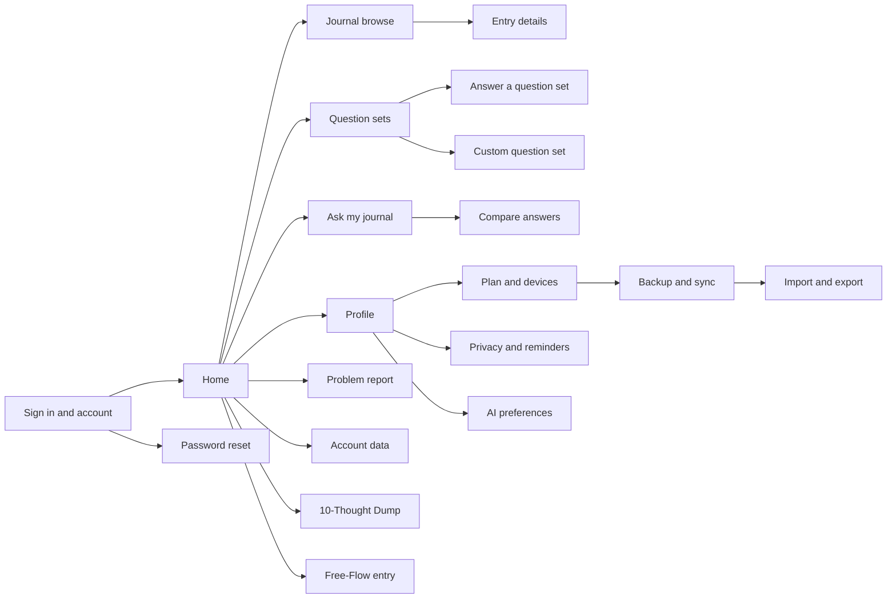

# MyDiary — UI Design

| | |
|---|---|
| App | MyDiary |
| Kind | app |
| Size | Medium |
| UI library | TrBlazeUI Components 2.1.9 with Lucide icons |
| Theme | Both; follows the device setting. <!-- inferred — please verify --> |

## Design system

- **Layout shell:** Desktop uses TrBlazeUI `SidebarProvider`, `Sidebar`, `SidebarInset` and a page header. Phones use `ResponsiveNav` with the same routes and a scrollable compact navigation row.
- **Theme:** TrBlazeUI's light and dark themes with warm paper-like surfaces and a muted sage primary colour. The sample screen uses realistic placeholder content only.
- **Shared controls:** `Card`, `Button`, `Field`, `Input`, `Textarea`, `Badge`, `Alert`, `Tabs`, `InputGroup`, `Dialog` and `LucideIcon` where needed. Form controls use the library's own components.
- **Rules:** Use the library's spacing scale consistently. Keep page content to a readable width; stack cards and controls below 720 px, and reduce table columns on phones rather than shrinking text. Use plain status messages and never rely on colour alone.

## Screens

### Screen: Sign in and account (`/account`)

**Mockup:** [mockups/sign-in-and-account.html](mockups/sign-in-and-account.html) · **Roles:** Journal user · **BRD:** BRD-1 to BRD-4

| Region | Control | Shows or binds |
|---|---|---|
| `account-panel` | `CenteredPanel`, `Card` | MyDiary welcome and sign-in/account choices |
| `account-tabs` | `Tabs` | Sign in or create account |
| `account-email`, `account-password` | `Field`, `Input` | AppManager credentials |
| `account-submit` | `Button` | Sign in or create account; links to Home in the click-through |
| `account-device-limit` | `Alert` | A refused device sign-in explains the paid licence option |

| Field | Type | Required | Validation |
|---|---|---|---|
| Email | email | yes | AppManager rules |
| Password | password | yes | AppManager rules |

**Dialogs opened here:** None. **States:** empty: no credentials · loading: sign-in in progress · error: AppManager refusal or device limit.

### Screen: Password reset (`/account/forgot-password`)

**Mockup:** [mockups/password-reset.html](mockups/password-reset.html) · **Roles:** Journal user · **BRD:** BRD-5

| Region | Control | Shows or binds |
|---|---|---|
| `reset-panel` | `CenteredPanel`, `Card` | Password-reset steps |
| `reset-email` | `Field`, `Input` | Account email |
| `reset-code` | `InputOTP` | Code supplied by AppManager |
| `reset-submit` | `Button` | Submit the reset request |
| `reset-message` | `Alert` | AppManager response |

| Field | Type | Required | Validation |
|---|---|---|---|
| Email | email | yes | AppManager rules |
| Reset code | one-time code | when requested | AppManager rules |
| New password | password | when requested | AppManager rules |

**Dialogs opened here:** None. **States:** empty: no email entered · loading: reset request sent · error: invalid or expired reset details.

### Screen: Home (`/home`)

**Mockup:** [mockups/home.html](mockups/home.html) · **Roles:** Journal user · **BRD:** BRD-6 to BRD-12

| Region | Control | Shows or binds |
|---|---|---|
| `app-shell`, `home-nav` | `Sidebar`, `ResponsiveNav` | Shared navigation |
| `home-today`, `home-streak` | `Card`, `StatTile` | Today's entries and current streak |
| `home-on-this-day` | `Card`, `Typography` | A warm story from this date or nearby dates in past years |
| `home-due-set` | `Card`, `Badge`, `Button` | A question set due today, including Monthly Goals on the 1st |
| `home-new-entry` | `Button`, `NavigationMenu` | Links to both entry-writing screens |

| Field | Type | Required | Validation |
|---|---|---|---|
| None | display only | no | None |

**Dialogs opened here:** None. **States:** empty: no entries yet · loading: today's journal is opening · error: local journal cannot be read.

### Screen: Journal browse (`/journal`)

**Mockup:** [mockups/journal-browse.html](mockups/journal-browse.html) · **Roles:** Journal user · **BRD:** BRD-13 to BRD-21, BRD-71

| Region | Control | Shows or binds |
|---|---|---|
| `journal-view` | `Tabs`, `ToggleGroup` | Timeline or calendar view |
| `journal-search` | `InputGroup` | Keyword search |
| `journal-date-filter` | `DateRangePicker` | Date range |
| `journal-filters` | `MultiSelect`, `Checkbox`, `Badge` | Tag, set, photo, star and mood filters |
| `journal-timeline` | `Timeline`, `Item` | Entries in date order; each row links to Entry details |
| `journal-calendar` | `Calendar`, `Card` | Dates with entries |

| Field | Type | Required | Validation |
|---|---|---|---|
| Keyword | search text | no | Matches saved journal text |
| Date range | date range | no | Start is not after end |
| Tag, set, photo, star, mood | filter choices | no | Any chosen filters apply to the one journal |

**Dialogs opened here:** None. **States:** empty: no entries match · loading: filter results are being read · error: search or local storage failed.

### Screen: Entry details (`/entries/{entryId}`)

**Mockup:** [mockups/entry-details.html](mockups/entry-details.html) · **Roles:** Journal user · **BRD:** BRD-22 to BRD-25

| Region | Control | Shows or binds |
|---|---|---|
| `entry-content` | `Card`, `Typography`, `Prose` | Saved entry text and date |
| `entry-photos` | `FileUpload` preview area, `Card` | Attached photos, separate from formatted text |
| `entry-tags` | `MultiSelect`, `Badge` | Tags on this entry |
| `entry-star` | `ToggleGroup`, `Button` | Starred state |
| `entry-mood` | `Rating` or `RadioGroup` | Selected mood |

| Field | Type | Required | Validation |
|---|---|---|---|
| Tags | multi-choice | no | Saved as entry tags |
| Starred | toggle | no | On or off |
| Mood | choice | no | One selected mood |

**Dialogs opened here:** None. **States:** empty: entry has no optional markers or photos · loading: entry is opening · error: entry is unavailable.

### Screen: 10-Thought Dump (`/entries/new/thought-dump`)

**Mockup:** [mockups/thought-dump.html](mockups/thought-dump.html) · **Roles:** Journal user · **BRD:** BRD-26 to BRD-27

| Region | Control | Shows or binds |
|---|---|---|
| `thought-dump-fields` | `Field`, `Input` | Ten numbered quick lines |
| `thought-dump-counter` | `Badge` | Ten lines available |
| `thought-dump-save` | `Button` | Save one entry; empty lines are dropped |
| `thought-dump-cancel` | `Button` | Return to Home or Journal |

| Field | Type | Required | Validation |
|---|---|---|---|
| Thought 1–10 | short text | no | Empty lines are omitted when saved |

**Dialogs opened here:** None. **States:** empty: all ten lines are blank · loading: entry is being saved · error: save failed and text remains visible.

### Screen: Free-Flow entry (`/entries/new/free-flow`)

**Mockup:** [mockups/free-flow-entry.html](mockups/free-flow-entry.html) · **Roles:** Journal user · **BRD:** BRD-28 to BRD-29

| Region | Control | Shows or binds |
|---|---|---|
| `free-flow-editor` | `RichTextEditor`, formatting toolbar | Formatted text |
| `free-flow-photos` | `FileUpload`, attachment previews | Photos attached beside the text, not inserted at the cursor |
| `free-flow-save` | `Button` | Save the entry |

| Field | Type | Required | Validation |
|---|---|---|---|
| Entry text | formatted text | no | No length limit stated |
| Photos | image files | no | Supported image files |

**Dialogs opened here:** Native file picker for photos. **States:** empty: blank editor and no photos · loading: save in progress · error: save or file selection failed.

### Screen: Question sets (`/questions`)

**Mockup:** [mockups/question-sets.html](mockups/question-sets.html) · **Roles:** Journal user · **BRD:** BRD-30

| Region | Control | Shows or binds |
|---|---|---|
| `question-set-list` | `Card`, `Item`, `Badge` | Seven built-in sets and the user's sets |
| `question-set-due` | `Badge`, `Alert` | Which set is due |
| `question-set-open` | `<a>` links | Opens an answer session for the selected set |
| `question-set-create` | `<a>` link, `Button` | Opens Custom question set |

| Field | Type | Required | Validation |
|---|---|---|---|
| None | display only | no | None |

**Dialogs opened here:** None. **States:** empty: no user-created sets · loading: set list is opening · error: question sets cannot be read.

### Screen: Answer a question set (`/questions/{setId}/answer`)

**Mockup:** [mockups/answer-question-set.html](mockups/answer-question-set.html) · **Roles:** Journal user · **BRD:** BRD-31

| Region | Control | Shows or binds |
|---|---|---|
| `answer-set-title` | `Card`, `Typography` | Selected set name and due date |
| `answer-set-questions` | `Field`, `Textarea` | Answers for each question |
| `answer-set-progress` | `Progress` | Position within the question set |
| `answer-set-save` | `Button` | Save answers into the journal under this set |

| Field | Type | Required | Validation |
|---|---|---|---|
| Answer for each question | multi-line text | no | No answer length stated |

**Dialogs opened here:** None. **States:** empty: questions shown without answers · loading: answers are being saved · error: save failed and answers remain visible.

### Screen: Custom question set (`/questions/custom/new`)

**Mockup:** [mockups/custom-question-set.html](mockups/custom-question-set.html) · **Roles:** Journal user · **BRD:** BRD-32

| Region | Control | Shows or binds |
|---|---|---|
| `custom-set-name` | `Field`, `Input` | User's set name |
| `custom-set-questions` | `Field`, `Textarea`, `Button` | Questions in the new set |
| `custom-set-save` | `Button` | Save the set and return to Question sets |

| Field | Type | Required | Validation |
|---|---|---|---|
| Set name | text | yes | No length limit stated |
| Question text | multi-line text | yes | At least one question; inferred from “build their own” |

**Dialogs opened here:** None. **States:** empty: no questions added · loading: set is being saved · error: save failed and entered questions remain visible.

### Screen: Ask my journal (`/ask`)

**Mockup:** [mockups/ask-my-journal.html](mockups/ask-my-journal.html) · **Roles:** Journal user · **BRD:** BRD-33 to BRD-37

| Region | Control | Shows or binds |
|---|---|---|
| `ask-thread` | `ChatThread`, `ChatMessage` | Question and response |
| `ask-composer` | `ChatComposer` | Plain-language question |
| `ask-count` | `Badge`, `Card` | Counted result, when supported |
| `ask-sources` | `ChatMessage` attachments | Source entries used for the answer |
| `ask-no-match` | `Alert` | No-match message; no fabricated answer |

| Field | Type | Required | Validation |
|---|---|---|---|
| Question | text | yes | Non-empty question |

**Dialogs opened here:** None. **States:** empty: no question asked · loading: answer is being prepared · error: no answer is returned. Exact count and no-match behavior are blocked by the TechieRag gap recorded in the Architecture.

### Screen: Compare answers (`/compare`)

**Mockup:** [mockups/compare-answers.html](mockups/compare-answers.html) · **Roles:** Journal user · **BRD:** BRD-38

| Region | Control | Shows or binds |
|---|---|---|
| `compare-question` | `Select` or `Combobox` | One question to compare |
| `compare-period-tabs` | `Tabs`, `ToggleGroup` | Month or year periods |
| `compare-results` | `Table`, `Card` | Answers side by side |
| `compare-sources` | `<a>` links | Opens the source entry |

| Field | Type | Required | Validation |
|---|---|---|---|
| Question | selection | yes | One question |
| Periods | month/year choices | two or more | No range limit stated |

**Dialogs opened here:** None. **States:** empty: no comparable answers · loading: periods are being compared · error: comparison failed.

### Screen: Profile (`/profile`)

**Mockup:** [mockups/profile.html](mockups/profile.html) · **Roles:** Journal user · **BRD:** BRD-39 to BRD-40

| Region | Control | Shows or binds |
|---|---|---|
| `profile-tabs` | `Tabs` | Profile details or password change |
| `profile-fields` | `Field`, `Input` | Account details supported by AppManager |
| `profile-password` | `Field`, `Input`, `PasswordStrength` | Current and new password |
| `profile-save` | `Button` | Save profile or password changes |

| Field | Type | Required | Validation |
|---|---|---|---|
| Profile details | AppManager-supported fields | per API | AppManager rules; guide is missing |
| Current, new and confirm password | password | yes for password change | AppManager rules |

**Dialogs opened here:** None. **States:** empty: profile values not loaded · loading: AppManager is saving · error: AppManager rejected the change.

### Screen: Plan and devices (`/plan-devices`)

**Mockup:** [mockups/plan-and-devices.html](mockups/plan-and-devices.html) · **Roles:** Journal user · **BRD:** BRD-41 to BRD-50, BRD-72

| Region | Control | Shows or binds |
|---|---|---|
| `plan-summary` | `Card`, `Badge` | Plan name and end date |
| `device-use` | `Progress`, `StatTile` | Devices in use versus the allowed limit |
| `device-list` | `DataTable` | Signed-in devices and their status |
| `device-actions` | `Button`, `AlertDialog` | Forget or block a device after confirmation |
| `purchase-exclusion` | `Alert` | No purchase button; paid licences are assigned outside MyDiary |

| Field | Type | Required | Validation |
|---|---|---|---|
| None | display and actions | no | Values come from AppManager |

**Dialogs opened here:** Confirm forgetting or blocking a device. **States:** empty: no devices listed · loading: plan and devices are being checked · error: AppManager could not be reached.

### Screen: Problem report (`/support/report`)

**Mockup:** [mockups/problem-report.html](mockups/problem-report.html) · **Roles:** Journal user · **BRD:** BRD-51

| Region | Control | Shows or binds |
|---|---|---|
| `report-form` | `Field`, `Textarea` | User's problem description |
| `report-submit` | `Button` | Send the report to AppManager |
| `report-result` | `Alert` | Submission result |

| Field | Type | Required | Validation |
|---|---|---|---|
| Problem description | multi-line text | yes | AppManager rules |

**Dialogs opened here:** None. **States:** empty: no report text · loading: report is sending · error: AppManager rejected or could not receive it.

### Screen: Account data (`/account/data`)

**Mockup:** [mockups/account-data.html](mockups/account-data.html) · **Roles:** Journal user · **BRD:** BRD-52 to BRD-53

| Region | Control | Shows or binds |
|---|---|---|
| `data-copy-request` | `Card`, `Button` | Request a copy of account data |
| `data-delete-request` | `Card`, `Button`, `AlertDialog` | Request deletion after confirmation |
| `data-result` | `Alert` | AppManager request status |

| Field | Type | Required | Validation |
|---|---|---|---|
| Request choice | radio choice | yes | Copy or deletion |
| Confirmation | explicit confirmation | yes for deletion | Must confirm before request |

**Dialogs opened here:** Deletion confirmation. **States:** empty: no request made · loading: request is being sent · error: AppManager request failed.

### Screen: AI preferences (`/settings/ai`)

**Mockup:** [mockups/ai-preferences.html](mockups/ai-preferences.html) · **Roles:** Paid journal user · **BRD:** BRD-54 to BRD-56

| Region | Control | Shows or binds |
|---|---|---|
| `ai-model-picker` | `Select`, `Badge` | Available model and current choice |
| `ai-service-key` | `Field`, `Input` | The user's own service key |
| `ai-data-warning` | `Alert`, `Checkbox` | Warns that journal text is sent online |
| `ai-save` | `Button` | Store the choice through TechieRag |

| Field | Type | Required | Validation |
|---|---|---|---|
| Model | selection | yes for model change | Must be supported by TechieRag |
| Service key | password | yes for online service | Stored with platform secure storage |
| Data-sharing acknowledgement | checkbox | yes for online service | Must be accepted before enabling |

**Dialogs opened here:** None. **States:** empty: no paid options configured · loading: model/provider list is loading · error: unsupported model or key rejected.

### Screen: Backup and sync (`/backup-sync`)

**Mockup:** [mockups/backup-and-sync.html](mockups/backup-and-sync.html) · **Roles:** Paid journal user · **BRD:** BRD-57 to BRD-60

| Region | Control | Shows or binds |
|---|---|---|
| `backup-provider` | `Tabs`, `Card` | Google Drive or OneDrive |
| `backup-actions` | `Button`, `AlertDialog` | Back up, sync or restore |
| `backup-progress` | `Progress`, `Badge` | Current transfer and result |
| `backup-history` | `Item` | Most recent transfer result |

| Field | Type | Required | Validation |
|---|---|---|---|
| Cloud provider | choice | yes | Google Drive or OneDrive |
| Transfer action | button choice | yes | Paid licence required |

**Dialogs opened here:** Confirm replacing local content during restore. **States:** empty: no backup yet · loading: transfer in progress · error: provider or licence check failed.

### Screen: Import and export (`/transfer`)

**Mockup:** [mockups/import-and-export.html](mockups/import-and-export.html) · **Roles:** Journal user · **BRD:** BRD-61 to BRD-63

| Region | Control | Shows or binds |
|---|---|---|
| `export-json` | `Card`, `Button` | Export one journal as JSON |
| `import-json` | `FileUpload`, `Button` | Import a MyDiary JSON file |
| `import-day-one` | `FileUpload`, `Button` | Import a Day One export |
| `transfer-result` | `Progress`, `Alert` | File operation result |

| Field | Type | Required | Validation |
|---|---|---|---|
| Import file | file | yes for import | Must be a valid supported export |

**Dialogs opened here:** Native file picker. **States:** empty: no file selected · loading: file is being processed · error: file is invalid or cannot be read.

### Screen: Privacy and reminders (`/settings/privacy`)

**Mockup:** [mockups/privacy-and-reminders.html](mockups/privacy-and-reminders.html) · **Roles:** Journal user · **BRD:** BRD-64 to BRD-66

| Region | Control | Shows or binds |
|---|---|---|
| `privacy-pin` | `Switch`, `Field`, `Input` | PIN lock |
| `privacy-biometric` | `Switch`, native platform prompt | Fingerprint or face unlock |
| `reminder-settings` | `Switch`, `TimePicker` | Journaling reminders |
| `privacy-save` | `Button` | Save privacy settings |

| Field | Type | Required | Validation |
|---|---|---|---|
| PIN | numeric password | yes when enabled | Platform lock rules; no length was supplied |
| Biometric | on/off | no | Device must support fingerprint or face unlock |
| Reminder time | time | yes when enabled | Platform reminder rules |

**Dialogs opened here:** Native biometric permission prompt. **States:** empty: no lock or reminder configured · loading: platform settings are saving · error: device does not support the selected protection.

## Click-through flow

## Branding guide

Use the component library's card, field, button and navigation shapes. Keep a quiet, private feel with warm neutral surfaces, a muted green primary colour, soft borders and no decorative charts. On This Day uses a short, warm story block; the rest of the screens stay clear and practical.
