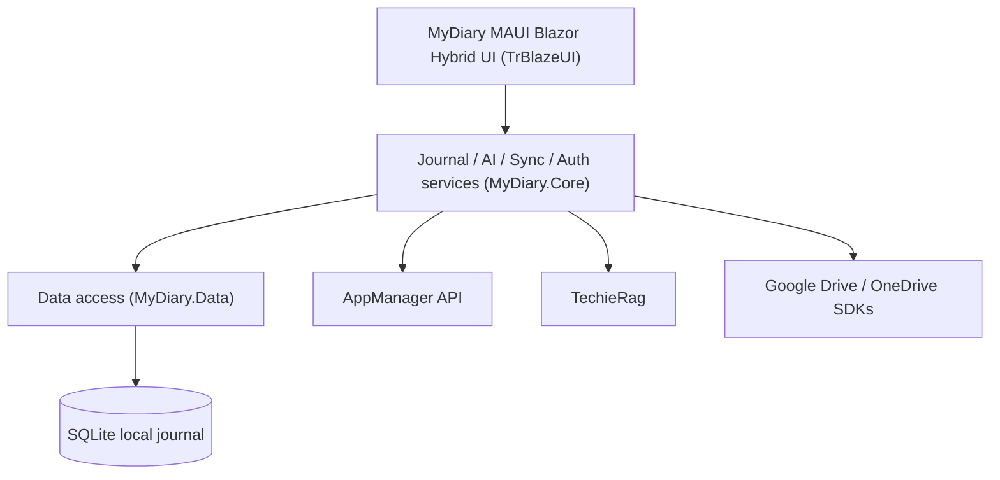
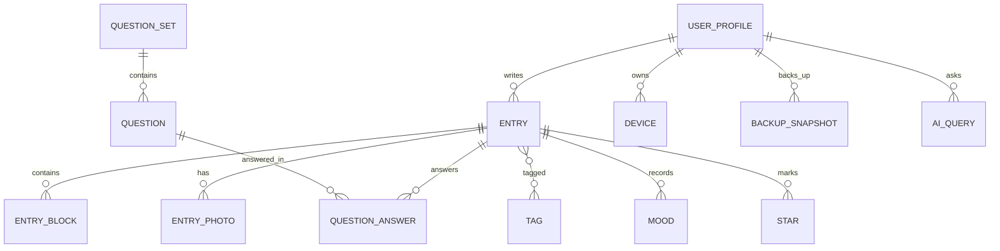

<!-- tf-schema

doc: architecture

file: docs/MyDiary-Architecture.md

header: App, Kind, Size, Stack answer set, Date

section: Stack decisions | required

section: Solution structure | required

section: Component map | required

section: Data model | required

section: Cross-cutting | required

section: Decisions log | required

section: Module responsibilities | optional-small

section: Open questions | optional

rule: stack-rows

rule: head-project

budget: S 2500 3500 | M 4000 6000 | L 4000 6000

rule: stack-table

rule: solution-table

rule: request-flow

rule: er-diagram

rule: decisions-log

-->

# MyDiary — Architecture

| | |
|---|---|
| App | MyDiary |
| Kind | app |
| Size | Medium |
| Stack answer set | DotNet |
| Date | 2026-10-18 |

## 1. Stack decisions

One row per stack question. "Source" says where the answer came from: the answer set, the owner, or the existing code.

| Q | Topic | Decision | Source |
|---|---|---|---|
| Q1 | Configuration | `appsettings.json` layered by `appsettings.{Environment}.json`; no other configuration mechanism | answer set: DotNet |
| Q2 | Secrets in development | `dotnet user-secrets`; `appsettings.Development.json` is committed and never holds real secrets; a `secrets.example.json` lists every key the application reads | answer set: DotNet |
| Q3 | Database | SQLite for the local journal store on each device; AppManager is the backend for identity, licences and devices | owner, day-1 (device app, free users keep data locally) |
| Q4 | Authentication | AppManager API with an installed-app key (`pk_live_…`) and a per-installation `X-Device-Id`; AppManager owns roles, licences and subscriptions | brief |
| Q5 | Logging | Serilog, always, with file logging wired at startup before anything else can fail | answer set: DotNet |
| Q6 | Tests | xUnit; a test project exists from day one; unit and integration tests | answer set: DotNet |
| Q7 | Layout and naming | `src/` and `tests/` at the root; primary executable named exactly `MyDiary`; secondary heads named descriptively | answer set: DotNet |
| Q8 | User interface | TrBlazeUI for the MAUI Blazor Hybrid head; icons from `TrBlazeUI.Icons.Lucide`; rendering mode is MAUI Blazor Hybrid (one head for Android, iOS, iPadOS, Windows and macOS) | answer set: DotNet + owner, day-1 |
| Q11 | Standing rules | 1. Never add a NuGet package without a line in the Architecture document saying why. 2. Never create a second configuration mechanism. 3. When TechieFlow, TrBlazeUI, TechieRag or any other internal library lacks something, record it in that library's feedback file and hold the feature until the library is fixed. 4. Data access is always Dapper. 5. Database migrations live in a dedicated project named `MyDiaryDb` using DbUp; the app runs migrations at startup. 6. Log files are written under `bin/`, never at the repository root. 7. No unnecessary folders at the repository root; everything sits under `src/` or `tests/`. | answer set: DotNet |

Required packages: `TrBlazeUI.Components`

## 2. Solution structure

| Project | Kind | Purpose |
|---|---|---|
| `MyDiary` | MAUI Blazor Hybrid app | Primary head for Android, iOS, iPadOS, Windows and macOS |
| `MyDiary.Core` | class library | Domain models, journal services, AI orchestration, AppManager client, TechieRag client, sync orchestration |
| `MyDiary.Data` | class library | SQLite data access with Dapper, repositories |
| `MyDiaryDb` | migrations project | DbUp migrations; run by the app at startup |
| `MyDiary.Tests` | test project | xUnit unit and integration tests |

## 3. Component map

**How a request travels** (a free user opens the home screen):
1. The `Home` page calls `JournalService.GetTodaysEntriesAsync` and `JournalService.GetOnThisDayAsync`.
2. `JournalService` asks `EntryRepository` for entries filtered by date and past years.
3. The repository runs Dapper SQL against the local SQLite database and returns entities.
4. The service maps entities to view models and the page renders the streak, today's list and the On This Day card.

## 4. Data model

| Entity | Key fields | Notes |
|---|---|---|
| UserProfile | UserId (AppManager), Email, FirstName, LastName, LicenceKey, LicenceName, LicenceExpiry | Local cache of the AppManager profile and active licence |
| Device | DeviceId, UserDeviceId, DeviceName, Platform, IsBlocked, LastSeenDate | Per-installation record; `X-Device-Id` persisted across sessions |
| Entry | EntryId, Type (Dump/FreeFlow/QuestionSet), Title, CreatedAt, UpdatedAt, StreakDate | One journal per user; no journal list |
| EntryBlock | BlockId, EntryId, Order, Content, Formatting | Rich blocks for a Free-Flow entry |
| EntryPhoto | PhotoId, EntryId, LocalPath, CloudPath, Caption | Photos stay on device unless backed up |
| Tag | TagId, Name | User-defined tags |
| Mood | MoodId, EntryId, MoodValue | Mood chosen for an entry |
| Star | StarId, EntryId | Starred entries |
| QuestionSet | QuestionSetId, Name, Category, IsCustom, DueRule | Built-in or custom sets (Monthly Goals, Yearly Review, Health, Fitness, Weekly Retro, Project Retro, Gratitude) |
| Question | QuestionId, QuestionSetId, Order, Prompt | Individual question within a set |
| QuestionAnswer | AnswerId, EntryId, QuestionId, AnswerText | One answer per question in an entry |
| BackupSnapshot | SnapshotId, UserId, Provider (GoogleDrive/OneDrive), CreatedAt, RemoteId | Record of a backup or restore |
| AiQuery | QueryId, UserId, QuestionText, AnswerText, SourceEntryIds, CreatedAt | Plain-question answers and the entries they used |

## 5. Cross-cutting

- **Identity:** AppManager API with an installed-app key and per-installation `X-Device-Id`; password reset, profile edit, password change, problem reports and account-data requests all call AppManager endpoints.
- **Configuration:** `appsettings.json` for shared defaults; `appsettings.Development.json` for local development; `dotnet user-secrets` for the AppManager installed-app key and any online AI keys.
- **Logging:** Serilog with file logging to the build output folder; the log file is created before any other startup code runs.
- **Errors:** Service methods return a `Result<T>` or throw domain exceptions; the UI shows friendly messages and logs the detail.
- **Offline:** The app keeps working offline for up to 30 days; licence validation is cached and retried when online.

## 6. Decisions log

One row per decision. Every package added to the project has a row saying why.

| Date | Decision | Why | Status |
|---|---|---|---|
| 2026-10-18 | MAUI Blazor Hybrid with TrBlazeUI | One head runs on Android, iOS, iPadOS, Windows and macOS; TrBlazeUI is the mandated component library | decided |
| 2026-10-18 | SQLite for the local journal | Free users keep everything on device; SQLite ships on every MAUI target and needs no server | decided |
| 2026-10-18 | AppManager for identity, licences and devices | Brief requires accounts, sign-in, device caps and licence checks to use AppManager; MyDiary has no server of its own | decided |
| 2026-10-18 | TechieRag for every AI feature | Brief requires all AI, built-in or online, to go through TechieRag; MyDiary writes no AI code | decided |
| 2026-10-18 | Google Drive and OneDrive SDKs for paid backup/sync | Brief restricts paid sync to Google Drive or OneDrive; no other cloud services are in scope | decided |

## 7. Module responsibilities

| Module | Responsibility | Depends on |
|---|---|---|
| `MyDiary` | Blazor pages, layout shell, platform services (biometrics, file picker, reminders), component composition | `MyDiary.Core` |
| `MyDiary.Core` | Domain models, journal business logic, AI orchestration through TechieRag, AppManager client, sync orchestration, Google Drive / OneDrive abstractions | `MyDiary.Data` |
| `MyDiary.Data` | SQLite connection management, Dapper repositories, entity mapping | — |
| `MyDiaryDb` | DbUp migration scripts; invoked by the app at startup | — |
| `MyDiary.Tests` | Unit and integration tests for services and repositories | `MyDiary.Core`, `MyDiary.Data` |

## 8. Open questions

- Which local AI model ships with the free-user build? The brief says "the smallest built-in AI model" but does not name it; TechieRag's catalogue will decide.
- Which OAuth flow and SDK versions are used for Google Drive and OneDrive backup? The brief names the services but not the libraries.
- How are sync conflicts between devices resolved when a paid user writes on multiple devices? A last-write-wins or per-field merge rule must be chosen before build.
