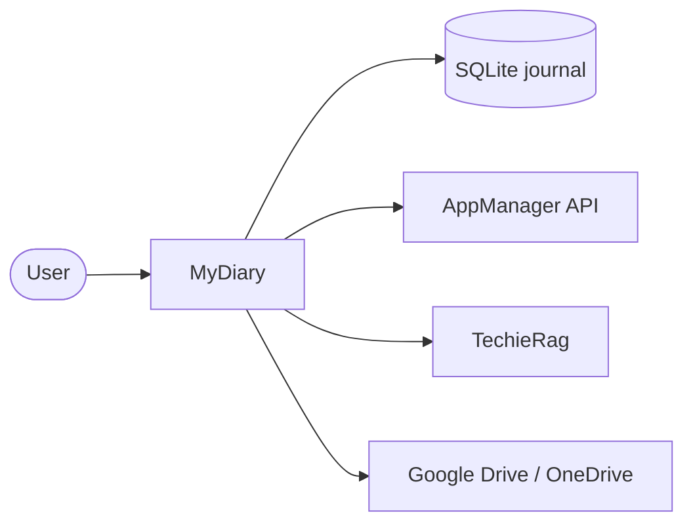

<!-- tf-schema

doc: brd

file: docs/MyDiary-BRD.md

header: App, Kind, Size, Stack answer set, Status, Date

section: Summary | required | max 200

section: Scope | required

section: Users and roles | required

section: Screens and flow | required

section: Requirements | required

section: Non-functional requirements | required

section: Development status | required

section: Context diagram | optional-small

section: Constraints and assumptions | optional-small

section: Risks | optional-small

section: Glossary | optional

budget: S 6000 8000 | M 10000 15000 | L 10000 15000

rule: brd-ledger

rule: screens-table

rule: mockup-links

-->

# MyDiary — Business Requirements

| | |
|---|---|
| App | MyDiary |
| Kind | app |
| Size | Medium |
| Stack answer set | DotNet |
| Status | Draft |
| Date | 2026-10-18 |

## 1. Summary

MyDiary is a private journaling app for phone, tablet and computer. A single user keeps one journal and writes through three modes: a 10-Thought Dump, a Free-Flow entry with formatting and photos, or a Targeted Questioning set. The home screen shows today's entries, a streak and an "On This Day" card that tells a warm story from past years. Users can browse, search, tag, star and pick moods; ask plain-language questions and see counted answers with the source entries listed; and compare one question's answers across months or years. Identity, licences, devices, problem reports and account-data requests are handled by the AppManager API, so MyDiary has no server of its own and AppManager never sees journal text. Every AI feature goes through TechieRag. Free users write on one device with a built-in local model. Paid users can choose another model, use their own online AI key, back up and sync through Google Drive or OneDrive, and use several devices.

## 2. Scope

**In:**

- Account creation and sign-in through AppManager on first launch.
- Offline use for up to 30 days, then online licence revalidation.
- Password reset, profile edit, password change, problem report, and account-data copy or deletion, all from inside the app.
- Free account limited to one device; paid account limited by licence.
- Device list, plan details, and the ability to forget or block a device.
- One journal per user with no journal picker.
- 10-Thought Dump, Free-Flow entry with formatting and photos, and Targeted Questioning sets.
- Built-in question sets (Monthly Goals, Yearly Review, Health, Fitness, Weekly Retro, Project Retro, Gratitude) and a custom set builder.
- Due-date suggestions for question sets.
- Home screen with today's entries, streak and On This Day story.
- Timeline and calendar browsing; tags, stars and moods.
- Search by keyword and filters by date, tag, question set, photo, star and mood.
- Plain-language questions with counted answers and listed source entries.
- Side-by-side comparison of one question across months or years.
- Built-in local AI model for free users; paid users can choose a model or enter their own online AI key.
- Paid backup, sync and restore through Google Drive or OneDrive.
- JSON export and import, including Day One imports.
- App lock with PIN or biometric, and journaling reminders.
- Android, iPhone, iPad, Windows and Mac from one MAUI Blazor Hybrid head.

**Out:**

- Purchase page, landing page, in-app payment and app-store purchases (phase 2 web app).
- Multiple journals, shared journals and family groups sharing one licence.
- Sending free-user journal text to any online service.
- iCloud, Dropbox and other sync services.
- Map view, voice transcription, widgets, handwriting and sharing an entry as an image.

## 3. Users and roles

| Role | Who they are | What they need |
|---|---|---|
| Free user | Writes on one device; keeps everything local | A simple, private journal with writing, browsing, search, questions and local AI |
| Paid user | Writes on several devices, backs up and restores, may choose an AI model or online service | All free features plus multi-device sign-in, cloud backup/sync, model choice and online AI with a clear warning |
| Goal reviewer | Free or paid user who runs periodic reviews | Pre-defined question sets and the ability to compare the same answers over time |
| Owner (admin) | Assigns paid licences and reads problem reports in AppManager | No action inside MyDiary; administration happens in the AppManager site |

## 4. Screens and flow

One row per routed page. A dialog is a row under its parent screen with `on /route` in the Route column; it is not counted as a screen.

| Screen | Route | Role | Mockup | Fields |
|---|---|---|---|---|
| Welcome | `/welcome` | Free user, Paid user | [mockup](mockups/sign-in.html) | email, password, first name, last name |
| Forgot password (dialog) | on `/welcome` | Free user, Paid user | [mockup](mockups/sign-in.html) | email |
| Home | `/home` | Free user, Paid user | [mockup](mockups/home.html) | today's entries, streak, On This Day card |
| 10-Thought Dump | `/dump` | Free user, Paid user | [mockup](mockups/dump.html) | ten numbered thought lines |
| Free-Flow entry | `/entry` | Free user, Paid user | [mockup](mockups/entry.html) | title, rich text blocks, photos, tags, mood, star |
| Photo picker (dialog) | on `/entry` | Free user, Paid user | [mockup](mockups/entry.html) | photo file, caption |
| Targeted Questioning | `/question-set` | Free user, Paid user, Goal reviewer | [mockup](mockups/question-set.html) | question set picker, question list, answers |
| Question set builder | `/question-set-builder` | Free user, Paid user, Goal reviewer | [mockup](mockups/question-set-builder.html) | set name, category, question prompts, order |
| Timeline | `/timeline` | Free user, Paid user | [mockup](mockups/timeline.html) | entry list, date filter, tag filter, mood filter, star filter |
| Calendar | `/calendar` | Free user, Paid user | [mockup](mockups/calendar.html) | month grid, day dots, date filter |
| Search | `/search` | Free user, Paid user | [mockup](mockups/search.html) | keyword, date range, tags, question set, photo, star, mood |
| AI Ask | `/ask` | Free user, Paid user | [mockup](mockups/ask.html) | plain question, counted answer, source entries |
| AI Compare | `/ask/compare` | Free user, Paid user, Goal reviewer | [mockup](mockups/ask-compare.html) | question picker, period range, answer grid |
| Account | `/account` | Free user, Paid user | [mockup](mockups/account.html) | profile, plan, devices, forget/block buttons |
| Edit profile (dialog) | on `/account` | Free user, Paid user | [mockup](mockups/account.html) | first name, last name, mobile number |
| Change password (dialog) | on `/account` | Free user, Paid user | [mockup](mockups/account.html) | current password, new password, confirm password |
| Problem report (dialog) | on `/account` | Free user, Paid user | [mockup](mockups/account.html) | title, description, environment |
| Account data request (dialog) | on `/account` | Free user, Paid user | [mockup](mockups/account.html) | copy or deletion request, confirmation |
| Settings | `/settings` | Free user, Paid user | [mockup](mockups/settings.html) | PIN, biometric, reminders, AI model, online AI key |
| AI model picker (dialog) | on `/settings` | Paid user | [mockup](mockups/settings.html) | model list, online AI key, warning |
| Backup & Restore | `/backup` | Paid user | [mockup](mockups/backup.html) | provider, backup now, restore, last sync |
| Export & Import | `/export` | Free user, Paid user | [mockup](mockups/export.html) | JSON export, JSON import, Day One import |

**Primary journey:**

1. A new user opens the app and sees the Welcome screen, where they create a MyDiary account or sign in through AppManager.
2. After authentication the Home screen loads, showing today's entries, the current streak and the On This Day card.
3. The user taps "Write" and chooses 10-Thought Dump, Free-Flow or a Targeted Questioning set.
4. They save the entry and return to Home, where the streak and today's list update.
5. Later they browse the Timeline or Calendar, search and filter, or ask a plain-language question on the AI Ask screen.

## 5. Requirements

One item per thing the verifier will test. Each names its screen, links the mockup, and states its acceptance in the form the checklist will carry.

### Welcome

The Welcome screen lets a new user create a MyDiary account or an existing user sign in through AppManager.

- **BRD-1** — Create account. *Screen:* Welcome · *Mockup:* [mockup](mockups/sign-in.html)
  - *Acceptance:* When a new user enters email, password and name and taps Create account, the Home screen opens.
- **BRD-2** — Sign in. *Screen:* Welcome · *Mockup:* [mockup](mockups/sign-in.html)
  - *Acceptance:* When an existing user enters email and password and taps Sign in, the Home screen opens.
- **BRD-3** — Forgot password link. *Screen:* Welcome · *Mockup:* [mockup](mockups/sign-in.html)
  - *Acceptance:* When a user taps Forgot password and submits their email, then a confirmation message appears and no error is shown.
- **BRD-4** — Password encryption. *Screen:* Welcome · *Mockup:* [mockup](mockups/sign-in.html)
  - *Acceptance:* When a password is submitted, then it is RSA-encrypted with the AppManager public key before leaving the device.

### Home

The Home screen shows today's entries, the current streak and a warm On This Day story from past years.

- **BRD-5** — Today's entries list. *Screen:* Home · *Mockup:* [mockup](mockups/home.html)
  - *Acceptance:* When the Home screen opens, then every entry created today is listed in reverse chronological order.
- **BRD-6** — Empty today state. *Screen:* Home · *Mockup:* [mockup](mockups/home.html)
  - *Acceptance:* When no entry exists today, then the Home screen shows a prompt to write the first entry.
- **BRD-7** — Streak display. *Screen:* Home · *Mockup:* [mockup](mockups/home.html)
  - *Acceptance:* When the Home screen opens, then the current consecutive-day streak is visible.
- **BRD-8** — On This Day card. *Screen:* Home · *Mockup:* [mockup](mockups/home.html)
  - *Acceptance:* When the Home screen opens, then a warm story built from entries on this date in past years is shown.
- **BRD-9** — Write menu. *Screen:* Home · *Mockup:* [mockup](mockups/home.html)
  - *Acceptance:* When the user taps Write, then choices for 10-Thought Dump, Free-Flow and Targeted Questioning appear.
- **BRD-10** — Entry opens for editing. *Screen:* Home · *Mockup:* [mockup](mockups/home.html)
  - *Acceptance:* When the user taps an existing entry, then the matching editor opens with the entry loaded.

### 10-Thought Dump

The 10-Thought Dump editor gives ten numbered quick lines; empty lines are dropped on save.

- **BRD-11** — Ten numbered lines. *Screen:* 10-Thought Dump · *Mockup:* [mockup](mockups/dump.html)
  - *Acceptance:* When the Dump screen opens, then ten empty numbered input lines are shown.
- **BRD-12** — Empty lines dropped. *Screen:* 10-Thought Dump · *Mockup:* [mockup](mockups/dump.html)
  - *Acceptance:* When the user saves with only some lines filled, then the saved entry keeps only those lines in order.
- **BRD-13** — Cancel returns home. *Screen:* 10-Thought Dump · *Mockup:* [mockup](mockups/dump.html)
  - *Acceptance:* When the user cancels the dump, then no entry is saved and the Home screen reappears.

### Free-Flow entry

The Free-Flow editor supports a title, rich formatting, photos, tags, mood and a star.

- **BRD-14** — Title and body. *Screen:* Free-Flow entry · *Mockup:* [mockup](mockups/entry.html)
  - *Acceptance:* When the user enters a title and body and saves, then the entry appears in today's list with that title.
- **BRD-15** — Rich formatting. *Screen:* Free-Flow entry · *Mockup:* [mockup](mockups/entry.html)
  - *Acceptance:* When the user applies bold, italic or a heading to selected text, then the formatting is preserved after save.
- **BRD-16** — Add photo. *Screen:* Free-Flow entry · *Mockup:* [mockup](mockups/entry.html)
  - *Acceptance:* When the user adds a photo with a caption, then the photo and caption appear in the entry.
- **BRD-17** — Add tags. *Screen:* Free-Flow entry · *Mockup:* [mockup](mockups/entry.html)
  - *Acceptance:* When the user adds tags, then those tags are stored with the entry and shown in the entry list.
- **BRD-18** — Pick mood. *Screen:* Free-Flow entry · *Mockup:* [mockup](mockups/entry.html)
  - *Acceptance:* When the user picks a mood, then the mood icon is stored and shown on the entry.
- **BRD-19** — Star entry. *Screen:* Free-Flow entry · *Mockup:* [mockup](mockups/entry.html)
  - *Acceptance:* When the user taps the star, then the entry is marked as starred.

### Targeted Questioning

The Targeted Questioning screen lets a user answer a pre-defined or custom question set.

- **BRD-20** — Built-in sets listed. *Screen:* Targeted Questioning · *Mockup:* [mockup](mockups/question-set.html)
  - *Acceptance:* When the screen opens, then Monthly Goals, Yearly Review, Health, Fitness, Weekly Retro, Project Retro and Gratitude are available.
- **BRD-21** — Custom sets listed. *Screen:* Targeted Questioning · *Mockup:* [mockup](mockups/question-set.html)
  - *Acceptance:* When the user has created custom sets, then they appear alongside the built-in sets.
- **BRD-22** — Answer questions. *Screen:* Targeted Questioning · *Mockup:* [mockup](mockups/question-set.html)
  - *Acceptance:* When the user selects a set and answers its questions, then the answers are saved as one entry.
- **BRD-23** — Due suggestion. *Screen:* Targeted Questioning · *Mockup:* [mockup](mockups/question-set.html)
  - *Acceptance:* When a question set is due, for example Monthly Goals on the 1st, then the Home screen suggests it.

### Question set builder

The Question set builder lets a user create and edit their own question sets.

- **BRD-24** — Create custom set. *Screen:* Question set builder · *Mockup:* [mockup](mockups/question-set-builder.html)
  - *Acceptance:* When the user names a set, picks a category and adds questions, the set is saved and listed.
- **BRD-25** — Reorder questions. *Screen:* Question set builder · *Mockup:* [mockup](mockups/question-set-builder.html)
  - *Acceptance:* When the user reorders questions, then the saved order is used when the set is answered.
- **BRD-26** — Edit existing set. *Screen:* Question set builder · *Mockup:* [mockup](mockups/question-set-builder.html)
  - *Acceptance:* When the user edits a custom set, then the updated questions are used for future answers; past answers stay unchanged.

### Timeline

The Timeline screen lists entries chronologically with filters.

- **BRD-27** — Entries in chronological order. *Screen:* Timeline · *Mockup:* [mockup](mockups/timeline.html)
  - *Acceptance:* When the Timeline screen opens, then entries are listed newest first with their date and title.
- **BRD-28** — Filter by date range. *Screen:* Timeline · *Mockup:* [mockup](mockups/timeline.html)
  - *Acceptance:* When the user picks a date range, then only entries in that range are shown.
- **BRD-29** — Filter by tag, mood and star. *Screen:* Timeline · *Mockup:* [mockup](mockups/timeline.html)
  - *Acceptance:* When the user picks a tag, mood or starred-only filter, then only matching entries are shown.

### Calendar

The Calendar screen shows a month grid with visual markers for days that have entries.

- **BRD-30** — Month grid. *Screen:* Calendar · *Mockup:* [mockup](mockups/calendar.html)
  - *Acceptance:* When the Calendar screen opens, then the current month is shown and days with entries are marked.
- **BRD-31** — Select day. *Screen:* Calendar · *Mockup:* [mockup](mockups/calendar.html)
  - *Acceptance:* When the user taps a day with entries, then that day's entries are listed.
- **BRD-32** — Navigate months. *Screen:* Calendar · *Mockup:* [mockup](mockups/calendar.html)
  - *Acceptance:* When the user swipes or taps previous/next, then the previous or next month is shown.

### Search

The Search screen finds entries by keyword and combined filters.

- **BRD-33** — Keyword search. *Screen:* Search · *Mockup:* [mockup](mockups/search.html)
  - *Acceptance:* When the user enters a keyword, then only entries whose title or body contains it are listed.
- **BRD-34** — Filter by date. *Screen:* Search · *Mockup:* [mockup](mockups/search.html)
  - *Acceptance:* When the user adds a date filter, then only entries in the range are listed.
- **BRD-35** — Filter by tag. *Screen:* Search · *Mockup:* [mockup](mockups/search.html)
  - *Acceptance:* When the user selects one or more tags, then only entries with those tags are listed.
- **BRD-36** — Filter by question set. *Screen:* Search · *Mockup:* [mockup](mockups/search.html)
  - *Acceptance:* When the user selects a question set, then only entries created from that set are listed.
- **BRD-37** — Filter by photo, star and mood. *Screen:* Search · *Mockup:* [mockup](mockups/search.html)
  - *Acceptance:* When the user toggles photo, star or mood filters, then only matching entries are listed.

### AI Ask

The AI Ask screen lets a user ask plain questions about their journal and get counted answers with sources listed.

- **BRD-38** — Plain question input. *Screen:* AI Ask · *Mockup:* [mockup](mockups/ask.html)
  - *Acceptance:* When the user types a plain question and submits it, then an answer appears.
- **BRD-39** — Counted answer. *Screen:* AI Ask · *Mockup:* [mockup](mockups/ask.html)
  - *Acceptance:* When the question asks for a count, then the answer shows a number.
- **BRD-40** — Source entries listed. *Screen:* AI Ask · *Mockup:* [mockup](mockups/ask.html)
  - *Acceptance:* When an answer is given, then the entries used to produce it are listed and tappable.
- **BRD-41** — No match response. *Screen:* AI Ask · *Mockup:* [mockup](mockups/ask.html)
  - *Acceptance:* When no entry matches the question, then the app says so and does not invent an answer.
- **BRD-42** — Free user uses local model. *Screen:* AI Ask · *Mockup:* [mockup](mockups/ask.html)
  - *Acceptance:* When a free user asks a question, then the built-in local model processes it without sending text online.
- **BRD-43** — Paid user can choose online model. *Screen:* AI Ask · *Mockup:* [mockup](mockups/ask.html)
  - *Acceptance:* When a paid user chooses an online model with their own key, the question is sent with a prior warning.

### AI Compare

The AI Compare screen shows one question's answers side by side across months or years.

- **BRD-44** — Pick question. *Screen:* AI Compare · *Mockup:* [mockup](mockups/ask-compare.html)
  - *Acceptance:* When the user picks a saved question, then its answers are loaded.
- **BRD-45** — Compare by month. *Screen:* AI Compare · *Mockup:* [mockup](mockups/ask-compare.html)
  - *Acceptance:* When the user selects monthly grouping, then each month's answer is shown in a column.
- **BRD-46** — Compare by year. *Screen:* AI Compare · *Mockup:* [mockup](mockups/ask-compare.html)
  - *Acceptance:* When the user selects yearly grouping, then each year's answer is shown in a column.
- **BRD-47** — Empty period handling. *Screen:* AI Compare · *Mockup:* [mockup](mockups/ask-compare.html)
  - *Acceptance:* When a period has no matching answer, then that period shows "no answer" instead of a made-up value.

### Account

The Account screen shows profile, plan, devices and actions for problem reports and account-data requests.

- **BRD-48** — Profile displayed. *Screen:* Account · *Mockup:* [mockup](mockups/account.html)
  - *Acceptance:* When the Account screen opens, then the user's first name, last name, email and mobile number are shown.
- **BRD-49** — Edit profile. *Screen:* Account · *Mockup:* [mockup](mockups/account.html)
  - *Acceptance:* When the user edits their profile and saves, then the changes are sent to AppManager and reflected on the screen.
- **BRD-50** — Change password. *Screen:* Account · *Mockup:* [mockup](mockups/account.html)
  - *Acceptance:* When the user enters current and new passwords and saves, then the password is changed through AppManager.
- **BRD-51** — Plan and expiry. *Screen:* Account · *Mockup:* [mockup](mockups/account.html)
  - *Acceptance:* When the Account screen opens, then the current plan name, expiry date and device cap are visible.
- **BRD-52** — Device list. *Screen:* Account · *Mockup:* [mockup](mockups/account.html)
  - *Acceptance:* When the Account screen opens, then every signed-in device is listed with its name, platform and last seen date.
- **BRD-53** — Devices in use count. *Screen:* Account · *Mockup:* [mockup](mockups/account.html)
  - *Acceptance:* When the Account screen opens, then the count of used devices versus the allowed number is shown.
- **BRD-54** — Forget device. *Screen:* Account · *Mockup:* [mockup](mockups/account.html)
  - *Acceptance:* When the user forgets a device, then it disappears from the list and its sessions are revoked.
- **BRD-55** — Block device. *Screen:* Account · *Mockup:* [mockup](mockups/account.html)
  - *Acceptance:* When the user blocks a device, then it is marked blocked and cannot sign in again.
- **BRD-56** — Problem report. *Screen:* Account · *Mockup:* [mockup](mockups/account.html)
  - *Acceptance:* When the user submits a problem report, then it is created through AppManager's IssueSvc.
- **BRD-57** — Account data copy request. *Screen:* Account · *Mockup:* [mockup](mockups/account.html)
  - *Acceptance:* When the user requests a copy of their account data, then AppManager initiates the request and a confirmation is shown.
- **BRD-58** — Account deletion request. *Screen:* Account · *Mockup:* [mockup](mockups/account.html)
  - *Acceptance:* When the user requests account deletion, then AppManager initiates the request and a confirmation is shown.

### Settings

The Settings screen controls app lock, reminders and AI model choice.

- **BRD-59** — Set PIN lock. *Screen:* Settings · *Mockup:* [mockup](mockups/settings.html)
  - *Acceptance:* When the user sets a PIN, then the app requires the PIN on resume.
- **BRD-60** — Enable biometric lock. *Screen:* Settings · *Mockup:* [mockup](mockups/settings.html)
  - *Acceptance:* When the device supports biometric and the user enables it, then the app unlocks with fingerprint or face.
- **BRD-61** — Journaling reminder. *Screen:* Settings · *Mockup:* [mockup](mockups/settings.html)
  - *Acceptance:* When the user sets a daily reminder time, then a local notification is scheduled for that time.
- **BRD-62** — Free user cannot pick AI model. *Screen:* Settings · *Mockup:* [mockup](mockups/settings.html)
  - *Acceptance:* When a free user opens AI model settings, only the local model is shown and no key input is offered.
- **BRD-63** — Paid user picks AI model. *Screen:* Settings · *Mockup:* [mockup](mockups/settings.html)
  - *Acceptance:* When a paid user selects a different built-in model, then future AI questions use it.
- **BRD-64** — Paid user enters online AI key. *Screen:* Settings · *Mockup:* [mockup](mockups/settings.html)
  - *Acceptance:* When a paid user enters an online AI key, a warning that journal text will be sent must be confirmed.

### Backup & Restore

The Backup & Restore screen is available to paid users for Google Drive and OneDrive.

- **BRD-65** — Back up to cloud. *Screen:* Backup & Restore · *Mockup:* [mockup](mockups/backup.html)
  - *Acceptance:* When a paid user taps Back up and picks a provider, the journal uploads and a snapshot record is saved.
- **BRD-66** — Restore from cloud. *Screen:* Backup & Restore · *Mockup:* [mockup](mockups/backup.html)
  - *Acceptance:* When a paid user picks a previous snapshot and taps Restore, then the journal is restored on this device.
- **BRD-67** — Sync between devices. *Screen:* Backup & Restore · *Mockup:* [mockup](mockups/backup.html)
  - *Acceptance:* When a paid user writes on one device and then opens another, then the new entry appears after sync.
- **BRD-68** — Free user sees upgrade prompt. *Screen:* Backup & Restore · *Mockup:* [mockup](mockups/backup.html)
  - *Acceptance:* When a free user reaches Backup & Restore, then a message explains it requires a paid licence.

### Export & Import

The Export & Import screen lets any user move journal data as JSON, including from Day One.

- **BRD-69** — Export to JSON. *Screen:* Export & Import · *Mockup:* [mockup](mockups/export.html)
  - *Acceptance:* When the user taps Export, then a JSON file containing all journal entries is produced.
- **BRD-70** — Import from JSON. *Screen:* Export & Import · *Mockup:* [mockup](mockups/export.html)
  - *Acceptance:* When the user imports a MyDiary JSON file, then the entries are added to the journal.
- **BRD-71** — Import from Day One. *Screen:* Export & Import · *Mockup:* [mockup](mockups/export.html)
  - *Acceptance:* When the user imports a Day One JSON export, then the entries are added to the journal.

### Device and licence rules

Rules enforced at sign-in and during use.

- **BRD-72** — Free user one-device limit. *Screen:* Welcome · *Mockup:* [mockup](mockups/sign-in.html)
  - *Acceptance:* When a free user signs in on a second device, sign-in is refused with a paid-licence message.
- **BRD-73** — Paid user device cap. *Screen:* Welcome · *Mockup:* [mockup](mockups/sign-in.html)
  - *Acceptance:* When a paid user signs in over the licence cap, sign-in is refused with a how-to-free-slot message.
- **BRD-74** — Licence determines paid features. *Screen:* Account · *Mockup:* [mockup](mockups/account.html)
  - *Acceptance:* When AppManager returns a licence, "Pro" allows 2 devices, "Pro-Plus" allows the configured number, and none means free.
- **BRD-75** — Keep free features after expiry. *Screen:* Account · *Mockup:* [mockup](mockups/account.html)
  - *Acceptance:* When a paid licence expires, then every free feature and the whole journal on the current device remain available.
- **BRD-76** — Offline grace period. *Screen:* Home · *Mockup:* [mockup](mockups/home.html)
  - *Acceptance:* When the app is offline, it works for up to 30 days before requiring an online licence check.

## 6. Non-functional requirements

| Id | Area | Requirement | Measure |
|---|---|---|---|
| BRD-77 | Security | Journal text never leaves the device for free users; online AI only happens when a paid user enters their own key and confirms the warning | journal-stays-local for free; online-ai-warning for paid |
| BRD-78 | Security | Passwords sent to AppManager are RSA-encrypted with the server's public key; no plain password leaves the device | password-encrypted |
| BRD-79 | Security | AppManager installed-app key (`pk_live_…`) and per-installation `X-Device-Id` are used on every AppManager call | installed-app-key |
| BRD-80 | Logging | Serilog file logging is wired at startup before any other code runs; logs are written under `bin/` and never at the repository root | log-file-on-startup |
| BRD-81 | Zoom (desktop head drawn in a web view) | Cmd/Ctrl+=, - and 0 zoom 50% to 300% in 10% steps; the level is kept across restarts | zoom-check: keys · zoom-check: kept |

## 7. Development status

Written by the status gate after every build, verify and handoff; not by hand.

**Snapshot as of 2026-10-18.** Live per-requirement status: `PROJECT-STATUS.md` and the Requirements Status table in `docs/MyDiary-Checklist.md`.

| Screen | Requirements | Verified | Open | Status |
|---|---|---|---|---|
| Welcome | 4 | 0 | 4 | Planned |
| Home | 6 | 0 | 6 | Planned |
| 10-Thought Dump | 3 | 0 | 3 | Planned |
| Free-Flow entry | 6 | 0 | 6 | Planned |
| Targeted Questioning | 4 | 0 | 4 | Planned |
| Question set builder | 3 | 0 | 3 | Planned |
| Timeline | 3 | 0 | 3 | Planned |
| Calendar | 3 | 0 | 3 | Planned |
| Search | 5 | 0 | 5 | Planned |
| AI Ask | 6 | 0 | 6 | Planned |
| AI Compare | 4 | 0 | 4 | Planned |
| Account | 11 | 0 | 11 | Planned |
| Settings | 6 | 0 | 6 | Planned |
| Backup & Restore | 4 | 0 | 4 | Planned |
| Export & Import | 3 | 0 | 3 | Planned |
| Device and licence rules | 5 | 0 | 5 | Planned |

## 8. Context diagram

## 9. Constraints and assumptions

- Accounts, sign-in, devices, licences, problem reports and account-data requests all use the AppManager API with an installed-app key; MyDiary has no server of its own.
- AppManager never sees journal text.
- Every AI feature, built-in or online, is done through TechieRag; MyDiary writes no AI code.
- Screens are built with TrBlazeUI, so mockups use TrBlazeUI components and visual language.
- The app runs on Android, iPhone, iPad, Windows and Mac from one MAUI Blazor Hybrid head.
- Paid licences are assigned by the owner in AppManager; there is no Buy button inside MyDiary in phase 1.

## 10. Risks

| Risk | Likelihood | Impact | Mitigation |
|---|---|---|---|
| TechieRag does not expose a needed AI model or comparison primitive | Medium | High | Log a feedback entry and hold the feature until the library is fixed |
| Google Drive / OneDrive OAuth flows differ significantly across mobile and desktop targets | Medium | Medium | Abstract the provider behind an interface and test each platform early |
| Local AI model size may exceed store limits on some mobile devices | Medium | Medium | Choose the smallest model that satisfies the brief and measure package size in the first build |
| Sync conflict resolution between devices is undefined | Medium | Medium | Decide last-write-wins or per-field merge before implementing sync |

## 11. Glossary

- **10-Thought Dump** — A journal mode with ten numbered quick lines; empty lines are dropped on save.
- **Free-Flow entry** — A journal mode with a title, rich formatting, photos, tags, mood and star.
- **Targeted Questioning** — A journal mode where the user answers a structured question set.
- **On This Day** — A short, warm story built from entries written on this date in past years.
- **Goal reviewer** — A user pattern of running periodic reviews using question sets and comparison.
