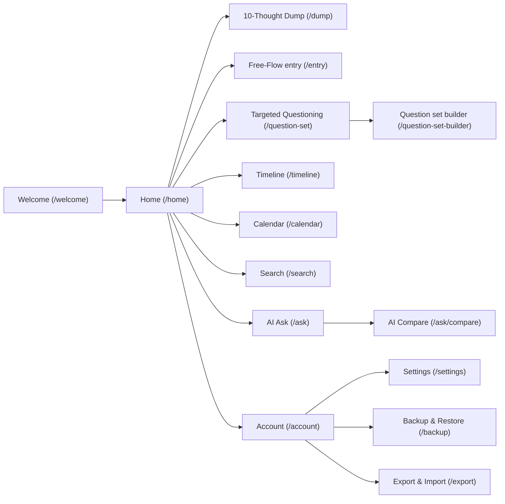

<!-- tf-schema

doc: uidesign

file: docs/MyDiary-UIDesign.md

header: App, Kind, Size, UI library, Theme

section: Design system | required | max 300

section: Screens | required

section: Click-through flow | optional-small

section: Branding guide | optional

entries: Screens | Screen:

per-entry: 250 400

rule: entry-mockup

rule: entry-regions-table

rule: entry-fields-table

rule: entry-states

rule: mockup-links

-->

# MyDiary — UI Design

| | |
|---|---|
| App | MyDiary |
| Kind | app |
| Size | Medium |
| UI library | TrBlazeUI.Components |
| Theme | light and dark, following system preference |

## Design system

- **Layout shell:** `TbAppBar` at the top with title and contextual actions; `TbBottomNav` on phones and `TbSidebar` on tablets and desktops. Content sits in a `TbScrollView` with 16px padding. All mockups share `docs/mockups/styles.css` so the set is visually consistent.
- **Theme:** light surface `#F8FAFC`, card surface `#FFFFFF`, dark surface `#0F172A`; primary indigo `#4F46E5`; text primary `#1E293B` / `#F8FAFC`; destructive rose `#E11D48`. System preference is the default.
- **Shared controls:** `TbAppBar`, `TbBottomNav`, `TbSidebar`, `TbButton`, `TbIconButton`, `TbFab`, `TbCard`, `TbTextField`, `TbTextArea`, `TbSelect`, `TbChip`, `TbBadge`, `TbList`, `TbListItem`, `TbDialog`, `TbBottomSheet`, `TbCalendar`, `TbToggle`, `TbAvatar`, `TbEmptyState`, `TbToolbar`.
- **Rules:** spacing scale 4/8/12/16/24/32px; touch targets at least 44px; phone breakpoint < 600px, tablet 600–1024px, desktop > 1024px; bottom nav has five items: Home, Timeline, Calendar, Ask, Account. Cards use 16px radius and a 1px slate-200 border.

## Screens

### Screen: Welcome (`/welcome`)

**Mockup:** [mockups/sign-in.html](mockups/sign-in.html) · **Roles:** Free user, Paid user · **BRD:** BRD-1–BRD-4, BRD-72–BRD-73

| Region | Control | Shows or binds |
|---|---|---|
| App bar | `TbAppBar` | App logo and "MyDiary" title |
| Tab switcher | `TbTabs` | "Sign in" / "Create account" |
| Sign-in form | `TbCard` | Email `TbTextField`, password `TbTextField`, Sign in `TbButton` |
| Create-account form | `TbCard` | First name, last name, email, password `TbTextField`s |
| Helper links | `TbButton` variant link | Forgot password, offline notice |

| Field | Type | Required | Validation |
|---|---|---|---|
| Email | email | yes | valid email format |
| Password | password | yes | AppManager password rules |
| First name | text | yes | 1–100 characters |
| Last name | text | yes | 1–100 characters |

**Dialogs opened here:** Forgot password: email field.

**States:** empty: form fields blank · loading: sign-in button shows spinner · error: inline validation message under the offending field.

### Screen: Home (`/home`)

**Mockup:** [mockups/home.html](mockups/home.html) · **Roles:** Free user, Paid user · **BRD:** BRD-5–BRD-10, BRD-76

| Region | Control | Shows or binds |
|---|---|---|
| App bar | `TbAppBar` | Title "Today", search icon button, settings icon button |
| Streak badge | `TbCard` | Flame icon and consecutive-day count |
| On This Day card | `TbCard` | Warm story paragraph from past years |
| Today's entries list | `TbList` | `TbListItem` per entry with title, time, tags, mood |
| Empty state | `TbEmptyState` | Prompt to write the first entry |
| Write FAB | `TbFab` | Opens write-choice bottom sheet |
| Bottom nav | `TbBottomNav` | Home, Timeline, Calendar, Ask, Account |

| Field | Type | Required | Validation |
|---|---|---|---|
| — | — | — | — |

**Dialogs opened here:** Write-choice bottom sheet with 10-Thought Dump, Free-Flow and Targeted Questioning options.

**States:** empty: `TbEmptyState` with a "Start writing" call to action · loading: skeleton cards · error: inline retry message.

### Screen: 10-Thought Dump (`/dump`)

**Mockup:** [mockups/dump.html](mockups/dump.html) · **Roles:** Free user, Paid user · **BRD:** BRD-11–BRD-13

| Region | Control | Shows or binds |
|---|---|---|
| App bar | `TbAppBar` | Back, title "10-Thought Dump", Save `TbButton` |
| Thought lines | `TbCard` | Ten `TbTextField`s numbered 1–10 |
| Hint text | `TbText` | "Empty lines will be dropped on save" |

| Field | Type | Required | Validation |
|---|---|---|---|
| Thought line | text | no | max 280 characters each |

**Dialogs opened here:** none.

**States:** empty: ten blank lines · loading: Save button spinner · error: save failure toast.

### Screen: Free-Flow entry (`/entry`)

**Mockup:** [mockups/entry.html](mockups/entry.html) · **Roles:** Free user, Paid user · **BRD:** BRD-14–BRD-19

| Region | Control | Shows or binds |
|---|---|---|
| App bar | `TbAppBar` | Back, title "Free-Flow", Save, star `TbIconButton` |
| Title | `TbTextField` | Entry title |
| Body | `TbTextArea` | Rich text with formatting toolbar |
| Toolbar | `TbToolbar` | Bold, italic, heading, photo, tag, mood buttons |
| Photos | `TbList` | Photo thumbnails with captions |
| Tags | `TbChip` list | Selected tags |
| Mood | `TbSelect` | Chosen mood icon |

| Field | Type | Required | Validation |
|---|---|---|---|
| Title | text | no | max 200 characters |
| Body | rich text | no | max 100,000 characters |
| Photo caption | text | no | max 200 characters |
| Tags | chips | no | user-defined |
| Mood | select | no | from preset list |

**Dialogs opened here:** Photo picker: file/camera and caption; Tag picker: existing and new tags; Mood picker: preset mood icons.

**States:** empty: blank title and body · loading: Save spinner · error: validation or save failure message.

### Screen: Targeted Questioning (`/question-set`)

**Mockup:** [mockups/question-set.html](mockups/question-set.html) · **Roles:** Free user, Paid user, Goal reviewer · **BRD:** BRD-20–BRD-23

| Region | Control | Shows or binds |
|---|---|---|
| App bar | `TbAppBar` | Back, title "Question Set", Save |
| Set selector | `TbSelect` | Built-in or custom set |
| Progress | `TbText` | "Question 3 of 7" |
| Question list | `TbCard` | One `TbTextArea` per question |
| New custom button | `TbButton` | Opens question set builder |

| Field | Type | Required | Validation |
|---|---|---|---|
| Answer | textarea | no | max 10,000 characters per answer |

**Dialogs opened here:** none.

**States:** empty: selector shows placeholder · loading: questions skeleton · error: save failure toast.

### Screen: Question set builder (`/question-set-builder`)

**Mockup:** [mockups/question-set-builder.html](mockups/question-set-builder.html) · **Roles:** Free user, Paid user, Goal reviewer · **BRD:** BRD-24–BRD-26

| Region | Control | Shows or binds |
|---|---|---|
| App bar | `TbAppBar` | Back, title "Build Set", Save |
| Name | `TbTextField` | Set name |
| Category | `TbSelect` | Monthly Goals, Yearly Review, Health, Fitness, Weekly Retro, Project Retro, Gratitude, Custom |
| Questions | `TbList` | Reorderable `TbTextField` rows |
| Add question | `TbIconButton` | Adds a new question row |

| Field | Type | Required | Validation |
|---|---|---|---|
| Set name | text | yes | 1–120 characters |
| Category | select | yes | one of the preset values |
| Question prompt | text | yes | 1–500 characters |

**Dialogs opened here:** Delete-question confirmation.

**States:** empty: one blank question row · loading: Save spinner · error: duplicate-name or empty-question validation.

### Screen: Timeline (`/timeline`)

**Mockup:** [mockups/timeline.html](mockups/timeline.html) · **Roles:** Free user, Paid user · **BRD:** BRD-27–BRD-29

| Region | Control | Shows or binds |
|---|---|---|
| App bar | `TbAppBar` | Title "Timeline", filter icon |
| Filter bar | `TbCard` | Date range, tag `TbSelect`, mood `TbSelect`, star toggle |
| Entry list | `TbList` | `TbListItem` with date, title, preview, tags, mood, star |
| Empty state | `TbEmptyState` | "No entries match your filters" |
| Bottom nav | `TbBottomNav` | Home, Timeline, Calendar, Ask, Account |

| Field | Type | Required | Validation |
|---|---|---|---|
| Date from | date | no | before or equal to date to |
| Date to | date | no | after or equal to date from |
| Tags | multi-select | no | existing tags |
| Mood | select | no | preset moods |
| Starred only | toggle | no | boolean |

**Dialogs opened here:** none.

**States:** empty: `TbEmptyState` · loading: skeleton list · error: retry button.

### Screen: Calendar (`/calendar`)

**Mockup:** [mockups/calendar.html](mockups/calendar.html) · **Roles:** Free user, Paid user · **BRD:** BRD-30–BRD-32

| Region | Control | Shows or binds |
|---|---|---|
| App bar | `TbAppBar` | Previous month, current month/year, next month |
| Month grid | `TbCalendar` | Days with entry dots |
| Selected day list | `TbList` | Entries for the selected day |
| Bottom nav | `TbBottomNav` | Home, Timeline, Calendar, Ask, Account |

| Field | Type | Required | Validation |
|---|---|---|---|
| — | — | — | — |

**Dialogs opened here:** none.

**States:** empty: grid shows no dots, day list hidden · loading: skeleton grid · error: retry message.

### Screen: Search (`/search`)

**Mockup:** [mockups/search.html](mockups/search.html) · **Roles:** Free user, Paid user · **BRD:** BRD-33–BRD-37

| Region | Control | Shows or binds |
|---|---|---|
| App bar | `TbAppBar` | Back, search `TbTextField`, search button |
| Filters | `TbCard` | Date range, tags, question set, photo toggle, star toggle, mood |
| Results | `TbList` | Matching entries with highlighted keyword |
| Empty state | `TbEmptyState` | "No entries match your search" |
| Bottom nav | `TbBottomNav` | Home, Timeline, Calendar, Ask, Account |

| Field | Type | Required | Validation |
|---|---|---|---|
| Keyword | search | no | max 200 characters |
| Date range | date range | no | valid range |
| Tags | multi-select | no | existing tags |
| Question set | select | no | built-in or custom sets |
| Photo | toggle | no | boolean |
| Star | toggle | no | boolean |
| Mood | select | no | preset moods |

**Dialogs opened here:** none.

**States:** empty: prompt to type a keyword · loading: skeleton results · error: search failure toast.

### Screen: AI Ask (`/ask`)

**Mockup:** [mockups/ask.html](mockups/ask.html) · **Roles:** Free user, Paid user · **BRD:** BRD-38–BRD-43

| Region | Control | Shows or binds |
|---|---|---|
| App bar | `TbAppBar` | Title "Ask your journal" |
| Question input | `TbTextArea` | Plain question |
| Ask button | `TbButton` | Submits question |
| Answer card | `TbCard` | Counted answer text |
| Source entries | `TbList` | Entries used for the answer |
| Empty state | `TbEmptyState` | "Ask anything about your journal" |
| Model notice | `TbBadge` | "Local model" or model name / warning |
| Bottom nav | `TbBottomNav` | Home, Timeline, Calendar, Ask, Account |

| Field | Type | Required | Validation |
|---|---|---|---|
| Question | textarea | yes | 1–1000 characters |

**Dialogs opened here:** none.

**States:** empty: input and prompt only · loading: answer card shows spinner · error: "No entries match" message or model error.

### Screen: AI Compare (`/ask/compare`)

**Mockup:** [mockups/ask-compare.html](mockups/ask-compare.html) · **Roles:** Free user, Paid user, Goal reviewer · **BRD:** BRD-44–BRD-47

| Region | Control | Shows or binds |
|---|---|---|
| App bar | `TbAppBar` | Back, title "Compare answers" |
| Question picker | `TbSelect` | Saved question |
| Period picker | `TbSelect` | Monthly or Yearly |
| Comparison grid | `TbCard` | Columns for each period with the answer |
| Empty period cells | `TbText` | "No answer" |
| Bottom nav | `TbBottomNav` | Home, Timeline, Calendar, Ask, Account |

| Field | Type | Required | Validation |
|---|---|---|---|
| Question | select | yes | previously asked question |
| Period | select | yes | Monthly or Yearly |

**Dialogs opened here:** none.

**States:** empty: picker prompts · loading: grid skeleton · error: "No answers to compare".

### Screen: Account (`/account`)

**Mockup:** [mockups/account.html](mockups/account.html) · **Roles:** Free user, Paid user · **BRD:** BRD-48–BRD-58, BRD-74–BRD-75

| Region | Control | Shows or binds |
|---|---|---|
| App bar | `TbAppBar` | Title "Account" |
| Profile card | `TbCard` | Avatar, name, email, mobile, Edit profile |
| Plan card | `TbCard` | Plan name, expiry, device cap, devices used |
| Devices list | `TbList` | Device name, platform, last seen, Forget/Block |
| Actions list | `TbList` | Change password, Problem report, Request data copy, Request deletion, Sign out |
| Bottom nav | `TbBottomNav` | Home, Timeline, Calendar, Ask, Account |

| Field | Type | Required | Validation |
|---|---|---|---|
| — | — | — | — |

**Dialogs opened here:** Edit profile: first name, last name, mobile; Change password: current, new, confirm; Problem report: title, description, environment; Account data request: copy or deletion, confirmation.

**States:** empty: not applicable (always has profile) · loading: skeleton cards · error: AppManager call failure toast.

### Screen: Settings (`/settings`)

**Mockup:** [mockups/settings.html](mockups/settings.html) · **Roles:** Free user, Paid user · **BRD:** BRD-59–BRD-64

| Region | Control | Shows or binds |
|---|---|---|
| App bar | `TbAppBar` | Back, title "Settings" |
| Security section | `TbCard` | PIN toggle/setup, biometric toggle |
| Reminders section | `TbCard` | Daily reminder time `TbSelect`, toggle |
| AI section | `TbCard` | Model picker (paid only), online key input (paid only) |
| About section | `TbCard` | Version, privacy policy link |

| Field | Type | Required | Validation |
|---|---|---|---|
| PIN | pin | yes for lock | 4–6 digits |
| Reminder time | time | no | valid time |
| Online AI key | password | no | service-specific format |

**Dialogs opened here:** PIN setup; online AI key warning confirmation.

**States:** empty: not applicable (settings always loaded) · loading: toggles disabled · error: biometric unavailable notice.

### Screen: Backup & Restore (`/backup`)

**Mockup:** [mockups/backup.html](mockups/backup.html) · **Roles:** Paid user (free sees upgrade prompt) · **BRD:** BRD-65–BRD-68

| Region | Control | Shows or binds |
|---|---|---|
| App bar | `TbAppBar` | Back, title "Backup & Restore" |
| Provider selector | `TbSelect` | Google Drive or OneDrive |
| Backup card | `TbCard` | Last backup time, Back up now button |
| Snapshots list | `TbList` | Date, size, Restore button |
| Sync status | `TbBadge` | "Synced", "Pending", "Offline" |
| Upgrade prompt | `TbCard` | For free users: explanation and how to upgrade via AppManager |

| Field | Type | Required | Validation |
|---|---|---|---|
| Cloud provider | select | yes for backup | Google Drive or OneDrive |

**Dialogs opened here:** Restore confirmation.

**States:** empty: no snapshots yet · loading: spinner on provider connect · error: provider auth or upload failure.

### Screen: Export & Import (`/export`)

**Mockup:** [mockups/export.html](mockups/export.html) · **Roles:** Free user, Paid user · **BRD:** BRD-69–BRD-71

| Region | Control | Shows or binds |
|---|---|---|
| App bar | `TbAppBar` | Back, title "Export & Import" |
| Export card | `TbCard` | Export to JSON button, file name preview |
| Import card | `TbCard` | Import MyDiary JSON button |
| Day One import card | `TbCard` | Import Day One JSON button |
| Progress / result | `TbText` | Success count or error summary |

| Field | Type | Required | Validation |
|---|---|---|---|
| File | file picker | yes for import | JSON, ZIP for Day One |

**Dialogs opened here:** Import confirmation (warns about duplicates).

**States:** empty: no file selected · loading: progress indicator · error: parse failure or duplicate-key message.

## Click-through flow

## Branding guide

No deviation from TrBlazeUI defaults except the primary colour (indigo `#4F46E5`) and the app name "MyDiary" in the app bar. Icons use Lucide through `TrBlazeUI.Icons.Lucide`.
