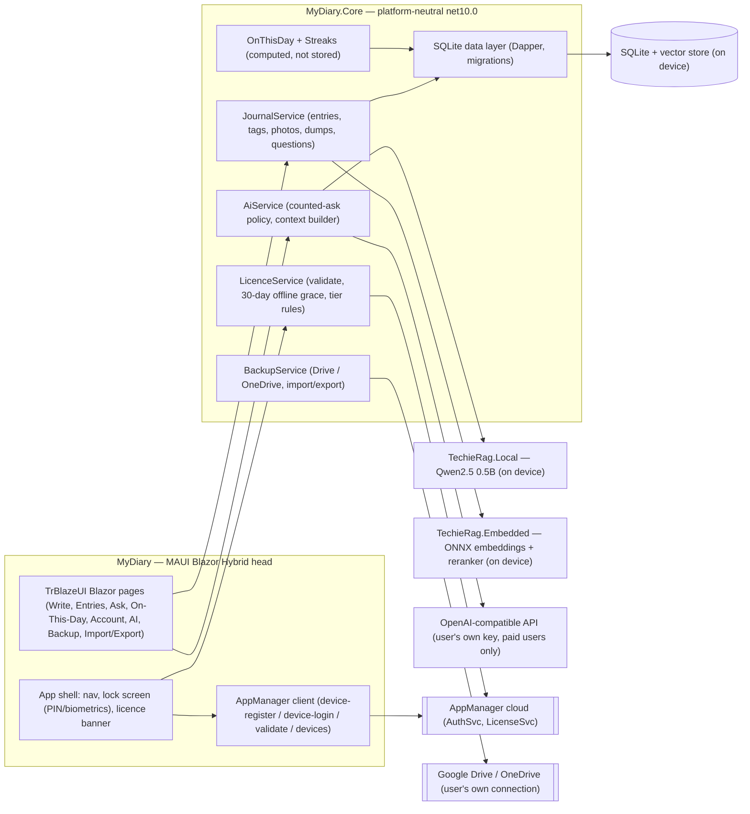
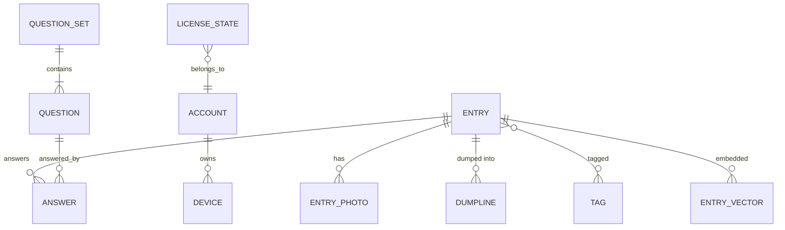

# MyDiary — Architecture

| | |
|---|---|
| App | MyDiary |
| Kind | app |
| Size | Medium |
| Stack answer set | dotnet |
| Date | 2026-10-19 |

The brief (`docs/MyDiary-Brief.md`) is the source of truth for the app concept and pins several
technical choices (MAUI Blazor Hybrid, TrBlazeUI, AppManager, local LLM / user key, no server of
its own). Where the brief is silent, the dotnet answer set (`.tfcore/templates/stack-defaults/dotnet.md`)
is the default; every override below is recorded with its reason. App size **Medium** was derived
from the brief's scope (≈14 routed screens, ≈55 requirements, 4 roles) — the brief does not state
a size, so the owner should confirm it at review.

## 1. Stack decisions

| Q | Topic | Decision | Source |
|---|---|---|---|
| Q1 | Configuration | `appsettings.json` for non-sensitive settings (app name, storage paths, AI defaults) + environment-variable layer; AppManager URL and installed-app API key arrive as build-time secrets, never committed. A device app has no user-facing config surface except the in-app AI provider screen. | dotnet answer set (Q1) |
| Q2 | Secrets in development | developer `user-secrets` in development + `secrets.example.json` at the repository root (the example holds placeholders only). The only build-time secret is the AppManager installed-app credential. A paid user's own LLM provider key is entered at runtime on the in-app AI screen and stored in the on-device protected store; it is never a repository secret. | dotnet answer set (Q2) |
| Q3 | Database | **local SQLite on the device** — the journal database lives in the app's private app-data directory; the brief's "No server of its own" replaces the dotnet default of PostgreSQL + Docker compose. Schema is versioned in code (Q11). | brief: "No server of its own" (override of dotnet Q3) |
| Q4 | Authentication | **AppManager installed-app** (`pk_live_…` key, `X-Device-Id`, RSA-encrypted passwords via `/AuthSvc/public-key`): `device-register` / `device-login` for AppManager identity, plus an **app-local PIN/biometrics layer** in front of the journal content. AppManager is the source of the user's identity and device list; the PIN/biometric is the device-level lock the journal adds on top. | brief: "AppManager" + "PIN/biometrics"; guide: `docs/AppManager-api-usage-guide.md` §2.1, §3.1 |
| Q5 | Logging | Serilog to file (rolling files in the app's log directory). Hard rule: log files must **never** contain diary text, photos, answers or AI prompts/responses — metadata only (action name, timestamp, duration, error type). | dotnet answer set (Q5) + brief: "Log files should never contain diary content" |
| Q6 | Tests | xUnit; unit tests live in `tests/MyDiary.Tests` and run on the WSL side via `dotnet test` (the Core project is a plain net10.0 library, so no workload is needed for the bulk of the tests). UI-level checks are smoke-driven against the running app in later phases. | dotnet answer set (Q6) |
| Q7 | Layout and naming | `src/` for code, `tests/` for tests. The head project is named exactly `MyDiary`. | dotnet answer set (Q7) |
| Q8 | User interface | **TrBlazeUI** component library (Tailwind v4 + shadcn/ui patterns, OKLCH tokens, built-in dark mode) rendered inside **MAUI Blazor Hybrid** — the brief's fixed choice. One Blazor codebase shared by all heads. | brief: "MAUI Blazor Hybrid + TrBlazeUI" |
| Q9 | Performance | not yet asked (UAT / production) — revisit when the app ships; no `perf-budget` rows are written until the owner gives numbers. Zoom: the MAUI Blazor Hybrid head renders inside a web view, so the NFR that content remains readable at the user's chosen text scale (the brief's "Web-view heads are zoomable") is enforced in the BRD's NFR table. | standard dotnet (Q9) + brief must-do |
| Q10 | Monitoring | not yet asked (UAT / production). A device app ships no telemetry today; the only outbound calls are the AppManager auth/licence endpoints and the user-initiated cloud AI calls. | standard dotnet (Q10) |
| Q11 | Standing rules | Dapper on SQLite — all SQL in Core, none in the head (11.2/11.3/11.4); schema versioned **in code** in `MyDiary.Core` (Dapper migration scripts ordered by version, applied at app start; 11.1); schema + migrations live in `src/MyDiary.Core/Db/` — no `database` folder at the repository root and no separate `MyDiaryDb` project, the device-app adaptation of 11.5. | dotnet Q11, adapted for a device app |

Required packages: `TrBlazeUI.Components`, `TechieRag`, `TechieRag.Embedded`, `TechieRag.Local`, `Dapper`, `SQLitePCLRaw.bundle_e_sqlite3`, `Serilog`

Rationale, package by package (each must be referenced by the project files by the time its feature
is built — `tf-stack-check` fails the build check otherwise):

- `TrBlazeUI.Components` (2.1.9) — the UI kit in the head (brief: MAUI Blazor Hybrid + TrBlazeUI); already in `src/MyDiary/MyDiary.csproj`.
- `TechieRag` (1.1.7) — AI orchestration in Core: embedding wiring, SQLite vector store, provider router, token tracking, conversation memory; already in `src/MyDiary.Core/MyDiary.Core.csproj`.
- `TechieRag.Embedded` — on-device ONNX embedding model + cross-encoder reranker (the local semantic search that free users get); added to Core with the AI feature.
- `TechieRag.Local` — in-process local LLM (Qwen2.5 0.5B class) powering free users' counted asks without any network; added to Core with the AI feature.
- `Dapper` (2.1.89) + `SQLitePCLRaw.bundle_e_sqlite3` (3.0.5) — the data layer (Q3/Q11); already in Core.
- `Serilog` + a file sink — logging (Q5); added to Core.
- The AppManager installed-app client is the `AppManagerClient` shape from `docs/AppManager-api-usage-guide.md` §4.5; its exact NuGet id is confirmed with the owner (it is not on the line above, so the stack check will not fail on the unknown id).

All TechieRag packages come from nuget.org (no configuration change); TrBlazeUI comes from the
private TrBlazeUI feed the repository's NuGet config already references.

## 2. Solution structure

| Project | Kind | Framework | Purpose |
|---|---|---|---|
| `MyDiary.slnx` | solution | — | the single solution at the repository root; no `database` folder at the root. |
| `MyDiary` | head (MAUI Blazor Hybrid) | `net10.0-android` on Linux builds; `net10.0-ios` + `net10.0-maccatalyst` on macOS builds; `net10.0-windows10.0.19041.0` on Windows builds | under `src/` — the app: TrBlazeUI-themed Blazor pages, app shell and navigation, the app-lock (PIN/biometrics), the AppManager client, the AI screen, backup UI, the 14-day-16:00 dump prompt, per-head permissions (photos, background) — the heads from must-do 24: Android, iPad/iPhone, macOS, Windows. |
| `MyDiary.Core` | class library | `net10.0` | under `src/` — everything that is not a screen: journal domain, SQLite via Dapper, AI service (TechieRag), licence service, backup/import/export engine, On-This-Day and streak computation. Shared verbatim across all heads; testable without a device. |
| `MyDiary.Tests` | test project | `net10.0` | under `tests/` — xUnit tests for Core (journal rules, licence grace logic, On-This-Day, streaks, backup engine, migration ordering). |

### Per-head build notes

The solution is built where the workload allows. From this WSL host, `tf-build.sh` reaches `dotnet`
and compiles the **Android** head (the WSL-side Android SDK is installed: platform 36, build-tools
36.0.0, platform-tools) plus the platform-neutral Core and the tests. The **iOS** and **macOS
Catalyst** heads compile only on a Mac (the iOS/maccatalyst TFMs are excluded on non-macOS hosts via
an MSBuild condition in the csproj); on a Mac, all three mobile/desktop TFMs plus the Windows head
build in one invocation. The **Windows** head builds on a Windows host (in the OpenCode-Docker
deployment that means through `winrun`; from WSL the solution build resolves it through the
`cmd.exe` rung of the build ladder). The heads the brief names — Android, iPad/iPhone, macOS,
Windows — are all present; iPad is the iOS TFM on the iPad idiom, not a separate project. Packaging
is unpackaged (`WindowsPackageType=None`) until the owner decides the MS Store question (§8).

## 3. Component map

**How a request travels** (one typical action per flow; per-screen detail is in the DevGuide):

*Writing and saving an entry (free, offline)*
1. The Write page collects text, tags and photo attachments; photos are copied into the app's private media store and referenced by entry id.
2. `JournalService` inserts the entry (and tag links, photo rows, question answers) in one local SQLite transaction via Dapper.
3. `TechieRag.Embedded` embeds the entry text on-device; the vector lands in the SQLite vector store.
4. Nothing leaves the device — the write path has no network by design; On-This-Day and streaks are recomputed on read.

*A counted ask*
1. The Ask page builds a context: the user's selected entries plus top-k neighbours from the local vector store, reranked on-device.
2. `AiService` applies the tier rule: a **free** user always gets the local model (`TechieRag.Local`, Qwen2.5 0.5B class) — no network, no key; a **paid** user gets whichever OpenAI-compatible provider they configured with their **own** key (key passed to the provider in code; never written to appsettings, never to logs, never to AppManager).
3. The ask counts only when the response is shown to the user (the brief's counting rule); the counter is per user per period, reset server-side by AppManager's licence, with the app tracking "asks left".

*Sign-in with the over-cap rule*
1. `AppManagerClient` fetches the RSA public key, encrypts the password, and calls `device-register` (new device) or `device-login` (existing device).
2. The response returns tokens plus the `device` block: `userDeviceId`, `isBlocked`, `isNewDevice`, `isOverCap`, and the `deviceCap` from the licence.
3. AppManager **reports** an over-cap device, it does not refuse it (200 + tokens + `isOverCap: true`). MyDiary therefore refuses itself: a free-tier user on their second device sees "Your free plan allows one device — sign out on your other device, or upgrade" and the app refuses to unlock the journal. A paid licence's higher cap (the licence name decides: 2 for Pro, more for Pro-Plus) is enforced the same way, reading `isOverCap`/`devicesUsed`/`devicesAllowed`.
4. The user can review and forget devices on the Account screen (`GET /AuthSvc/devices`, `DELETE …/{aUserDeviceId}` — a forgotten device reappears on the next validate).

### Screens and navigation

The app is one Blazor routing surface inside the MAUI WebView, wrapped by an app shell that
implements the lock. The routed screens (14) and the one dialog are the set the BRD's "Screens and
flow" table defines exactly: Sign-in, Home, Write, Questioning, Entries list, Entry detail,
On-This-Day, Search, Ask, Account, AI, Backup, Import/Export, and the Lock screen — plus the
"Build Your Own" dialog on the Questioning screen. Sign-in and Lock are the two gateways: the lock
is a router gate, and sign-in is reached from Account (sign out) or a first launch with no PIN set.
Navigation is standard Blazor `@page` routing with a persistent TrBlazeUI navigation; the **lock
screen** gates every route — after app background or an owner-configurable timeout, every route is
unreachable until the PIN or biometric unlock succeeds, so deep links and cold starts land on the
lock, never on a journal route. A user without any sign-in simply uses the app locally: the journal
works, and AppManager features (cloud continuity, licence, device list) stay visibly dormant.

## 4. Data model

All data lives in one SQLite file in the app's private directory. The journal content (entries,
photos, answers) is strictly separated from account/licence state; AppManager never receives any
journal content.

| Entity | Key fields | Notes |
|---|---|---|
| `Entry` | id, createdAt (UTC), text, isPrivate (bool), wordCount | the journal; `isPrivate` hides the entry from AI context and backups. |
| `EntryPhoto` | id, entryId, storagePath, createdAt | photo bytes live in the app's private media folder; the row holds the path — keeps the DB small. |
| `DumpLine` | entryId, seq, timestamp (UTC), text | the 14-day-16:00 prompt appends one line per day (time + text) to a running entry; the entry row is the day's anchor. |
| `Tag` / `EntryTag` | name (unique) / (entryId, tagId) | user vocabulary, free text. |
| `QuestionSet` / `Question` | name, isUser / (setId, text, order) | built-in sets plus user-built ones (the brief's "build your own"). |
| `Answer` | entryId, questionId, text | answers attach to entries; they are journal content and stay on-device. |
| `EntryVector` | entryId, modelId, vector (blob) | on-device vectors from `TechieRag.Embedded`; rebuilt if the embedding model changes. |
| `Account` | appManagerUserId, email, plan (free/paid), createdAt | the local mirror of the AppManager user, created at first sign-in. |
| `Device` | aUserDeviceId (AppManager), xDeviceId (install GUID), deviceName, lastSeenAt, isBlocked, isOverCap | the app's view of the user's device list from `GET /AuthSvc/devices` + the latest validate; drives the over-cap refusal and the Account device screen. |
| `LicenseState` | licenseName, licenseKey, isValid, expiryDate, daysRemaining, devicesUsed, devicesAllowed, lastValidatedAt, offlineGraceExhaustedAt | cached from `POST /LicenseSvc/validate`; the 30-day offline grace and the expiry rules read from this row. |
| `AiSettings` | providerId, apiKeyEncrypted, modelId, active | the paid user's own provider configuration; key stored encrypted at rest (DPAPI/Keystore/Keychain per head). |
| `AppSettings` | pinEnabled, biometricEnabled, language, askCounterPeriod, askCounterUsed | the app's local switches; the PIN is stored as a salted hash, never the raw PIN. |
| `BackupLog` | provider, lastAttemptAt, lastSuccessAt, lastStatus | the backup screen's state; backups themselves live in the user's own Drive/OneDrive. |

On-This-Day and streaks are **computed on read** from `Entry`/`DumpLine` timestamps — they are
deliberately not stored, so they can never drift out of sync with the journal.

**Migrations and schema evolution.** The schema is a sequence of versioned DDL statements in
`src/MyDiary.Core/Db/` (each with a version number and an idempotent up-migration), tracked in a
`SchemaVersion` table and applied at app start before any other read. Migrations may only add
columns or tables in this app's lifecycle — the journal is the user's lifetime of writing, so a
migration that rewrites history is a design bug, not a feature. The vector store is part of the
same file (a table of entryId + modelId + blob): if the embedding model in `TechieRag.Embedded`
changes between app versions, vectors under the old `modelId` are left in place and a re-embed job
regenerates them lazily on first use after the update.

**The 14-day 16:00 dump (mechanism).** A MAUI background task wakes the app daily at 16:00 local
time (in the window the brief names). For the current entry being written, it appends one
`DumpLine` (timestamp + the text present so far); the line accumulates as a running day inside that
entry. The dump entry is the anchor: opening it on the On-This-Day screen shows the day's running
text and, for each of the last 14 dumps, a one-line preview so the user can open any previous day.
The dump is a convenience view over `DumpLine` rows — deleting the entry deletes its dump lines
with it, and nothing about the dump is sent anywhere.

## 5. Cross-cutting

- **Identity:** AppManager installed-app authentication — every call carries the installed-app key plus the `X-Device-Id` (a GUID created once per install, persisted in the app settings); passwords travel RSA-encrypted (`GET /AuthSvc/public-key` first). Tokens are kept in the head's secure store and refreshed by the client; the Core licence service only sees valid tokens. AppManager rate-limits at 60 requests/minute per device — the app batches (validate on launch, not on every screen) and treats 429 + `Retry-After` as "keep the cached state". The app-local PIN/biometrics layer guards the journal *on the device* independently of AppManager: the journal is openable with a PIN even if AppManager is unreachable.
- **Licensing:** `POST /LicenseSvc/validate` on app launch (and a daily app-scheduler tick) returns `isValid`, `license.licenseName`/`licenseKey`, `devicesUsed`/`devicesAllowed`, `deviceRegistered` and `deviceCap`. Rules: **no valid licence** (message "No active license found for this application") → the app runs as a **free** user (everything local, AI limited to the local model, one device); **valid licence** → the plan the `licenseName` names unlocks online AI with the user's key and the higher device cap; **offline grace** → if the last successful validate is older than 30 days and none can be reached, the app keeps the free capabilities and shows a banner — it never locks the journal away from a user who simply has no network (the brief: the app keeps working offline); **expiry** (`daysRemaining` reaches 0, message "License has expired") → the app keeps running and the journal keeps working, but the **AI features are disabled** until the licence is renewed (the brief's expiry rule); renewal happens in the separate MyDiary purchase web app, out of scope, and the Account screen deep-links to it.
- **Configuration:** `appsettings.json` holds non-sensitive defaults; environment variables override in development. AppManager URL + installed-app API key come from user-secrets in development (`secrets.example.json` documents the shape). At runtime a paid user's LLM key is stored encrypted in `AiSettings` using the head's platform key store; it is passed to the provider in code and is never logged, backed up, or sent to AppManager.
- **Logging:** Serilog with a rolling file sink (a few most-recent files, size-capped). The privacy rule is a coding standard, not just a comment: no Serilog sink configuration, formatter, or `AiService` code path may format entry text, photo data, answers or LLM I/O into a log; a unit test asserts the Serilog templates contain no capture of the journal fields.
- **Errors:** offline-first by design — the journal, On-This-Day, search and the local AI work with no network. Network failures surface as states, not crashes: the licence banner shows "last validated N days ago" and degrades to free after the grace; the backup screen shows the last success and the failure reason; the AI screen says "online AI unavailable — using local model" (free) or "waiting for network" (paid) instead of a red screen. All AppManager calls go through the client's single retry/backoff path.
- **Privacy and security:** journal content never leaves the device except through the two user-initiated, user-controlled paths (the paid user's cloud AI call on their key, and their own Drive/OneDrive backup) — the default state sends nothing. Entries marked private are excluded from AI context and from backups unless the user opts in. Photos sit in the app's private directory with per-head permissions requested lazily (camera/photos permission on first attachment, not at install). The PIN is a salted hash; biometrics gate the same unlock state. At-rest, the database file sits in the OS-protected app directory; optional SQLCipher encryption is an open question (§8).
- **AI:** `AiService` is the single AI entry point, wrapping TechieRag: context building (selected entries + vector-store neighbours, reranked by the cross-encoder), the tier policy (free → `TechieRag.Local` in-process Qwen2.5 0.5B; paid → the configured OpenAI-compatible provider with the user's own key), and the ask counter (counts on shown response). TechieRag's token tracking powers the usage display on the AI screen. Conversation memory is local per device; there is no server-side conversation store because there is no server.
- **Backup and portability:** `BackupService` bundles the whole journal (entries, photos, answers, vectors optionally recomputed on restore) into a single file and uploads it to the user's own Google Drive or OneDrive over the user's own signed-in connection (platform Drive APIs; no MyDiary-owned service). Restore and the file-based import/export go through the same bundle format, so a user can move between heads without a network. Backups are encrypted at rest with a key derived from the user's PIN — restoring on a new device requires the PIN.
- **Theming:** the TrBlazeUI default — Tailwind CSS v4 with OKLCH design tokens, the shadcn/ui component patterns, built-in dark mode. The app adds its own accent on top of the token system and a reading-tuned type scale for the text-dominant Write and On-This-Day screens; dark mode follows the system setting by default, overridable in Account, persisted in `AppSettings`. No hand-rolled CSS outside the token system: a screen that needs a new token gets the token, not a one-off class, so all four heads stay visually identical and a TrBlazeUI upgrade is a version bump, not a rewrite. The full design system (tokens, per-screen region and field tables) is specified in `docs/MyDiary-UIDesign.md`; this document says only *how* theming is wired, not *what it looks like*.
- **Testing and verification:** Core is a plain net10.0 library, so the xUnit suite runs anywhere `dotnet test` runs — from this WSL host, in CI, or on the owner's machine — with no workload, no emulator and no WebView. That is where the risk lives (licence grace, over-cap refusal, On-This-Day, streaks, ask counter, backup bundle format, migration ordering), and those rules get unit tests in the same commit as the code. The head gets no unit tests for UI logic: the build phase ends with a self-smoke driving the running app, and the verify phase checks the BRD's acceptance lines against the running UI per the verifier's gates. Unit green plus smoke-clean is the bar before any requirement may be reported verified; the Requirements Status table is written by the verifier, never by the implementer.

## 6. Decisions log

| Date | Decision | Why | Status |
|---|---|---|---|
| 2026-10-19 | AI stack = TechieRag v3 (`TechieRag` + `.Embedded` + `.Local`) | one orchestration layer for embeddings, SQLite vector store, provider routing, token tracking and conversation memory, with MAUI-native wiring in `.Embedded` — instead of a hand-rolled ONNX wrapper | decided |
| 2026-10-19 | local model = Qwen2.5 0.5B class via `TechieRag.Local` | the brief's "local LLM" must run on a phone offline; 0.5B fits in-app (the project's convention for phone-sized local LLMs) | decided |
| 2026-10-19 | database = SQLite on device (override of the dotnet default PostgreSQL + Docker) | the brief: "No server of its own" — a journal app's data belongs to the device | decided |
| 2026-10-19 | auth = AppManager installed-app + app-local PIN/biometrics | the brief pins AppManager for identity/devices/licence; the PIN/biometric covers the device lock AppManager cannot see | decided |
| 2026-10-19 | UI = TrBlazeUI inside MAUI Blazor Hybrid | the brief's fixed choice; one Blazor codebase across all heads, Tailwind v4 + shadcn patterns, dark mode built in | decided |
| 2026-10-19 | heads = Android, iOS (iPhone + iPad), macOS (Catalyst), Windows | brief must-do 24; the iOS/Mac heads build only on a Mac, the others anywhere | decided |
| 2026-10-19 | size = Medium | ≈14 routed screens + 1 dialog, ≈55 requirements, 4 roles — over the Small (10 screens) ceiling; the brief is silent, owner confirms at review | planned |
| 2026-10-19 | `TechieRag.Embedded`, `TechieRag.Local`, `Serilog` added to `MyDiary.Core` when the AI/logging features are built | they are on the Required packages line; the build that writes those features must reference them (tf-stack-check enforces) | planned |
| 2026-10-19 | AppManager client package id confirmed with the owner | the guide shows the `AppManagerClient` API but not the feed; the exact NuGet id cannot be assumed | planned |

## 7. Module responsibilities

| Module | Responsibility | Depends on |
|---|---|---|
| `src/MyDiary` (head) | all screens, navigation, the lock screen, AppManager client calls, platform permissions, the AI provider screen, backup UI, the 14-day-16:00 prompt host, per-head permissions and packaging | `MyDiary.Core` (the only project reference); MAUI + Blazor + TrBlazeUI |
| `src/MyDiary.Core` | journal domain, SQLite + Dapper + migrations, On-This-Day/streak computation, AI service (TechieRag), licence service (grace/expiry/tier rules), backup/import/export engine — platform-neutral: no MAUI, no Blazor references, so it stays unit-testable on plain WSL .NET | Dapper, SQLitePCLRaw, TechieRag, Serilog; the head injects the real AppManager client and AI provider implementations |
| `tests/MyDiary.Tests` | unit tests for every Core rule (grace expiry, over-cap refusal, On-This-Day, streaks, ask counter, backup bundle format, migration order) | `MyDiary.Core`; xUnit |

The head depends on Core; the tests depend on Core; nothing depends on the head.

## 8. Open questions

- **Model bundling:** bundle the Qwen2.5 0.5B weights in the app package, or download them on first use? Bundling inflates the store download; downloading breaks first-run offline. Needs the owner's call once the real model file size is known (stage 2 build).
- **SQLite at-rest encryption:** rely on the OS-protected app directory, or add SQLCipher? SQLCipher costs first-run time and key management; the brief is silent, so the default is the OS directory until the owner says otherwise.
- **Backup bundle format and size:** one file vs. a photos sidecar; a large photo library can make the bundle exceed the cloud drive's single-upload sweet spot. The format is internal, so it can be revised at the backup feature's build.
- **Windows packaging:** the scaffold ships Windows **unpackaged** (`WindowsPackageType=None`); the brief says "Windows UWP". Confirm whether the owner wants the packaged MS Store flavour or the simpler unpackaged build.
- **Free-tier device cap:** the app enforces one device for licence-less users by counting the AppManager device list; confirm the exact user-facing wording and whether a licence-less user may ever sign in on a second device at all (the brief says free = 1 device).
