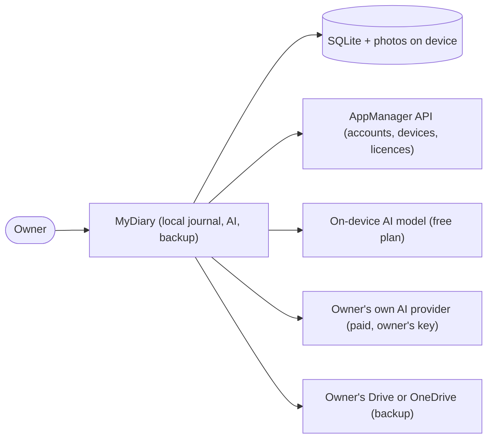

# MyDiary — Business Requirements

| | |
|---|---|
| App | MyDiary |
| Kind | app |
| Size | Medium |
| Stack answer set | dotnet |
| Status | Draft |
| Date | 2026-10-19 |

## 1. Summary

MyDiary is a private journaling app for phone, tablet and computer. One journal per person, three ways to write: a 10-Thought Dump of ten quick numbered lines, a Free-Flow entry with formatting and photos, and Targeted Questioning sets that can be answered again and read side by side over time. Opening the app shows a short, warm story of what was written on this date in past years. A user can ask plain questions about their past and gets a counted answer that lists the entries it used — or an honest "no match", never an invention. Free users write on one device with everything staying on it, using the small built-in AI model that runs on-device. A paid licence adds backup to the user's own Drive or OneDrive, several devices, and a choice of AI model. Accounts, sign-in, devices, licences, problem reports and account-data requests all run against the AppManager API; MyDiary has no server of its own, and AppManager never sees journal text.

## 2. Scope

**In:**

- One personal journal per user, with three writing modes (10-Thought Dump, Free-Flow, Targeted Questioning)
- Home screen with today's entries, a streak, and the On This Day card
- Browsing by timeline and calendar; tags, stars and moods on every entry
- On This Day: a warm per-year story for the date, with tap-through to the source entries
- Search by keyword with filters for date, tag, question set, photo, star and mood
- Ask: plain-language questions answered with a count and the source entries, through TechieRag
- AI: free users get the on-device model (no network); paid users may choose a model or enter their own key for an online service they use
- Backup to the user's own Google Drive or OneDrive, sync between devices, restore with a PIN
- JSON export/import, including Day One exports
- Account management through AppManager: sign-in, plan, devices, forget/block device, profile, password, problem report, data copy, deletion, sign-out
- App lock with PIN or biometrics, and journaling reminders
- The same screens on Android, iPhone, iPad, Windows and Mac

**Out:**

- The purchase and landing page — a separate MyDiary web app (phase 2); until then the owner assigns licences in AppManager
- Payment inside the app and app-store purchases
- More than one journal, shared journals, family licence sharing
- Sending journal text anywhere for a free user
- iCloud, Dropbox or any other sync service
- Map view, voice transcription, widgets, handwriting, sharing an entry as an image

## 3. Users and roles

| Role | Who they are | What they need |
|---|---|---|
| Free user | Writes on one device; everything stays on it | Write three ways, browse, search, ask (on-device model), lock, reminders, export/import |
| Paid user | Pro or Pro-Plus licence; several devices | Everything free has, plus backup/sync/restore, device management, model choice or own AI key |
| Goal reviewer | Free or paid; runs reviews on a schedule | Questioning sets that suggest when due and show past answers side by side |
| Owner (admin) | Buys and assigns licences; works on the AppManager site | Assigns licences, reads problem reports — does nothing inside MyDiary |

## 4. Screens and flow

One row per routed page. A dialog is a row under its parent screen with `on /route` in the Route column; it is not counted as a screen.

| Screen | Route | Role | Mockup | Fields |
|---|---|---|---|---|
| Sign in | `/signin` | Free, Paid | [mockup](mockups/signin.html) | email, password |
| Home | `/` | Free, Paid | [mockup](mockups/home.html) | today's entries, streak, On this day card, due set |
| Write | `/write` | Free, Paid | [mockup](mockups/write.html) | mode, text, photos, mood, tags |
| Questioning | `/questioning` | Free, Paid | [mockup](mockups/questioning.html) | set list, answers, due date |
| Entries | `/entries` | Free, Paid | [mockup](mockups/entries.html) | timeline, calendar, tag, star, mood |
| Entry detail | `/entries/:id` | Free, Paid | [mockup](mockups/entry-detail.html) | text, photos, tags, star, mood, private |
| On this day | `/on-this-day` | Free, Paid | [mockup](mockups/on-this-day.html) | date, per-year story |
| Search | `/search` | Free, Paid | [mockup](mockups/search.html) | keyword, date, tag, set, photo, star, mood |
| Ask | `/ask` | Free, Paid | [mockup](mockups/ask.html) | question, count, sources |
| Account | `/account` | Free, Paid | [mockup](mockups/account.html) | plan, devices, profile, password |
| AI | `/ai` | Free, Paid | [mockup](mockups/ai.html) | model, own key, asks left |
| Backup | `/backup` | Paid | [mockup](mockups/backup.html) | folder, last backup, private opt-in |
| Import and export | `/import-export` | Free, Paid | [mockup](mockups/import-export.html) | file choice, format |
| Lock | `/lock` | Free, Paid | [mockup](mockups/lock.html) | PIN, biometric, auto-lock |
| Build your own (dialog) | `on /questioning` | Free, Paid | [mockup](mockups/questioning.html) | set name, questions |

**Primary journey:**

1. The user signs in (or creates an account) on first launch, and the journal loads from this device.
2. Home shows today's entries, the streak, the On this day card, and any question set that is due.
3. The user writes a dump, a free-flow entry, or answers a set; the entry stores locally and is embedded for Ask.
4. Days later the user asks a plain question, reads the counted answer with its sources, or opens On this day for a warm story of this date.
5. A paid user connects a backup folder, signs in on a second device, and restores the journal there.

## 5. Requirements

One item per thing the verifier will test. Each names its screen, links the mockup, and states its acceptance in the form the checklist will carry.

### Sign in

Sign-in is the gateway to the app: one account through AppManager, the journal itself always local.

- **BRD-1** — Create account. *Screen:* Sign in · *Mockup:* [mockup](mockups/signin.html)
  - *Acceptance:* When a new user registers with email and password, then AppManager creates the account and a local journal exists.
- **BRD-2** — Sign in with password. *Screen:* Sign in · *Mockup:* [mockup](mockups/signin.html)
  - *Acceptance:* When the owner signs in with email and password, then AppManager returns a token and the journal loads.
- **BRD-3** — Free second device refused. *Screen:* Sign in · *Mockup:* [mockup](mockups/signin.html)
  - *Acceptance:* When a free user signs in on a second device, then sign-in is refused with a slot message.
- **BRD-4** — Paid over-cap refused. *Screen:* Sign in · *Mockup:* [mockup](mockups/signin.html)
  - *Acceptance:* When a paid user signs in past the licence device cap, then sign-in is refused with the freeing instructions.
- **BRD-5** — Offline grace. *Screen:* Sign in · *Mockup:* [mockup](mockups/signin.html)
  - *Acceptance:* When sign-in fails offline within 30 days of last success, then the app opens read-only journal access.
- **BRD-6** — Password reset. *Screen:* Sign in · *Mockup:* [mockup](mockups/signin.html)
  - *Acceptance:* When the owner requests a password reset from the sign-in screen, then AppManager emails the reset link.

### Home

Home is the daily landing: what was written today, the streak, and the door to the past.

- **BRD-7** — Today's entries. *Screen:* Home · *Mockup:* [mockup](mockups/home.html)
  - *Acceptance:* When the app opens on Home, then today's entries list with a write prompt appears.
- **BRD-8** — Streak. *Screen:* Home · *Mockup:* [mockup](mockups/home.html)
  - *Acceptance:* When Home loads, then the current streak shows consecutive days with at least one entry.
- **BRD-9** — On this day card. *Screen:* Home · *Mockup:* [mockup](mockups/home.html)
  - *Acceptance:* When Home loads and past entries exist, then a card opens the warm On this day story.
- **BRD-10** — Due set suggestion. *Screen:* Home · *Mockup:* [mockup](mockups/home.html)
  - *Acceptance:* When a questioning set is due, then Home offers it with one tap into Questioning.
- **BRD-11** — One journal, no picker. *Screen:* Home · *Mockup:* [mockup](mockups/home.html)
  - *Acceptance:* When the owner reaches any writing surface, then one journal is addressed, never a journal picker.

### Write

Write hosts the three writing modes and is the only way entries are created.

- **BRD-12** — 10-Thought Dump prompts. *Screen:* Write · *Mockup:* [mockup](mockups/write.html)
  - *Acceptance:* When the owner starts a 10-Thought Dump, then ten numbered prompts appear, one per line.
- **BRD-13** — Dump drops empty lines. *Screen:* Write · *Mockup:* [mockup](mockups/write.html)
  - *Acceptance:* When a dump is saved, then empty lines are dropped and written lines keep their order.
- **BRD-14** — Free-Flow formatting. *Screen:* Write · *Mockup:* [mockup](mockups/write.html)
  - *Acceptance:* When the owner writes free-flow, then text formatting and inline photos are allowed.
- **BRD-15** — Photos stored on device. *Screen:* Write · *Mockup:* [mockup](mockups/write.html)
  - *Acceptance:* When a photo is added in Write, then it stores on-device and appears inside the entry.
- **BRD-16** — Single journal target. *Screen:* Write · *Mockup:* [mockup](mockups/write.html)
  - *Acceptance:* When Write is opened, then the owner's single journal is the target, with no picker.
- **BRD-17** — Save embeds the entry. *Screen:* Write · *Mockup:* [mockup](mockups/write.html)
  - *Acceptance:* When an entry is saved, then it is embedded so later Ask questions can find it.

### Questioning

Questioning lists the seven built-in sets plus any custom sets, and holds answers over time.

- **BRD-18** — Built-in sets listed. *Screen:* Questioning · *Mockup:* [mockup](mockups/questioning.html)
  - *Acceptance:* When Questioning is opened, then the seven built-in sets are listed with their due status.
- **BRD-19** — Answer a set. *Screen:* Questioning · *Mockup:* [mockup](mockups/questioning.html)
  - *Acceptance:* When the owner answers a set, then each answer stores against that set and date.
- **BRD-20** — Build your own dialog. *Screen:* Build your own (dialog) · *Mockup:* [mockup](mockups/questioning.html)
  - *Acceptance:* When the owner opens Build Your Own, then a dialog collects set name and questions before saving.
- **BRD-21** — Save custom set. *Screen:* Questioning · *Mockup:* [mockup](mockups/questioning.html)
  - *Acceptance:* When a custom set is saved, then it joins the Questioning list and can be answered like a built-in.
- **BRD-22** — Answers side by side. *Screen:* Questioning · *Mockup:* [mockup](mockups/questioning.html)
  - *Acceptance:* When a set is answered again later, then past answers show side by side over time.

### Entries

Entries is the browse view: timeline and calendar over the whole journal.

- **BRD-23** — Timeline newest first. *Screen:* Entries · *Mockup:* [mockup](mockups/entries.html)
  - *Acceptance:* When Entries is opened, then entries list newest first with date, mood, and tags visible.
- **BRD-24** — Calendar marks days. *Screen:* Entries · *Mockup:* [mockup](mockups/entries.html)
  - *Acceptance:* When the entries calendar is shown, then days with entries are marked and tappable.

### Entry detail

Entry detail shows one entry and every change made to it, including edit, star, mood, tags, private and delete.

- **BRD-25** — View an entry. *Screen:* Entry detail · *Mockup:* [mockup](mockups/entry-detail.html)
  - *Acceptance:* When an entry is opened, then its text, photos, tags, star, and mood display.
- **BRD-26** — Edit re-embeds. *Screen:* Entry detail · *Mockup:* [mockup](mockups/entry-detail.html)
  - *Acceptance:* When an entry is edited, then the stored text updates and its embedding refreshes.
- **BRD-27** — Star toggle. *Screen:* Entry detail · *Mockup:* [mockup](mockups/entry-detail.html)
  - *Acceptance:* When the star is toggled, then the entry is marked or unmarked as a favourite.
- **BRD-28** — Mood set. *Screen:* Entry detail · *Mockup:* [mockup](mockups/entry-detail.html)
  - *Acceptance:* When a mood is set, then the entry stores it and the list shows the mood icon.
- **BRD-29** — Tags. *Screen:* Entry detail · *Mockup:* [mockup](mockups/entry-detail.html)
  - *Acceptance:* When tags are added, then they store on the entry and filter Search and Entries.
- **BRD-30** — Mark private. *Screen:* Entry detail · *Mockup:* [mockup](mockups/entry-detail.html)
  - *Acceptance:* When an entry is marked private, then it is hidden from Ask answers and backups unless opted in.
- **BRD-31** — Delete entry. *Screen:* Entry detail · *Mockup:* [mockup](mockups/entry-detail.html)
  - *Acceptance:* When an entry is deleted, then the entry, its photos, and its set answers are removed.

### On this day

On this day tells a short warm story of each past year around today's date, with a way back to the sources.

- **BRD-32** — Warm per-year story. *Screen:* On this day · *Mockup:* [mockup](mockups/on-this-day.html)
  - *Acceptance:* When On this day opens for a date, then a warm per-year story appears, not a bare list.
- **BRD-33** — Around-date window. *Screen:* On this day · *Mockup:* [mockup](mockups/on-this-day.html)
  - *Acceptance:* When the exact date has no entries, then nearby days within a small window contribute to the story.
- **BRD-34** — Tap to source. *Screen:* On this day · *Mockup:* [mockup](mockups/on-this-day.html)
  - *Acceptance:* When a story line is tapped, then the source entry opens in Entry detail.

### Search

Search finds entries by keyword and narrows by any combination of the six filters.

- **BRD-35** — Keyword search. *Screen:* Search · *Mockup:* [mockup](mockups/search.html)
  - *Acceptance:* When a keyword is searched, then matching entries list with the matching line highlighted.
- **BRD-36** — Date filter. *Screen:* Search · *Mockup:* [mockup](mockups/search.html)
  - *Acceptance:* When a date range is applied, then only entries inside the range appear in results.
- **BRD-37** — Tag filter. *Screen:* Search · *Mockup:* [mockup](mockups/search.html)
  - *Acceptance:* When a tag filter is chosen, then results are limited to entries carrying that tag.
- **BRD-38** — Question set filter. *Screen:* Search · *Mockup:* [mockup](mockups/search.html)
  - *Acceptance:* When a questioning-set filter is chosen, then results are limited to entries from that set.
- **BRD-39** — Photo filter. *Screen:* Search · *Mockup:* [mockup](mockups/search.html)
  - *Acceptance:* When the has-photo filter is set, then only entries with at least one photo appear.
- **BRD-40** — Star filter. *Screen:* Search · *Mockup:* [mockup](mockups/search.html)
  - *Acceptance:* When the starred filter is set, then only favourited entries appear in results.
- **BRD-41** — Mood filter. *Screen:* Search · *Mockup:* [mockup](mockups/search.html)
  - *Acceptance:* When a mood filter is chosen, then results are limited to entries with that mood.

### Ask

Ask answers plain-language questions about the journal through TechieRag, always counting and always citing.

- **BRD-42** — Counted answer with sources. *Screen:* Ask · *Mockup:* [mockup](mockups/ask.html)
  - *Acceptance:* When a question is asked, then the answer lists a count and the entries it used.
- **BRD-43** — Honest no-match. *Screen:* Ask · *Mockup:* [mockup](mockups/ask.html)
  - *Acceptance:* When no entries match, then the app says so plainly and invents nothing.
- **BRD-44** — Source tap-through. *Screen:* Ask · *Mockup:* [mockup](mockups/ask.html)
  - *Acceptance:* When an Ask answer lists sources, then tapping a source opens that entry.

### Account

Account is the settings home: plan and devices through AppManager, profile, password, data, sign-out, lock and reminders.

- **BRD-45** — Plan and end date. *Screen:* Account · *Mockup:* [mockup](mockups/account.html)
  - *Acceptance:* When Account is opened, then the active plan, its licence end date, and device usage show.
- **BRD-46** — Device list. *Screen:* Account · *Mockup:* [mockup](mockups/account.html)
  - *Acceptance:* When the device list is opened, then each device shows its usage against the licence allowance.
- **BRD-47** — Forget a device. *Screen:* Account · *Mockup:* [mockup](mockups/account.html)
  - *Acceptance:* When a device is forgotten, then its token is removed and the slot frees for a new sign-in.
- **BRD-48** — Block a device. *Screen:* Account · *Mockup:* [mockup](mockups/account.html)
  - *Acceptance:* When a device is blocked, then it cannot sign in again until the block is lifted.
- **BRD-49** — Edit profile. *Screen:* Account · *Mockup:* [mockup](mockups/account.html)
  - *Acceptance:* When profile details are saved, then AppManager updates the account name and email.
- **BRD-50** — Change password. *Screen:* Account · *Mockup:* [mockup](mockups/account.html)
  - *Acceptance:* When a new password is set, then AppManager replaces it and existing sessions stay valid.
- **BRD-51** — Problem report. *Screen:* Account · *Mockup:* [mockup](mockups/account.html)
  - *Acceptance:* When a problem report is sent, then AppManager logs it with app and version details.
- **BRD-52** — Data copy. *Screen:* Account · *Mockup:* [mockup](mockups/account.html)
  - *Acceptance:* When a data copy is requested, then a download of account data is produced from AppManager.
- **BRD-53** — Delete account. *Screen:* Account · *Mockup:* [mockup](mockups/account.html)
  - *Acceptance:* When the account is deleted, then AppManager removes account data and the local journal is cleared.
- **BRD-54** — Sign out. *Screen:* Account · *Mockup:* [mockup](mockups/account.html)
  - *Acceptance:* When the owner signs out, then the journal stays local and AppManager features go dormant.
- **BRD-55** — Licence expiry. *Screen:* Account · *Mockup:* [mockup](mockups/account.html)
  - *Acceptance:* When a licence expires, then the plan drops to free, AI stays on the local model, the journal keeps working.
- **BRD-56** — Journal reminders. *Screen:* Account · *Mockup:* [mockup](mockups/account.html)
  - *Acceptance:* When a journal reminder is set, then a daily nudge appears at the chosen time.
- **BRD-57** — PIN and biometric toggles. *Screen:* Account · *Mockup:* [mockup](mockups/account.html)
  - *Acceptance:* When PIN or biometric lock is toggled, then the setting applies to the next lock screen.

### AI

The AI screen shows what answers the app: the model, the owner's key, and the asks remaining.

- **BRD-58** — Free local model. *Screen:* AI · *Mockup:* [mockup](mockups/ai.html)
  - *Acceptance:* When the AI screen is opened on the free plan, then the local model answers with no network call.
- **BRD-59** — Paid model choice. *Screen:* AI · *Mockup:* [mockup](mockups/ai.html)
  - *Acceptance:* When a paid owner picks a model, then Ask and On this day use the chosen model.
- **BRD-60** — Own key. *Screen:* AI · *Mockup:* [mockup](mockups/ai.html)
  - *Acceptance:* When an API key is saved, then it stores encrypted and is sent only to the owner's provider.
- **BRD-61** — Online warning. *Screen:* AI · *Mockup:* [mockup](mockups/ai.html)
  - *Acceptance:* When an online model is selected, then the app warns that journal text will leave the device.
- **BRD-62** — Asks remaining. *Screen:* AI · *Mockup:* [mockup](mockups/ai.html)
  - *Acceptance:* When the AI screen is opened, then the asks remaining in the current period are shown.

### Backup

Backup moves the encrypted journal to the owner's own cloud folder and brings it back to other devices.

- **BRD-63** — Connect a folder. *Screen:* Backup · *Mockup:* [mockup](mockups/backup.html)
  - *Acceptance:* When a backup is connected, then the owner's own Drive or OneDrive folder is chosen.
- **BRD-64** — Backup runs. *Screen:* Backup · *Mockup:* [mockup](mockups/backup.html)
  - *Acceptance:* When a backup runs, then the encrypted journal uploads to the connected folder.
- **BRD-65** — Private excluded by default. *Screen:* Backup · *Mockup:* [mockup](mockups/backup.html)
  - *Acceptance:* When a backup runs, then private entries are skipped unless the owner opts them in.
- **BRD-66** — New device restore offer. *Screen:* Backup · *Mockup:* [mockup](mockups/backup.html)
  - *Acceptance:* When a new device signs in, then it offers to restore the latest backup.
- **BRD-67** — Restore with PIN. *Screen:* Backup · *Mockup:* [mockup](mockups/backup.html)
  - *Acceptance:* When a restore starts, then the backup PIN is required before any entry is written.

### Import and export

Import and export move the journal to and from plain JSON files, including Day One.

- **BRD-68** — JSON export. *Screen:* Import and export · *Mockup:* [mockup](mockups/import-export.html)
  - *Acceptance:* When a JSON export is run, then the full journal downloads as one portable file.
- **BRD-69** — JSON import. *Screen:* Import and export · *Mockup:* [mockup](mockups/import-export.html)
  - *Acceptance:* When a JSON import runs, then entries merge into the journal without overwriting existing ones.
- **BRD-70** — Day One import. *Screen:* Import and export · *Mockup:* [mockup](mockups/import-export.html)
  - *Acceptance:* When a Day One export is imported, then its entries and photos appear in MyDiary.

### Lock

Lock is the router gate: while locked, nothing else on the device is reachable.

- **BRD-71** — PIN gate blocks all routes. *Screen:* Lock · *Mockup:* [mockup](mockups/lock.html)
  - *Acceptance:* When the app is locked, then the PIN gate blocks every route until unlock.
- **BRD-72** — Biometric unlock. *Screen:* Lock · *Mockup:* [mockup](mockups/lock.html)
  - *Acceptance:* When biometric unlock is enabled, then a face or fingerprint opens the lock screen.
- **BRD-73** — Auto-lock. *Screen:* Lock · *Mockup:* [mockup](mockups/lock.html)
  - *Acceptance:* When the app backgrounds or times out, then it locks itself automatically.

## 6. Non-functional requirements

| Id | Area | Requirement | Measure |
|---|---|---|---|
| BRD-74 | Performance | The journal stays fast on a mid-range phone: opening Home, writing, searching and asking feel immediate, because everything runs on-device | Numbers are set with the owner at UAT; no fixed budget yet |
| BRD-75 | Security | Journal text, photos, answers and AI keys never leave the device except the owner's chosen online AI and the owner's own backup folder; keys are encrypted at rest | AppManager never sees journal text |
| BRD-76 | Logging | Serilog writes rolling log files with metadata only — never journal content, photos, answers, or AI input/output | Log review at UAT |
| BRD-77 | Zoom (a desktop head drawn in a web view) | Cmd/Ctrl+=, - and 0 zoom 50% to 300% in 10% steps; the level is kept across restarts | zoom-check: keys · zoom-check: kept |

## 7. Development status

Written by the status gate after every build, verify and handoff; not by hand.

**Snapshot as of 2026-10-19.** Live per-requirement status: `PROJECT-STATUS.md` and the Requirements Status table in `docs/MyDiary-Checklist.md`.

| Screen | Requirements | Verified | Open | Status |
|---|---|---|---|---|
| Sign in | 6 | 0 | 6 | Planned |
| Home | 5 | 0 | 5 | Planned |
| Write | 6 | 0 | 6 | Planned |
| Questioning | 5 | 0 | 5 | Planned |
| Entries | 2 | 0 | 2 | Planned |
| Entry detail | 7 | 0 | 7 | Planned |
| On this day | 3 | 0 | 3 | Planned |
| Search | 7 | 0 | 7 | Planned |
| Ask | 3 | 0 | 3 | Planned |
| Account | 13 | 0 | 13 | Planned |
| AI | 5 | 0 | 5 | Planned |
| Backup | 5 | 0 | 5 | Planned |
| Import and export | 3 | 0 | 3 | Planned |
| Lock | 3 | 0 | 3 | Planned |

## 8. Context diagram

## 9. Constraints and assumptions

- AppManager is the only backend: accounts, sign-in, devices, licences, problem reports and account-data requests; it never sees journal text.
- MyDiary has no server of its own; there is no sync service of its own — backup is the owner's folder.
- The AI tier is fixed by licence: free gets the on-device model (no network, no key); paid may choose a model or enter an own key for an online service TechieRag supports.
- The AppManager URL and installed-app key are build-time secrets; they never ship in the app or in source.
- Free = 1 device, Pro = 2 devices, Pro-Plus = more per the licence in AppManager; the app reads `isValid`, licence name and `devicesUsed/Allowed` and enforces the cap itself.
- Offline tolerance: up to 30 days after the last successful sign-in the app keeps working, then it must check the licence online.
- All AI features, built-in or online, run through TechieRag; MyDiary writes no AI code of its own.
- The purchase page is out of scope: a separate web app in phase 2; until then the owner assigns licences in AppManager.
- The same screens must work on Android, iPhone, iPad, Windows and Mac from one codebase (MAUI Blazor Hybrid).

## 10. Risks

| Risk | Likelihood | Impact | Mitigation |
|---|---|---|---|
| AppManager unreachable when offline past 30 days | Medium | High — user locked out | 30-day grace keeps the journal open read-write locally; re-check on reconnect |
| Free user expects online AI | Medium | Medium — support load | The AI screen states the plan and model in plain words; warning before any online call |
| Backup folder permissions change | Low | Medium — backup fails silently | Backup screen shows the last successful backup and errors plainly |
| Own AI key leaked in logs | Low | High — privacy breach | Keys encrypted at rest, never logged, never sent to AppManager |
| On-device model too slow for Ask | Medium | Medium — perceived slowness | Free plan is the smallest model by design; numbers agreed at UAT |
| Day One import edge cases | Medium | Low — import incomplete | Import reports what came in and what it skipped; nothing is lost |

## 11. Glossary

- **10-Thought Dump** — a writing mode of ten numbered quick lines; empty lines are dropped on save.
- **Free-Flow** — the free-form writing mode with text formatting and photos.
- **Targeted Questioning** — a set of fixed questions (Monthly Goals, Yearly Review, Health, Fitness, Weekly Retro, Project Retro, Gratitude) answered on a schedule.
- **Set** — one questioning collection with its own due date and past answers.
- **On This Day** — the per-year warm story of what was written on or around today's date.
- **Ask** — plain-language questions about the journal, answered with a count and the source entries.
- **Streak** — consecutive days with at least one entry.
- **Private entry** — an entry hidden from Ask answers and from backup unless the owner opts it in.
- **Free / Pro / Pro-Plus** — the licence names AppManager returns; they set the device cap (1 / 2 / more).
- **AppManager** — the external API for accounts, devices, licences and account data; never sees journal text.
- **TechieRag** — the library through which every AI feature runs; MyDiary writes no AI code itself.
- **Local model** — the small AI model installed with the app and running on-device for free users.
