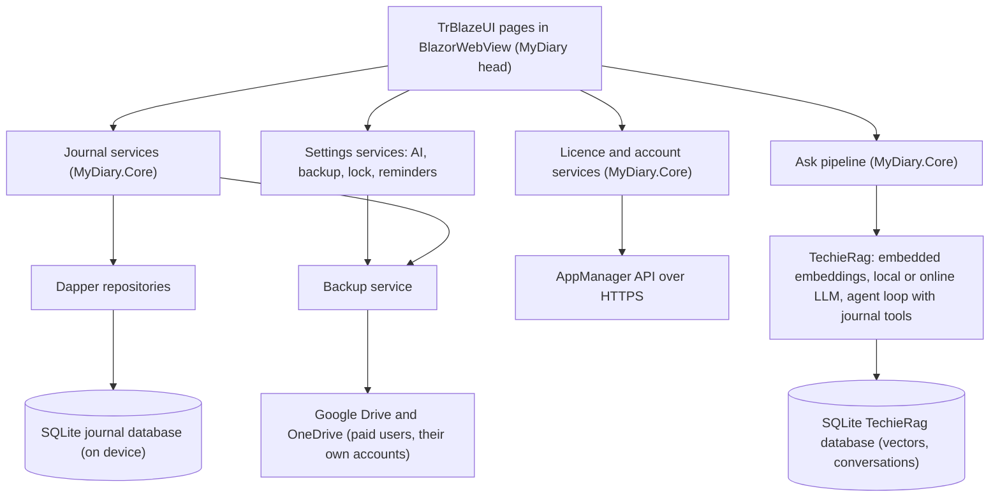
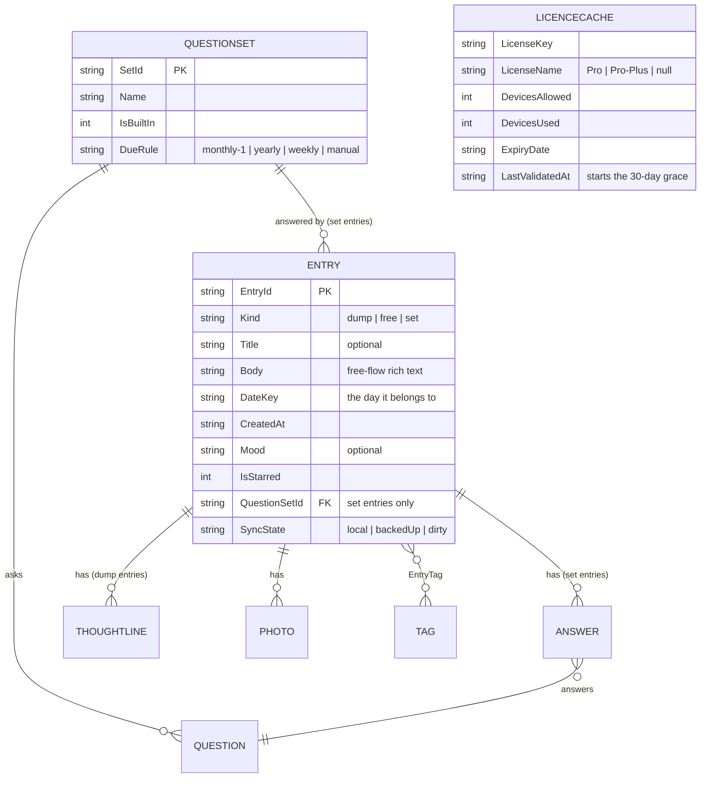

# MyDiary — Architecture

| | |
|---|---|
| App | MyDiary |
| Kind | app |
| Size | Medium |
| Stack answer set | DotNet (`.tfcore/templates/stack-defaults/dotnet.md`) |
| Date | 2026-10-25 |

MyDiary is a private journaling app for phone, tablet and computer: one journal per person, three ways to write (a 10-Thought Dump, a Free-Flow entry, and Targeted Questioning sets), a warm "On This Day" story for each past year, and plain-question asking over the journal with counted answers that list the entries they used. It is free on one device; a paid licence adds backup, several devices and a choice of AI model. The concept source is `docs/MyDiary-Brief.md` (owner, 2026-10-18), carried in full and never summarised away; every section below attributes what came from it. Three choices are fixed by the brief and are treated as owner decisions everywhere in this document:

- **Accounts, sign-in, devices, licences, problem reports and account-data requests all use the AppManager API** (`docs/AppManager-api-usage-guide.md`, harvested into this project's `docs/`) with its **installed-app key**. MyDiary has no server of its own, and AppManager never sees journal text.
- **Screens are built with TrBlazeUI**, so the mockups use TrBlazeUI's own components and look.
- **Every AI feature, built-in or online, is done through TechieRag**; MyDiary writes no AI code of its own.

Size was recorded as **Medium** (19 routed screens counted in the BRD's Screens and flow table; one signed-in role whose free or paid state is a licence fact, not a second login role; the admin works only in AppManager and never inside MyDiary). The owner's day-1 instruction was to take the brief's answers and, where the brief is silent, the answer set's default, recording each such choice — the Source column and the Decisions log do that throughout.

## 1. Stack decisions

One row per stack question. "Source" says where the answer came from: the answer set, the owner (the brief counts as the owner's written answer), or a recorded choice taken where both are silent, as the day-1 instruction directs.

| Q | Topic | Decision | Source |
|---|---|---|---|
| Q1 | Configuration | Non-secret configuration lives in `appsettings.json`, layered by `appsettings.{Environment}.json`, embedded in the app package and read at startup. Values that differ per platform (for example the AppManager base URL if it ever changes) stay in this one mechanism. No other configuration mechanism is created. | answer set: DotNet |
| Q2 | Secrets in development | Project user secrets (`dotnet user-secrets`) on the development machine, never committed; `appsettings.Development.json` is committed and therefore never holds a real secret; a `secrets.example.json` lists every key the application reads. On the device there is exactly one shipped credential — the AppManager **installed-app key** (`pk_live_…`), which is public by design and carries no secret (guide §2.1.1). Anything genuinely private that the user enters (their own online-AI key, the app-lock PIN) is stored in the platform secure store (`SecureStorage`), never in settings files and never in the journal database. | answer set: DotNet; brief ("installed-app key"); recorded choice for `SecureStorage` |
| Q3 | Database | **SQLite on the device** — one journal database file per installation in the app's data folder, accessed with Dapper over `Microsoft.Data.Sqlite`. TechieRag keeps its own SQLite database (vectors, conversations) beside it through `UseSqliteVec()` / `WithPersistence(StoreProvider.Sqlite)`. There is no server database anywhere: the brief fixes "MyDiary has no server of its own", everything for a free user stays on the device, and the app must work offline for up to 30 days. The answer set's PostgreSQL-in-Docker default applies to server applications and cannot apply to this one; this row records that departure rather than following the default blindly. Schema migrations live in `MyDiaryDb` (DbUp, SQLite provider) and run at app startup on the device. | brief (overrides answer set: DotNet); recorded choice for the engine |
| Q4 | Authentication | **AppManager**, the fixed choice of the brief. The app calls the API with the installed-app public key (`X-Api-Key: pk_live_…`) plus a device id it generates once per installation and persists (`X-Device-Id`), signs users in and registers them through `POST /AuthSvc/device-login` and `POST /AuthSvc/device-register`, encrypts every password with the server's RSA-OAEP-256 public key before sending, refreshes tokens through `POST /AuthSvc/refresh`, and reads the licence through `POST /LicenseSvc/validate`. Roles, licences and subscriptions are owned by AppManager; the admin assigns paid licences there and reads problem reports on the AppManager site. | brief (fixed choice); guide §2.1.1, §2.4, §3.1, §3.2 |
| Q4a | Test users | Three test users are registered on AppManager under MyDiary's own application id through its **device-register** call (MyDiary is device-bound): `mydiary-owner@…` for the walkthrough, `mydiary-second@…` as the second user, `mydiary-yolo-tester@…` for unattended runs. A script in the project does it (`tests/verify/register-test-users.mjs`); it generates each password and writes it only to git-ignored local storage. The UsageGuide's Test users table lists the three and says where each password is kept, and never holds a password. No agent asks for, stores or uses the owner's personal AppManager account. | answer set: DotNet Q4a |
| Q5 | Logging | Serilog, always, with file logging wired at startup before anything else can fail. On a device the log file is written under the app's own data folder (the device analogue of the answer set's git-ignored build-output rule — there is no `bin/` on a phone); during development runs the file goes under the build output folder. Journal text is never written to logs. | answer set: DotNet; recorded choice for the on-device folder |
| Q6 | Tests | xUnit, always; `tests/MyDiary.Tests` exists from day-1. The running UI is driven per head by the framework's runtime verification: Appium against the Android emulator, the iOS simulator and the Mac, FlaUI or Appium-Windows against the Windows head, all reached over HTTP from WSL per `core-config.yaml → runtimeVerification` and `WORKFLOW.html §0b`. There is no web head in this app, so headless Playwright applies only to the mockup and document checks, not to the product. | answer set: DotNet; build-invocation-ladder |
| Q7 | Layout and naming | `src/` and `tests/` at the root. The primary executable project is named exactly **`MyDiary`** (`MyDiary.App` is banned); it is the single MAUI Blazor Hybrid head that multi-targets Android, iOS (iPhone and iPad), Mac Catalyst and Windows, because the brief requires the same screens on all of them. Secondary projects take descriptive names: `MyDiary.Core` (class library), `MyDiaryDb` (migrations), `MyDiary.Tests`. | answer set: DotNet; brief #24 |
| Q8 | User interface | **TrBlazeUI** for the MAUI Blazor Hybrid head: NuGet `TrBlazeUI.Components` (it brings `TrBlazeUI.Primitives`), icons from `TrBlazeUI.Icons.Lucide`. Rendering mode: a hybrid head renders inside `BlazorWebView` — local interactive rendering with no server and no WebAssembly host; the answer set leaves rendering mode open and this row records it, since it is the only mode this head has. The component reference used for the mockups and the build is `.trblazeui/TrBlazeUI-AI-Reference.md`. | brief (fixed choice); recorded choice for rendering mode |
| Q9 | Hosting | Not yet asked (UAT). The app ships as store-distributed or sideloaded installs; there is no server side to host. The separate purchase-and-landing web app is out of scope (brief: phase 2, separate app). | — |
| Q10 | Production secrets | Not yet asked (production). | — |
| Q11 | Standing rules | 1. Never add a NuGet package without a row in §6 saying why. 2. Never create a second configuration mechanism. 3. When TechieFlow, TrBlazeUI, TechieRag, AppManager or any other internal library lacks something, record it in that library's feedback file and hold the feature until the library is fixed; never implement a workaround. 4. Data access is always Dapper. 5. Database migrations live in `MyDiaryDb` using DbUp, run at app startup. 6. Log files are written under the build output folder in development (git-ignored) and under the app data folder on a device — never at the repository root. 7. No unnecessary folders at the repository root; everything sits under `src/` or `tests/`. | answer set: DotNet Q11 |

Required packages: `TrBlazeUI.Components` (brings `TrBlazeUI.Primitives`), `TrBlazeUI.Icons.Lucide`.

## 2. Solution structure

| Project | Kind | Purpose |
|---|---|---|
| `MyDiary` | MAUI Blazor Hybrid app (net10.0-android, -ios, -maccatalyst, -windows), at `src/MyDiary` | The one executable head: TrBlazeUI pages, the layout shell, platform services (secure store, biometrics, notifications, file pickers), DI composition root. iPhone and iPad are the same iOS head. |
| `MyDiary.Core` | class library, at `src/MyDiary.Core` | Everything headless: journal services and Dapper repositories, the AppManager client, licence and device-cap logic, the TechieRag wiring and the Ask pipeline, On This Day story generation, search and filters, backup connectors (Google Drive, OneDrive), JSON and Day One export/import, app-lock and reminder logic. Unit-testable without a device. |
| `MyDiaryDb` | migrations library (DbUp, SQLite), at `src/MyDiaryDb` | The journal database schema and its ordered migrations, embedded as resources; `MyDiary` runs them at startup before any repository opens. |
| `MyDiary.Tests` | xUnit project, at `tests/MyDiary.Tests` | Unit tests for Core: licence rules, cap enforcement, grace window, dump-line dropping, search filters, export/import round-trips, Ask pipeline with a stubbed LLM. |
| `tests/verify` | scripts | `register-test-users.mjs` (Q4a) and the Appium verification scripts the framework's verifier drives per head. |

## 3. Component map

**How a request travels** — the plain question "how many coffee bottles did I open last year?" (brief #17), the one request that touches every layer:

1. The Ask page (`/ask`) sends the question to the Ask pipeline in `MyDiary.Core` with the signed-in user's scope and the licence state (free users get the built-in local model; a paid user's chosen model or own key is used instead, after the sending-text warning was accepted — see §5).
2. The pipeline asks TechieRag's agent loop with three registered tools: `search_entries` (keyword, tag, date-range, mood, star and photo filters over the journal database), `count_entries` (a counted answer over the same filters) and `get_entry` (one entry's full text). TechieRag embeds the question with the embedded provider, retrieves candidate entry chunks from its SQLite vector store, and the language model — local or the paid user's online one — decides which tools to call.
3. `search_entries` and `count_entries` run through the same Dapper repositories the browse screens use, so a counted answer counts real rows: the tool returns the number and the matching entries' ids, dates and first lines.
4. The pipeline returns the counted answer, the list of source entries it used, and the token usage. When no entry matches, it returns the "nothing matches" result and the page says so in plain words — it never presents an invented entry (brief #17). The page renders the answer with the sources as links that open `/entry` for each.

A sign-in travels: the sign-in page → licence and account services → `POST /AuthSvc/device-login` with the persisted device id and the RSA-encrypted password → the response's `deviceCap` block and a following `POST /LicenseSvc/validate` decide free or paid and whether this device may proceed (§5, Identity and licence) → tokens and licence state are cached in the journal database → the home page loads.

## 4. Data model

One journal per person (brief #9): the database itself is the journal — there is no journal table to pick from and no multi-journal key anywhere. Everything below lives in the on-device SQLite file; AppManager owns the account, licence and device rows and MyDiary only caches what it must to work offline.

| Entity | Key fields | Notes |
|---|---|---|
| `Entry` | `EntryId`, `Kind`, `Title`, `Body`, `DateKey`, `CreatedAt`, `UpdatedAt`, `Mood`, `IsStarred`, `QuestionSetId`, `SyncState` | One row per written thing. `Kind` separates the three ways to write (brief #10, #11). `DateKey` is the local calendar day the entry belongs to — what timeline, calendar, streak and On This Day all read. `Mood` is a picked value from a fixed small list; `IsStarred` is the star. `SyncState` drives backup for paid users. Soft-deleted rows stay until the next backup completes, then are purged. |
| `ThoughtLine` | `LineId`, `EntryId`, `Position` (1–10), `Text` | The ten numbered quick lines of a dump. Empty lines are dropped on save and never stored (brief #10). |
| `Photo` | `PhotoId`, `EntryId`, `FilePath`, `Caption`, `AddedAt` | Files live in the app sandbox; the row points at them. Free-flow entries carry photos (brief #10); the photo filter in search reads these rows (brief #16). |
| `Tag` / `EntryTag` | `TagId`, `Name` / `EntryId`, `TagId` | Tags are per-journal free text with reuse; the tag filter reads the join table (brief #14, #16). |
| `QuestionSet` | `SetId`, `Name`, `IsBuiltIn`, `DueRule`, `CreatedAt` | The seven built-in sets ship as seed rows (Monthly Goals, Yearly Review, Health, Fitness, Weekly Retro, Project Retro, Gratitude — brief #11); user-built sets are ordinary rows with `IsBuiltIn = 0`. `DueRule` drives the suggestion on the home page (for example `monthly-1` suggests Monthly Goals on the 1st — brief #12). |
| `Question` | `QuestionId`, `SetId`, `Position`, `Text` | The set's questions in order; the answer screen steps through them. |
| `Answer` | `AnswerId`, `EntryId`, `QuestionId`, `Text` | One answer row per question answered; the set entry's `EntryId` groups them. Compare reads answers by `QuestionId` across time (brief #18). |
| `LicenceCache` | `LicenseKey`, `LicenseName`, `DevicesAllowed`, `DevicesUsed`, `ExpiryDate`, `LastValidatedAt`, `IsValid` | Single row. Written from `POST /LicenseSvc/validate` whenever online; `LastValidatedAt` starts the 30-day offline grace (brief #2). `LicenseName` of "Pro" or "Pro-Plus" marks paid (brief #7); no valid licence means free and one device. |
| `DeviceCache` | `UserDeviceId`, `DeviceIdentifier`, `DeviceName`, `Platform`, `FirstSeenDate`, `LastSeenDate`, `IsBlocked` | Mirrors `GET /AuthSvc/devices` so the account screen can list devices offline and the free plan can recognise "the one device" (brief #4, #6). |
| `AiSettings` | `ModelChoice`, `OnlineRoute`, `OnlineEndpoint`, `KeyRef`, `SendWarningAccepted` | `ModelChoice` is the built-in local model (free) or a chosen route (paid). `KeyRef` is a pointer into the secure store — the user's own online-AI key is never in this database (brief #20). `SendWarningAccepted` records that the app warned journal text will be sent to that service. |
| `LockSettings` | `Enabled`, `Mode` (pin/biometric), `PinRef` | The PIN lives in the secure store; this row only says locking is on and how (brief #23). |
| `ReminderSettings` | `Enabled`, `LocalTime`, `Days` | Journaling reminders (brief #23), scheduled with the platform notification API. |
| `BackupSettings` | `Provider` (none/gdrive/onedrive), `AccountLabel`, `RemoteFolderRef`, `LastBackupAt`, `AutoSync` | Paid feature (brief #21); OAuth tokens for the chosen cloud live in the secure store. |
| `OtdStoryCache` | `DateKey`, `YearCovered`, `StoryText`, `GeneratedAt`, `ModelUsed` | On This Day stories are generated, then cached per covered year so opening the home page offline still shows the warm story (brief #15). Regenerated on demand. |
| `InstallationState` | `DeviceId`, `UserId`, `TokensRef`, `FirstRunAt` | The device id generated once and persisted (guide §3.1 `device-login` rules), the signed-in user, and a pointer to the refresh token in the secure store. |

Journal text, photos and the caches above never leave the device except: to the paid user's own chosen cloud backup, to an export file the user asks for, and — only for a paid user who entered their own online-AI key and accepted the warning — to that AI service (brief, Out of scope: "Sending journal text anywhere for a free user" is out).

## 5. Cross-cutting

- **Identity.** AppManager only (brief, fixed choice). Every call carries the installed-app public key and the persisted `X-Device-Id`; the guide allows exactly the endpoints MyDiary needs under a public key: all of `AuthSvc` (including the device endpoints), profile get/put, change-password, delete-request, `LicenseSvc/validate`, `GET /LicenseSvc`, and all of `IssueSvc` (§2.1.1). Account creation is `device-register`; sign-in is `device-login`; every password field is RSA-OAEP-256 encrypted with the key from `GET /AuthSvc/public-key` before it leaves the device (§2.4); tokens are refreshed with `POST /AuthSvc/refresh` and the refresh token is kept in the secure store. Forgotten passwords go through `POST /AuthSvc/forgot-password` and `POST /AuthSvc/reset-password`; the server's `message` on a refused password is shown to the user as-is (guide §2.5). The 60-requests-a-minute per-device limit is respected by batching licence and device reads at startup, not polling.
- **Licence, devices and the offline grace.** What is paid comes from the licence key and licence name that `POST /LicenseSvc/validate` returns: "Pro" allows 2 devices, "Pro-Plus" allows the number set on the licence in AppManager (`devicesAllowed`), no valid licence means free — one device (brief #7). **The cap is enforced by MyDiary, not by AppManager**: the guide is explicit that going over the cap does not refuse the sign-in — `device-login` issues tokens anyway and merely reports `deviceCap.isOverCap` (§3.1), and `validate` is read-only (§3.2). So after any sign-in the app checks: for a paid licence, if this device is new (`deviceRegistered` false) and `isOverCap`, the app refuses to proceed, discards the tokens and shows how to free a slot (`DELETE /AuthSvc/devices/{id}` from another device, or `DELETE /LicenseSvc/{id}/devices/{id}`) — brief #5. For a free account (no licence, `deviceCap` null), the app reads `GET /AuthSvc/devices`: if this device is not the account's one declared device, it refuses with the message that a paid licence allows more — brief #4. When online, every startup re-validates and rewrites `LicenceCache`; offline, the app keeps working from the cache until `LastValidatedAt` is 30 days old, after which an online licence check is required before further use (brief #2). When a paid licence ends, nothing is taken away on the current device: every free feature and the whole journal keep working (brief #8) — the app simply falls back to free state, one device, local model, no cloud backup.
- **AI.** Every AI feature runs through TechieRag (brief, fixed choice). Free users get the smallest built-in model running on the device: `TechieRag.Local`'s platform default — Qwen2.5 0.5B Instruct (333 MB) on phones, Phi-3 mini 4k (2.7 GB) on desktops (TechieRag reference §"Local model"). The weights download once after the user accepts the model's terms and then work offline; store rules forbid shipping weights inside the app bundle, so "installed with the app" (brief #19) is realised as "installed by the app on first AI use, then fully on-device" — recorded here and marked inferred in the BRD for the owner to verify. Embeddings are `TechieRag.Embedded`'s platform default (all-MiniLM-L6-v2 on phones, bge-m3 on desktops), vectors live in TechieRag's SQLite store. A paid user can choose a different model or enter their own key for any online service TechieRag supports (routes such as `openai/…`, `anthropic/…`, `openai-compatible/<model>@https://…`); the key goes to the secure store, and before the first online call the app shows the warning that journal text will then be sent to that service (brief #20) and records the acceptance. On This Day stories (brief #15) and Ask answers (brief #17) are generated with the same pipeline; Ask uses the tool-calling agent loop so counts come from real repository queries, and a no-match answer says so plainly. For a free user no journal text ever leaves the device — the online routes are unreachable in the free state, by licence check, not by convention.
- **Configuration.** The Q1 mechanism only. The AppManager base URL and application id, the built-in model ids, the mood list and the built-in question sets' seed data are configuration or embedded resources — never a second mechanism.
- **Logging.** Serilog from the first line of startup (Q5). Log lines carry the screen, the service and the AppManager error code when one came back; they never carry journal text, passwords, tokens or AI keys. On a device the sink is a rolling file under the app data folder.
- **Errors.** AppManager answers with a stable `error` code and a human `message`; the app shows the `message` (it is written for users — guide §2.5, §3.3) and logs the code. Refusals that are MyDiary's own (device cap, grace expired, cloud not connected) have their own plain-word messages defined in the BRD. Every external call has a timeout and one retry; a licence check that cannot be reached while inside the grace window is not an error — the app continues offline.
- **Security.** Passwords are RSA-encrypted before sending and never stored; tokens and user-entered keys live in the platform secure store; the journal database and photos live in the app sandbox; the app lock (PIN or fingerprint/face, brief #23) gates opening the app on the device. Backup and sync (paid) talk to Google Drive or OneDrive over the user's own OAuth authorisation obtained with the platform browser flow; the app never sees the cloud password. Export produces a JSON file the user saves where they choose; import reads that shape, including a Day One export (brief #22).

## 6. Decisions log

One row per decision. Every package added to the project has a row saying why (standing rule Q11.1).

| Date | Decision | Why | Status |
|---|---|---|---|
| 2026-10-25 | Size Medium, kind app; 19 routed screens, one signed-in role with a free/paid licence state | Day-1 count per the task rule; owner instruction: brief first, recorded choice where silent | decided |
| 2026-10-25 | One MAUI Blazor Hybrid head `src/MyDiary`, multi-targeted to Android, iOS, Mac Catalyst and Windows | Brief #24: the same screens on Android, iPhone, iPad, Windows and Mac; one code base is the only way that holds | decided |
| 2026-10-25 | Package `TrBlazeUI.Components` (brings `TrBlazeUI.Primitives`) and `TrBlazeUI.Icons.Lucide` | Brief fixed choice; answer set Q8 requires the package for every Blazor head | decided |
| 2026-10-25 | Package `TechieRag` | Brief fixed choice: every AI feature through TechieRag; provides the agent loop, tools, vector store, providers and routes | decided |
| 2026-10-25 | Package `TechieRag.Embedded` | Offline on-device embeddings (and reranker) with no external API; the only embedding path that satisfies "free user's text never leaves the device" | decided |
| 2026-10-25 | Package `TechieRag.Local` | The on-device completion provider (`UseLocalLlm`) for the free plan's built-in model; runs in-process on every MyDiary platform, downloads weights once after terms acceptance, supports tool calling on both catalogue models | decided |
| 2026-10-25 | Packages `Microsoft.Data.Sqlite` and `Dapper` | Q3 recorded choice (on-device SQLite, no server) plus standing rule Q11.4 (data access is always Dapper) | decided |
| 2026-10-25 | `MyDiaryDb` migrations project with DbUp and its SQLite provider, run at app startup | Standing rule Q11.5; provider availability is tracked as an open question — if it fails at build time the gap is filed against the stack rule, never worked around silently | planned |
| 2026-10-25 | Packages `Serilog`, `Serilog.Sinks.File` | Answer set Q5: Serilog always, file logging wired at startup | decided |
| 2026-10-25 | Package `Microsoft.Graph` | OneDrive backup and sync for paid users (brief #21); the supported way to reach a user's own OneDrive | planned |
| 2026-10-25 | Package `Google.Apis.Drive.v3` | Google Drive backup and sync for paid users (brief #21) | planned |
| 2026-10-25 | A local-notification package for reminders (`Plugin.LocalNotification` unless the verification at build time prefers another) | Brief #23 journaling reminders; MAUI has no built-in scheduled local notification API | planned |
| 2026-10-25 | Biometric unlock through the platform APIs behind a small `MyDiary.Core` interface (package choice at build time, row updated then) | Brief #23 fingerprint/face lock; keeps Core unit-testable with a stub | planned |
| 2026-10-25 | Device caps enforced client-side from `deviceCap` (paid) and the device list (free); over-cap sign-in is refused by MyDiary and its tokens discarded | AppManager reports an over-cap but still issues tokens (guide §3.1, §3.2); the brief's #4/#5 refusal behaviour can therefore only live in the app | decided |
| 2026-10-25 | "Installed with the app" for the free model is realised as a one-time on-device download after terms acceptance | TechieRag.Local never packs weights (store rules); the model is then fully offline — marked inferred in the BRD for owner verification | decided |
| 2026-10-25 | Rendering mode: BlazorWebView local interactive | The only rendering a MAUI Blazor Hybrid head has; recorded because the answer set leaves rendering mode open | decided |
| 2026-10-25 | Journal text is never logged, never sent to AppManager, and for a free user never leaves the device at all | Brief fixed choice ("AppManager never sees journal text") and Out-of-scope rule | decided |
| 2026-10-25 | Account-data copy request (`POST /UserSvc/data-export`) is held: the endpoint refuses installed-app public keys | Guide §2.1.1 allow-list; standing rule Q11.3 — filed as AM-001 in `docs/MyDiary-AppManager-Feedback.md`, feature held until AppManager fixes it; the delete request is unaffected (allowed since 1.7) | planned |

## 7. Module responsibilities

| Module | Responsibility | Depends on |
|---|---|---|
| `MyDiary` (head) | Pages and layout in TrBlazeUI; DI composition; platform bridges (secure store, biometrics, notifications, photo and file pickers, browser OAuth flow); app-lock gate; startup (Serilog first, then migrations, then licence check) | `MyDiary.Core`, `MyDiaryDb`, TrBlazeUI, TechieRag packages |
| `MyDiary.Core/Journal` | Entry, dump-line, photo, tag, star and mood services; timeline, calendar and streak queries; search with every filter; JSON and Day One export/import | repositories, SQLite |
| `MyDiary.Core/Account` | AppManager HTTP client (key, device id, RSA encryption, tokens, refresh, rate-limit care); sign-in, register, forgot/reset password, profile, change password, issue report, delete request; device list, forget and block | AppManager API |
| `MyDiary.Core/Licensing` | `validate` orchestration, `LicenceCache`, the 30-day grace window, free/paid entitlement, Pro and Pro-Plus device counts, cap enforcement decisions and their messages | Account, repositories |
| `MyDiary.Core/Ai` | TechieRag builder wiring per licence state; the journal tools; Ask pipeline with counted answers and sources; On This Day story generation and cache; model choice and the online-send warning | TechieRag, Journal |
| `MyDiary.Core/Backup` | Google Drive and OneDrive connectors, backup bundle format, sync both ways, restore on a new device; paid-only gate | cloud SDKs, Journal, secure store |
| `MyDiary.Core/Settings` | AI settings, lock settings, reminder scheduling, due-set suggestion rules | repositories, notifications |
| `MyDiaryDb` | Schema and ordered migrations as embedded resources | DbUp |
| `MyDiary.Tests` | Unit tests for all of Core's rules | `MyDiary.Core` |
| `tests/verify` | Test-user registration script; Appium scripts per head | AppManager API |

## 8. Open questions

- Does the DbUp SQLite provider work on all four target platforms at build time? If not, the gap is filed against the stack's own rule (Q11.5) in the TechieFlow feedback file and the migration mechanism is revisited with the owner — never silently replaced (Q11.3).
- Google Drive and OneDrive OAuth need client applications registered by the owner (Google Cloud console, Azure/Entra app registration) before backup can run against real accounts; day-1 documents assume they will exist by build time, and the verification degrades to static-only for the cloud legs until then.
- The exact reminder notification package and the biometric package are chosen at build time; each gets its Decisions log row then (Q11.1).
- `POST /UserSvc/data-export` refuses installed-app keys (guide §2.1.1), so the brief's "ask for a copy of their account data" is held as AM-001 in `docs/MyDiary-AppManager-Feedback.md`. Whether AppManager adds the endpoint to the public-key allow-list, or the owner decides differently, is upstream's or the owner's call — not a workaround decision for this project.
