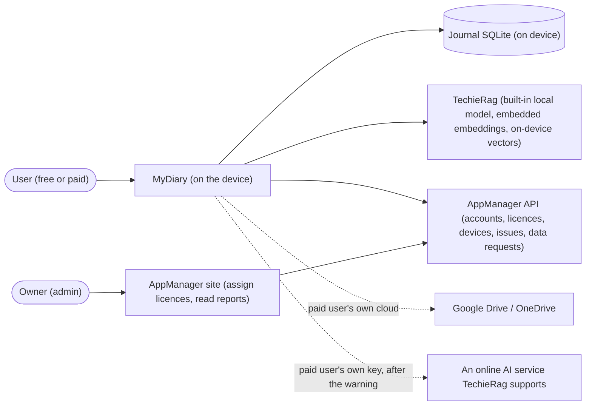

# MyDiary — Business Requirements

| | |
|---|---|
| App | MyDiary |
| Kind | app |
| Size | Medium |
| Stack answer set | DotNet |
| Status | Draft |
| Date | 2026-10-25 |

## 1. Summary

MyDiary is a private journaling app for phone, tablet and computer. One journal per person, three ways to write: a 10-Thought Dump of ten quick numbered lines, a Free-Flow entry with formatting and photos, and Targeted Questioning sets — seven built-in reviews plus the user's own. Opening it shows a warm story of what the user wrote on this date in past years — not a list. The user can ask plain questions about their past ("how many coffee bottles did I open last year?") and get a counted answer listing the entries it used, and can see one question's answers side by side across months or years. Free on one device: everything stays on it and the smallest built-in AI model runs there. A paid licence adds backup and sync to the user's own Google Drive or OneDrive, several devices, and a choice of AI model or their own key for an online service. Accounts, licences, devices, problem reports and account-data requests run through the AppManager API; MyDiary has no server of its own and AppManager never sees journal text. Every AI feature is done through TechieRag. (Source: `docs/MyDiary-Brief.md`, owner 2026-10-18, carried into the Requirements item by item.)

## 2. Scope

**In:**

- Account creation and sign-in on first launch through AppManager, with forgotten-password reset, profile editing, password change, problem reports and account-data requests from inside the app (brief #1, #3).
- Free and paid plans: one device free, licence-counted devices paid; offline use for up to 30 days between licence checks; a paid licence that ends leaves every free feature and the whole journal on the current device (brief #2, #4, #5, #7, #8).
- Plan view: what the user has, when it ends, every device signed in with the count of allowed devices in use, and forget or block per device (brief #6).
- One journal, three ways to write: 10-Thought Dump, Free-Flow with formatting and photos, and Targeted Questioning — the built-in Monthly Goals, Yearly Review, Health, Fitness, Weekly Retro, Project Retro and Gratitude sets, plus user-built sets, with a suggestion when a set is due (brief #9–#12).
- Home: today's entries, a streak, the On This Day card (brief #13); On This Day as a short warm story per past year (brief #15).
- Browse by timeline or calendar; tags, stars and moods; search by keyword with filters by date, tag, question set, photo, star and mood (brief #14, #16).
- Plain-question asking with counted answers that list the source entries, never inventing one when nothing matches (brief #17); one question's answers side by side across months or years (brief #18).
- AI: the smallest built-in on-device model for free users (brief #19); for paid users a different model or their own key for any online AI service TechieRag supports, with a warning that journal text will then be sent to that service (brief #20).
- Paid backup to the user's own Google Drive or OneDrive, sync between devices, restore on a new device (brief #21); JSON export and import for every user, including a Day One export (brief #22).
- App lock with a PIN or fingerprint/face, and journaling reminders (brief #23).
- The same screens on Android, iPhone, iPad, Windows and Mac (brief #24).

**Out:**

- The purchase and landing page — a separate MyDiary web app in phase 2, buying licences through AppManager; until then the admin assigns paid licences in AppManager and MyDiary has no "Buy" button (brief, Out of scope).
- Taking payment inside the app, and app-store purchases.
- More than one journal, shared journals, family groups sharing one licence.
- Sending journal text anywhere for a free user; online AI only happens when a paid user enters their own key.
- iCloud, Dropbox and any other sync service.
- Map view, voice transcription, widgets, handwriting, sharing an entry as an image.
- Anything the owner (admin) does: assigning licences and reading problem reports happen on the AppManager site, never inside MyDiary (brief, Who it is for).

## 3. Users and roles

| Role | Who they are | What they need |
|---|---|---|
| User (free) | Writes on one device; everything stays on that device (brief, Who it is for). Free and paid are states of the one signed-in account, decided by the licence check, not separate logins. | All three ways to write, the full journal, search and filters, On This Day, plain-question asking with the smallest built-in on-device model, JSON export/import, lock and reminders. |
| User (paid) | Holds a "Pro" (2 devices) or "Pro-Plus" (the licence's device count) licence assigned in AppManager. | Everything a free user has, plus several devices, backup/sync/restore on their own Google Drive or OneDrive, and a choice of AI model or their own key for an online AI service, with the sending warning. |
| Goal reviewer | A free or paid user who runs monthly, yearly, health, fitness or project reviews. | The built-in question sets on their due dates, and the same question's answers side by side over time. |
| Owner (admin) | Assigns paid licences and reads problem reports on the AppManager site. | Nothing inside MyDiary — deliberately has no screen here (brief, Who it is for). |

## 4. Screens and flow

One row per routed page; a dialog is a row under its parent screen with `on /route`. 19 screens, within the Medium cap of 20.

| Screen | Route | Role | Mockup | Fields |
|---|---|---|---|---|
| Sign In | `/signin` | User | [mockup](mockups/signin.html) | mode (sign in / create account), email, password, confirm password (create) |
| Device refused (dialog) | on `/signin` | User | [mockup](mockups/signin.html) | message (free: paid licence allows more; paid: how to free a slot) |
| Reset Password | `/reset-password` | User | [mockup](mockups/reset-password.html) | email (request step), reset token, new password, confirm new password |
| Home | `/home` | User | [mockup](mockups/home.html) | today's entries list, streak count, On This Day card, due-set suggestion banner |
| On This Day | `/on-this-day` | User | [mockup](mockups/on-this-day.html) | year selector, story text per past year, source entry links |
| Write | `/write` | User | [mockup](mockups/write.html) | three way cards: Thought Dump, Free-Flow, Question set |
| Thought Dump | `/write/dump` | User | [mockup](mockups/thought-dump.html) | ten numbered lines, date, mood |
| Free-Flow | `/write/free` | User | [mockup](mockups/free-flow.html) | title, formatted body, photos, date, tags, mood, star |
| Question Sets | `/sets` | User | [mockup](mockups/question-sets.html) | built-in set list, custom set list, due badges |
| Delete set (dialog) | on `/sets` | User | [mockup](mockups/question-sets.html) | set name, confirm |
| Answer a Set | `/sets/answer` | User | [mockup](mockups/answer-set.html) | question text, answer text, question progress, date |
| Build a Set | `/sets/build` | User | [mockup](mockups/build-set.html) | set name, due rule, question list (text, order) |
| Timeline | `/timeline` | User | [mockup](mockups/timeline.html) | entries grouped by day, quick filters |
| Calendar | `/calendar` | User | [mockup](mockups/calendar.html) | month grid, per-day entry marks, selected day's entries |
| Entry | `/entry` | User | [mockup](mockups/entry.html) | entry body or dump lines or set answers, date, tags, star, mood, photos |
| Add tag (dialog) | on `/entry` | User | [mockup](mockups/entry.html) | tag name, existing-tag suggestions |
| Delete entry (dialog) | on `/entry` | User | [mockup](mockups/entry.html) | entry title or first line, confirm |
| Search | `/search` | User | [mockup](mockups/search.html) | keyword, date range, tag, question set, has-photo, star, mood, results list |
| Ask | `/ask` | User | [mockup](mockups/ask.html) | question text, counted answer, source entry list, nothing-matches message |
| Compare | `/compare` | User | [mockup](mockups/compare.html) | question picker, period (months or years), side-by-side answer columns |
| Account | `/account` | User | [mockup](mockups/account.html) | plan name, expiry or "free", devices allowed and in use, device list (name, platform, last seen) |
| Forget device (dialog) | on `/account` | User | [mockup](mockups/account.html) | device name, confirm |
| Block device (dialog) | on `/account` | User | [mockup](mockups/account.html) | device name, confirm |
| Profile & Support | `/profile` | User | [mockup](mockups/profile.html) | first name, last name, mobile number, email (read-only); change password (current, new, confirm); problem report; data copy request; account deletion request |
| Problem report (dialog) | on `/profile` | User | [mockup](mockups/profile.html) | title, description, type, priority |
| Delete account (dialog) | on `/profile` | User | [mockup](mockups/profile.html) | confirm email, reason |
| Settings | `/settings` | User | [mockup](mockups/settings.html) | tabs — AI model: model choice, online service route, own key, send-warning state; Backup & sync: provider, account, back up now, auto-sync, restore; Export & import: JSON export, JSON import, Day One import; Lock: enable, PIN, fingerprint/face; Reminders: enable, time, days |
| Online AI warning (dialog) | on `/settings` | User | [mockup](mockups/settings.html) | service name, warning text, accept |
| Model terms (dialog) | on `/settings` | User | [mockup](mockups/settings.html) | model name, licence, download size, accept |
| Lock grace expired (dialog) | on `/signin` | User | [mockup](mockups/signin.html) | days offline, check-licence action |

**Primary journey:**

1. The user opens MyDiary for the first time, creates an account on Sign In (or signs in), and lands on Home: today's entries, the streak, and the On This Day card — empty and welcoming on day one.
2. They tap Write and pick their way in: a 10-Thought Dump when thoughts are many and short, a Free-Flow entry with photos when the day deserves prose, or a question set — Home shows "Monthly Goals is due" on the 1st — answered step by step on Answer a Set.
3. On a later day they open the On This Day card into its page and read the warm story of this date in past years, each line linking to the entry it came from.
4. They ask "how many coffee bottles did I open last year?" on Ask and get a counted answer listing the entries it used; on Compare they put one question's answers side by side across months or years.
5. They browse: Timeline by day, Calendar by month, Search by keyword with filters; on an Entry they star it, set a mood, add tags.
6. In Settings a paid user picks an AI model or enters their own online key (warning first), connects Google Drive or OneDrive and backs up; any user exports the journal to JSON. On Account they see the plan, its end date and every device; on Profile & Support they fix their profile, report a problem or request their data. A forgotten password is reset from Reset Password; a lost phone is blocked from Account.

## 5. Requirements

One item per thing the verifier will test. Each names its screen, links the mockup, and carries one acceptance line. The concept source is `docs/MyDiary-Brief.md` — every must-do, actor and constraint in it becomes an item below, with the brief's own number cited. Items the brief does not state literally are marked inferred.

### Sign In

The door to the app: create an account or sign in through AppManager on first launch, and the two refusals a device can meet.

- **BRD-1** — Create an account on first launch. *Screen:* Sign In · *Mockup:* [mockup](mockups/signin.html)
  - *Acceptance:* When a new user registers with email and password on Sign In, then the account is created through AppManager and Home opens. (brief #1)
- **BRD-2** — Sign in to an existing account. *Screen:* Sign In · *Mockup:* [mockup](mockups/signin.html)
  - *Acceptance:* When a user signs in with valid credentials on Sign In, then the device signs in through AppManager and Home opens. (brief #1)
- **BRD-3** — A wrong password shows AppManager's own message. *Screen:* Sign In · *Mockup:* [mockup](mockups/signin.html)
  - *Acceptance:* When a user signs in with a wrong password on Sign In, then the refusal shows AppManager's message as-is.
- **BRD-4** — A free account is refused on a second device. *Screen:* Sign In · *Mockup:* [mockup](mockups/signin.html)
  - *Acceptance:* When a free user signs in on a second device on Sign In, then the sign-in is refused and the message says a paid licence allows more. (brief #4)
- **BRD-5** — A paid account over its device number is refused. *Screen:* Sign In · *Mockup:* [mockup](mockups/signin.html)
  - *Acceptance:* When a paid user signs in over the licence's device number, then Sign In refuses and the message says how to free a slot. (brief #5)

### Reset Password

Forgotten passwords are reset from inside the app, in AppManager's two steps.

- **BRD-6** — Request the reset email. *Screen:* Reset Password · *Mockup:* [mockup](mockups/reset-password.html)
  - *Acceptance:* When a user requests a reset for their email on Reset Password, then a confirmation shows that the email is on its way. (brief #3)
- **BRD-7** — Set a new password with the token. *Screen:* Reset Password · *Mockup:* [mockup](mockups/reset-password.html)
  - *Acceptance:* When a user submits the emailed token with a valid new password on Reset Password, then the password is set and sign-in works with it.
- **BRD-8** — A weak new password is refused in the server's words. *Screen:* Reset Password · *Mockup:* [mockup](mockups/reset-password.html)
  - *Acceptance:* When a user submits a weak new password on Reset Password, then AppManager's rule message is shown as-is and nothing changes.
- **BRD-9** — A dead token says so. *Screen:* Reset Password · *Mockup:* [mockup](mockups/reset-password.html)
  - *Acceptance:* When a user submits an invalid or expired token on Reset Password, then the token error message is shown and no password changes.

### Home

The opening screen: today's entries, the streak, the On This Day card, and the suggestion when a set is due.

- **BRD-10** — Today's entries are listed. *Screen:* Home · *Mockup:* [mockup](mockups/home.html)
  - *Acceptance:* When a user with entries today opens Home, then each of today's entries is listed with its kind, time and title or first line. (brief #13)
- **BRD-11** — The streak is shown. *Screen:* Home · *Mockup:* [mockup](mockups/home.html)
  - *Acceptance:* When a user who wrote on consecutive days opens Home, then the streak tile shows that number of days. (brief #13)
- **BRD-12** — The On This Day card teases the story. *Screen:* Home · *Mockup:* [mockup](mockups/home.html)
  - *Acceptance:* When a user with past-year entries on this date opens Home, then the card shows the story's first lines and opens On This Day. (brief #13)
- **BRD-13** — A due set is suggested. *Screen:* Home · *Mockup:* [mockup](mockups/home.html)
  - *Acceptance:* When a user opens Home on the 1st of a month, then the banner suggests Monthly Goals and its Start button opens Answer a Set. (brief #12)
- **BRD-14** — Day one shows an empty, welcoming Home. *Screen:* Home · *Mockup:* [mockup](mockups/home.html)
  - *Acceptance:* When a new user with no entries opens Home, then the empty state invites them and offers the way to write. <!-- inferred — please verify -->

### On This Day

For each past year, a short warm story of what was written on this date or around it — never a list of entries.

- **BRD-15** — Each past year gets a warm story. *Screen:* On This Day · *Mockup:* [mockup](mockups/on-this-day.html)
  - *Acceptance:* When a user opens On This Day with entries on this date in past years, then each year shows a generated narrative, not a list of entries. (brief #15)
- **BRD-16** — The story names its sources. *Screen:* On This Day · *Mockup:* [mockup](mockups/on-this-day.html)
  - *Acceptance:* When a user reads a story on On This Day, then the entries it used are listed and each link opens that Entry.
- **BRD-17** — A year with nothing written is said plainly. *Screen:* On This Day · *Mockup:* [mockup](mockups/on-this-day.html)
  - *Acceptance:* When no entry exists on or around this date, then On This Day says nothing was written and invents no story. <!-- the brief's never-invent rule (#17) applied to the story -->
- **BRD-18** — The story is there offline. *Screen:* On This Day · *Mockup:* [mockup](mockups/on-this-day.html)
  - *Acceptance:* When a user opens On This Day offline with a cached story, then the cached story shows; with none, the screen says so plainly. <!-- inferred — please verify -->

### Write

The chooser: three ways to write, one tap each.

- **BRD-19** — All three ways are offered. *Screen:* Write · *Mockup:* [mockup](mockups/write.html)
  - *Acceptance:* When a user opens Write, then the three way cards are shown and each opens its own screen. (brief #10, #11)

### Thought Dump

Ten numbered quick lines; empty ones are dropped on save.

- **BRD-20** — Ten numbered lines. *Screen:* Thought Dump · *Mockup:* [mockup](mockups/thought-dump.html)
  - *Acceptance:* When a user opens Thought Dump, then exactly ten numbered lines are shown, each optional. (brief #10)
- **BRD-21** — Empty lines are dropped on save. *Screen:* Thought Dump · *Mockup:* [mockup](mockups/thought-dump.html)
  - *Acceptance:* When a user saves a dump with some lines empty on Thought Dump, then the saved entry holds only the non-empty lines in order. (brief #10)
- **BRD-22** — The saved dump appears with its day and mood. *Screen:* Thought Dump · *Mockup:* [mockup](mockups/thought-dump.html)
  - *Acceptance:* When a user saves a dump with a date and mood on Thought Dump, then Home and Timeline show it under that day with the mood.

### Free-Flow

A proper page: formatting, photos, title, day, mood.

- **BRD-23** — Formatting survives the save. *Screen:* Free-Flow · *Mockup:* [mockup](mockups/free-flow.html)
  - *Acceptance:* When a user writes bold text and a list on Free-Flow and saves, then the Entry shows the same formatting. (brief #10)
- **BRD-24** — Photos can be added. *Screen:* Free-Flow · *Mockup:* [mockup](mockups/free-flow.html)
  - *Acceptance:* When a user adds photos from the device on Free-Flow and saves, then the Entry shows those photos. (brief #10)
- **BRD-25** — The entry saves with title, day and mood. *Screen:* Free-Flow · *Mockup:* [mockup](mockups/free-flow.html)
  - *Acceptance:* When a user saves a Free-Flow entry with a title, date and mood, then the Entry shows all three and Timeline files it under that day.

### Question Sets

The seven built-in reviews and the user's own sets, with due badges.

- **BRD-26** — The seven built-in sets are listed. *Screen:* Question Sets · *Mockup:* [mockup](mockups/question-sets.html)
  - *Acceptance:* When a user opens Question Sets, then Monthly Goals, Yearly Review, Health, Fitness, Weekly Retro, Project Retro and Gratitude are listed. (brief #11)
- **BRD-27** — The user's own sets are listed. *Screen:* Question Sets · *Mockup:* [mockup](mockups/question-sets.html)
  - *Acceptance:* When a user who built a set opens Question Sets, then that set is listed under "Your own". (brief #11)
- **BRD-28** — A due set carries its badge. *Screen:* Question Sets · *Mockup:* [mockup](mockups/question-sets.html)
  - *Acceptance:* When a user opens Question Sets on a set's due date, then that set shows the "Due today" badge. (brief #12)
- **BRD-29** — A custom set can be deleted. *Screen:* Question Sets · *Mockup:* [mockup](mockups/question-sets.html)
  - *Acceptance:* When a user confirms Delete set for a custom set on Question Sets, then the set disappears and its written answers stay in the journal.
- **BRD-30** — Built-in sets cannot be deleted. *Screen:* Question Sets · *Mockup:* [mockup](mockups/question-sets.html)
  - *Acceptance:* When a user opens the row menu of a built-in set on Question Sets, then no Delete action is offered. <!-- inferred — please verify -->

### Answer a Set

One question at a time; the answers become one entry.

- **BRD-31** — Questions come one at a time. *Screen:* Answer a Set · *Mockup:* [mockup](mockups/answer-set.html)
  - *Acceptance:* When a user starts a set on Answer a Set, then one question is shown at a time with the question's number and the set's progress. (brief #11)
- **BRD-32** — A question can be skipped. *Screen:* Answer a Set · *Mockup:* [mockup](mockups/answer-set.html)
  - *Acceptance:* When a user skips a question on Answer a Set, then the stepper marks it skipped and the next question is shown.
- **BRD-33** — Answers are kept while moving through the set. *Screen:* Answer a Set · *Mockup:* [mockup](mockups/answer-set.html)
  - *Acceptance:* When a user answers, moves on and comes back on Answer a Set, then the earlier answer text is still there.
- **BRD-34** — Finishing saves one entry. *Screen:* Answer a Set · *Mockup:* [mockup](mockups/answer-set.html)
  - *Acceptance:* When a user finishes a set on Answer a Set, then one entry holding every question and answer is saved and opens.

### Build a Set

The user's own targeted questions, in their order, with an optional due rule.

- **BRD-35** — A set is named. *Screen:* Build a Set · *Mockup:* [mockup](mockups/build-set.html)
  - *Acceptance:* When a user saves a set with a name on Build a Set, then the set is stored under that name. (brief #11)
- **BRD-36** — Questions are added. *Screen:* Build a Set · *Mockup:* [mockup](mockups/build-set.html)
  - *Acceptance:* When a user taps Add question and types text on Build a Set, then a new question row appears with that text.
- **BRD-37** — Questions are reordered. *Screen:* Build a Set · *Mockup:* [mockup](mockups/build-set.html)
  - *Acceptance:* When a user moves a question up or down on Build a Set and saves, then answering the set asks them in the new order.
- **BRD-38** — A question is deleted. *Screen:* Build a Set · *Mockup:* [mockup](mockups/build-set.html)
  - *Acceptance:* When a user deletes a question row on Build a Set, then the saved set no longer contains it.
- **BRD-39** — The due rule drives the suggestion. *Screen:* Build a Set · *Mockup:* [mockup](mockups/build-set.html)
  - *Acceptance:* When a user saves a set with a due rule on Build a Set, then Home suggests it on that rule's date. (brief #12)
- **BRD-40** — A set needs a name and one question. *Screen:* Build a Set · *Mockup:* [mockup](mockups/build-set.html)
  - *Acceptance:* When a user saves without a name or without any question on Build a Set, then the save is refused and the missing part is named.

### Timeline

Everything written, grouped by day, newest first.

- **BRD-41** — Entries are grouped by day. *Screen:* Timeline · *Mockup:* [mockup](mockups/timeline.html)
  - *Acceptance:* When a user opens Timeline, then entries are grouped under day headers, newest day first. (brief #14)
- **BRD-42** — A row opens its entry. *Screen:* Timeline · *Mockup:* [mockup](mockups/timeline.html)
  - *Acceptance:* When a user taps an entry row on Timeline, then that Entry opens.
- **BRD-43** — Quick filters narrow the list. *Screen:* Timeline · *Mockup:* [mockup](mockups/timeline.html)
  - *Acceptance:* When a user enables the Starred filter on Timeline, then only starred entries are listed. <!-- inferred — please verify -->

### Calendar

The same journal by month: marked days, one tap to a day's entries.

- **BRD-44** — Days with entries are marked. *Screen:* Calendar · *Mockup:* [mockup](mockups/calendar.html)
  - *Acceptance:* When a user opens Calendar on a month with entries, then each day that has entries carries a mark. (brief #14)
- **BRD-45** — A day lists its entries. *Screen:* Calendar · *Mockup:* [mockup](mockups/calendar.html)
  - *Acceptance:* When a user taps a marked day on Calendar, then that day's entries are listed and each opens its Entry.
- **BRD-46** — Months are navigated. *Screen:* Calendar · *Mockup:* [mockup](mockups/calendar.html)
  - *Acceptance:* When a user taps the next-month arrow on Calendar, then the following month is shown with its marks.

### Entry

One written thing, in full: its kind's own shape, star, mood, tags, photos, and its end.

- **BRD-47** — The body renders per kind. *Screen:* Entry · *Mockup:* [mockup](mockups/entry.html)
  - *Acceptance:* When a user opens an entry on Entry, then a dump shows its numbered lines, a Free-Flow its formatted text, a set entry its question-answer pairs.
- **BRD-48** — The star toggles. *Screen:* Entry · *Mockup:* [mockup](mockups/entry.html)
  - *Acceptance:* When a user taps the star on Entry, then the entry's starred state flips and Timeline's Starred filter follows it. (brief #14)
- **BRD-49** — The mood is picked and changed. *Screen:* Entry · *Mockup:* [mockup](mockups/entry.html)
  - *Acceptance:* When a user picks a mood on Entry, then the entry keeps that mood and shows it. (brief #14)
- **BRD-50** — A tag is added. *Screen:* Entry · *Mockup:* [mockup](mockups/entry.html)
  - *Acceptance:* When a user adds a tag through the dialog on Entry, then the tag badge appears and Search finds the entry by it. (brief #14)
- **BRD-51** — A tag is removed. *Screen:* Entry · *Mockup:* [mockup](mockups/entry.html)
  - *Acceptance:* When a user removes a tag on Entry, then the badge disappears and the tag no longer matches in Search.
- **BRD-52** — An entry is deleted through its confirm. *Screen:* Entry · *Mockup:* [mockup](mockups/entry.html)
  - *Acceptance:* When a user confirms Delete on Entry, then the entry disappears from Timeline, Calendar and Search.

### Search

Keyword plus every filter the brief names: date, tag, question set, photo, star, mood.

- **BRD-53** — Keyword search finds matches. *Screen:* Search · *Mockup:* [mockup](mockups/search.html)
  - *Acceptance:* When a user searches a word on Search, then entries containing it are listed with the match marked. (brief #16)
- **BRD-54** — The date range narrows results. *Screen:* Search · *Mockup:* [mockup](mockups/search.html)
  - *Acceptance:* When a user sets From and To dates on Search, then only entries of those days are listed. (brief #16)
- **BRD-55** — The tag filter narrows results. *Screen:* Search · *Mockup:* [mockup](mockups/search.html)
  - *Acceptance:* When a user picks a tag on Search, then only entries carrying it are listed. (brief #16)
- **BRD-56** — The question-set filter narrows results. *Screen:* Search · *Mockup:* [mockup](mockups/search.html)
  - *Acceptance:* When a user picks a question set on Search, then only entries of that set are listed. (brief #16)
- **BRD-57** — The photo filter narrows results. *Screen:* Search · *Mockup:* [mockup](mockups/search.html)
  - *Acceptance:* When a user enables Has a photo on Search, then only entries with photos are listed. (brief #16)
- **BRD-58** — The star filter narrows results. *Screen:* Search · *Mockup:* [mockup](mockups/search.html)
  - *Acceptance:* When a user enables Starred on Search, then only starred entries are listed. (brief #16)
- **BRD-59** — The mood filter narrows results. *Screen:* Search · *Mockup:* [mockup](mockups/search.html)
  - *Acceptance:* When a user picks a mood on Search, then only entries with that mood are listed. (brief #16)

### Ask

Plain questions, counted answers, sources listed, nothing invented.

- **BRD-60** — A plain question gets a counted answer. *Screen:* Ask · *Mockup:* [mockup](mockups/ask.html)
  - *Acceptance:* When a user asks a counting question on Ask, then the answer states the number counted from the journal's entries. (brief #17)
- **BRD-61** — The answer lists the entries it used. *Screen:* Ask · *Mockup:* [mockup](mockups/ask.html)
  - *Acceptance:* When an answer is shown on Ask, then every entry the answer used is listed beneath it. (brief #17)
- **BRD-62** — A source opens its entry. *Screen:* Ask · *Mockup:* [mockup](mockups/ask.html)
  - *Acceptance:* When a user taps a source on Ask, then that Entry opens.
- **BRD-63** — No match is said, never invented. *Screen:* Ask · *Mockup:* [mockup](mockups/ask.html)
  - *Acceptance:* When a user asks about something the journal never mentions on Ask, then the answer says no entry matches and lists none. (brief #17)
- **BRD-64** — A free user's answer is generated on the device. *Screen:* Ask · *Mockup:* [mockup](mockups/ask.html)
  - *Acceptance:* When a free user asks a question on Ask with the network off, then the answer is still generated, by the built-in model. (brief #19)

### Compare

One question's answers side by side, across months or years.

- **BRD-65** — A question is picked for comparison. *Screen:* Compare · *Mockup:* [mockup](mockups/compare.html)
  - *Acceptance:* When a user picks a set and question on Compare, then every answer to that question is gathered. (brief #18)
- **BRD-66** — Answers line up by month. *Screen:* Compare · *Mockup:* [mockup](mockups/compare.html)
  - *Acceptance:* When a user chooses Months on Compare, then one column per month shows that month's answer side by side. (brief #18)
- **BRD-67** — Answers line up by year, gaps included. *Screen:* Compare · *Mockup:* [mockup](mockups/compare.html)
  - *Acceptance:* When a user chooses Years on Compare, then one column per year is shown and an unanswered period says "not answered". (brief #18)

### Account

The plan, its end, every device signed in, and the offline clock.

- **BRD-68** — The plan and its end are shown. *Screen:* Account · *Mockup:* [mockup](mockups/account.html)
  - *Acceptance:* When a user opens Account, then the plan name and when it ends are shown — Free with no end, or Pro or Pro-Plus with its expiry. (brief #6, #7)
- **BRD-69** — The device count is shown. *Screen:* Account · *Mockup:* [mockup](mockups/account.html)
  - *Acceptance:* When a user opens Account, then how many of the allowed devices are in use is shown. (brief #6)
- **BRD-70** — Every signed-in device is listed. *Screen:* Account · *Mockup:* [mockup](mockups/account.html)
  - *Acceptance:* When a user opens Account, then every device signed in to the account is listed with its name, platform and last seen. (brief #6)
- **BRD-71** — A device can be forgotten. *Screen:* Account · *Mockup:* [mockup](mockups/account.html)
  - *Acceptance:* When a user confirms Forget on a device on Account, then the device leaves the list and the count drops at once. (brief #6)
- **BRD-72** — A device can be blocked. *Screen:* Account · *Mockup:* [mockup](mockups/account.html)
  - *Acceptance:* When a user confirms Block on a device on Account, then that device's next sign-in is refused. (brief #6)
- **BRD-73** — An ended licence takes nothing away. *Screen:* Account · *Mockup:* [mockup](mockups/account.html)
  - *Acceptance:* When a paid licence ends and the user opens Account, then the plan reads Free and every free feature and the whole journal still work on this device. (brief #8)
- **BRD-74** — Offline works up to 30 days, then needs a check. *Screen:* Account · *Mockup:* [mockup](mockups/account.html)
  - *Acceptance:* When the app has been offline 30 days since its last licence check, then it requires an online check before further use. (brief #2)

### Profile & Support

The user's own details and the four things the brief puts inside the app: password, problem report, data copy, data deletion.

- **BRD-75** — The profile is edited. *Screen:* Profile & Support · *Mockup:* [mockup](mockups/profile.html)
  - *Acceptance:* When a user saves a changed name or mobile number on Profile & Support, then AppManager stores it and reopening shows the new value. (brief #3)
- **BRD-76** — The password is changed. *Screen:* Profile & Support · *Mockup:* [mockup](mockups/profile.html)
  - *Acceptance:* When a user changes their password on Profile & Support, then the next sign-in needs the new one; a weak one is refused in AppManager's words. (brief #3)
- **BRD-77** — A problem report is sent. *Screen:* Profile & Support · *Mockup:* [mockup](mockups/profile.html)
  - *Acceptance:* When a user sends a problem report on Profile & Support, then it reaches AppManager's issues and a confirmation is shown. (brief #3)
- **BRD-78** — A copy of the account data is requested. *Screen:* Profile & Support · *Mockup:* [mockup](mockups/profile.html)
  - *Acceptance:* When a user asks for a copy of their account data, then AppManager queues the request and confirms. (brief #3; held: gap AM-001)
- **BRD-79** — Account deletion is requested. *Screen:* Profile & Support · *Mockup:* [mockup](mockups/profile.html)
  - *Acceptance:* When a user types their email and confirms deletion on Profile & Support, then the request is queued and the account keeps working until an admin approves. (brief #3)

### Settings

The five tabs: AI model, backup and sync, export and import, lock, reminders.

- **BRD-80** — The free plan runs the built-in model, installed once. *Screen:* Settings · *Mockup:* [mockup](mockups/settings.html)
  - *Acceptance:* When a free user accepts the model terms on Settings, then the model downloads once and AI works with no network afterwards. <!-- brief #19: "installed with the app" realised as a first-run download, store rules forbid packed weights — inferred, please verify -->
- **BRD-81** — A paid user can choose another model. *Screen:* Settings · *Mockup:* [mockup](mockups/settings.html)
  - *Acceptance:* When a paid user picks a different model on Settings, then Ask answers come from that model. (brief #20)
- **BRD-82** — A paid user can enter their own key. *Screen:* Settings · *Mockup:* [mockup](mockups/settings.html)
  - *Acceptance:* When a paid user saves their own online-service key on Settings, then that service answers Ask and the key stays only in the secure store. (brief #20)
- **BRD-83** — The app warns before journal text is sent. *Screen:* Settings · *Mockup:* [mockup](mockups/settings.html)
  - *Acceptance:* When an online model is used the first time, then the warning that journal text goes to that service is shown and the choice is remembered. (brief #20)
- **BRD-84** — A free user cannot reach an online model. *Screen:* Settings · *Mockup:* [mockup](mockups/settings.html)
  - *Acceptance:* When a free user opens the AI tab, then online choices are marked paid and cannot be used. (brief Out of scope)
- **BRD-85** — Google Drive is connected. *Screen:* Settings · *Mockup:* [mockup](mockups/settings.html)
  - *Acceptance:* When a paid user connects their Google account on Settings, then the connection is shown with the account's email. (brief #21)
- **BRD-86** — OneDrive is connected. *Screen:* Settings · *Mockup:* [mockup](mockups/settings.html)
  - *Acceptance:* When a paid user connects their Microsoft account on Settings, then the connection is shown with the account's email. (brief #21)
- **BRD-87** — The journal backs up now. *Screen:* Settings · *Mockup:* [mockup](mockups/settings.html)
  - *Acceptance:* When a paid user taps Back up now on Settings, then the journal is written to their own cloud space and the last-backup time updates. (brief #21)
- **BRD-88** — Auto-sync keeps devices even. *Screen:* Settings · *Mockup:* [mockup](mockups/settings.html)
  - *Acceptance:* When auto-sync is on and a second device writes an entry, then the first device shows that entry after its next sync. (brief #21)
- **BRD-89** — A new device restores the journal. *Screen:* Settings · *Mockup:* [mockup](mockups/settings.html)
  - *Acceptance:* When a paid user restores from their cloud on a new device, then the whole journal — entries, photos, tags — is there. (brief #21)
- **BRD-90** — Backup is a paid feature, plainly marked. *Screen:* Settings · *Mockup:* [mockup](mockups/settings.html)
  - *Acceptance:* When a free user opens the Backup tab on Settings, then the paid-only note is shown and no connect action runs. (brief #21)
- **BRD-91** — The journal exports to JSON. *Screen:* Settings · *Mockup:* [mockup](mockups/settings.html)
  - *Acceptance:* When any user taps Export JSON on Settings, then a file with the whole journal is saved where they choose. (brief #22)
- **BRD-92** — A JSON journal imports back. *Screen:* Settings · *Mockup:* [mockup](mockups/settings.html)
  - *Acceptance:* When a user imports a MyDiary JSON file on Settings, then its entries appear and importing twice adds nothing twice. (brief #22; no-duplicates inferred — please verify)
- **BRD-93** — A Day One export imports. *Screen:* Settings · *Mockup:* [mockup](mockups/settings.html)
  - *Acceptance:* When a user imports a Day One export on Settings, then its entries appear as Free-Flow entries with their dates, photos and tags. (brief #22)
- **BRD-94** — The PIN lock gates opening. *Screen:* Settings · *Mockup:* [mockup](mockups/settings.html)
  - *Acceptance:* When the lock is on with a PIN and the app reopens, then the journal stays hidden until the right PIN is entered. (brief #23)
- **BRD-95** — Fingerprint or face unlocks. *Screen:* Settings · *Mockup:* [mockup](mockups/settings.html)
  - *Acceptance:* When biometric unlock is on and the user presents their fingerprint or face at the lock, then the journal opens. (brief #23)
- **BRD-96** — Reminders arrive. *Screen:* Settings · *Mockup:* [mockup](mockups/settings.html)
  - *Acceptance:* When reminders are on for a time and days on Settings, then the device notifies at that time on those days. (brief #23)

## 6. Non-functional requirements

| Id | Area | Requirement | Measure |
|---|---|---|---|
| BRD-97 | Logging | Serilog file logging is wired at startup before anything else can fail; the file lives under the build output folder in development and the app data folder on a device; journal text, passwords, tokens and AI keys never appear in a log line | log file exists after startup; no journal text in it |
| BRD-98 | Security | For a free user no journal text ever leaves the device; for a paid user it leaves only to their own connected cloud backup, an export file they asked for, or their own online AI service after the accepted warning; AppManager never receives journal text | free-state network trace carries no journal text |
| BRD-99 | Zoom (a desktop head drawn in a web view) | Cmd/Ctrl+=, - and 0 zoom 50% to 300% in 10% steps on the Windows and Mac heads; the level is kept across restarts | zoom-check: keys · zoom-check: kept |

The owner's brief states no load-time number, so no `perf-budget:` row is written — the rule is to write one only where the owner gave a number.

## 7. Development status

Written by the status gate after every build, verify and handoff; not by hand.

**Snapshot as of 2026-10-25.** Live per-requirement status: `PROJECT-STATUS.md` and the Requirements Status table in `docs/MyDiary-Checklist.md` (created in stage 2).

| Screen | Requirements | Verified | Open | Status |
|---|---|---|---|---|
| Sign In | 5 | 0 | 5 | Planned |
| Reset Password | 4 | 0 | 4 | Planned |
| Home | 5 | 0 | 5 | Planned |
| On This Day | 4 | 0 | 4 | Planned |
| Write | 1 | 0 | 1 | Planned |
| Thought Dump | 3 | 0 | 3 | Planned |
| Free-Flow | 3 | 0 | 3 | Planned |
| Question Sets | 5 | 0 | 5 | Planned |
| Answer a Set | 4 | 0 | 4 | Planned |
| Build a Set | 6 | 0 | 6 | Planned |
| Timeline | 3 | 0 | 3 | Planned |
| Calendar | 3 | 0 | 3 | Planned |
| Entry | 6 | 0 | 6 | Planned |
| Search | 7 | 0 | 7 | Planned |
| Ask | 5 | 0 | 5 | Planned |
| Compare | 3 | 0 | 3 | Planned |
| Account | 7 | 0 | 7 | Planned |
| Profile & Support | 5 | 0 | 5 | Planned |
| Settings | 17 | 0 | 17 | Planned |
| Non-functional | 3 | 0 | 3 | Planned |

## 8. Context diagram

## 9. Constraints and assumptions

- MyDiary has no server of its own (brief, fixed choice); every server-side fact — accounts, licences, devices, issues, data requests — comes from the AppManager API through its installed-app key.
- AppManager never sees journal text (brief, fixed choice); it is never sent there by any code path.
- Every AI feature, built-in or online, is done through TechieRag; MyDiary writes no AI code of its own (brief, fixed choice).
- Screens are built with TrBlazeUI, so the mockups use TrBlazeUI's own components and look (brief, fixed choice).
- One journal per person; there is no list of journals and no multi-journal key anywhere (brief #9).
- App-store rules forbid shipping model weights inside the app bundle: the built-in model downloads once after the user accepts its terms, then runs fully offline (recorded reading of brief #19 — inferred, please verify).
- The purchase and landing page is a separate web app in phase 2; until then the admin assigns paid licences in AppManager and MyDiary shows no Buy button (brief, Out of scope).
- Only Google Drive and OneDrive sync; iCloud, Dropbox and every other sync service are out (brief, Out of scope).
- Device caps are enforced by MyDiary from AppManager's reported cap, because AppManager reports an over-cap but still issues tokens (guide §3.1–§3.2; Architecture §5).
- The same TrBlazeUI screens run on Android, iPhone, iPad, Windows and Mac from one MAUI Blazor Hybrid head (brief #24).
- Test users are registered on AppManager under MyDiary's own application id by a project script; no personal account is ever used (answer set Q4a).

## 10. Risks

| Risk | Likelihood | Impact | Mitigation |
|---|---|---|---|
| AppManager gap AM-001: `POST /UserSvc/data-export` refuses installed-app keys, so BRD-78 (ask for a copy of the account data) cannot run from the app | certain (documented, guide §2.1.1) | that one feature is held | filed in `docs/MyDiary-AppManager-Feedback.md`; per standing rule Q11.3 the feature is held until AppManager fixes it — no workaround; the button stays visible and explains the hold |
| The DbUp SQLite provider misbehaves on one of the four device platforms | medium | migrations (and first run) blocked on that head | spike it first at build time; a failure is filed against the stack rule, never silently replaced (Architecture §8) |
| The built-in model will not fit a low-end phone's memory | medium | Ask and On This Day unavailable there | TechieRag checks memory before loading and refuses clearly; the app shows that message and the rest of the journal keeps working |
| Google and Microsoft OAuth client registrations are not ready when backup is built | medium | BRD-85…89 unverifiable against real clouds until registered | owner registers both early; until then those legs verify static-only, never faked |
| Client-side cap enforcement can be bypassed by a modified app | low | a free user could use two devices | accepted product decision: AppManager reports, the app enforces; the journal itself stays honest per device |
| Ask over a large journal is slow on a phone CPU | medium | the counted answer arrives late | sources are counted through indexed repository queries, not model reading; the typing indicator keeps the wait honest |
