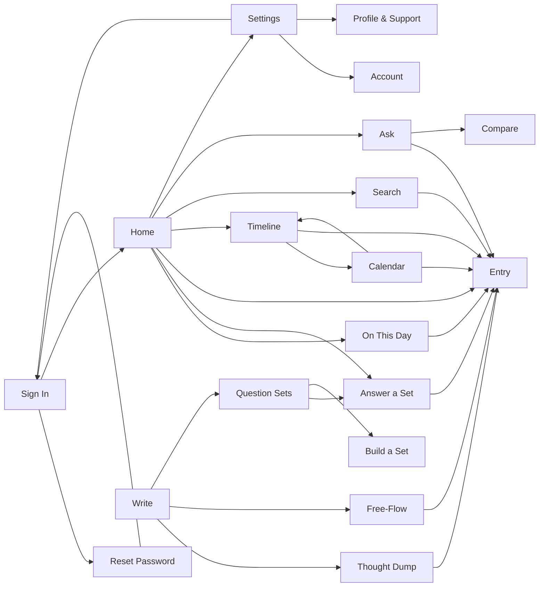

# MyDiary — UI Design

| | |
|---|---|
| App | MyDiary |
| Kind | app |
| Size | Medium |
| UI library | TrBlazeUI (`TrBlazeUI.Components` + `TrBlazeUI.Icons.Lucide`), reference `.trblazeui/TrBlazeUI-AI-Reference.md` |
| Theme | both — the app follows the system theme; mockups are drawn light |

## Design system

- **Layout shell:** one phone-first column, centered and capped at 480px on tablet and desktop (the same screens everywhere, brief #24). A `Card`-based page body inside a `ScrollArea`; a top bar (page title, `Button Variant="ghost"` search icon, `Badge` for the plan); a bottom `NavigationMenu` with five items — Home, Timeline, Write (center, emphasized), Ask, Settings. Sign-in screens use `CenteredPanel` without the bottom nav.
- **Theme:** TrBlazeUI defaults — OKLCH semantic tokens (`--background`, `--card`, `--primary`, `--muted`, `--destructive`, `--border`, `--ring`, `--radius`), neutral primary, dark mode by the `.dark` class. No custom palette.
- **Shared controls:** `Button`, `Input`, `Textarea`, `Field`/`FieldLabel`/`FieldContent`, `Select`, `Switch`, `Checkbox`, `Card`, `Badge`, `Alert`, `Dialog`, `AlertDialog`, `Toast` (via `ToastService`), `LucideIcon`, `Empty`, `Skeleton`, `Spinner`, `Separator`, `Tabs`, `DataTable`, `DatePicker`, `DateRangePicker`, `RichTextEditor`, `FileUpload`, `ToggleGroup`, `Stepper`, `Timeline`, `StatTile`, `SortableList`, `Progress`, `PasswordStrength`.
- **Rules:** spacing is the library's (4px grid, `Card` padding 16px, 12px gaps between fields); density comfortable-touch (44px minimum targets); one breakpoint behaviour — the column simply centers above 480px; every list row is a link to its detail; destructive actions always confirm in an `AlertDialog`; money-free product — no price is ever shown (buying happens in AppManager, brief Out of scope).

## Screens

### Screen: Sign In (`/signin`)

**Mockup:** [mockups/signin.html](mockups/signin.html) · **Roles:** User (signed out) · **BRD:** BRD-1

| Region | Control | Shows or binds |
|---|---|---|
| Panel | `CenteredPanel` + `Card` | App name, warm one-line welcome |
| Mode switch | `Tabs` | "Sign in" / "Create account" |
| Credentials | `Field` + `Input Type="InputType.Email"` / `InputType.Password` | email, password; create mode adds name + confirm |
| Submit | `Button` | `device-login` / `device-register`; busy state `Spinner` |
| Help links | `Button Variant="link"` | → Reset Password |
| Refusal | `AlertDialog` | device-refused and grace-expired messages |

| Field | Type | Required | Validation |
|---|---|---|---|
| Email | email | yes | a valid address |
| Password | password | yes | non-empty; rules enforced by AppManager, message shown as-is |
| Confirm password | password | create only | must match |

**Dialogs opened here:** Device refused (free: "a paid licence allows more devices"; paid: how to free a slot); Licence check needed (30 offline days used up — check now).

**States:** empty: n/a · loading: submit `Spinner`, fields disabled · error: `Alert Variant="destructive"` with AppManager's `message` verbatim.

### Screen: Reset Password (`/reset-password`)

**Mockup:** [mockups/reset-password.html](mockups/reset-password.html) · **Roles:** User (signed out) · **BRD:** BRD-6

| Region | Control | Shows or binds |
|---|---|---|
| Step 1 request | `Card` + `Field` + `Input` email + `Button` | `POST /AuthSvc/forgot-password`; success `Alert` "check your email" |
| Step 2 set | `Card` + `Field`s: token `Input`, new password `Input` + `PasswordStrength`, confirm | `POST /AuthSvc/reset-password` |
| Nav | `Button Variant="ghost"` | ← back to Sign In |

| Field | Type | Required | Validation |
|---|---|---|---|
| Email | email | yes | valid address |
| Reset token | text | yes (step 2) | from the email; invalid/expired shows the server message |
| New password | password | yes (step 2) | AppManager rule; refusal message shown as-is |

**Dialogs opened here:** none.

**States:** empty: n/a · loading: `Spinner` in the active step's button · error: destructive `Alert`, server `message` verbatim.

### Screen: Home (`/home`)

**Mockup:** [mockups/home.html](mockups/home.html) · **Roles:** User · **BRD:** BRD-10

| Region | Control | Shows or binds |
|---|---|---|
| Greeting | `Typography` + `Avatar` | first name, today's date |
| Streak | `StatTile` | current streak in days, flame icon |
| On This Day card | `Card` (links to `/on-this-day`) | first lines of this date's story, years covered `Badge`s |
| Due suggestion | `Alert Variant="info"` + `Button` | "Monthly Goals is due" → Answer a Set (only when a set is due) |
| Today's entries | `Timeline` of `Card` rows | each row links to Entry; kind icon, title/first line, mood, star |
| Bottom nav | `NavigationMenu` | Home (active), Timeline, Write, Ask, Settings |

| Field | Type | Required | Validation |
|---|---|---|---|
| (none — a read-only dashboard) | — | — | every row and card is a link; nothing is typed here |

**Dialogs opened here:** none.

**States:** empty: `Empty` "Your journal starts today" + Write button (day one, nothing written) · loading: three `Skeleton` cards · error: destructive `Alert` with retry.

### Screen: On This Day (`/on-this-day`)

**Mockup:** [mockups/on-this-day.html](mockups/on-this-day.html) · **Roles:** User · **BRD:** BRD-15

| Region | Control | Shows or binds |
|---|---|---|
| Year selector | `Select` | the past years that have entries around this date |
| Story | `Card` + `Prose` | the warm generated story for the chosen year — narrative, never a list of entries |
| Sources | `Item` rows | the entries the story used, each links to Entry |
| Regenerate | `Button Variant="outline"` | makes the story again (model shown in a `Badge`) |

| Field | Type | Required | Validation |
|---|---|---|---|
| Year | select | no | the past years that have entries on or around this date |

**Dialogs opened here:** none.

**States:** empty: `Empty` "Nothing written on this day yet — come back next year" · loading: `Spinner` + `Skeleton` lines while the story generates · error: destructive `Alert` (offline and no cached story: say so plainly).

### Screen: Write (`/write`)

**Mockup:** [mockups/write.html](mockups/write.html) · **Roles:** User · **BRD:** BRD-19

| Region | Control | Shows or binds |
|---|---|---|
| Prompt | `Typography` | "What are you writing today?" |
| Three ways | three `Card`s, each a link | 10-Thought Dump → `/write/dump`; Free-Flow → `/write/free`; Question set → `/sets` — icon, name, one-line description each |

| Field | Type | Required | Validation |
|---|---|---|---|
| (none — a chooser) | — | — | the three cards are links; nothing is typed here |

**Dialogs opened here:** none.

**States:** empty/loading/error: none — a static chooser.

### Screen: Thought Dump (`/write/dump`)

**Mockup:** [mockups/thought-dump.html](mockups/thought-dump.html) · **Roles:** User · **BRD:** BRD-20

| Region | Control | Shows or binds |
|---|---|---|
| Lines | ten numbered `Field`s + `Input` | lines 1–10, all optional |
| Date | `DatePicker` | the day it belongs to (default today) |
| Mood | `ToggleGroup` (emoji set) | optional mood |
| Save | `Button` | drops empty lines, saves, `Toast`, → Home |

| Field | Type | Required | Validation |
|---|---|---|---|
| Line 1–10 | text | no | at least one non-empty line to save; each ≤ 280 chars |

**Dialogs opened here:** none.

**States:** empty: all ten lines blank with a hint · loading: `Spinner` in Save · error: destructive `Alert`.

### Screen: Free-Flow (`/write/free`)

**Mockup:** [mockups/free-flow.html](mockups/free-flow.html) · **Roles:** User · **BRD:** BRD-23

| Region | Control | Shows or binds |
|---|---|---|
| Title | `Field` + `Input` | optional title |
| Body | `RichTextEditor` | formatted text: bold, italic, lists, headings |
| Photos | `FileUpload` + thumbnails | images from the device; each with a remove `Button` |
| Date / Mood | `DatePicker` + `ToggleGroup` | the day, optional mood |
| Save | `Button` | saves, `Toast`, → Entry |

| Field | Type | Required | Validation |
|---|---|---|---|
| Title | text | no | ≤ 120 chars |
| Body | rich text | yes | non-empty to save |

**Dialogs opened here:** none.

**States:** empty: editor placeholder "What happened today?" · loading: `Spinner` in Save, photo upload `Progress` · error: destructive `Alert`.

### Screen: Question Sets (`/sets`)

**Mockup:** [mockups/question-sets.html](mockups/question-sets.html) · **Roles:** User · **BRD:** BRD-26

| Region | Control | Shows or binds |
|---|---|---|
| Built-in | `Card` list, 7 rows | Monthly Goals, Yearly Review, Health, Fitness, Weekly Retro, Project Retro, Gratitude; due `Badge`; each links to Answer a Set |
| Custom | `Card` list | the user's own sets; each links to Answer a Set; overflow `DropdownMenu` (drawn open) with Delete |
| New set | `Button` | → Build a Set |

| Field | Type | Required | Validation |
|---|---|---|---|
| (none — a list screen) | — | — | rows are links; built-in sets cannot be deleted, customs can |

**Dialogs opened here:** Delete set (`AlertDialog`: name, "answers already written stay in the journal", confirm).

**States:** empty (custom section): one line "No sets of your own yet" · loading: `Skeleton` rows · error: destructive `Alert`.

### Screen: Answer a Set (`/sets/answer`)

**Mockup:** [mockups/answer-set.html](mockups/answer-set.html) · **Roles:** User · **BRD:** BRD-31

| Region | Control | Shows or binds |
|---|---|---|
| Set name | `Typography` + `Badge` | which set, question x of y |
| Progress | `Stepper` + `Progress` | position in the set |
| Question | `Card` + `Typography` | the current question text |
| Answer | `Textarea` | the answer, autosaved per question |
| Nav | `Button`s | Back, Skip, Next; last question → Finish |
| Finish | `Button` | saves one entry, `Toast`, → Entry |

| Field | Type | Required | Validation |
|---|---|---|---|
| Answer | textarea | no | saved per question; a skipped one stays "Skipped" and answerable later |
| Date | read-only | — | the day the set is answered |

**Dialogs opened here:** none.

**States:** empty: a skipped question shows "Skipped" in the stepper · loading: `Spinner` on Finish · error: destructive `Alert`.

### Screen: Build a Set (`/sets/build`)

**Mockup:** [mockups/build-set.html](mockups/build-set.html) · **Roles:** User · **BRD:** BRD-35

| Region | Control | Shows or binds |
|---|---|---|
| Name | `Field` + `Input` | set name |
| Due rule | `Select` | Manual, Weekly, Monthly (day 1), Yearly |
| Questions | `SortableList` of `Field`s | question text per row; move up / move down `Button`s; delete per row |
| Add question | `Button Variant="outline"` | appends a row |
| Save | `Button` | creates the set, `Toast`, → Question Sets |

| Field | Type | Required | Validation |
|---|---|---|---|
| Name | text | yes | 1–60 chars, not a duplicate of a built-in name |
| Question | text | at least one | 1–280 chars |

**Dialogs opened here:** none.

**States:** empty: one blank question row · loading: `Spinner` in Save · error: destructive `Alert` (duplicate name).

### Screen: Timeline (`/timeline`)

**Mockup:** [mockups/timeline.html](mockups/timeline.html) · **Roles:** User · **BRD:** BRD-41

| Region | Control | Shows or binds |
|---|---|---|
| View switch | `ToggleGroup` | Timeline (active) / Calendar → `/calendar` |
| Quick filters | `Badge` toggles | Starred, With photos — narrow the list |
| Days | `Timeline` grouped by `DateKey` | day headers; entry `Card` rows: kind icon, title or first line, mood, star, photo count; each links to Entry |

| Field | Type | Required | Validation |
|---|---|---|---|
| Quick filters | toggle badges | no | Starred / With photos narrow the list; off shows everything |

**Dialogs opened here:** none.

**States:** empty: `Empty` "Nothing written yet" + Write button · loading: `Skeleton` rows · error: destructive `Alert`.

### Screen: Calendar (`/calendar`)

**Mockup:** [mockups/calendar.html](mockups/calendar.html) · **Roles:** User · **BRD:** BRD-44

| Region | Control | Shows or binds |
|---|---|---|
| View switch | `ToggleGroup` | Timeline → `/timeline` / Calendar (active) |
| Month | `Calendar` | dots on days that have entries; month back/forward `Button`s |
| Day list | `Card` rows | the selected day's entries, each links to Entry |

| Field | Type | Required | Validation |
|---|---|---|---|
| Selected day | date (grid tap) | no | any day of the shown month; defaults to today |

**Dialogs opened here:** none.

**States:** empty (selected day): "Nothing on this day" · loading: `Skeleton` · error: destructive `Alert`.

### Screen: Entry (`/entry`)

**Mockup:** [mockups/entry.html](mockups/entry.html) · **Roles:** User · **BRD:** BRD-47

| Region | Control | Shows or binds |
|---|---|---|
| Header | `Typography` + `Badge` | date, kind badge (Dump / Free-Flow / set name) |
| Body | `Prose` / numbered lines / question–answer pairs | rendered per kind; photos in a grid |
| Star | `Button` (star icon, toggles) | starred state |
| Mood | `ToggleGroup` | the entry's mood, changeable |
| Tags | `Badge` list + Add `Button` | each tag with a remove ×; Add opens the dialog |
| Actions | `DropdownMenu` (drawn open) | Edit (→ its write screen), Delete |

| Field | Type | Required | Validation |
|---|---|---|---|
| Mood | toggle group | no | one of the five moods, or none |
| Tag | text (dialog) | no | 1–30 characters; existing tags offered for reuse |

**Dialogs opened here:** Add tag (`Dialog`: `Input` + existing-tag suggestions, add); Delete entry (`AlertDialog`: first line, confirm).

**States:** empty: n/a (an entry exists) · loading: `Skeleton` body · error: destructive `Alert`.

### Screen: Search (`/search`)

**Mockup:** [mockups/search.html](mockups/search.html) · **Roles:** User · **BRD:** BRD-53

| Region | Control | Shows or binds |
|---|---|---|
| Keyword | `Field` + `Input` | the words to find |
| Filters | `DateRangePicker`, `MultiSelect` (tags), `Select` (question set), `Checkbox` (has photo), `Checkbox` (starred), `Select` (mood) | every filter of brief #16 |
| Results | `Card` rows | match with the keyword highlighted, date, kind; each links to Entry; result count `Badge` |
| Clear | `Button Variant="ghost"` | resets keyword and filters |

| Field | Type | Required | Validation |
|---|---|---|---|
| Keyword | text | no | a keyword or at least one filter must be set to search |
| From / To | dates | no | From must not be after To |
| Tags | multi-select | no | any of the journal's tags |
| Question set | select | no | any set, or "Any" |
| Mood | select | no | one of the five moods, or "Any" |
| Has photo / Starred | checkboxes | no | narrow to entries with a photo / with a star |

**Dialogs opened here:** none.

**States:** empty (no matches): `Empty` "No entries match" · loading: `Skeleton` rows · error: destructive `Alert`.

### Screen: Ask (`/ask`)

**Mockup:** [mockups/ask.html](mockups/ask.html) · **Roles:** User · **BRD:** BRD-60

| Region | Control | Shows or binds |
|---|---|---|
| Question | `Field` + `Input` + send `Button` | plain words, e.g. "how many coffee bottles did I open last year?" |
| Model badge | `Badge` | "On this device" (free) or the paid user's chosen model |
| Answer | `Card` + `Prose` | the counted answer — a number and its wording |
| Sources | `Item` rows | every entry the answer used: date, first line; each links to Entry |
| Nothing found | `Alert Variant="info"` (`data-tf-state="no-match"`) | "No entry matches that — nothing is made up" |
| Compare | `Button Variant="outline"` | → Compare for a set question |

| Field | Type | Required | Validation |
|---|---|---|---|
| Question | text | yes | 1–300 characters, plain words |

**Dialogs opened here:** none.

**States:** empty: example questions as chips · loading: `Typing` indicator while the answer is written · error: destructive `Alert` (a model that will not load says why, plainly).

### Screen: Compare (`/compare`)

**Mockup:** [mockups/compare.html](mockups/compare.html) · **Roles:** User · **BRD:** BRD-65

| Region | Control | Shows or binds |
|---|---|---|
| Question picker | `Select` (set, then question) | one question from any answered set |
| Period | `ToggleGroup` | Months / Years |
| Columns | `ScrollArea` of `Card`s side by side | one card per month or year: period label, that period's answer text; unanswered periods say "not answered" |

| Field | Type | Required | Validation |
|---|---|---|---|
| Question set | select | yes | a set the user has answered |
| Question | select | yes | a question of that set with at least one answer |
| Period | toggle (Months / Years) | yes | one of the two |

**Dialogs opened here:** none.

**States:** empty: "Pick a question you have answered more than once" · loading: `Skeleton` columns · error: destructive `Alert`.

### Screen: Account (`/account`)

**Mockup:** [mockups/account.html](mockups/account.html) · **Roles:** User · **BRD:** BRD-68

| Region | Control | Shows or binds |
|---|---|---|
| Plan | `Card` | plan name (`Badge`: Free / Pro / Pro-Plus), "ends {date}" or "no end", licence key |
| Devices count | `StatTile` | "{used} of {allowed} devices in use" + `Progress` |
| Device list | `DataTable` | name, platform, last seen, this-device `Badge`; per row `DropdownMenu` (drawn open): Forget, Block |
| Offline state | `Alert Variant="warning"` (`data-tf-state="offline"`) | "Offline — licence checked {n} days ago; {30−n} days left" |

| Field | Type | Required | Validation |
|---|---|---|---|
| (none — a read screen with actions) | — | — | Forget and Block act per device row, each through its confirm dialog |

**Dialogs opened here:** Forget device (`AlertDialog`: frees a slot at once); Block device (`AlertDialog`: its next sign-in is refused).

**States:** empty: n/a (this device is always listed) · loading: `Skeleton` table · error: destructive `Alert`; a licence check that cannot be reached inside the grace window shows the offline `Alert`, not an error.

### Screen: Profile & Support (`/profile`)

**Mockup:** [mockups/profile.html](mockups/profile.html) · **Roles:** User · **BRD:** BRD-75

| Region | Control | Shows or binds |
|---|---|---|
| Profile | `Card` + `Field`s | first name, last name, mobile number; email read-only (`Input Disabled`); Save `Button` (`PUT /UserSvc/profile`) |
| Password | `Card` + `Field`s | current, new + `PasswordStrength`, confirm; Change `Button` |
| Problem report | `Card` + `Button` | opens the dialog (`POST /IssueSvc`) |
| My data | `Card` + two `Button`s | "Ask for a copy" (held — AppManager gap AM-001; enabled, badged "held", its tap explains the hold) and "Ask to delete my account" (opens the dialog) |

| Field | Type | Required | Validation |
|---|---|---|---|
| First name / Last name | text | no | applied when present and not blank |
| Mobile number | text | no | an empty string clears it |
| Current password | password | yes (to change) | RSA-encrypted before sending |
| New password + confirm | password | yes (to change) | AppManager rule (8+ chars, uppercase, digit, special); its refusal message is shown as-is |
| Report title / description | text | yes (report) | non-blank; type and priority from fixed lists |
| Confirm email | email | yes (deletion) | must match the account's email exactly, typed by the user |

**Dialogs opened here:** Problem report (`Dialog`: title, description, type `Select`, priority `Select`, send); Delete account (`AlertDialog`: type-your-email confirm field, reason, queue `Toast` — the account keeps working until an admin approves).

**States:** empty: n/a · loading: `Spinner` per action · error: destructive `Alert`, AppManager `message` verbatim (the password rule sentence is shown as-is).

### Screen: Settings (`/settings`)

**Mockup:** [mockups/settings.html](mockups/settings.html) · **Roles:** User (paid sections marked) · **BRD:** BRD-80

| Region | Control | Shows or binds |
|---|---|---|
| Tab strip | `Tabs` | AI model · Backup & sync · Export & import · Lock · Reminders (all five panels drawn, stacked) |
| AI — model | `RadioGroup` / `Select` | free: the built-in model with a `Progress` download state and terms `Button`; paid: any TechieRag model, plus "my own key" |
| AI — own key | `Field` + `Input Type="Password"` | the paid user's online-service key (secure store); route `Select` from `LlmConnectorCatalog.Describe()` |
| AI — warning | `Alert Variant="warning"` | "Journal text will be sent to {service}" — accepted before the first online answer |
| Backup | provider `Select` (Drive / OneDrive), Connect, account `Badge`, Back up now, auto-sync `Switch`, Restore, last-backup time | paid; free users see a paid-only note |
| Export & import | three `Button`s | Export JSON, Import JSON, Import from Day One — file picker, result `Toast` |
| Lock | `Switch` enable, PIN `Field`s, fingerprint/face `Switch` | gates the app on open |
| Reminders | `Switch` enable, `TimePicker`, day `MultiSelect` | journaling reminders |
| Account links | `Item` rows | → Account, → Profile & Support, Sign out `Button` (→ Sign In) |

| Field | Type | Required | Validation |
|---|---|---|---|
| Model choice | radio/select | no | free: the built-in model only; paid: any route TechieRag supports |
| Own key | password input | paid, online route | secure store only; never in the database or logs |
| Provider | select | no | Google Drive or OneDrive; paid only |
| Auto-sync | switch | no | paid; off until a provider is connected |
| PIN | password (digits) | when locking is on | 4–8 digits, kept in the secure store |
| Biometric / reminders switches, time, days | switch, time, day toggles | no | reminders need a time when enabled |

**Dialogs opened here:** Online AI warning (`AlertDialog`: service, what leaves the device, accept — recorded); Model terms (`Dialog`: model, licence, size, accept → `Progress` download).

**States:** empty: "Not connected" line · loading: `Spinner`/`Progress` (model download, backup) · error: destructive `Alert` per action.

## Click-through flow

## Branding guide

None — TrBlazeUI defaults (neutral OKLCH tokens, library radius and type scale). The mockups draw the light theme; the built app follows the system theme.
